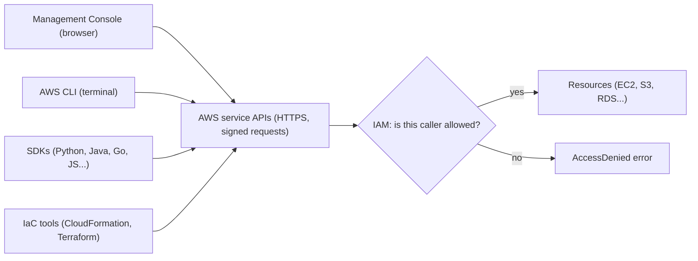
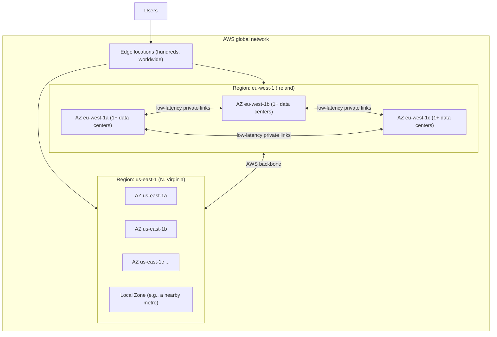
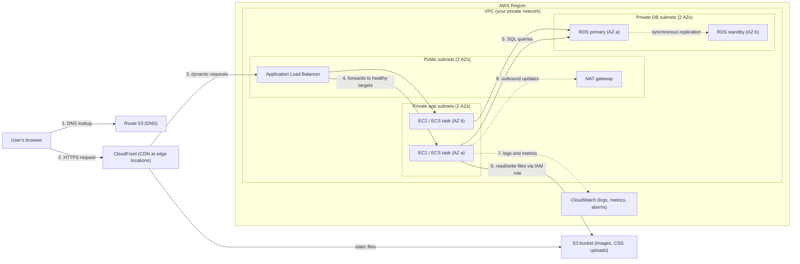

# Cloud & AWS basics

> [Home](../README.md) · [Beginner track](README.md) · Next: [Networking basics](02-networking-basics.md)

You have already used AWS more than you might think. Every `kubectl get pods` you ran against EKS went through AWS credentials, an AWS-managed control plane and AWS-run virtual machines. This page fills in what sits underneath: what "the cloud" is, how an AWS account works, how you talk to AWS, where AWS physically runs, who is responsible for what, how the bill works, and how the pieces fit into a normal web application.

Budget about **3–4 hours** for this page, including the self-check at the end. Nothing here needs an AWS account, but if you have one, the "try it" hints will make it stick faster.

**On this page**
1. [What "the cloud" actually is](#1-what-the-cloud-actually-is)
2. [Why companies use it](#2-why-companies-use-it)
3. [The AWS account](#3-the-aws-account)
4. [Three ways to talk to AWS](#4-three-ways-to-talk-to-aws)
5. [Global infrastructure](#5-global-infrastructure)
6. [The shared responsibility model](#6-the-shared-responsibility-model)
7. [How AWS bills you](#7-how-aws-bills-you)
8. [How services fit together](#8-how-services-fit-together)
9. [How to read AWS architecture diagrams](#9-how-to-read-aws-architecture-diagrams)
10. [The Well-Architected Framework](#10-the-well-architected-framework)
11. [What the exam expects from a beginner](#11-what-the-exam-expects-from-a-beginner)
12. [Self-check](#12-self-check)

---

## 1. What "the cloud" actually is

**In plain words:** the cloud is renting someone else's data centers, by the second, through an API.

Unpack that sentence piece by piece:

- **Someone else's data centers.** AWS owns buildings full of servers, disks, network switches, power and cooling. You never see them or touch them.
- **Renting.** You don't buy hardware. You pay for what you use while you use it, and stop paying when you delete it.
- **By the second.** Many resources (for example, Linux virtual machines) are billed per second after a short minimum. Others are billed per hour, per GB stored per month, or per request. The point is that the billing unit is small, so short experiments are cheap.
- **Through an API.** Everything you do is an HTTPS call to an AWS endpoint: "create a virtual machine", "store this file", "delete this database". The web console, the command line and Terraform are all just different ways of making those API calls.

That last point is the one that matters most to you as a developer. A data center you control with API calls behaves like software. You can version it, script it, review it in a pull request and recreate it from scratch.

### IaaS, PaaS and SaaS

Cloud services are often sorted by **how much of the stack the provider runs for you**. A useful everyday analogy is food:

| Model | Stands for | Food analogy | You manage | Provider manages | AWS examples |
|---|---|---|---|---|---|
| **IaaS** | Infrastructure as a Service | Rent a kitchen: you bring ingredients and cook | OS, runtime, app, data | Hardware, network, virtualization | Amazon EC2 (virtual machines), Amazon EBS (disks), Amazon VPC (private network) |
| **PaaS** | Platform as a Service | Meal kit: ingredients arrive prepped, you just assemble | Your app code and data | OS, runtime, patching, scaling plumbing | AWS Elastic Beanstalk, Amazon RDS (managed database), AWS Lambda (often called "serverless" or FaaS, Function as a Service) |
| **SaaS** | Software as a Service | Restaurant: you just eat | Your users and your data | Everything | Amazon Connect (contact center), and non-AWS examples like Gmail or Salesforce |

The lines are fuzzy, and the exam doesn't ask you to classify services by these labels. What it *does* test is the underlying idea: **the more the provider manages, the less operational work you have**. You will see the phrase "with the **least operational overhead**" in many exam questions. That phrase is a hint to pick the more managed option.

### The Kubernetes angle: your EKS cluster is rented machines

Here is how your EKS world maps onto these layers:

- The **Kubernetes control plane** (API server, etcd, scheduler, controller manager) is run by AWS in an AWS-owned account. You never see those machines. That part is PaaS-like: you get an API endpoint and AWS keeps it patched and highly available.
- The **worker nodes** your Pods run on are, in most clusters, **Amazon EC2 instances**: rented virtual machines in your own AWS account. That part is IaaS. Someone on your team (or a tool like Karpenter or EKS Auto Mode) chose their size, and the company pays for them per second.
- When you created a `PersistentVolumeClaim`, a CSI driver probably created an **Amazon EBS volume** (a rented network disk). When you created a `Service` of type `LoadBalancer` or an `Ingress`, a controller probably created an **AWS load balancer**.

So the Kubernetes objects you know are often thin wrappers that ask AWS to create real, billable resources. This track will keep pointing out which AWS resource sits behind each Kubernetes object. [Kubernetes to AWS](03-kubernetes-to-aws.md) covers that in depth.

### Deployment models (one paragraph)

**Cloud** (or "cloud-native") means everything runs in a provider like AWS. **On-premises** means you run your own data center. **Hybrid** means both, connected by a VPN or a private link, which is very common in large companies and very common in exam questions ("the company has an on-premises data center and wants to..."). You will meet hybrid connectivity in [Networking basics](02-networking-basics.md).

---

## 2. Why companies use it

### The big ideas in plain words

- **Elasticity.** Capacity can grow and shrink with demand, automatically. Think Kubernetes HPA (Horizontal Pod Autoscaler) plus Cluster Autoscaler, but for every layer: servers, databases, queues. At 3 a.m. you run 2 servers; on Black Friday you run 200.
- **Pay-as-you-go.** You pay for actual use, not for peak capacity you bought "just in case".
- **CapEx to OpEx.** CapEx (capital expenditure) is a big up-front purchase, like buying servers you depreciate over five years. OpEx (operating expenditure) is a running cost, like a monthly bill. The cloud turns hardware purchases into a utility bill. Finance teams care about this a lot.
- **Global reach.** You can run in Europe, Asia and the Americas without signing a lease anywhere.
- **Managed services.** AWS will run the database, the queue, the load balancer or the Kubernetes control plane for you, so your team writes product code instead of patching servers.

### AWS's "six advantages of cloud computing"

AWS lists six advantages in its introductory material. They are worth knowing because the exam's way of thinking comes straight from them.

| # | Advantage (AWS wording, simplified) | What it means in practice |
|---|---|---|
| 1 | **Trade fixed expense for variable expense** | Stop buying servers up front; pay only for what you consume. |
| 2 | **Benefit from massive economies of scale** | AWS buys hardware and power in enormous volume, so its unit costs (and therefore prices) can be lower than yours. |
| 3 | **Stop guessing capacity** | No more over-buying for a peak that never comes, or under-buying and falling over. Scale when you need to. |
| 4 | **Increase speed and agility** | A new server takes minutes, not a six-week procurement cycle. Teams can experiment cheaply. |
| 5 | **Stop spending money running and maintaining data centers** | No racking, cabling, cooling or hardware refresh. Spend engineering time on the product. |
| 6 | **Go global in minutes** | Deploy close to users worldwide for lower latency, with a few clicks or API calls. |

The cloud is not automatically cheaper. A big, steady workload that never changes size can be cheaper on owned hardware. The cloud wins on **flexibility and speed**, and it wins on cost when you actually use the elasticity and turn things off.

---

## 3. The AWS account

### What an account is

An **AWS account** is a container for AWS resources with two jobs:

1. **A billing boundary.** Every resource in the account adds to that account's bill.
2. **A security boundary.** By default, nothing in account A can touch anything in account B. Access across accounts must be granted on purpose.

Each account has a 12-digit **account ID** (for example `111122223333`).

**Kubernetes analogy:** an account is like a giant namespace that comes with its own bill. Resources live "in" it, permissions are scoped to it, and names often only need to be unique inside it.

**Where the analogy breaks:** a namespace is a soft boundary inside one cluster, and a cluster admin can see all namespaces. An AWS account is a much **harder** boundary, closer to "a separate cluster run by a separate company". That's why companies use many accounts (dev, test, prod, security, logging) to limit the blast radius of mistakes and breaches.

### Root user vs IAM identities

When you sign up, you create the **root user**: the email address and password that own the account.

| | Root user | IAM identities (users, roles) |
|---|---|---|
| What it is | The account owner. Created at sign-up. | Identities you create inside the account with specific permissions. |
| Permissions | Full, unrestricted access to everything in the account. IAM policies in the account can't limit it. | Only what their attached policies allow. Default is **deny everything**. |
| Daily use? | **No.** Lock it away. | Yes. |
| Typical uses | A handful of tasks only root can do: changing account settings such as the root email, closing the account, some billing settings, restoring access if every admin is locked out. | All normal work. |
| Best practice | Turn on **MFA** (multi-factor authentication), create **no access keys**, store the credentials safely. | Prefer **temporary credentials** (roles, IAM Identity Center) over long-lived passwords and access keys. |

**Everyday analogy:** the root user is the building owner's master key. You don't carry it around; you keep it in a safe and give staff keycards that only open the doors they need.

**IAM** (AWS Identity and Access Management) is the permission system for the whole account. The main identity types:

- **IAM user:** a named identity with long-term credentials (a console password and/or access keys). Older style; still on the exam.
- **IAM group:** a collection of users so you attach permissions once.
- **IAM role:** an identity with permissions but **no long-term credentials**. Something *assumes* the role and gets short-lived credentials. EC2 instances, Lambda functions, ECS tasks, users from another account, and people logging in through single sign-on all use roles.

**Kubernetes analogy:** an IAM role is a lot like a Kubernetes **ServiceAccount** bound to a Role through RBAC: a workload identity with a set of permissions. In EKS this is literal: IRSA (IAM Roles for Service Accounts) and EKS Pod Identity link a ServiceAccount to an IAM role so Pods can call AWS APIs. More in [IAM](services/identity-governance.md#aws-iam).

For people, AWS now recommends **AWS IAM Identity Center** (single sign-on across accounts) rather than creating IAM users one by one.

### AWS Organizations in one paragraph

Real companies have dozens or hundreds of accounts. **AWS Organizations** groups them under one **management account**. Accounts can be arranged into **organizational units (OUs)**, such as "Prod" and "Dev", and you can attach **service control policies (SCPs)**: guardrails that set the *maximum* permissions anyone in an account can have (for example, "no one may use Regions outside the EU"). Organizations also gives **consolidated billing**: one bill for all accounts, with volume discounts pooled. Think of it as a cluster-of-clusters admin layer that sets policy for every cluster beneath it. Deep dive: [Notes 01](../notes/01-iam-multi-account.md).

---

## 4. Three ways to talk to AWS

Every action on AWS is an **API call** over HTTPS, signed with credentials so AWS knows who you are. There are three common ways to make those calls.

**Kubernetes analogy:** this is exactly like Kubernetes. `kubectl`, the Kubernetes Dashboard, Helm and client libraries all talk to the same **API server**. AWS has one API per service (EC2 API, S3 API, and so on), and the console, CLI and SDKs are clients of those APIs.



### 4.1 The AWS Management Console

The console is the website at `console.aws.amazon.com`. A quick tour of the top navigation bar, left to right:

| What you see | What it does | Why a beginner should care |
|---|---|---|
| **AWS logo / Console Home** | Back to the home page with recently visited services and widgets (cost, health). | Your starting point. |
| **Service search bar** | Type "S3", "EC2", "billing" and jump straight there. It also finds features and docs. | Faster than browsing menus. Use it for everything. |
| **CloudShell icon** (a small terminal symbol) | Opens a Linux shell in the browser, already logged in as you, with the AWS CLI installed. No extra charge, and a small persistent home directory per Region. | The easiest way to try CLI commands without installing anything. |
| **Notifications / Help / Settings icons** | Service events, docs, console preferences (language, default Region). | Set a default Region here. |
| **Region selector** (e.g., "N. Virginia") | Chooses which Region you're looking at. | ⚠️ The #1 "where did my server go?" moment. Most resources are Regional, so if you switch Region, your EC2 instances seem to vanish. They haven't; you're just looking at a different Region. For global services like IAM, the selector shows "Global". |
| **Account menu** (your user / account name) | Shows the account ID, your identity, and links to Billing and Cost Management, Security credentials, switch role, and sign out. | Billing lives here. Copy the account ID from here. |

Inside a service, the left sidebar lists that service's resource types (for EC2: Instances, AMIs, Volumes, Security Groups, Load Balancers...). The main area is usually a table of resources with an **Actions** button and a **Create** button.

The console is great for **learning and exploring**. For anything you want to repeat, use the CLI or IaC.

### 4.2 The AWS CLI

The **AWS CLI** (command line interface) is a single tool, `aws`, with a subcommand per service:

```bash
aws sts get-caller-identity          # "who am I?" - like `kubectl auth whoami`
aws s3 ls                            # list your S3 buckets
aws ec2 describe-instances --region eu-west-1
```

The shape is always `aws <service> <operation> [options]`, which maps almost one-to-one to the service's API operations (`describe-instances` calls the EC2 `DescribeInstances` API).

**How credentials work.** The CLI needs credentials to sign requests. It looks for them in a fixed order and uses the first it finds. Simplified:

1. Options on the command line (for example `--profile`).
2. Environment variables (`AWS_ACCESS_KEY_ID`, `AWS_SECRET_ACCESS_KEY`, `AWS_SESSION_TOKEN`, `AWS_PROFILE`, `AWS_REGION`).
3. The shared files in your home directory: `~/.aws/credentials` and `~/.aws/config`. These hold **profiles**, named sets of settings.
4. When running on AWS compute: the role attached to the EC2 instance, ECS task or Lambda function, delivered automatically. **No keys in code or on disk.**

**Profiles** are the CLI's version of kubeconfig **contexts**. Each profile names an account, a role or SSO session, and a default Region. You switch with `--profile prod` or `export AWS_PROFILE=prod`, just like `kubectl config use-context prod`.

Two ways to set up a profile:

- **`aws configure`** asks for an access key ID, secret access key, default Region and output format, then writes them to `~/.aws/credentials` and `~/.aws/config`. Simple, but it stores **long-lived keys** on disk. Fine for a throwaway study account; discouraged in companies.
- **`aws configure sso`** then **`aws sso login --profile <name>`** uses IAM Identity Center. You log in through the browser and the CLI receives **temporary credentials** that expire after a few hours. This is the modern, recommended approach for people.

**The EKS connection you've already used.** When someone ran `aws eks update-kubeconfig --name my-cluster`, the CLI wrote a kubeconfig entry that calls `aws eks get-token` every time kubectl needs to authenticate. So your kubectl was using your **AWS credentials**: EKS checked your IAM identity, then mapped it to Kubernetes RBAC permissions (through EKS access entries or the older `aws-auth` ConfigMap). If kubectl ever said "You must be logged in to the server", the real problem was usually expired AWS credentials.

### 4.3 SDKs

The **AWS SDKs** (software development kits) are libraries for Python (boto3), Java, JavaScript/TypeScript, Go, .NET and others. Your application code uses them to call AWS: upload a file to S3, send a message to a queue, read a secret. They use the **same credential chain** as the CLI, which is why the best practice is "attach an IAM role to the compute, and let the SDK find the credentials". Your code never contains an access key.

### 4.4 Infrastructure as Code (IaC)

**Infrastructure as Code** means describing your AWS resources in text files and letting a tool create, update and delete them to match. **AWS CloudFormation** is AWS's built-in IaC service: you write a YAML or JSON **template**, and CloudFormation creates a **stack** of resources from it, tracks them, and can roll back on failure. **Terraform** (by HashiCorp) is a popular third-party tool that does the same across many clouds. **Kubernetes analogy:** this is the same declarative model as `kubectl apply -f` with YAML manifests (or a Helm chart): you describe the desired state, and a controller makes reality match. The difference is that CloudFormation and Terraform usually run on demand rather than as a continuous reconcile loop, so if someone changes a resource by hand, the template and reality can **drift** apart until you check. The exam likes CloudFormation for "repeatable environments" and "deploy the same stack to many accounts/Regions". See [AWS CloudFormation](services/management-monitoring.md).

---

## 5. Global infrastructure

AWS's physical footprint has four layers you need to know.

| Term | What it is | Everyday analogy |
|---|---|---|
| **Region** | A geographic area (e.g., `us-east-1` in N. Virginia, `eu-west-1` in Ireland) containing several Availability Zones. Regions are isolated from each other. AWS runs more than 30 of them. | A city where a company has offices. |
| **Availability Zone (AZ)** | One or more data centers with independent power, cooling and networking, physically separated from other AZs in the Region (kilometers apart) but linked by fast, low-latency private fiber. Most Regions have 3 or more AZs. Named like `us-east-1a`. | Separate office buildings in that city, on different power grids, so a fire in one doesn't close the others. |
| **Edge location** | A smaller site (hundreds worldwide, many more than Regions) used to cache content and answer requests close to users. Used by CloudFront (CDN), Route 53 (DNS), AWS Global Accelerator and AWS Shield. | Local post-office branches: you don't need to visit headquarters to pick up a parcel. |
| **Local Zone** | An extension of a Region placed in a large city, running a subset of services (such as EC2 and EBS) for single-digit-millisecond latency to users there. | A satellite office downtown, still managed by the main city office. |

A detail that surprises people: AZ names like `us-east-1a` are mapped **per account**. Your `us-east-1a` might be a different physical AZ from someone else's. When you need to line up AZs across accounts, use **AZ IDs** such as `use1-az1`, which are the same for everyone.



**Why AZs matter so much on the exam:** an AZ can fail (power, flood, network). If your app runs in only one AZ, it goes down with it. The single most common resilience answer on SAA-C03 is "**spread across at least two AZs**" (Multi-AZ). Spreading across *Regions* is for disaster recovery and global users, and costs more.

**Kubernetes analogy:** you may have seen node labels like `topology.kubernetes.io/zone=eu-west-1a`. Those zones *are* AZs. Pod topology spread constraints and anti-affinity rules that spread Pods across zones are the Kubernetes version of "Multi-AZ".

### How to choose a Region

Four factors, roughly in the order the exam weighs them:

1. **Compliance and data residency.** Laws or contracts may require data to stay in a country or bloc (e.g., "customer data must stay in the EU"). This overrides everything else. Data you put in a Region stays there unless you move it.
2. **Latency.** Choose a Region close to your users. A user in Sydney talking to a server in Virginia pays roughly 200 ms per round trip just from distance.
3. **Service availability.** Not every service or feature is in every Region. New services usually launch in a few large Regions first.
4. **Price.** The same resource can cost different amounts in different Regions.

### Regional vs global vs zonal services

Every AWS resource lives at one of three scopes. Knowing which is which explains a lot of exam answers ("why do I need a NAT gateway *per AZ*?", "why can't I attach this EBS volume to that instance?").

- **Global:** one instance of the service for your whole account, not tied to a Region.
- **Regional:** lives in one Region, usually spread across that Region's AZs by AWS for you.
- **Zonal:** lives in one specific AZ. If that AZ fails, so does the resource. You get high availability by creating copies in several AZs.

| Service / resource | Scope | What it means for you |
|---|---|---|
| IAM users, roles, policies | **Global** | Create once, use in every Region. |
| AWS Organizations | **Global** | One organization spans all Regions. |
| Route 53 (DNS) | **Global** | Hosted zones aren't tied to a Region. |
| CloudFront distribution | **Global** (runs at edge locations) | One distribution serves users worldwide. |
| S3 bucket | **Regional**, with a **global namespace** | Data is stored in the Region you pick and replicated across its AZs, but the bucket *name* must be unique across all AWS accounts. |
| VPC | **Regional** | A VPC spans all AZs in its Region. |
| Subnet | **Zonal** | Each subnet lives in exactly one AZ. That's how you place things in AZs. |
| EC2 instance | **Zonal** | Runs in the AZ of its subnet. |
| EBS volume | **Zonal** | Can only attach to instances in the same AZ. To move it, snapshot it and restore elsewhere. |
| EBS snapshot, AMI | **Regional** | Usable in any AZ of the Region; copy them to use in another Region. |
| NAT gateway (classic mode) | **Zonal** | One per AZ for high availability. |
| Application Load Balancer | **Regional** (spans the AZs you choose) | AWS runs nodes in each enabled AZ. |
| Security group | **Regional** (belongs to one VPC) | Usable by resources in any AZ of that VPC. |
| RDS DB instance | **Zonal** (single-AZ) or **Multi-AZ** | Multi-AZ keeps a standby in another AZ. |
| DynamoDB table, Lambda function, SQS queue | **Regional** | AWS spreads them across AZs for you. |
| KMS key | **Regional** (multi-Region keys exist) | Data encrypted in one Region needs a key in that Region. |

**Rule of thumb:** if AWS handles the AZ spreading for you, it's Regional and highly available by default. If *you* pick an AZ (or a subnet) when you create it, it's zonal and **you** must build the redundancy.

---

## 6. The shared responsibility model

Security on AWS is split between AWS and you. AWS's short version: **AWS is responsible for security *of* the cloud; you are responsible for security *in* the cloud.**

### The apartment analogy

Think of renting an apartment:

- **The landlord (AWS)** is responsible for the building: foundations, walls, roof, the lock on the main entrance, the wiring inside the walls, the plumbing up to your tap. In AWS terms: data centers, physical security, hardware, the global network, and the virtualization layer.
- **You (the tenant)** are responsible for what happens inside your apartment: locking your own door, who you give keys to, not leaving the stove on, insuring your valuables. In AWS terms: who has access (IAM), network rules (security groups), encrypting your data, patching anything you installed, and configuring services correctly.

The more "furnished" the apartment, the less you look after. A serviced apartment (a managed service like Lambda) includes cleaning and maintenance; an empty unit (EC2) leaves almost everything to you. **But you always own your data and who can access it.** No managed service changes that.

### Who patches what

| Layer | EC2 (virtual machine) | RDS (managed database) | Lambda (serverless functions) | S3 (object storage) |
|---|---|---|---|---|
| Physical data center, hardware, network | AWS | AWS | AWS | AWS |
| Virtualization / host OS | AWS | AWS | AWS | AWS |
| Guest operating system (patching) | **You** | AWS (applied in a maintenance window you choose) | AWS | AWS (no OS to see) |
| Runtime / database engine (patching) | **You** | AWS (you choose when to apply major version upgrades) | AWS for managed runtimes (you update your function when a runtime version is deprecated) | AWS |
| Your application code and libraries | **You** | n/a (your schema, queries and DB users are yours) | **You** (code and dependencies) | n/a |
| Network access rules | **You** (security groups, subnets) | **You** (security groups, public or private) | **You** (only if attached to a VPC) | **You** (bucket policies, Block Public Access) |
| Identity and permissions (IAM) | **You** | **You** | **You** (the function's execution role) | **You** |
| Data encryption and backups | **You** choose and configure | **You** turn on encryption, set backup retention | **You** (data the function handles) | **You** choose key type; default encryption is on |
| Scaling and availability | **You** (Auto Scaling, multiple AZs) | **You** choose Multi-AZ, read replicas | AWS (automatic) | AWS (automatic) |

**Kubernetes analogy:** with EKS, AWS runs and patches the control plane. Your team is still responsible for the worker nodes' OS (unless you use managed node groups with updated AMIs, Fargate or EKS Auto Mode, which shift more to AWS), your container images, your RBAC, your NetworkPolicies and your Secrets. It's the same split, just drawn at a different line.

⚠️ **Trap:** "AWS is responsible for patching the OS on my EC2 instance" is **false**. On EC2, the guest OS is yours.

---

## 7. How AWS bills you

### The three cost drivers

Almost every AWS charge comes from one of three things:

| Driver | What you pay for | Examples |
|---|---|---|
| **Compute time** | How long something runs, and how big it is | EC2 instances per second/hour, Lambda per request plus per GB-second, a running RDS instance per hour, a NAT gateway or load balancer per hour |
| **Storage** | How much data you keep, per GB per month | S3 objects, EBS volumes (charged for the size you *provision*, even if empty), snapshots, database storage, logs |
| **Data transfer** | Moving data, mostly **out** | Data **into** AWS from the internet is generally free. Data **out** to the internet is charged per GB. Data moving **between AZs** or **between Regions** is also charged. |

Plus per-request charges on some services (API calls to S3, messages to SQS) and fixed hourly fees on some "always on" infrastructure (NAT gateways, load balancers, public IPv4 addresses, which are billed hourly).

**Everyday analogy:** it's like a utility bill. Electricity (compute) is charged while the lights are on. A storage unit (storage) is charged every month whether you visit it or not. Shipping (data transfer) is charged when parcels leave the warehouse.

### Free Tier and credits

Accounts created on or after **July 15, 2025** choose between two plans at sign-up:

| | Free plan | Paid plan |
|---|---|---|
| Credits | **$100** at sign-up, plus up to **$100 more** for completing onboarding activities | Same |
| How long | Ends after **6 months or when credits run out**, whichever comes first. The account then closes, and you have **90 days** to upgrade and recover it. | No time limit |
| Can you be surprised by a bill? | No: it's a hard cap | Yes: once credits are used, usage is billed to your card |
| Service access | Some expensive services and features are restricted | Full access |

On both plans, more than 30 services keep an **always-free** allowance (small monthly amounts of usage). Credits are consumed by everything else, and some lab resources (NAT gateways, load balancers, Multi-AZ databases) consume them quickly. [Labs: lab safety first](../labs/README.md) walks through the setup step by step.

### The #1 beginner bill shock: forgetting to delete

Cloud resources don't stop when you close the browser tab. A few patterns cause most surprise bills:

- **Things that charge by the hour even when idle.** A NAT gateway, a load balancer, an RDS instance or an EC2 instance costs money for every hour it exists, even with zero traffic. For example, one NAT gateway left running for a month costs approx. tens of dollars before any data flows through it.
- **Things left in another Region.** You created a lab in `us-east-1`, then switched the console to `eu-west-1` and forgot. Check every Region you used.
- **Orphaned leftovers.** Deleting an EC2 instance doesn't always delete its EBS volumes, snapshots or Elastic IP addresses. Deleting an EKS cluster doesn't automatically delete load balancers or volumes created by Kubernetes controllers if you delete the cluster before the `Service` or `PVC` objects.
- **Leaked access keys.** Keys pushed to a public Git repository get found by bots within minutes and used to run expensive instances. Never put keys in code.

**Habit to build now:** every lab ends with a cleanup step, done the same day. Tag your resources (for example `project=saa-study`) so you can find them.

### Budgets and alerts

- **AWS Budgets:** set a monthly budget (even $1 or a "zero spend" budget) and get an email when actual or forecasted spend crosses a threshold. Set this up on day one.
- **AWS Cost Anomaly Detection:** uses machine learning to spot unusual spending and alerts you.
- **AWS Cost Explorer:** charts of what you spent, by service, Region or tag. Your "where did the money go?" tool.
- **Billing alarms in Amazon CloudWatch:** an older way to alert on the estimated charges metric.

Alerts are a safety net, not a substitute for cleanup: they tell you after the money has started flowing. See [Cost management services](services/cost-management.md) and [Notes 10](../notes/10-cost-optimization.md).

---

## 8. How services fit together

AWS has more than 200 services, which is overwhelming until you see that most real applications use the same dozen in the same shape. Here's the classic **three-tier web application**: a presentation tier (what the user's browser talks to), an application tier (your code), and a data tier (the database). You'll see variations of this in a large share of exam questions.



### The request, step by step

1. **DNS.** The user types `www.example.com`. Their browser asks DNS where that is. [Amazon Route 53](services/networking.md#amazon-route-53), AWS's DNS service, answers with the address of the CloudFront distribution. (Kubernetes analogy: like CoreDNS resolving a Service name, but for the public internet.)
2. **Edge and caching.** The browser opens an HTTPS connection to the nearest edge location of [Amazon CloudFront](services/networking.md#amazon-cloudfront), AWS's CDN (content delivery network). If the request is for a static file (an image, a JavaScript bundle) and CloudFront has a cached copy, it returns it immediately. If not, it fetches it from the **origin**, here an [Amazon S3](services/storage.md#amazon-s3) bucket, and caches it for next time.
3. **Dynamic requests go to the load balancer.** Requests that need your code (e.g., `/api/orders`) are forwarded to an **Application Load Balancer** from [Elastic Load Balancing](services/networking.md#elastic-load-balancing-elb). The ALB sits in **public subnets** in two AZs inside your [Amazon VPC](services/networking.md#amazon-vpc) (virtual private cloud: your own isolated network in AWS). It usually terminates TLS. (Kubernetes analogy: the ALB plays the role of your Ingress controller. In EKS, the AWS Load Balancer Controller literally creates an ALB from an Ingress object.)
4. **Application tier.** The ALB forwards each request to a healthy target: an [Amazon EC2](services/compute.md#amazon-ec2) instance or an [Amazon ECS](services/containers.md#amazon-ecs) task (a running container). These sit in **private subnets** with no public IP addresses, so the internet can't reach them directly; only the load balancer can. An Auto Scaling group (or ECS service auto scaling) adds or removes capacity with load, like HPA. They are spread across two AZs so one AZ failing doesn't take the site down.
5. **Data tier.** The app queries a relational database on [Amazon RDS](services/databases.md#amazon-rds), in its own private subnets. With **Multi-AZ**, RDS keeps a synchronized standby copy in a second AZ and fails over to it automatically if the primary fails.
6. **Files.** User uploads and generated files go to [Amazon S3](services/storage.md#amazon-s3), not the server's local disk, so any server can read them and servers can be replaced freely. The app gets permission through an **IAM role** attached to the instance or task, managed by [AWS IAM](services/identity-governance.md#aws-iam). No access keys live in the code. (Kubernetes analogy: a ServiceAccount with IRSA or Pod Identity.)
7. **Observability.** Application logs, metrics (CPU, request counts, latency) and alarms go to [Amazon CloudWatch](services/management-monitoring.md#amazon-cloudwatch). An alarm can page someone or trigger scaling.
8. **Outbound internet.** When the private servers need to download OS patches or call a third-party API, they go out through a **NAT gateway** in a public subnet, which allows outbound connections but blocks unsolicited inbound ones. [Networking basics](02-networking-basics.md) explains NAT properly.

**Kubernetes mapping of the whole picture:**

| Three-tier on AWS | What you'd recognise in Kubernetes |
|---|---|
| Route 53 | External DNS records (often managed by ExternalDNS) |
| CloudFront + ALB | Ingress / Ingress controller (plus a CDN in front) |
| EC2 Auto Scaling group / ECS service | Deployment + HPA + Cluster Autoscaler |
| Private subnets + security groups | Cluster network + NetworkPolicies |
| RDS | A StatefulSet running Postgres, except AWS runs it |
| S3 | An object store you'd otherwise run (e.g., MinIO) |
| IAM role on the instance/task | ServiceAccount + RBAC (+ IRSA to reach AWS) |
| CloudWatch | Prometheus + Grafana + a log stack |

If you understand this one picture, a large share of exam scenarios become variations: "make it cheaper", "make it survive an AZ failure", "make it faster for global users", "make it more secure".

---

## 9. How to read AWS architecture diagrams

Exam questions are text-only, but AWS documentation, blog posts, and your future job are full of diagrams drawn with the official **AWS Architecture Icons**. Learning to read them takes ten minutes.

### The boxes: nesting tells you scope

Diagrams use **group boxes** nested inside each other. Reading from the outside in:

| Box | Usual look | What it tells you |
|---|---|---|
| **AWS Cloud** (sometimes "AWS account") | Outer box, solid line, AWS logo or cloud icon in the corner | Everything inside runs in AWS (and often in one account). Things outside are users, on-premises data centers or third parties. |
| **Region** | Dashed outline with a Region label like "us-east-1" | Everything inside is in one Region. Two Region boxes means a multi-Region design (often DR). |
| **VPC** | Solid outline, often purple, with a small VPC icon and maybe a CIDR range like `10.0.0.0/16` | Your private network. Things inside it have private IP addresses in your network. |
| **Availability Zone** | Dashed outline, often blue, labeled "Availability Zone A" | Things inside sit in one AZ. Two or three AZ boxes side by side means Multi-AZ. |
| **Subnet** | Filled box, typically **green for public** and **blue for private**, often with a CIDR like `10.0.1.0/24` | Public subnets have a route to the internet; private ones don't directly. |
| **Security group** | Thin red (or dashed) outline around one or more resources | Those resources share a firewall rule set. |
| **Auto Scaling group** | Dashed box with a scaling icon around several instances | Those instances are a fleet that grows and shrinks together. |

Exact colors and line styles vary between icon-set versions and authors, so trust the labels over the colors.

**Two reading tips:**

- **Where a box sits shows its scope.** Services drawn *inside* the VPC (EC2, RDS, load balancers, NAT gateways) have network interfaces in your subnets. Services drawn *outside* the VPC but inside the Region (S3, DynamoDB, SQS, Lambda not attached to a VPC) are Regional services that AWS runs; your VPC reaches them over the AWS network or through a **VPC endpoint**.
- **Something drawn across the AZ boxes** (like a load balancer straddling two AZs) is a Regional or multi-AZ resource. Something drawn inside one AZ box is zonal.

### The icons

Each service has its own square icon. The current icon set color-codes by category, for example:

- **Orange:** compute and containers (EC2, Lambda, ECS, EKS).
- **Green:** storage (S3, EBS, EFS).
- **Purple:** networking and content delivery (VPC, CloudFront, Route 53, ELB), and analytics.
- **Red:** security, identity and compliance (IAM, KMS, WAF).
- **Pink:** application integration and management tools (SQS, SNS, CloudWatch).

Database icons have their own category color. Inside a group, a smaller **resource icon** shows a specific thing: an EC2 instance, an RDS DB instance, an S3 bucket, a NAT gateway, an internet gateway (often a small cloud-with-arrows symbol on the VPC edge). Arrows usually show the direction of requests or data flow; dashed arrows often mean replication, async messages or optional paths.

**How to practise:** open any "AWS Reference Architecture" or an architecture blog post, cover the text, and narrate the request flow aloud like in [section 8](#8-how-services-fit-together). If you can say which tier each box is in, which AZ, and whether it's public or private, you're reading it right.

---

## 10. The Well-Architected Framework

The **AWS Well-Architected Framework** is AWS's published set of design principles and best practices, organized into **six pillars**. AWS solutions architects use it to review customer designs, and there's a free **AWS Well-Architected Tool** in the console that walks you through the questions. It's also the mental model behind the whole SAA exam.

| Pillar | In plain English | Typical exam-style ideas |
|---|---|---|
| **Operational excellence** | Run and improve the system smoothly: automate, observe, make small reversible changes, learn from failure. | IaC, CloudWatch alarms, "least operational overhead" (pick the managed service). |
| **Security** | Protect data, systems and identities. | Least privilege IAM, encryption at rest and in transit, private subnets, audit logs. |
| **Reliability** | Keep working when parts fail, and recover quickly. | Multi-AZ, Auto Scaling, decoupling with queues, backups, DR across Regions. |
| **Performance efficiency** | Use the right resource types and sizes, and keep up as demand changes. | Caching (CloudFront, ElastiCache), right instance type, read replicas, serverless. |
| **Cost optimization** | Deliver the outcome at the lowest price. | Right-sizing, Spot / Savings Plans, S3 storage classes, turning off idle resources. |
| **Sustainability** | Minimize the environmental impact of running the workload. | Use only what you need, managed and serverless services, efficient instance types (e.g., Graviton). |

### Why the exam's four domains map onto it

The SAA-C03 exam has four domains, and each one is basically a pillar:

| Exam domain (weight) | Pillar |
|---|---|
| D1 Design Secure Architectures (30%) | Security |
| D2 Design Resilient Architectures (26%) | Reliability |
| D3 Design High-Performing Architectures (24%) | Performance efficiency |
| D4 Design Cost-Optimized Architectures (20%) | Cost optimization |

Operational excellence and sustainability don't have their own domain, but operational excellence shows up constantly as the tie-breaker phrase "**with the least operational overhead**". When two answers both work, the exam usually prefers the one that is more managed, more automated and has fewer moving parts.

Read questions through the pillar lens: first spot *which pillar the question cares about* ("most cost-effective", "highly available", "most secure", "lowest latency"), then pick the answer that best serves that pillar while still meeting the other requirements.

---

## 11. What the exam expects from a beginner

SAA-C03 is an **architecture** exam. It describes a situation and asks you to choose the best design. It is not a hands-on or coding exam.

### What it tests

- **Choosing the right service** for a requirement: "store millions of small JSON items with single-digit-millisecond reads" (DynamoDB) vs "run complex SQL joins" (RDS or Aurora).
- **Combining services** into a design: a queue between two tiers, a CDN in front of a bucket, a NAT gateway per AZ.
- **Trade-offs:** cheapest vs most available vs fastest vs least operational overhead. Many answers "work"; one fits the stated priority best.
- **Key features and limits that change a decision:** Lambda's 15-minute maximum run time, S3 storage class retrieval times, which EBS volume type for high IOPS, what Multi-AZ vs read replicas actually do.
- **Security fundamentals:** IAM roles vs users, least privilege, encryption with KMS, security groups vs network ACLs, private vs public subnets.

### What it doesn't test

- ❌ **Writing code.** No programming. You may see a short JSON IAM policy and need to read what it allows.
- ❌ **CLI syntax.** You won't be asked for flags or exact commands.
- ❌ **Console click-paths.** You won't be asked which button to press.
- ❌ **Deep Kubernetes.** EKS appears as "the company already uses Kubernetes" or "wants an open-source-compatible orchestrator". You won't be asked about Pod specs or Helm. Your Kubernetes knowledge is a bridge for *understanding* AWS, not an exam topic in itself.
- ❌ **Exact prices.** You need to know relative cost ("Spot is cheapest but can be interrupted"), not dollar figures.

### A realistic beginner strategy

1. Learn the **core services** first, the ones in section 8: VPC, EC2, ELB, Auto Scaling, S3, RDS, IAM, CloudWatch, Route 53, CloudFront. Then Lambda, DynamoDB, SQS, SNS, EBS, EFS, KMS.
2. For each service, learn **when to use it, when not to, and what it's usually compared with**. The [services pages](services/README.md) are organized that way.
3. Do the labs, even if the exam isn't hands-on. Clicking through a VPC once makes a dozen exam questions obvious.
4. Then move to the [main notes](../notes/01-iam-multi-account.md) and practice questions.

---

## 12. Self-check

Try to answer each question in a sentence or two before opening the answers.

1. In one sentence, what is "the cloud"?
2. Your EKS cluster's worker nodes: are they IaaS or PaaS, and what AWS service are they usually?
3. Why should you not use the root user for daily work, and what two things should you do to protect it?
4. What's the difference between an IAM user and an IAM role, and which is closer to a Kubernetes ServiceAccount?
5. You launched an EC2 instance, then later can't find it in the console. What's the most likely reason?
6. What is an Availability Zone, and why does "deploy across two AZs" protect you?
7. Name two global, two Regional and two zonal AWS resources.
8. Under the shared responsibility model, who patches the operating system of an EC2 instance? Of an RDS instance?
9. What are the three main drivers of an AWS bill, and which one is generally free in one direction?
10. A question asks for "the solution with the LEAST operational overhead". Which Well-Architected pillar does that hint at, and what kind of answer does it usually point to?

<details>
<summary>Answers</summary>

1. Renting someone else's data centers (compute, storage, networking and managed services), paying by usage in small increments, and controlling it all through APIs.
2. IaaS. They are usually **Amazon EC2** instances in your account (unless the cluster uses Fargate, where AWS manages the underlying capacity). The control plane is the PaaS-like part that AWS runs.
3. The root user has unrestricted access that IAM policies in the account can't limit, so a compromise is catastrophic. Turn on **MFA** and **don't create root access keys**; use IAM identities (ideally via IAM Identity Center) for daily work.
4. An IAM user has long-term credentials (password, access keys) and represents one person or app. An IAM role has no long-term credentials; something assumes it and gets temporary credentials. A **role** is closer to a ServiceAccount: a workload identity that compute (EC2, Lambda, ECS tasks, Pods via IRSA/Pod Identity) uses.
5. The console's **Region selector** is set to a different Region. EC2 instances are zonal/Regional resources, so they only show in the Region they were launched in.
6. One or more physically separate data centers within a Region, with independent power, cooling and networking. If one AZ fails, copies of your app in the other AZ keep serving.
7. Global: IAM, Route 53, CloudFront, Organizations. Regional: VPC, S3 bucket, Lambda function, DynamoDB table, SQS queue, AMI, security group. Zonal: subnet, EC2 instance, EBS volume, NAT gateway (classic mode), single-AZ RDS instance.
8. EC2: **you** patch the guest OS. RDS: **AWS** patches the OS and engine, during a maintenance window you choose.
9. **Compute time, storage, and data transfer** (plus per-request and hourly infrastructure fees). Data transfer **into** AWS from the internet is generally free; data **out** is charged.
10. **Operational excellence.** It usually points to the **most managed** option: a serverless or managed service (Lambda, Fargate, RDS, DynamoDB, a managed AWS feature) over something you'd build, run and patch yourself on EC2.

</details>

---

**Next:** [Networking basics](02-networking-basics.md)
