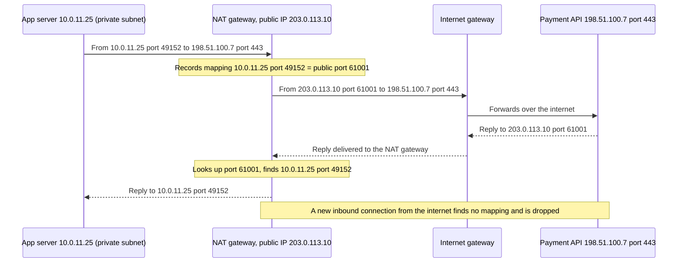
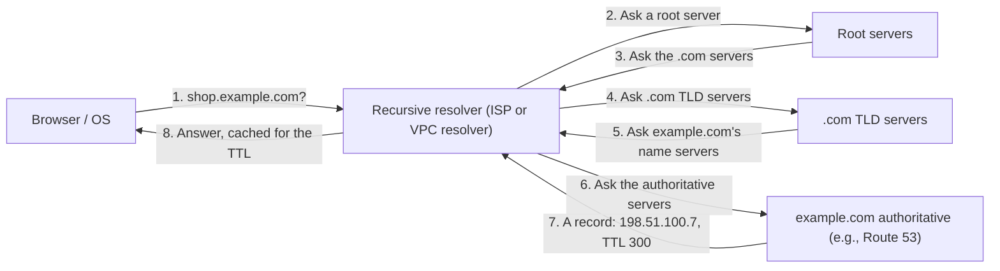
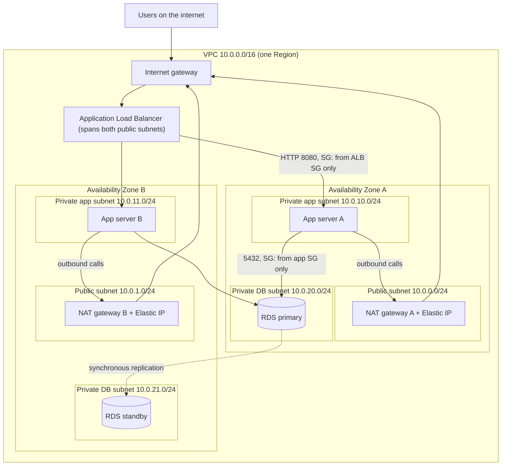

# Networking basics for cloud architects

> [Home](../README.md) · [Beginner track](README.md) · Next: [Kubernetes → AWS](03-kubernetes-to-aws.md)

This page teaches the networking you need for the exam from first principles. Each idea is explained **vendor-neutral first** (how networks work anywhere), then mapped to **the AWS equivalent**. If you've only ever typed `kubectl get svc`, a lot of this has been hidden from you by Kubernetes and by whoever built your cluster's VPC. That's fine: by the end you'll be able to read an AWS network diagram and explain where every packet goes.

Budget about 4–6 hours for this page, including the exercises. Don't skip the CIDR practice; it pays off on exam day.

---

## 1. Why networking matters on SAA-C03

The Solutions Architect – Associate exam (SAA-C03) isn't a networking exam, but roughly **a third of its questions touch networking** somewhere:

- **Security (Domain 1, 30%)**: "Make the database reachable only from the app tier" is a security group question. "Instances in a private subnet must download patches" is a NAT question. "Access S3 without going over the internet" is a VPC endpoint question.
- **Resilience (Domain 2, 26%)**: "Survive an Availability Zone failure" means subnets, load balancers and NAT gateways in at least two AZs.
- **Performance (Domain 3, 24%)**: task 3.4 is literally "high-performing and scalable network architectures": CloudFront, Global Accelerator, Direct Connect, load balancer choice.
- **Cost (Domain 4, 20%)**: task 4.4 is "cost-optimized network architectures": NAT gateway charges, cross-AZ data transfer, VPC endpoints vs NAT.

Developers usually find networking the hardest part of this exam, because applications normally sit on top of a network someone else built. The good news: the concepts are few and very stable. Learn them once and they apply on AWS, Azure, GCP and in a data center.

> **Kubernetes bridge:** in your EKS cluster, every pod already has a real IP address from an AWS subnet, traffic leaves through a NAT gateway, and your `Ingress` is an AWS load balancer. You've been using AWS networking all along; you just couldn't see it. [Kubernetes → AWS](03-kubernetes-to-aws.md) shows exactly where.

---

## 2. IP addresses

### 2.1 IPv4 structure

An **IP (Internet Protocol) address** is a machine's address on a network, like a street address on an envelope. An **IPv4** address is 32 bits, written as four numbers from 0 to 255 separated by dots ("dotted decimal"):

```
10      .  0       .  1       .  25
00001010   00000000   00000001   00011001     ← 4 octets × 8 bits = 32 bits
```

Each of the four parts is an **octet** (8 bits). 32 bits gives about 4.3 billion addresses, which the world ran out of years ago. Two tricks keep IPv4 alive: **private address ranges** and **NAT** (section 5).

An address has two parts: a **network part** (which street) and a **host part** (which house on the street). The **CIDR prefix** (section 3) says where the split is.

### 2.2 Public vs private addresses

- A **public IP address** is globally unique and routable on the internet. Someone must allocate it to you; on AWS that means a public IPv4 or an **Elastic IP** (a static public IPv4 you keep). Since Feb 2024 AWS **bills every public IPv4 address hourly**, which is a cost angle the exam can use.
- A **private IP address** comes from ranges reserved by **RFC 1918** (RFC = "Request for Comments", the internet's standards documents). Anyone may use them inside their own network, and internet routers drop them, so the same addresses are reused in millions of networks.

| RFC 1918 range | CIDR | Size | Typical use |
|---|---|---|---|
| 10.0.0.0 – 10.255.255.255 | `10.0.0.0/8` | ~16.7 million | Large corporate networks, most AWS VPCs |
| 172.16.0.0 – 172.31.255.255 | `172.16.0.0/12` | ~1 million | Default VPCs on AWS use `172.31.0.0/16` |
| 192.168.0.0 – 192.168.255.255 | `192.168.0.0/16` | ~65,000 | Home routers |

Two other ranges worth recognising:
- `100.64.0.0/10` is "carrier-grade NAT" space. EKS users sometimes add it as a secondary VPC range for pod IPs when they run short of RFC 1918 space.
- `169.254.0.0/16` is **link-local**: valid only on the local link. On AWS, `169.254.169.254` is the **instance metadata service**, where an EC2 instance (or a pod on it) fetches its own details and temporary credentials.

**AWS equivalent:** a **VPC (Virtual Private Cloud)** is your private network in a Region, and you give it a private range such as `10.0.0.0/16`. Every EC2 instance, pod (on EKS) and database gets a **private IP** from it. Some resources also get a **public IP**, which AWS maps to the private IP at the internet gateway (the instance itself never "sees" its public IP on its network card).

### 2.3 IPv6 in brief

**IPv6** addresses are 128 bits, written in hexadecimal groups: `2001:db8:1234:5600::25`. There are so many that **every IPv6 address is globally unique**: there is no "private" IPv6 in the RFC 1918 sense and usually no NAT.

On AWS you can add an IPv6 block to a VPC (AWS hands out a `/56`), and each subnet gets a `/64`. Because IPv6 addresses are reachable from the internet, AWS offers an **egress-only internet gateway**: IPv6 traffic can go out, nothing can come in. It's the IPv6 counterpart of a NAT gateway, and a favourite exam distractor.

---

## 3. CIDR notation

### 3.1 What the slash means

**CIDR (Classless Inter-Domain Routing)** notation writes a range as `address/prefix`. The prefix is **how many leading bits are fixed** (the network part). The remaining bits are free to vary (the host part).

> **Address count = 2^(32 − prefix)**

So every time the prefix grows by 1, the range halves. Smaller number after the slash = bigger network.

| CIDR | Free bits | Addresses | Usable in an AWS subnet (−5) | Mental picture |
|---|---|---|---|---|
| `/16` | 16 | 65,536 | 65,531 | A whole town: the largest VPC AWS allows |
| `/20` | 12 | 4,096 | 4,091 | A neighbourhood: default VPC subnets are /20 |
| `/24` | 8 | 256 | 251 | One street: the classic subnet size |
| `/28` | 4 | 16 | 11 | A cul-de-sac: the smallest subnet AWS allows |
| `/32` | 0 | 1 | n/a | Exactly one address (used in firewall rules) |
| `/0` | 32 | all | n/a | "Anywhere": `0.0.0.0/0` |

### 3.2 Worked examples

**`10.0.0.0/16`.** The first 16 bits (two octets, `10.0`) are fixed. The last two octets vary from `0.0` to `255.255`. Range: `10.0.0.0 – 10.0.255.255`, 2^16 = 65,536 addresses.

**`10.0.0.0/24`.** First three octets fixed. Range `10.0.0.0 – 10.0.0.255`, 256 addresses. Prefixes on an octet boundary (/8, /16, /24) are the easy ones: just count fixed octets.

**`10.0.16.0/20`.** Not on an octet boundary, so look at the third octet. 20 fixed bits = 16 (first two octets) + 4 bits of the third octet. The 4 remaining bits of the third octet give 2^4 = 16 values, so the third octet spans a **block of 16**: `16` to `31`.
Range: `10.0.16.0 – 10.0.31.255`, 4,096 addresses (16 × 256). The next /20 starts at `10.0.32.0`.

> **Shortcut for odd prefixes:** block size in the "interesting" octet = 2^(8 − bits used in that octet). /20 uses 4 bits of octet 3, so blocks of 16. /22 uses 6, so blocks of 4. /26 uses 2 bits of octet 4, so blocks of 64. A valid range always starts on a multiple of its block size (`10.0.16.0/20` ✅, `10.0.17.0/20` ❌).

**`10.0.1.16/28`.** /28 uses 4 bits of the last octet, so blocks of 2^4 = 16. Range: `10.0.1.16 – 10.0.1.31`, 16 addresses. In AWS, 11 usable.

### 3.3 Subnetting a /16 into /24s

**Subnetting** means carving a big range into smaller, non-overlapping ranges. Going from /16 to /24 fixes 8 more bits, so you get 2^8 = **256 subnets of 256 addresses**:

```
10.0.0.0/24    10.0.0.0   – 10.0.0.255
10.0.1.0/24    10.0.1.0   – 10.0.1.255
10.0.2.0/24    10.0.2.0   – 10.0.2.255
...
10.0.255.0/24  10.0.255.0 – 10.0.255.255
```

A common, readable AWS layout uses the third octet to encode tier and AZ:

| Subnet | CIDR | AZ |
|---|---|---|
| public-a | `10.0.0.0/24` | AZ a |
| public-b | `10.0.1.0/24` | AZ b |
| app-a | `10.0.10.0/24` | AZ a |
| app-b | `10.0.11.0/24` | AZ b |
| db-a | `10.0.20.0/24` | AZ a |
| db-b | `10.0.21.0/24` | AZ b |

⚠️ For EKS, /24 app subnets are often **too small**: with the VPC CNI every pod consumes a VPC IP, so a busy cluster can exhaust 251 addresses quickly. EKS teams typically use /19 or /20 subnets for nodes and pods.

### 3.4 Overlapping ranges and why they break peering

Two ranges **overlap** if any address is in both. `10.0.0.0/16` and `10.0.128.0/17` overlap (the second is inside the first). `10.0.0.0/16` and `10.1.0.0/16` don't.

Overlap matters the moment you connect networks. A router choosing where to send `10.0.5.9` must have exactly one answer. If VPC A and VPC B both claim `10.0.0.0/16`, the address is ambiguous, so:
- **VPC peering refuses** to connect VPCs with overlapping CIDRs.
- Transit Gateway and VPN routing get messy or impossible.
- Mergers and acquisitions become painful ("both companies used `10.0.0.0/16`").

**Architect habit:** plan non-overlapping ranges across all VPCs, accounts and on-premises networks *before* you build. Many organisations keep an IP plan (AWS offers **VPC IP Address Manager (IPAM)** for this). Changing a VPC's primary CIDR later isn't possible; you'd rebuild.

### 3.5 AWS rules to remember

- VPC CIDR: between **/16 and /28**. You can add secondary CIDRs later.
- A subnet is a slice of the VPC CIDR and lives in **exactly one AZ**.
- **AWS reserves 5 addresses in every subnet.** In `10.0.1.0/24`:

| Address | Reserved for |
|---|---|
| `10.0.1.0` | Network address |
| `10.0.1.1` | The VPC router |
| `10.0.1.2` | Amazon DNS server (the VPC's base address + 2) |
| `10.0.1.3` | Reserved for future use |
| `10.0.1.255` | Broadcast address (VPCs don't do broadcast, but it's reserved) |

So usable = 2^(32 − prefix) − 5.

### 3.6 Practice exercises

Try each on paper before opening the answer.

**1.** How many addresses are in a /22? How many can you use in an AWS subnet of that size?

<details><summary>Answer</summary>

2^(32−22) = 2^10 = **1,024** addresses; **1,019** usable in AWS (1,024 − 5).
</details>

**2.** You need one AWS subnet for 500 EC2 instances. What's the smallest prefix that fits?

<details><summary>Answer</summary>

**/23**: 512 − 5 = 507 usable. A /24 gives only 251. (In real life, leave headroom for growth and rolling deployments.)
</details>

**3.** Split `10.20.0.0/16` into 4 equal subnets. List them.

<details><summary>Answer</summary>

4 subnets = 2 extra bits, so /18. Third-octet block size = 2^(8−2) = 64.
`10.20.0.0/18`, `10.20.64.0/18`, `10.20.128.0/18`, `10.20.192.0/18` (16,384 addresses each).
</details>

**4.** VPC A is `10.0.0.0/16`. VPC B is `10.0.64.0/18`. Can you peer them?

<details><summary>Answer</summary>

**No.** `10.0.64.0/18` spans `10.0.64.0 – 10.0.127.255`, which is inside `10.0.0.0 – 10.0.255.255`. The CIDRs overlap, so VPC peering is rejected. Re-address one VPC (e.g., `10.1.0.0/16`).
</details>

**5.** Is `172.32.5.10` a private (RFC 1918) address? What about `172.20.5.10`?

<details><summary>Answer</summary>

`172.16.0.0/12` spans `172.16.0.0 – 172.31.255.255`. So `172.32.5.10` is **public** (just outside the range) and `172.20.5.10` is **private**. This "172.16 to 172.31" boundary trips people up.
</details>

---

## 4. Subnets and routing

### 4.1 What a router and a route table do

A **subnet** is a group of addresses that can talk to each other directly. To reach anything outside the subnet, a machine hands the packet to a **router**, like posting a letter at the post office instead of walking it to the neighbour's door.

The router decides where to forward each packet by looking up the destination in its **route table**: a list of `destination range → next hop (target)` entries.

```
Destination      Target
10.0.0.0/16      local            ← anything inside my network: deliver directly
172.16.0.0/12    vpn-tunnel       ← the office network: send through the VPN
0.0.0.0/0        internet-gateway ← everything else: the internet
```

`0.0.0.0/0` is the **default route** ("if nothing more specific matches, send it here"). It matches every address because /0 fixes zero bits.

### 4.2 Longest-prefix match

When several routes match, the router picks the **most specific** one: the one with the **longest prefix** (biggest number after the slash). A /24 beats a /16, which beats a /0. This is how one route table can say "most things go to the internet, but this one range goes through the VPN".

Worked example with this table:

| Destination | Target |
|---|---|
| `10.0.0.0/16` | local |
| `192.168.0.0/16` | peering connection to VPC X |
| `192.168.50.0/24` | transit gateway |
| `0.0.0.0/0` | NAT gateway |

| Packet to | Matching routes | Winner |
|---|---|---|
| `10.0.11.40` | /16 local, /0 | **local** (/16 beats /0) |
| `192.168.7.9` | /16 peering, /0 | **peering** |
| `192.168.50.9` | /24 TGW, /16 peering, /0 | **transit gateway** (/24 is longest) |
| `52.94.1.1` | only /0 | **NAT gateway** |

### 4.3 A worked packet path

Your laptop (`192.168.1.20`, home network `192.168.1.0/24`) opens a website at public IP `198.51.100.7`:

1. The laptop checks: is `198.51.100.7` inside `192.168.1.0/24`? No. So it sends the packet to its **default gateway**, the home router (`192.168.1.1`).
2. The home router's route table has `0.0.0.0/0 → ISP`. It also performs **NAT** (section 5), swapping the private source address for the home's single public IP.
3. Internet routers each do a longest-prefix lookup and pass the packet hop by hop toward `198.51.100.7`.
4. The reply comes back to the home's public IP; the router reverses the NAT and delivers it to `192.168.1.20`.

### 4.4 The AWS equivalent

- Every VPC has an invisible **VPC router**. You control it through **route tables**.
- Every route table starts with a **local route** for the VPC CIDR, which you can't delete: all subnets in a VPC can reach each other by default (firewalls permitting).
- Each subnet is associated with **one** route table. Many subnets can share one.
- **A subnet is "public" only because of its route table**: it has `0.0.0.0/0 → internet gateway`. A "private" subnet doesn't; it usually has `0.0.0.0/0 → NAT gateway` instead. There is no "public" checkbox on a subnet. This is one of the most important facts on the exam.

Deep dive: [Amazon VPC](services/networking.md#amazon-vpc) · [Notes 02: subnets, route tables and gateways](../notes/02-networking-vpc.md)

---

## 5. Gateways and NAT

### 5.1 Internet gateway

A **gateway** is a door between two networks. An **internet gateway** is the door between your private network and the internet.

**AWS:** an **internet gateway (IGW)** is attached to a VPC (one per VPC). It's horizontally scaled, highly available and free (you pay for data transfer). It does two jobs: it lets traffic out to and in from the internet for subnets whose route table points at it, and it translates between instances' private IPs and their public IPs. An instance is reachable from the internet only if **all three** are true: it has a public IP, its subnet routes `0.0.0.0/0` to the IGW, and firewalls allow the traffic.

### 5.2 NAT: out yes, in no

**NAT (Network Address Translation)** rewrites the source address of outgoing packets. Many private machines share one public address. The NAT device keeps a **translation table** remembering who asked for what, so it can route the reply back.

The key security property: **private machines can start connections out, but nobody on the internet can start a connection in.** An unsolicited inbound packet arrives at the NAT device, finds no matching entry in its table, and is dropped. Everyday analogy: a company switchboard. Staff can dial out and the callee sees the main number. An outsider who calls the main number can't reach a specific desk unless that desk called them first.

**PAT (Port Address Translation)**, also called NAT overload, is how many machines share *one* public IP. The NAT device rewrites both the source IP **and** the source port, and records the mapping:



**AWS:**
- A **NAT gateway** is a managed NAT service. The classic (zonal) NAT gateway **lives in a public subnet**, has an Elastic IP, and private subnets route `0.0.0.0/0` to it.
- **High availability = one NAT gateway per AZ**, with each AZ's private route table pointing at its own AZ's NAT gateway. One shared NAT gateway is cheaper but fails if its AZ fails and adds cross-AZ data charges. The exam tests this trade-off directly.
- A newer **regional NAT gateway** mode (Nov 2025) spans AZs automatically, but exam questions are framed around the zonal, one-per-AZ pattern.
- NAT gateways charge per hour **and per GB processed**. Sending S3 or DynamoDB traffic through a NAT gateway is a classic cost trap; a **gateway VPC endpoint** (section 11) is free.
- A **NAT instance** (an EC2 instance doing NAT) is the old, self-managed alternative: cheaper at tiny scale, but a single point of failure, and you must disable its source/destination check.

Deep dive: [Notes 02: NAT](../notes/02-networking-vpc.md) · [Lab 02: build it by hand](../labs/lab-02-custom-vpc.md)

---

## 6. Ports, protocols and layers

### 6.1 The layer model in plain English

Networks are described in **layers**. Each layer solves one problem and relies on the one below. The formal **OSI (Open Systems Interconnection)** model has 7 layers; the practical **TCP/IP** model has 4. Architects only use three numbers day to day:

| Layer | Name | Question it answers | Examples | "Address" it understands |
|---|---|---|---|---|
| **L3** | Network | Which machine? | IP, ICMP (ping) | IP address |
| **L4** | Transport | Which program on that machine, and how reliably? | TCP, UDP | IP + **port** |
| **L7** | Application | What is the program actually saying? | HTTP, HTTPS, DNS, SMTP, gRPC | URL path, host name, headers, cookies |

Analogy: L3 is the building's street address, L4 is the apartment number, L7 is the content of the letter.

**Why load balancers are called "Layer 4" or "Layer 7":** it's about how much of the request they read before deciding where to send it.
- A **Layer 4** load balancer sees only IPs, ports and the protocol (TCP/UDP). It forwards connections without opening them. Fast, cheap per request, protocol-agnostic. **AWS: Network Load Balancer (NLB).**
- A **Layer 7** load balancer parses HTTP. It can route `/api/*` to one group of servers and `/images/*` to another, route by host name, read headers and cookies, and redirect HTTP to HTTPS. **AWS: Application Load Balancer (ALB).**
- AWS also has a **Gateway Load Balancer (GWLB)**, which works at L3 to send traffic through third-party firewall appliances. Recognise the name; it's rarely the answer unless "virtual appliances" or "inspection" appears.

### 6.2 TCP vs UDP

| | **TCP (Transmission Control Protocol)** | **UDP (User Datagram Protocol)** |
|---|---|---|
| Connection | Yes: a three-way handshake (SYN, SYN-ACK, ACK) first | No: just send |
| Reliability | Retransmits lost packets, keeps order | Fire and forget; the app handles loss |
| Overhead | Higher | Lower |
| Used by | HTTP/HTTPS, SSH, databases, most things | DNS queries, video/voice streaming, gaming, VPN (IPsec NAT-T), QUIC/HTTP/3 |
| AWS hint | ALB handles HTTP over TCP | **"UDP" in a question → NLB or Global Accelerator, never ALB** |

### 6.3 Common ports

A **port** is a 16-bit number (0–65,535) identifying a service on a machine. Servers listen on **well-known ports**. Memorise these; firewall questions assume you know them.

| Port | Protocol | Service |
|---|---|---|
| 22 | TCP | SSH (Secure Shell): Linux remote login |
| 53 | UDP and TCP | DNS |
| 80 | TCP | HTTP |
| 443 | TCP | HTTPS (HTTP over TLS) |
| 445 | TCP | SMB (Server Message Block): Windows file shares, FSx for Windows |
| 1433 | TCP | Microsoft SQL Server |
| 2049 | TCP | NFS (Network File System): Amazon EFS |
| 3306 | TCP | MySQL / MariaDB (and Aurora MySQL) |
| 3389 | TCP | RDP (Remote Desktop Protocol): Windows remote login |
| 5432 | TCP | PostgreSQL (and Aurora PostgreSQL) |
| 6379 | TCP | Redis / Valkey (ElastiCache) |
| 27017 | TCP | MongoDB (and DocumentDB) |

### 6.4 Ephemeral ports

When your browser connects to a server on port 443, the *client* side also needs a port so the reply can find its way back. The operating system picks a temporary **ephemeral port** from a high range: Linux typically uses 32768–60999, Windows 49152–65535, and AWS guidance for firewall rules is the whole **1024–65535** range.

So a connection really looks like:

```
Request:  client 203.0.113.50 : 51514  →  server 10.0.0.10 : 443
Response: server 10.0.0.10    : 443    →  client 203.0.113.50 : 51514
```

This matters for **stateless firewalls** (next section). A stateless firewall doesn't remember the request, so you must explicitly allow the **response** traffic going back to the client's ephemeral port range. Forgetting this is the classic "NACL broke my app" bug, and an exam favourite.

---

## 7. Firewalls

A **firewall** filters traffic by rules such as "allow TCP 443 from anywhere". Two properties define any firewall.

**Stateful vs stateless**
- **Stateful**: the firewall tracks connections. If a request was allowed in, the reply is automatically allowed out (and vice versa). You write rules only for the side that *starts* the conversation. Analogy: a building security desk that remembers the visitor it let in and lets them leave.
- **Stateless**: every packet is judged on its own, with no memory. You need rules for both directions, including the ephemeral-port replies. Analogy: a turnstile that checks every pass, both ways.

**Allow lists vs deny rules**
- **Allow-only** firewalls start from "deny everything" and you add what's permitted. You *can't* write "block this one IP".
- Firewalls with **allow and deny rules** evaluate an ordered list; the first match wins. These *can* block a specific bad IP range.

### 7.1 AWS: security groups vs network ACLs

| | **Security group (SG)** | **Network ACL (NACL, network access control list)** |
|---|---|---|
| Attached to | Network interfaces (ENIs) of instances, load balancers, RDS, Lambda in a VPC, pods… | A **subnet** (applies to everything in it) |
| State | **Stateful** | **Stateless**: allow return traffic on ephemeral ports |
| Rules | **Allow only** | **Allow and deny**, numbered, lowest number evaluated first, first match wins |
| Default | New SG: no inbound, all outbound allowed | Default NACL allows all; a **new custom NACL denies all** until you add rules |
| Can reference | Other security groups ("allow 3306 from the app-tier SG") | Only CIDR ranges |
| Typical job | Main, fine-grained control per tier | Coarse subnet guardrail; **blocking a specific IP range** |

Exam patterns:
- "Allow only the web tier to reach the database" → DB security group allows 3306/5432 **from the web tier's security group ID** (not from IPs).
- "Block a malicious IP address" → **NACL deny rule** (security groups can't deny), or AWS WAF for HTTP traffic.
- "Inbound works but responses never arrive" → the NACL's outbound rules lack **1024–65535** to the client.

A NACL rule set for a public web subnet, showing the ephemeral-port rules:

| Direction | Rule # | Protocol / port | Source / destination | Action |
|---|---|---|---|---|
| Inbound | 100 | TCP 443 | `0.0.0.0/0` | ALLOW |
| Inbound | 110 | TCP 1024–65535 | `0.0.0.0/0` (replies to outbound calls) | ALLOW |
| Inbound | * | all | all | DENY |
| Outbound | 100 | TCP 1024–65535 | `0.0.0.0/0` (replies to clients) | ALLOW |
| Outbound | 110 | TCP 443 | `0.0.0.0/0` (instance calling out) | ALLOW |
| Outbound | * | all | all | DENY |

### 7.2 Kubernetes NetworkPolicy comparison

| | K8s **NetworkPolicy** | Security group | NACL |
|---|---|---|---|
| Selects targets by | **Labels** (podSelector, namespaceSelector) | Attachment to an ENI | Subnet membership |
| Default | All traffic allowed until a policy selects a pod; then only what's listed | Deny inbound | Default NACL allows all |
| Deny rules | No (standard API is allow-only) | No | Yes |
| State | Stateful in common implementations | Stateful | Stateless |
| Enforced by | The CNI plugin (on EKS, the VPC CNI's network policy feature, or Calico/Cilium) | AWS hypervisor/network | AWS network |

The closest match to a NetworkPolicy is a **security group referencing another security group**: "pods labelled `app=api` may reach pods labelled `app=db`" ≈ "SG `api-sg` may reach SG `db-sg` on 5432". The difference: security groups attach to network interfaces, not to labels, so they can't follow a pod around by label. On EKS, a pod normally shares its node's security groups unless you enable **security groups for pods**. More in [Kubernetes → AWS](03-kubernetes-to-aws.md).

Deep dive: [Amazon VPC: security groups and NACLs](services/networking.md#amazon-vpc) · [Notes 02: security groups vs network ACLs](../notes/02-networking-vpc.md)

---

## 8. DNS

### 8.1 What DNS does

**DNS (Domain Name System)** turns names (`shop.example.com`) into IP addresses. It's the internet's phone book, but distributed: no single server knows everything, and each part of the name is owned by a different set of servers.

### 8.2 Resolution step by step

When your browser looks up `shop.example.com` for the first time:



1. The OS checks its own cache, then asks a **recursive resolver** (your ISP's, a public one like `1.1.1.1`, or on AWS the VPC's built-in resolver).
2. The resolver asks a **root server**, which says "I don't know, but here are the `.com` servers".
3. It asks a **TLD (top-level domain)** server for `.com`, which says "`example.com` is served by these **name servers**" (its **NS** records).
4. It asks those **authoritative** name servers, which give the real answer.
5. The resolver **caches** the answer for its **TTL** and returns it.

### 8.3 Record types

| Record | Maps | Example |
|---|---|---|
| **A** | Name → IPv4 address | `shop.example.com → 198.51.100.7` |
| **AAAA** | Name → IPv6 address | `shop.example.com → 2001:db8::7` |
| **CNAME** | Name → another name (an alias at the DNS level) | `www.example.com → shop.example.com`. ⚠️ Not allowed at the zone apex (`example.com` itself) |
| **MX** | Domain → mail servers, with priority | `example.com → 10 mail.example.com` |
| **TXT** | Name → free text | Domain-ownership proofs, SPF/DKIM email settings |
| **NS** | Zone → its authoritative name servers | Set at your registrar to delegate to Route 53 |
| **Alias** (AWS only) | Name → an AWS resource (ALB, CloudFront, S3 website, API Gateway, another record) | `example.com → my-alb-123.elb.amazonaws.com` |

**Alias records** are a Route 53 extension and an exam favourite: unlike a CNAME they **work at the zone apex**, they automatically follow the target's changing IPs, and Route 53 doesn't charge for alias queries to AWS resources. "Point the naked domain `example.com` at a load balancer" → **alias record**.

### 8.4 TTL

**TTL (time to live)** is how long resolvers may cache an answer, in seconds. Long TTLs (e.g., 86,400 = 1 day) mean fewer lookups and faster responses but slow changes. Short TTLs (60 s) let you fail over or migrate quickly. Architect's trick: **lower the TTL a day before a migration**, switch, then raise it again.

### 8.5 Public vs private zones

- A **public hosted zone** answers queries from the internet (`shop.example.com`).
- A **private hosted zone** answers only inside the VPCs you associate with it, e.g., `db.internal.example.com → 10.0.20.15`. The VPC needs its DNS attributes enabled (`enableDnsSupport`, `enableDnsHostnames`).
- Every VPC has a built-in DNS resolver at the **VPC base address + 2** (e.g., `10.0.0.2`). AWS calls it the **Route 53 Resolver**. For hybrid setups, **Resolver endpoints** forward queries between the VPC and on-premises DNS.

### 8.6 The Kubernetes analogy

In your cluster, **CoreDNS** is a private DNS zone you never configured: `orders.shop.svc.cluster.local` resolves to the Service's ClusterIP, and pods find each other by name. Route 53 private hosted zones play the same role for whole VPCs. In fact, on EKS, CoreDNS answers cluster names itself and **forwards everything else to the VPC's Route 53 Resolver**, which is how your pods resolve RDS endpoints and AWS API names.

Route 53 also does things CoreDNS doesn't: **routing policies** (weighted, latency-based, failover, geolocation, and more) with health checks, which make DNS a global traffic-steering tool. That's covered on the service page.

Deep dive: [Amazon Route 53](services/networking.md#amazon-route-53) · [Notes 02: DNS](../notes/02-networking-vpc.md)

---

## 9. HTTP, HTTPS and TLS

**HTTP (Hypertext Transfer Protocol)** is the L7 request/response protocol of the web. **HTTPS** is HTTP inside a **TLS (Transport Layer Security)** tunnel: encrypted, tamper-proof, and the server proves its identity.

### 9.1 Certificates and CAs

- A **certificate** binds a domain name to a public key. The server holds the matching **private key**.
- A **CA (certificate authority)** signs certificates. Browsers and operating systems ship with a list of trusted CAs, so they can verify the signature chain. Analogy: a passport (certificate) issued by a government (CA) that border control (the browser) already trusts.
- During the **TLS handshake**, the server presents its certificate, the client verifies it, and they agree on session keys.

**AWS:** **AWS Certificate Manager (ACM)** issues free public certificates for use with AWS integrated services (ELB, CloudFront, API Gateway) and renews them automatically. ⚠️ A certificate for **CloudFront must be in `us-east-1`**, whatever Region your origin is in. Details: [ACM](services/security.md#aws-certificate-manager-acm).

### 9.2 Where TLS terminates

**Termination** is where traffic gets decrypted.

| Pattern | How it works | Why choose it |
|---|---|---|
| **Terminate at the load balancer** | Client ↔ ALB is HTTPS; ALB ↔ servers is HTTP inside the VPC | Simplest; the ALB can read L7 data for routing and WAF; certificate lives in one place (ACM) |
| **Re-encrypt** | Client ↔ ALB HTTPS, then ALB ↔ servers HTTPS again | Compliance requires encryption in transit everywhere, but you still want L7 routing |
| **End-to-end passthrough** | An **NLB with a TCP listener** forwards the encrypted bytes untouched; servers hold the certificate | The load balancer must never see plaintext; or you need client-certificate auth on the servers |

**Offloading** TLS to the load balancer saves CPU on your servers and centralises certificate management, a common exam "reduce operational overhead" answer.

### 9.3 SNI and mTLS

- **SNI (Server Name Indication)**: the client says which host name it wants at the start of the TLS handshake, so one load balancer (one IP) can serve many domains with different certificates. ALB and NLB support multiple certificates via SNI; that's the answer to "host many HTTPS sites behind one load balancer".
- **mTLS (mutual TLS)**: the client also presents a certificate, so both sides prove identity. Used for service-to-service and B2B APIs; ALB and API Gateway support it.

---

## 10. Load balancing concepts

A **load balancer** is a single front door that spreads requests across many servers (**targets**), and stops sending to unhealthy ones. Analogy: the host at a restaurant seating guests across tables and skipping the one being cleaned.

| Concept | Meaning | AWS detail |
|---|---|---|
| **L4 vs L7** | L4 forwards connections by IP/port; L7 routes by URL, host, header | **NLB** = L4 (TCP/UDP/TLS, very high throughput, a static IP per AZ). **ALB** = L7 (HTTP/HTTPS/gRPC, path and host routing, redirects, WAF, OIDC/Cognito authentication) |
| **Listener** | The port/protocol the LB accepts, e.g., HTTPS 443 | Rules on a listener choose a target group |
| **Target group** | The pool of backends | Instances, IPs (e.g., pods), Lambda functions (ALB), or an ALB (NLB) |
| **Health checks** | The LB probes each target (e.g., `GET /health` expecting 200) and stops routing to failures | An Auto Scaling group can use ELB health checks to **replace** unhealthy instances |
| **Sticky sessions** | Send a given user back to the same target | ALB uses cookies. Better design: keep sessions out of servers (ElastiCache/DynamoDB) so any target works |
| **Cross-zone load balancing** | Spread evenly across targets in *all* AZs, not just the AZ the request entered | On by default for ALB; off by default for NLB (and inter-AZ data then costs extra if you enable it) |
| **Internet-facing vs internal** | Public IPs vs private-only | Internal ALBs sit between tiers |
| **Connection draining** | Let in-flight requests finish before removing a target | AWS calls it **deregistration delay** |

**Kubernetes analogy:**
- A **Service** of type ClusterIP is an internal L4 load balancer (kube-proxy spreads connections across matching pods).
- A **Service of type LoadBalancer** on EKS becomes an **NLB** (when the AWS Load Balancer Controller or EKS Auto Mode manages it).
- An **Ingress** on EKS becomes an **ALB**: host and path rules in your YAML become ALB listener rules.
- **Readiness probes** decide whether a pod receives traffic, much like target-group health checks. Liveness probes (restart the container) are closer to an Auto Scaling group replacing an unhealthy instance.

Deep dive: [Elastic Load Balancing](services/networking.md#elastic-load-balancing-elb)

---

## 11. Connecting networks

Sooner or later a VPC needs to talk to another VPC, to an office, or to an AWS service, **without** going over the open internet. The analogy for this whole section: **the public internet is a highway anyone can use; these options are private roads** of different kinds.

### 11.1 VPN: an armoured truck on the public highway

A **VPN (virtual private network)** builds an encrypted **tunnel** across the internet. The standard is **IPsec (Internet Protocol Security)**. Traffic still travels the public highway, but sealed in an armoured truck nobody can open.

- **AWS Site-to-Site VPN** connects an on-premises network (via its router, the **customer gateway**) to a VPC's **virtual private gateway** or to a Transit Gateway. Each connection has **two tunnels** for redundancy.
- Set up in **minutes to hours**, cheap, encrypted; but throughput (approx. 1.25 Gbps per tunnel) and latency depend on the internet.
- **AWS Client VPN** is for individual laptops, not whole offices.

### 11.2 Dedicated lines: your own private road

A **dedicated private line** is a physical circuit from your data center into the provider's network. No internet involved: consistent latency and high bandwidth.

- **AWS Direct Connect (DX)**: a dedicated connection at a DX location (dedicated ports up to 100 Gbps and beyond, smaller "hosted" connections via partners).
- Takes **weeks** to provision. ⚠️ Not encrypted by default: add MACsec or run a VPN over it if the question demands encryption.
- Classic resilient pattern: **DX as primary, Site-to-Site VPN as backup**. Need it fast? VPN now, DX later.

### 11.3 Peering: a private bridge between two neighbours

**VPC peering** connects two VPCs (same or different account, same or different Region) so they route to each other with private IPs.
- **No overlapping CIDRs** (section 3.4).
- **Not transitive**: if A peers with B and B peers with C, A **cannot** reach C through B. You'd need A–C peering too. With many VPCs that's a full mesh: n × (n − 1) / 2 connections (10 VPCs = 45).

### 11.4 Hub-and-spoke: an airport hub

**AWS Transit Gateway (TGW)** is a regional **hub** router. Every VPC, VPN and Direct Connect gateway attaches once to the hub, and the hub routes between them (transitively, controlled by its route tables). Like an airline hub: fly anywhere via one connection each, instead of direct flights between every pair of cities. "Dozens of VPCs plus on-premises, simplify management" → **Transit Gateway**.

### 11.5 Private service endpoints: a private on-ramp

How does a private-subnet instance reach S3 or an AWS API without a NAT gateway or the internet?

- **Gateway VPC endpoint**: a route-table entry that sends **S3 or DynamoDB** traffic over AWS's network. **Free.** Only these two services.
- **Interface VPC endpoint (powered by AWS PrivateLink)**: AWS puts a **network interface with a private IP in your subnet** that represents a service (SQS, Secrets Manager, ECR, your partner's API…). Your traffic goes to a local private IP and never touches the internet. Charged hourly plus per GB.
- **PrivateLink for your own services**: put your service behind an NLB, publish it as an **endpoint service**, and consumers in other VPCs or accounts create interface endpoints to it. Only that one service is exposed, not the whole network, and **overlapping CIDRs don't matter**. "Expose one service to hundreds of customer VPCs" → **PrivateLink**, not peering.

| Need | Analogy | AWS answer |
|---|---|---|
| Office ↔ VPC, quick, encrypted, cheap | Armoured truck on the highway | Site-to-Site VPN |
| Office ↔ VPC, consistent, high bandwidth | Your own private road | Direct Connect |
| Two VPCs | Bridge between neighbours | VPC peering |
| Many VPCs + on-prem | Airport hub | Transit Gateway |
| Reach S3/DynamoDB privately | Private on-ramp, free | Gateway endpoint |
| Reach one service privately | Private door into one shop, not the whole mall | Interface endpoint / PrivateLink |

Deep dive: [Direct Connect](services/networking.md#aws-direct-connect) · [Site-to-Site VPN](services/networking.md#aws-site-to-site-vpn) · [Transit Gateway](services/networking.md#aws-transit-gateway) · [PrivateLink](services/networking.md#aws-privatelink) · [Notes 02: connecting VPCs and hybrid connectivity](../notes/02-networking-vpc.md)

---

## 12. CDN and edge

A **CDN (content delivery network)** keeps copies of your content in many **edge locations** close to users. Analogy: instead of every customer driving to the central warehouse, local corner shops stock the popular items.

- The **origin** is the authoritative source (an S3 bucket, an ALB, any HTTP server).
- When a user requests a file, the nearest edge serves it from **cache** (a **cache hit**). On a **cache miss**, the edge fetches it from the origin, returns it, and stores it.
- How long the edge keeps it is again a **TTL**, set by the origin's `Cache-Control` headers or the CDN's policy. To force an update early, you **invalidate** the cached object (or use versioned file names like `app.v42.js`).
- Benefits: lower latency, less load on the origin, cheaper egress, and a big attack surface absorbed at the edge (DDoS protection).

**AWS: Amazon CloudFront** is the CDN, with hundreds of edge locations. It caches static and dynamic content, terminates TLS at the edge, integrates with AWS WAF and Shield, and can lock an S3 bucket so only CloudFront can read it (**origin access control**).

**Anycast** (for Global Accelerator): normally one IP address = one place. With **anycast**, the *same* IP address is announced from many locations worldwide, and internet routing delivers each user to the nearest one. **AWS Global Accelerator** gives you **two static anycast IP addresses**; users enter AWS's private backbone at the closest edge, then ride it to your load balancers or instances in one or more Regions, with fast failover between Regions. It **doesn't cache**. Rule of thumb: **cacheable HTTP content → CloudFront; TCP/UDP apps, static IPs, or fast multi-Region failover → Global Accelerator.**

Deep dive: [CloudFront](services/networking.md#amazon-cloudfront) · [Global Accelerator](services/networking.md#aws-global-accelerator)

---

## 13. Latency vs bandwidth vs throughput

| Term | Meaning | Highway analogy | Unit |
|---|---|---|---|
| **Latency** | Time for one packet to get there (and back = RTT, round-trip time) | How long the drive is | ms |
| **Bandwidth** | Maximum capacity of the link | Number of lanes | Mbps / Gbps |
| **Throughput** | What you actually achieve | Cars actually arriving per hour | Mbps / Gbps |

A fat pipe doesn't fix latency: a 10 Gbps link from Mumbai to Virginia still has a round trip of around 200 ms. Latency fixes are about **distance** (CloudFront, Global Accelerator, deploy in a nearer Region). Bandwidth fixes are about **capacity** (Direct Connect, parallel transfers, offline transfer).

**The "how long will this transfer take?" math.** Watch the units: storage is in **bytes (B)**, links are in **bits (b)**, and 1 byte = 8 bits.

How long does **10 TB over a 1 Gbps** link take?

```
10 TB = 10 × 10^12 bytes × 8   = 8 × 10^13 bits
1 Gbps = 10^9 bits per second
8 × 10^13 / 10^9               = 80,000 seconds ≈ 22 hours   (at 100% utilisation)
```

Real links rarely run at 100% for a whole day, and the business still needs the line. At **50% of the link**, that's about **44 hours**, nearly 2 days. Scale it: **100 TB ≈ 9 days at full speed**, about 18 days at half. **1 PB over 1 Gbps ≈ 3 months.**

This is the math behind exam questions like "migrate 500 TB within 2 weeks over a 500 Mbps internet link": it would take about 3 months, so online transfer is impossible and the answer is **offline transfer** (the AWS Snow Family in exam terms; note that Snowball Edge is no longer offered to new customers in real life) or a much bigger dedicated link. When the numbers fit, **AWS DataSync** over the network is the usual answer for online bulk transfer.

Handy anchor: **1 Gbps ≈ 10 TB per day** (≈ 10.8 TB at 100%).

---

## 14. Putting it together in AWS

Here is the reference design you'll see in countless exam questions and build yourself in [Lab 02](../labs/lab-02-custom-vpc.md): a VPC across two AZs with public, app and database subnets.



The route tables that make it work:

| Route table | Associated with | Routes |
|---|---|---|
| Public | public-a, public-b | `10.0.0.0/16 → local`, `0.0.0.0/0 → igw` |
| Private A | app-a, db-a | `10.0.0.0/16 → local`, `0.0.0.0/0 → nat-gw-A` |
| Private B | app-b, db-b | `10.0.0.0/16 → local`, `0.0.0.0/0 → nat-gw-B` |

(Database subnets often get no `0.0.0.0/0` route at all, which is stricter still.)

The security groups:

| SG | Inbound rule |
|---|---|
| `alb-sg` | TCP 443 from `0.0.0.0/0` |
| `app-sg` | TCP 8080 from `alb-sg` |
| `db-sg` | TCP 5432 from `app-sg` |

### A request's journey

1. A user types `https://shop.example.com`. **DNS**: Route 53 has an **alias record** for `shop.example.com` pointing at the ALB and returns the ALB's public IPs.
2. The browser opens **TCP 443** to one of those IPs. The packet arrives at the **internet gateway**, which hands it into the VPC to the ALB node in a public subnet.
3. `alb-sg` allows 443 from anywhere. The ALB **terminates TLS** with its ACM certificate, reads the HTTP request, and applies its listener rules (say, `/api/*` → app target group).
4. The ALB picks a **healthy** target (health checks have been probing `/health`), possibly in the other AZ (cross-zone), and forwards over HTTP 8080 to App server A's **private IP**. The VPC router delivers it via the **local route**. `app-sg` allows it because the source is `alb-sg`.
5. App server A queries the database on 5432. Local route again; `db-sg` allows it because the source is `app-sg`. Because security groups are **stateful**, the replies flow back without extra rules.
6. App server A also calls an external payment API. Its subnet's route table sends `0.0.0.0/0` to **NAT gateway A**, which rewrites the source to its Elastic IP and sends it out through the **IGW**. The reply comes back through the same NAT. Nobody on the internet can open a connection to App server A.
7. The response travels back through the ALB, re-encrypted with TLS, to the user.

What survives an **AZ A outage**? The ALB stops routing to App server A; App server B keeps serving; RDS fails over to the standby in AZ B; App server B still has internet access via NAT gateway B. That's why the exam wants **two of everything, one per AZ**.

Deep dive: [Amazon VPC](services/networking.md#amazon-vpc) · [Notes 02: reference design](../notes/02-networking-vpc.md) · [Lab 02: build this VPC by hand](../labs/lab-02-custom-vpc.md)

---

## 15. Self-check

**1.** A subnet's route table has `0.0.0.0/0 → nat-0abc`. Is it public or private?

<details><summary>Answer</summary>

**Private.** A subnet is public only if its route table sends traffic to an **internet gateway**. A NAT route means instances can call out but can't be reached from the internet.
</details>

**2.** How many usable IP addresses does an AWS subnet `10.0.4.0/22` have?

<details><summary>Answer</summary>

2^10 = 1,024 − 5 reserved = **1,019**.
</details>

**3.** A route table has `10.0.0.0/16 → local`, `10.1.0.0/16 → pcx-1` and `10.1.5.0/24 → tgw-1`. Where does a packet for `10.1.5.20` go?

<details><summary>Answer</summary>

**tgw-1.** Longest-prefix match: /24 beats /16.
</details>

**4.** You must block one abusive IP range from reaching every instance in a subnet. Security group or NACL?

<details><summary>Answer</summary>

**NACL**, with a low-numbered DENY rule. Security groups have no deny rules. (For HTTP traffic at the ALB or CloudFront, AWS WAF is another option.)
</details>

**5.** You added a custom NACL allowing inbound 443. Users connect but the page never loads. Why?

<details><summary>Answer</summary>

NACLs are **stateless**. The **outbound** rules must allow the responses to the clients' **ephemeral ports (1024–65535)**. A new custom NACL denies everything until you add rules.
</details>

**6.** Which record type lets you point `example.com` (the zone apex) at an ALB?

<details><summary>Answer</summary>

A Route 53 **alias** record. A CNAME isn't allowed at the zone apex.
</details>

**7.** Your app uses UDP for real-time game traffic and needs static IPs that clients can allow-list. Which load balancer, and what could sit in front globally?

<details><summary>Answer</summary>

**NLB** (L4, supports UDP, a static IP per AZ). ALB doesn't do UDP. For global users and two static anycast IPs, put **Global Accelerator** in front.
</details>

**8.** Two VPCs both use `10.0.0.0/16`. Can you peer them? What could still let one consume a single service from the other?

<details><summary>Answer</summary>

No, peering requires non-overlapping CIDRs. **PrivateLink** (an NLB-backed endpoint service plus an interface endpoint) works with overlapping CIDRs because the consumer reaches the service through an IP in its own subnet.
</details>

**9.** VPC A peers with B, and B peers with C. Can A reach C?

<details><summary>Answer</summary>

**No.** Peering is not transitive. Peer A with C directly or use a **Transit Gateway**.
</details>

**10.** Private EC2 instances download large files from S3 through a NAT gateway, and the NAT bill is high. Cheapest fix?

<details><summary>Answer</summary>

Add an **S3 gateway VPC endpoint** (free) and its route to the private route tables. S3 traffic then bypasses the NAT gateway's per-GB processing charge.
</details>

**11.** Roughly how long does it take to send 50 TB over a dedicated 1 Gbps link at full speed?

<details><summary>Answer</summary>

50 × 10^12 × 8 = 4 × 10^14 bits ÷ 10^9 = 400,000 s ≈ **4.6 days** (using ≈ 10 TB/day per Gbps gives ~5 days). At realistic utilisation, about a week or more.
</details>

**12.** You want the ALB to route by URL path and host name, while compliance requires encryption all the way to the instances. What TLS setup?

<details><summary>Answer</summary>

**Terminate TLS at the ALB** (it must decrypt to read paths and hosts) and **re-encrypt** to the targets with an HTTPS target group. Pure passthrough would need an NLB TCP listener, which can't do path routing.
</details>

---

**Next:** [Kubernetes → AWS map](03-kubernetes-to-aws.md)
