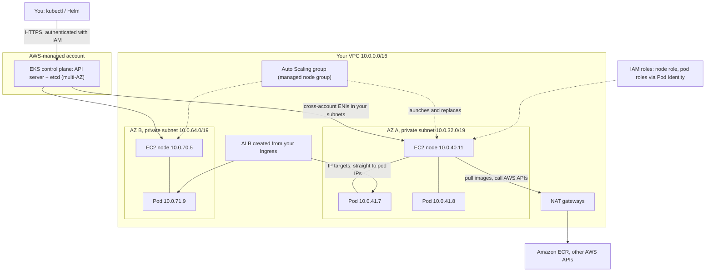

# From kubectl to AWS: using your EKS experience

> [Home](../README.md) · [Beginner track](README.md) · Next: [Services A–Z](services/README.md)

You already know more AWS than you think. Every time you ran `kubectl apply` against your EKS cluster, AWS was quietly creating EC2 instances, network interfaces, load balancers, disks and IAM credentials on your behalf. This page lifts the lid: what's underneath your cluster, how each Kubernetes (K8s) concept maps to AWS, **where the analogy breaks**, and why the exam usually prefers a different answer than "run it in Kubernetes".

Read [Networking basics](02-networking-basics.md) first if CIDR, subnets, NAT and security groups aren't yet comfortable; this page leans on them.

---

## 1. What's really underneath your EKS cluster

**Amazon EKS (Elastic Kubernetes Service)** is managed Kubernetes. "Managed" means AWS runs the parts you never `kubectl exec` into, and you run (or choose how to run) the rest.

| Part | Who runs it | What it actually is |
|---|---|---|
| **Control plane** (API server, etcd, scheduler, controller manager) | **AWS** | Runs in an AWS-owned account, spread across multiple Availability Zones (AZs), patched and scaled by AWS. You see only its API endpoint. You pay a per-cluster hourly fee. |
| **Worker nodes** | You choose | **EC2 instances** (virtual machines). With **managed node groups** they sit in an **EC2 Auto Scaling group (ASG)** that EKS creates and updates for you. Alternatives: self-managed nodes, **Karpenter**, **EKS Auto Mode**, or **AWS Fargate** (no nodes at all). |
| **Pod networking** | The **Amazon VPC CNI** plugin (an EKS add-on) | Gives every pod a **real IP address from your VPC subnet**, taken from the node's network interfaces (ENIs). No overlay network. |
| **The network itself** | You (or whoever built the cluster) | A **VPC** with subnets in two or three AZs, route tables, NAT gateways, security groups. |
| **Load balancers** | The **AWS Load Balancer Controller** (or EKS Auto Mode) | Watches your `Ingress` and `Service` objects and creates ALBs and NLBs. |
| **Disks** | The **EBS CSI** / **EFS CSI** drivers | Turn PersistentVolumeClaims into EBS volumes or EFS file system access points. |
| **Credentials for pods** | **EKS Pod Identity** or **IRSA** | Give a ServiceAccount an IAM role, so pods call AWS APIs without stored keys. |



Key facts that surprise kubectl users:

- **Pods are first-class VPC citizens.** `kubectl get pods -o wide` shows IPs from your subnet ranges. That's why EKS subnets need to be large (often /19 or /20) and why IP exhaustion is a real EKS problem. Each EC2 instance type supports only a limited number of ENIs and IPs, which caps pods per node (prefix delegation raises the cap).
- **Nodes are ordinary EC2 instances.** You can find them in the EC2 console, with tags naming the cluster and node group. They have an **IAM role** (the node role) and **security groups**.
- **The control plane talks to your nodes** through network interfaces EKS places in your subnets. The API endpoint can be public, private, or both.
- **Fargate on EKS** runs each pod in its own isolated, right-sized compute environment. A **Fargate profile** selects which pods (by namespace and labels) go there. No nodes to patch, but no DaemonSets either.
- **Karpenter** is an open-source node provisioner: it watches for unschedulable pods and launches right-sized EC2 instances (often Spot) directly, then consolidates nodes to save money.
- **EKS Auto Mode** (launched Dec 2024) goes further: AWS provisions, patches and replaces the nodes (it's built on Karpenter) and runs core components such as the VPC CNI, load balancing, EBS storage and Pod Identity for you. It's the closest EKS gets to "serverless Kubernetes" while keeping EC2 choice.

---

## 2. The big mapping table

How to read it: column 2 is what your K8s object becomes **inside EKS**. Column 3 is what the **exam usually asks about**: the native AWS way to get the same outcome without Kubernetes. Column 4 links to the beginner service page.

| Kubernetes concept | Inside EKS it becomes… | Outside K8s, the AWS equivalent is… (exam focus) | Read |
|---|---|---|---|
| **Cluster** | An EKS cluster: AWS-run control plane + your data plane in your VPC | An **ECS cluster** (a logical grouping, no control plane to run), or no cluster at all with Lambda | [EKS](services/containers.md#amazon-eks) · [ECS](services/containers.md#amazon-ecs) |
| **Node** | An **EC2 instance** (managed node group, Karpenter, Auto Mode) or a Fargate micro-environment | **EC2** instances; or **Fargate** where you don't see servers | [EC2](services/compute.md#amazon-ec2) · [Fargate](services/containers.md#aws-fargate) |
| **Pod** | A pod with its own VPC IP (VPC CNI) | An **ECS task** (one or more containers, own ENI in `awsvpc` mode); loosely, a Lambda invocation | [ECS](services/containers.md#amazon-ecs) |
| **Deployment / ReplicaSet** | Same objects; the K8s controllers keep N pods running | An **ECS service** (keeps a desired count of tasks, registers them with a load balancer); for VMs, an **Auto Scaling group's desired capacity** | [ECS](services/containers.md#amazon-ecs) · [EC2 Auto Scaling](services/compute.md#amazon-ec2-auto-scaling) |
| **HPA** (Horizontal Pod Autoscaler) | Same, fed by metrics-server or custom metrics | **ECS service auto scaling** (target tracking on CPU, memory, request count); **EC2 Auto Scaling** target tracking policies; Lambda scales by itself | [EC2 Auto Scaling](services/compute.md#amazon-ec2-auto-scaling) |
| **Cluster Autoscaler / Karpenter** | Cluster Autoscaler resizes the node group's ASG; Karpenter launches EC2 instances directly; Auto Mode does it for you | **EC2 Auto Scaling**; with **Fargate** there's no capacity to manage | [EC2 Auto Scaling](services/compute.md#amazon-ec2-auto-scaling) · [Fargate](services/containers.md#aws-fargate) |
| **Service (ClusterIP)** | A virtual IP handled by kube-proxy on each node, plus a CoreDNS name | An **internal ALB/NLB**, or ECS Service Connect / AWS Cloud Map for service discovery | [ELB](services/networking.md#elastic-load-balancing-elb) |
| **Service type LoadBalancer** | An **NLB** created by the **AWS Load Balancer Controller** (or Auto Mode). Without the controller, the legacy built-in integration creates a Classic Load Balancer | **Network Load Balancer** (L4, TCP/UDP, static IPs) | [ELB](services/networking.md#elastic-load-balancing-elb) |
| **Ingress** | An **ALB** created by the AWS Load Balancer Controller; host/path rules become listener rules | **Application Load Balancer** (L7); for APIs, also Amazon API Gateway | [ELB](services/networking.md#elastic-load-balancing-elb) |
| **NetworkPolicy** | Enforced by the VPC CNI's network policy feature (or Calico/Cilium). **Security groups for pods** can attach VPC security groups to individual pods | **Security groups** (stateful, per ENI) and **network ACLs** (stateless, per subnet) | [VPC](services/networking.md#amazon-vpc) |
| **PersistentVolume / StorageClass** | **EBS volume** via the EBS CSI driver (ReadWriteOnce, one AZ); **EFS** via the EFS CSI driver (ReadWriteMany, multi-AZ) | **Amazon EBS** (block disk for one instance) and **Amazon EFS** (shared NFS file system); S3 for objects | [EBS](services/storage.md#amazon-ebs) · [EFS](services/storage.md#amazon-efs) |
| **ConfigMap** | Still a ConfigMap; can be sourced from AWS via the Secrets Store CSI driver | **SSM Parameter Store** (part of AWS Systems Manager), **AWS AppConfig** for feature flags and validated config rollout | [Systems Manager](services/management-monitoring.md#aws-systems-manager) |
| **Secret** | A K8s Secret in etcd (encrypted at rest by EKS; optionally with your own KMS key); or synced from AWS via **External Secrets Operator** or the **Secrets Store CSI driver** with the AWS provider | **AWS Secrets Manager** (automatic rotation, e.g., RDS passwords); Parameter Store SecureString for simpler cases | [Secrets Manager](services/security.md#aws-secrets-manager) |
| **ServiceAccount + RBAC** | Two separate things: (1) **pod → AWS**: a ServiceAccount gets an IAM role via **EKS Pod Identity** (newer, simpler) or **IRSA** (IAM Roles for Service Accounts, OIDC-based). (2) **human → cluster**: IAM principals mapped to K8s permissions via **access entries**, replacing the deprecated `aws-auth` ConfigMap | **IAM roles** attached to compute: EC2 instance profiles, ECS task roles, Lambda execution roles | [IAM](services/identity-governance.md#aws-iam) |
| **Namespace** | Same; access entries can be scoped to namespaces | No 1:1 equivalent. Hard isolation = separate **AWS accounts** under AWS Organizations; soft grouping = **tags** | [Organizations](services/identity-governance.md#aws-organizations) |
| **Job / CronJob** | Same objects | **EventBridge Scheduler** triggering a Lambda function or an ECS task; **AWS Batch** for large or long batch jobs | [EventBridge](services/integration.md#amazon-eventbridge) · [Lambda](services/compute.md#aws-lambda) · [Batch](services/compute.md#aws-batch) |
| **Image registry** | Images pulled from **Amazon ECR** (via the node role) | **Amazon ECR** (private registry, image scanning, replication) | [ECR](services/containers.md#amazon-ecr) |
| **Helm charts / YAML manifests** | Still Helm/manifests, often applied by Argo CD or Flux | **Infrastructure as code**: AWS CloudFormation, AWS CDK (generates CloudFormation), Terraform | [CloudFormation](services/management-monitoring.md#aws-cloudformation) |
| **CoreDNS / kube-dns** | CoreDNS add-on answers `*.cluster.local`, forwards everything else to the VPC's Route 53 Resolver | **Route 53** private hosted zones and Route 53 Resolver; AWS Cloud Map for service discovery | [Route 53](services/networking.md#amazon-route-53) |
| **metrics-server / Prometheus / Grafana** | CloudWatch Container Insights via the CloudWatch Observability add-on; or Prometheus scraped into a managed workspace | **Amazon CloudWatch** (metrics, alarms, dashboards), **Amazon Managed Service for Prometheus**, **Amazon Managed Grafana** | [CloudWatch](services/management-monitoring.md#amazon-cloudwatch) · [AMP](services/management-monitoring.md#amazon-managed-service-for-prometheus) · [AMG](services/management-monitoring.md#amazon-managed-grafana) |
| **`kubectl logs`** | Container logs shipped by **Fluent Bit** to CloudWatch Logs; control-plane logs can also go to CloudWatch Logs | **CloudWatch Logs** (ECS's `awslogs` driver, Lambda logs automatically) | [CloudWatch](services/management-monitoring.md#amazon-cloudwatch) |
| **Liveness / readiness probes** | Kubelet still runs them; ALB target groups also health-check pod IPs | **ELB health checks** (stop routing to bad targets) and **ASG health checks** (replace bad instances) | [ELB](services/networking.md#elastic-load-balancing-elb) · [EC2 Auto Scaling](services/compute.md#amazon-ec2-auto-scaling) |
| **Rolling update** | Deployment `RollingUpdate` strategy | **ECS rolling updates or blue/green deployments** (built into ECS, or via AWS CodeDeploy); ASG instance refresh for VMs | [ECS](services/containers.md#amazon-ecs) |
| **Sidecars / service mesh** | Istio, Linkerd, or your own sidecars | **ECS Service Connect** or Amazon VPC Lattice. AWS App Mesh was discontinued on Sept 30, 2026, so ignore it if older material mentions it | [ECS](services/containers.md#amazon-ecs) |
| **In-cluster brokers** (RabbitMQ, Kafka StatefulSets) | You run and upgrade them yourself | **Amazon MQ** (managed RabbitMQ/ActiveMQ: lift-and-shift with existing protocols), **Amazon SQS** (cloud-native queue), **Amazon MSK** (managed Kafka) | [MQ](services/integration.md#amazon-mq) · [SQS](services/integration.md#amazon-sqs) · [MSK](services/analytics.md#amazon-msk) |
| **Database StatefulSet** (Postgres/MySQL on PVs) | Pods on EBS volumes; you handle backups, failover, upgrades | **Amazon RDS / Aurora** (managed relational, Multi-AZ, automated backups); **Amazon DynamoDB** (serverless key-value) | [RDS](services/databases.md#amazon-rds) · [DynamoDB](services/databases.md#amazon-dynamodb) |

> **Pattern to notice:** in almost every row, the exam's preferred answer is the column-3 **managed service**, not "run it in your cluster". SAA-C03 rewards **least operational overhead**.

---

## 3. Where the analogy breaks

Analogies are scaffolding. These four places are where kubectl intuition will mislead you on the exam.

### 3.1 IAM isn't RBAC

| | Kubernetes RBAC | AWS IAM |
|---|---|---|
| Scope | One cluster's API | **Every AWS API** in an account (and across accounts) |
| Who | Users/groups (from your authenticator) and ServiceAccounts | **Principals**: IAM users, **roles**, AWS services, federated identities |
| Rules | Verbs on resources (`get pods` in namespace `shop`) | **JSON policies**: `Effect`, `Action` (`s3:GetObject`), `Resource` (an ARN), optional `Condition` |
| Deny | No explicit deny; permissions only add up | **Explicit deny always wins**; default is implicit deny |
| Layers | Role/ClusterRole bindings | Identity policies, **resource-based policies** (e.g., S3 bucket policy), permission boundaries, **SCPs** at the organisation level, session policies |
| Credentials | Tokens, certificates | Mostly **temporary credentials from assuming a role** (STS) |

Two different gates protect your EKS work: **IAM** decides whether you may call the EKS API at all and which K8s identity you become (via access entries); **RBAC** then decides what that identity can do inside the cluster. Pods hitting S3 skip RBAC entirely: only the pod's IAM role matters. Study IAM as its own subject, starting at [AWS IAM](services/identity-governance.md#aws-iam) and [Notes 01](../notes/01-iam-multi-account.md).

### 3.2 A security group isn't a NetworkPolicy

- A **NetworkPolicy** selects pods **by label** and follows them wherever they're scheduled.
- A **security group** attaches to a **network interface (ENI)**. By default, all pods on a node share the **node's** security groups, so a security group can't tell your `api` pod from your `batch` pod on the same node, unless you enable **security groups for pods**, which gives selected pods their own ENI.
- Security groups are **stateful and allow-only**, like a NetworkPolicy. **NACLs** are stateless and subnet-wide, with no Kubernetes equivalent.
- Security groups protect **everything** in the VPC: RDS, ElastiCache, Lambda, load balancers. Most exam questions are about security groups between tiers, not about pods.

### 3.3 Managed services remove the "run it yourself" burden

In Kubernetes, the natural answer to "we need a queue / a database / a cache / a cron job" is "deploy it in the cluster". You then own its upgrades, backups, failover, scaling and patching.

AWS sells the opposite: **let AWS operate it**. When an exam question says "**least operational overhead**", "**fully managed**", or "**minimize administration**", the right answer is almost never "run X on EKS/EC2". It's RDS or Aurora instead of a Postgres StatefulSet, SQS or Amazon MQ instead of RabbitMQ pods, ElastiCache instead of a Redis Deployment, EventBridge Scheduler + Lambda instead of a CronJob.

### 3.4 Accounts are hard walls; namespaces are curtains

A **namespace** is a soft boundary inside one cluster: same control plane, same nodes, same blast radius. An **AWS account** is a hard boundary: separate IAM, separate billing, separate quotas, and nothing crosses unless you explicitly allow it. AWS best practice is **many accounts** (prod, dev, security, logging…) managed with **AWS Organizations** and **AWS Control Tower**. "Isolate teams/environments with strong boundaries" → separate accounts, not namespaces or tags.

---

## 4. ECS vs EKS vs Fargate vs Lambda: when the exam picks which

First, untangle the names:

- **Amazon ECS (Elastic Container Service)**: AWS's own container orchestrator. Simpler than Kubernetes: you write **task definitions** (≈ a pod spec) and **services** (≈ a Deployment + Service). No control plane to upgrade, no per-cluster fee.
- **Amazon EKS**: managed Kubernetes.
- **AWS Fargate**: **not an orchestrator**. It's serverless *compute* that runs containers for **either ECS or EKS** without you managing EC2 instances.
- **AWS Lambda**: runs functions (or container images) in response to events, for up to 15 minutes per invocation, scaling to zero.

**The exam rule:** for "run containers with the **least operational overhead**", pick **ECS on Fargate**. Pick **EKS only when** the question mentions **Kubernetes**, existing **K8s manifests/Helm charts/tooling**, or **portability** across clouds or on-premises.

| Scenario keywords | Best answer | Why |
|---|---|---|
| "Containerize the app, least operational overhead" | **ECS on Fargate** | No servers, no control plane, no K8s upgrades |
| "Already use Kubernetes", "Helm charts", "avoid vendor lock-in / portable" | **EKS** (with managed node groups, Fargate, Karpenter or Auto Mode) | Keeps the K8s API and tooling |
| Kubernetes, and also "no node management" | **EKS on Fargate** or **EKS Auto Mode** | K8s API without managing nodes |
| Containers needing GPUs, special instance types, or the cheapest steady compute (Reserved/Spot) | **ECS or EKS on EC2** | Fargate restricts instance choice; EC2 capacity can be cheaper at steady scale |
| Event-driven, short tasks (< 15 min), spiky or idle traffic | **Lambda** | Pay per request, scales to zero |
| Long-running or heavy batch jobs | **AWS Batch** (on EC2/Spot or Fargate) | Job queues and scheduling built in |
| Containers on your own on-prem servers, managed from AWS | **ECS Anywhere** / **EKS Anywhere** | Same tooling on-prem |
| Simple web app or API from a container image, no infra decisions | AWS App Runner (rarely the exam answer) | Fully abstracted |

⚠️ Trap: "EKS" is not the answer just because the word "containers" appears. And "Fargate" alone doesn't answer "which orchestrator"; it's ECS-on-Fargate or EKS-on-Fargate.

Deep dive: [Amazon ECS](services/containers.md#amazon-ecs) · [Amazon EKS](services/containers.md#amazon-eks) · [AWS Fargate](services/containers.md#aws-fargate) · [AWS Lambda](services/compute.md#aws-lambda) · [Notes 03: containers](../notes/03-compute-containers.md)

---

## 5. Your advantage and your blind spots

**What you already have (use it):**
- **Containers and images**: you know what an image, registry and tag are. ECR, ECS task definitions and Lambda container images will feel familiar.
- **Horizontal scaling**: replicas, HPA and node autoscaling map directly onto Auto Scaling groups and target tracking.
- **Declarative configuration**: if you think in YAML desired state, CloudFormation and CDK are the same idea for AWS resources.
- **Service discovery and load balancing**: Services, DNS names and Ingress rules map onto Route 53, ALB and NLB.
- **Health checks and rolling updates**: probes and Deployments map onto ELB/ASG health checks and ECS deployments.
- **Stateless design**: twelve-factor habits are exactly what "design resilient architectures" rewards.

**Where you're likely weakest (plan extra time):**

| Blind spot | Why it bites | Beginner page | Deep dive |
|---|---|---|---|
| **VPC networking** (CIDR, routing, NAT, endpoints, hybrid) | Kubernetes and your platform team hid it | [Networking basics](02-networking-basics.md) · [VPC](services/networking.md#amazon-vpc) | [Notes 02](../notes/02-networking-vpc.md) |
| **IAM policies** (evaluation logic, roles, cross-account, SCPs) | RBAC intuition misleads; D1 is 30% of the exam | [IAM](services/identity-governance.md#aws-iam) | [Notes 01](../notes/01-iam-multi-account.md) |
| **Databases** (RDS vs Aurora vs DynamoDB, Multi-AZ vs read replicas, caching) | You consumed a connection string; the exam wants you to pick and size the engine | [Databases](services/databases.md) | [Notes 05](../notes/05-databases.md) |
| **Storage classes** (S3 tiers and lifecycle, EBS volume types, EFS vs FSx) | A StorageClass YAML hid the trade-offs | [Storage](services/storage.md) | [Notes 04](../notes/04-storage.md) |
| **Cost** (purchase options, Savings Plans, data transfer, NAT charges) | Someone else paid the bill | [Cost management](services/cost-management.md) | [Notes 10](../notes/10-cost-optimization.md) |
| **Disaster recovery** (RPO/RTO, backup & restore → multi-site, multi-Region) | A cluster is usually one Region; DR is an architecture choice | [Management & monitoring](services/management-monitoring.md) · [Storage: AWS Backup](services/storage.md#aws-backup) | [Notes 08](../notes/08-ha-dr-edge-ops.md) |

---

## 6. Connect the dots in your own cluster's account (read-only)

The fastest way to make this page stick is to look at the AWS resources your cluster already created.

> ⚠️ **Read-only, and ask first.** Your work account is not a lab. **Don't create, change or delete anything**, even something that looks unused: a "stray" load balancer may be serving production. Ask your platform or cloud team before you look, and use a read-only role if one exists (many organisations have one, e.g., with the AWS managed `ReadOnlyAccess` policy). Do your hands-on building in your own personal account with a budget alert ([Cloud and AWS basics](01-cloud-and-aws-basics.md)).

Make sure the console is set to the cluster's **Region** (top right).

**1. Find your nodes in the EC2 console.**
- EKS console → your cluster → **Compute** tab: note the node groups (or Fargate profiles, or Auto Mode).
- EC2 console → **Instances**: filter by the tag `eks:cluster-name` (managed node groups add it). These are your nodes. Compare their private IPs with `kubectl get nodes -o wide`.
- EC2 console → **Auto Scaling groups**: find the group behind each managed node group and look at its min/desired/max and AZs. (With Karpenter or Auto Mode you may find no ASG; that's expected.)

**2. Find the network in the VPC console.**
- On an instance, note its **VPC** and **subnet**. In the VPC console, look at those subnets' CIDRs and **available IP counts**: this is where pod IPs come from.
- Run `kubectl get pods -A -o wide` and check that pod IPs fall inside the same subnet ranges.
- Open each subnet's **route table**: do node subnets send `0.0.0.0/0` to a NAT gateway? Where are the NAT gateways and internet gateway?
- EC2 console → **Network interfaces**: filter by the node's instance ID and count the ENIs and secondary IPs the VPC CNI attached.

**3. Find the load balancers your Services and Ingresses created.**
- `kubectl get ingress -A` and `kubectl get svc -A | grep LoadBalancer` show DNS names ending in `elb.amazonaws.com`.
- EC2 console → **Load Balancers**: match them. Check the **type** (application or network), the **listeners** and rules (your Ingress paths), and the **target groups** (are targets pod IPs or node instances? healthy?).
- Look at their **security groups** and which subnets they sit in (public for internet-facing).

**4. Find the IAM roles.**
- EKS console → cluster → **Access** tab: the **authentication mode** and **access entries** (which IAM roles map to which K8s permissions). If the cluster still uses the `aws-auth` ConfigMap, `kubectl -n kube-system get configmap aws-auth -o yaml` shows the mapping.
- Your node group's **node IAM role** (Compute tab → node group): open it in the IAM console and read the attached policies (ECR pull, CNI, and others).
- Pod roles: EKS console → **Access** tab → **Pod Identity associations**, or for IRSA, `kubectl get sa -A -o yaml | grep role-arn`. Open one role in IAM and read its **trust policy** (who can assume it) and **permissions policy** (what it can do).

**5. Find the logs in CloudWatch.**
- CloudWatch console → **Log groups**: look for `/aws/eks/<cluster>/cluster` (control-plane logs, if enabled) and `/aws/containerinsights/<cluster>/...` (container logs and performance data, if the CloudWatch Observability add-on or Fluent Bit is installed).
- Open a log stream for one of your services and compare it with `kubectl logs`.

Useful read-only CLI commands (they only *describe* things):

```bash
aws eks describe-cluster --name <cluster> --query "cluster.{version:version,vpc:resourcesVpcConfig,auth:accessConfig}"
aws eks list-nodegroups --cluster-name <cluster>
aws eks list-access-entries --cluster-name <cluster>
aws eks list-pod-identity-associations --cluster-name <cluster>
aws ec2 describe-subnets --filters Name=vpc-id,Values=<vpc-id> --query "Subnets[].{id:SubnetId,az:AvailabilityZone,cidr:CidrBlock,free:AvailableIpAddressCount}"
```

Write down what you find as a diagram in the style of [Networking basics, section 14](02-networking-basics.md#14-putting-it-together-in-aws). If you can draw your own cluster's VPC, subnets, NAT gateways, load balancers and IAM roles from memory, you've covered a surprising amount of the exam.

---

## 7. Self-check

**1.** In EKS, what AWS resource is a node in a managed node group, and what keeps the number of nodes in range?

<details><summary>Answer</summary>

An **EC2 instance**, launched by an **EC2 Auto Scaling group** that EKS creates and manages for the node group. Cluster Autoscaler adjusts that ASG's desired capacity; Karpenter and EKS Auto Mode launch instances directly instead.
</details>

**2.** Where does a pod's IP address come from in EKS by default, and why does that affect subnet sizing?

<details><summary>Answer</summary>

The **Amazon VPC CNI** assigns each pod a **real IP from the VPC subnet** (secondary IPs on the node's ENIs). Every pod consumes a subnet IP, so small subnets (e.g., /24 with 251 usable) can run out; EKS subnets are usually /19–/20 or use prefix delegation or extra CIDR ranges.
</details>

**3.** You create an `Ingress` and a `Service` of type `LoadBalancer` on an EKS cluster with the AWS Load Balancer Controller. What does AWS create for each?

<details><summary>Answer</summary>

Ingress → an **Application Load Balancer** (L7, path/host rules). Service type LoadBalancer → a **Network Load Balancer** (L4).
</details>

**4.** A pod must read from an S3 bucket. What's the current recommended way to give it permissions, and what should you avoid?

<details><summary>Answer</summary>

Associate an IAM role with the pod's **ServiceAccount** using **EKS Pod Identity** (or IRSA, e.g., for Fargate pods, which Pod Identity doesn't support). Avoid long-lived access keys in Secrets and avoid granting S3 access to the **node role**, which every pod on the node could use.
</details>

**5.** How do IAM users and roles get Kubernetes permissions in a current EKS cluster?

<details><summary>Answer</summary>

Through **access entries** managed with the EKS API (console, CLI, CloudFormation), with either AWS-provided access policies or mapping to K8s RBAC groups. The older **`aws-auth` ConfigMap** is deprecated; EKS Auto Mode requires access entries.
</details>

**6.** A question asks you to containerise an application "with the least operational overhead". The team has no Kubernetes experience. ECS on Fargate or EKS?

<details><summary>Answer</summary>

**ECS on Fargate**: no servers and no Kubernetes control plane or upgrades to manage. EKS only wins when Kubernetes is required or already in use.
</details>

**7.** Your team runs PostgreSQL as a StatefulSet with EBS volumes. The exam asks for higher availability and less admin work. What's the answer?

<details><summary>Answer</summary>

Move to **Amazon RDS for PostgreSQL Multi-AZ** or **Aurora PostgreSQL**: managed backups, patching and automatic failover to another AZ. (An EBS volume lives in one AZ, so a StatefulSet pod can't simply move to another AZ with its disk.)
</details>

**8.** Your teams share one cluster, separated by namespaces. The security team wants a strong isolation boundary between prod and dev, including billing. What's the AWS-native answer?

<details><summary>Answer</summary>

**Separate AWS accounts** for prod and dev, managed with **AWS Organizations** (and SCPs, perhaps Control Tower). Accounts are hard boundaries for IAM, networking, quotas and billing; namespaces are soft boundaries inside one control plane.
</details>

---

**Next:** [All AWS services A–Z](services/README.md)
