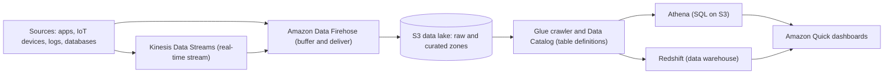

# Analytics & data: AWS services explained for beginners
> [Home](../../README.md) · [Beginner track](../README.md) · [All services A–Z](README.md) · Deep dive: [Notes 09](../../notes/09-data-analytics-migration.md)

These services collect data, store it cheaply, transform it, and let people query it and build dashboards. Almost every analytics design on the exam is the same pipeline: **ingest** (Kinesis, Firehose, MSK) → **store** in an S3 data lake → **catalog and transform** (Glue, Lake Formation) → **query** (Athena, Redshift, EMR) → **visualize** (Amazon Quick). The exam (task 3.5, "high-performing data ingestion and transformation") asks architect questions: *which* ingestion service, *which* query engine, *which* file format, and how to make it cheaper. You don't need to know Spark or Kafka in depth. Two terms you'll meet constantly: **ETL** (extract, transform, load: pull data out, reshape it, write it somewhere else) and **IoT** (Internet of Things: sensors and connected devices).

| Service | One-liner | Exam importance |
|---|---|---|
| [Amazon Kinesis Data Streams](#amazon-kinesis-data-streams) | A real-time, replayable stream of records that many consumers can read | ★★★ |
| [Amazon Data Firehose](#amazon-data-firehose) | Zero-admin delivery of streaming data into S3, Redshift, OpenSearch and others | ★★★ |
| [Amazon Managed Service for Apache Flink](#amazon-managed-service-for-apache-flink) | Managed Apache Flink for real-time calculations on streams | ★★ |
| [Amazon Kinesis Video Streams](#amazon-kinesis-video-streams) | Ingest and store video from cameras and devices | ★ |
| [Amazon MSK](#amazon-msk) | Managed Apache Kafka | ★★ |
| [AWS Glue](#aws-glue) | Serverless data catalog, schema discovery and ETL (Spark) jobs | ★★★ |
| [Amazon Athena](#amazon-athena) | Serverless SQL queries straight on files in S3, pay per data scanned | ★★★ |
| [AWS Lake Formation](#aws-lake-formation) | Fine-grained permissions (table, column, row) for a data lake | ★★ |
| [Amazon EMR](#amazon-emr) | Managed big-data clusters (Spark, Hive, Presto and more) | ★★ |
| [Amazon Quick](#amazon-quick) | Business intelligence dashboards (formerly QuickSight) | ★★ |
| [AWS Data Exchange](#aws-data-exchange) | A marketplace to subscribe to third-party datasets | ★ |
| [AWS Data Pipeline](#aws-data-pipeline) | Legacy scheduled data-movement service, closed to new customers | ★ |

---

### Beginner concepts first

#### Batch vs streaming

Think about how your bank tells you about card payments.

- **Batch** = the **monthly statement**. Data piles up, then a job processes all of it at once on a schedule (hourly, nightly). It's simple and cheap, but the answer is hours old. Example: a nightly job that loads yesterday's orders into a warehouse.
- **Streaming** = the **push notification on every purchase**. Each record is processed seconds or milliseconds after it happens. It's needed for fraud detection, live dashboards and alerts, but it's more complex. Example: clickstream events flowing into a real-time "users online now" counter.
- **Near real-time** sits in between: records are **buffered for a short time** (seconds to minutes) and delivered in small batches. Amazon Data Firehose works this way.

| | Batch | Near real-time | Real-time streaming |
|---|---|---|---|
| Freshness | Hours to a day | Seconds to minutes | Milliseconds to seconds |
| Typical AWS tools | Glue jobs, EMR, DataSync, DMS full load | **Amazon Data Firehose** | **Kinesis Data Streams**, **MSK**, Managed Service for Apache Flink |
| Kubernetes analogy | A `CronJob` that crunches a day's files | Fluent Bit buffering logs and flushing them to storage every minute | A Kafka cluster in the cluster with consumer Deployments |

#### What is a data lake?

A **data lake** is one big, cheap storage area where you keep **all** your data (logs, CSV exports, JSON events, images) **in its original form**, and decide how to read it later. On AWS the lake is almost always **Amazon S3** (Simple Storage Service).

- **Everyday analogy:** a large storage unit where you throw in every box as it arrives, plus a **card catalog** at the door that says what's in each box and where. The catalog is the **AWS Glue Data Catalog**. Without it, nobody can find anything (that's called a "data swamp").
- **Schema-on-read.** The lake doesn't force a structure when data is written. A query engine like Athena applies the table definition when it reads the files.
- **Zones.** Teams usually keep a *raw* zone (exactly as received), a *curated* zone (cleaned, converted to efficient formats) and an *analytics* zone (aggregated), as separate S3 prefixes or buckets.
- **Columnar formats.** Converting CSV/JSON into **Parquet** or **ORC** (column-oriented file formats) and **partitioning** by date makes queries faster and much cheaper, because engines read only the columns and folders they need.
- **Data lake vs data warehouse.** A **data warehouse** (Amazon Redshift) is the tidy, structured version: data is cleaned and loaded into tables first (schema-on-write) for fast, frequent business reporting. Many designs use both.

#### The typical AWS analytics pipeline

Read it left to right: data arrives, gets delivered into S3, Glue describes it as tables, query engines read those tables, and Amazon Quick draws charts for business users. [AWS Lake Formation](#aws-lake-formation) sits over the catalog and controls who may see which tables, columns and rows.

---

## Amazon Kinesis Data Streams

> **In one line:** a managed, real-time data stream that stores ordered records for 24 hours to 365 days so several applications can each read and replay them.

| Exam importance | Kubernetes / everyday analogy | Pricing model (rough) |
|---|---|---|
| ★★★ High | Like running Kafka (e.g., with the Strimzi operator) in your cluster, but AWS-native and with no brokers to manage. Everyday: a CCTV recording that several people can watch independently, each rewinding to wherever they like | Provisioned: per shard-hour plus PUT units. On-demand: per stream-hour plus per GB in and out |

**What it is.** Producers (apps, IoT devices, log agents) write small **records** into a **stream**. Unlike a queue, reading a record doesn't delete it: the stream keeps it for its retention period, and **many independent consumers** (Lambda functions, apps on EC2 or containers, Firehose, Flink) read the same data, each tracking its own position. That makes it the right tool for real-time analytics, clickstreams, telemetry and anything that needs **replay**. Without it, you'd run and scale a Kafka cluster yourself.

**Key ideas to know**
- **Shard.** The unit of capacity. Each shard accepts about **1 MB/s or 1,000 records/s** of writes and serves **2 MB/s** of reads.
- **Capacity modes.** *Provisioned* (you choose the number of shards) or *on-demand* (AWS scales shards automatically; best for unpredictable traffic).
- **Partition key.** Chosen by the producer; records with the same key go to the same shard, **in order**. A key with few distinct values creates a "hot shard" that throttles (`ProvisionedThroughputExceededException`).
- **Retention.** **24 hours by default, up to 365 days.** Consumers can re-read anything inside that window.
- **Enhanced fan-out.** Gives each registered consumer its **own** 2 MB/s per shard, instead of sharing, for low-latency multi-consumer setups.
- **Consumers.** Lambda (event source mapping), the Kinesis Client Library (KCL) on EC2/ECS/EKS, Firehose, Managed Service for Apache Flink.

**Use it when / don't use it when**
- ✅ Real-time processing (sub-second) with **several consumers** on the same data.
- ✅ You need **ordering per key** or the ability to **replay**.
- ❌ You only want to land streaming data in S3/Redshift/OpenSearch with no custom code → [Amazon Data Firehose](#amazon-data-firehose).
- ❌ You're decoupling a job queue where each message is processed once → [Amazon SQS](integration.md#amazon-sqs).
- ❌ Your apps already use Kafka APIs → [Amazon MSK](#amazon-msk).

**Exam hot spots**
- "Real-time", "multiple applications consume the same stream", "replay", "ordering" → **Kinesis Data Streams**.
- `ProvisionedThroughputExceededException` → better (high-cardinality) partition key, more shards or on-demand mode, retries with backoff.
- Several consumers slowing each other down → **enhanced fan-out**.
- ⚠️ Trap: Kinesis Data Streams can't write to S3 by itself. Add Firehose (or a consumer) to land data.

**Try it** (read-only, to avoid shard charges): open the Kinesis console → **Data streams** → **Create data stream** and read the capacity-mode options (provisioned vs on-demand), then cancel.

**Go deeper:** [Notes 09: Kinesis Data Streams](../../notes/09-data-analytics-migration.md) · related services: [Amazon Data Firehose](#amazon-data-firehose) · [Amazon MSK](#amazon-msk) · [AWS Lambda](compute.md#aws-lambda)

---

## Amazon Data Firehose

> **In one line:** a fully managed delivery service that buffers streaming data and loads it into S3, Redshift, OpenSearch, Splunk or HTTP endpoints, with no servers or shards to manage.

*Name change: this is the service formerly called **Amazon Kinesis Data Firehose**. Older practice questions use the old name.*

| Exam importance | Kubernetes / everyday analogy | Pricing model (rough) |
|---|---|---|
| ★★★ High | Like a Fluent Bit DaemonSet with an S3 output: it buffers records and flushes them to storage every so often. Everyday: a delivery van that waits until it's full (or the clock runs out) and then drops everything at the warehouse | Per GB ingested, plus extra for format conversion and some destinations |

**What it is.** You create a **Firehose stream**, point producers at it (or connect it to Kinesis Data Streams, MSK, CloudWatch Logs and others), and choose a **destination**. Firehose collects records, **buffers** them by size or time, optionally transforms them, and delivers them. There's no capacity to plan and nothing to operate. Without it, you'd write and run consumer code that batches records, retries failures and writes files to S3.

**Key ideas to know**
- **Buffering.** Delivery happens when the buffer reaches a size (MiB) **or** an interval (seconds up to a few minutes). That's why Firehose is **near real-time**, not real-time.
- **Destinations.** **S3**, **Redshift** (it stages in S3, then runs `COPY`), **OpenSearch Service**, **Splunk**, generic **HTTP endpoints** and partner tools, and Apache Iceberg tables.
- **Lambda transformation.** Run a function on each batch to clean, enrich or filter records.
- **Format conversion.** Convert JSON to **Parquet or ORC** on the way in, using a table schema from the Glue Data Catalog. This makes later Athena queries cheaper.
- **Dynamic partitioning.** Write to S3 folders based on values inside each record (e.g., `customer_id=42/date=2026-11-09/`).
- **No storage, no replay, no custom consumers.** Firehose delivers and forgets.

**Use it when / don't use it when**
- ✅ "Load streaming data (logs, clickstream, IoT) into S3/Redshift/OpenSearch with the **least operational overhead**".
- ✅ You want compression, Parquet conversion or partitioning without writing code.
- ❌ You need sub-second processing, several custom consumers or replay → [Kinesis Data Streams](#amazon-kinesis-data-streams) (optionally in front of Firehose).

**Exam hot spots**
- "Near real-time" + "deliver to S3/Redshift/OpenSearch/Splunk" + "minimal management" → **Firehose**.
- "Convert incoming JSON to Parquet before storing in S3" → Firehose **record format conversion**.
- ⚠️ Trap: Firehose isn't real-time (buffered) and can't replay data. If the question says "real-time" or "multiple consumers", think Kinesis Data Streams.

**Go deeper:** [Notes 09: Amazon Data Firehose, and KDS vs Firehose](../../notes/09-data-analytics-migration.md) · related services: [Amazon S3](storage.md#amazon-s3) · [Amazon Redshift](databases.md#amazon-redshift) · [Amazon OpenSearch Service](databases.md#amazon-opensearch-service)

---

## Amazon Managed Service for Apache Flink

> **In one line:** runs Apache Flink applications (Java, Python, Scala or SQL) for real-time, stateful processing of streaming data, without managing servers.

*Name change: this is the service formerly called **Amazon Kinesis Data Analytics**. The old SQL-only version is discontinued.*

| Exam importance | Kubernetes / everyday analogy | Pricing model (rough) |
|---|---|---|
| ★★ Medium | Like running Flink with the Flink Kubernetes Operator, minus the cluster. Everyday: a scoreboard operator who updates totals as each point is scored | Per KPU-hour (Kinesis Processing Unit, a bundle of vCPU and memory) |

**What it is.** Apache Flink is an open-source engine for computations over a never-ending stream: "count clicks per page per minute", "join orders with payments as they happen", "flag a sensor whose reading jumps". The service runs your Flink app, scales it, and saves its state (checkpoints) so it can recover from failures. It reads from Kinesis Data Streams or MSK and writes to destinations such as S3, Firehose, OpenSearch or another stream.

**Key ideas to know**
- **Stateful.** It remembers things between records (running totals, windows), unlike a simple per-record Lambda.
- **Windows.** Group records by time (e.g., tumbling 1-minute windows) to compute aggregates.
- **Studio notebooks.** Write Flink SQL interactively for exploration.

**Use it when / don't use it when**
- ✅ Real-time aggregations, anomaly detection or stream joins.
- ❌ Just landing data in S3 → [Amazon Data Firehose](#amazon-data-firehose). Batch ETL on files → [AWS Glue](#aws-glue).

**Exam hot spots**
- "Real-time analytics / aggregations / anomaly detection on a stream, using SQL or Flink, serverless" → **Managed Service for Apache Flink** (older questions: "Kinesis Data Analytics").

**Go deeper:** [Notes 09: Managed Service for Apache Flink](../../notes/09-data-analytics-migration.md) · related services: [Amazon Kinesis Data Streams](#amazon-kinesis-data-streams) · [Amazon MSK](#amazon-msk)

---

## Amazon Kinesis Video Streams

> **In one line:** securely ingests, stores and plays back video and other time-encoded media from cameras and devices.

| Exam importance | Kubernetes / everyday analogy | Pricing model (rough) |
|---|---|---|
| ★ Low | A managed video recorder in the cloud for thousands of cameras | Per GB ingested, stored and consumed |

**What it is.** Devices stream video into AWS, which stores and indexes it by time. Apps can play it back (with standard web video protocols such as HLS and DASH, or WebRTC for live two-way video) or feed it to machine learning such as Amazon Rekognition Video.

**Exam hot spots**
- "Stream video from cameras for live viewing or ML analysis" → **Kinesis Video Streams** (not Kinesis Data Streams).

**Go deeper:** [Notes 09: Kinesis Video Streams](../../notes/09-data-analytics-migration.md) · related services: [Amazon Rekognition](ai-ml.md#amazon-rekognition)

---

## Amazon MSK

> **In one line:** Amazon Managed Streaming for Apache Kafka: fully managed Kafka clusters (or serverless Kafka) for apps that use the Kafka APIs.

| Exam importance | Kubernetes / everyday analogy | Pricing model (rough) |
|---|---|---|
| ★★ Medium | Like the Kafka cluster you'd deploy with Strimzi, but AWS runs the brokers, ZooKeeper/KRaft, patching and storage | Provisioned: per broker-hour plus storage. Serverless: per cluster-hour, partition-hour and GB |

**What it is.** Apache Kafka is the most popular open-source event-streaming platform. Running it yourself means sizing brokers, replacing failed nodes and upgrading versions. MSK does that for you while keeping the standard **Kafka APIs**, so existing producers, consumers and tools (Kafka Connect, Kafka Streams) keep working.

**Key ideas to know**
- **MSK provisioned.** You pick broker size and count, spread across 2–3 Availability Zones (AZs).
- **MSK Serverless.** No broker sizing; pay for what you use.
- **MSK Connect.** Managed Kafka Connect connectors (e.g., Debezium for change data capture from databases, an S3 sink).
- **Topics and partitions.** Kafka's equivalent of Kinesis streams and shards.

**Use it when / don't use it when**
- ✅ "Existing Kafka applications", "migrate on-premises Kafka", or you need Kafka-specific features.
- ❌ A new AWS-native stream with the least operations → [Kinesis Data Streams](#amazon-kinesis-data-streams).

**Exam hot spots**
- Keyword **"Kafka"** in the scenario → **MSK**. No Kafka mentioned → usually Kinesis.

**Go deeper:** [Notes 09: Amazon MSK](../../notes/09-data-analytics-migration.md) · related services: [Amazon Kinesis Data Streams](#amazon-kinesis-data-streams) · [Amazon MQ](integration.md#amazon-mq)

---

## AWS Glue

> **In one line:** a serverless data integration service: a central data catalog, crawlers that discover schemas, and Spark-based ETL jobs.

| Exam importance | Kubernetes / everyday analogy | Pricing model (rough) |
|---|---|---|
| ★★★ High | The Data Catalog is the library's **card catalog**. ETL jobs are like a Spark job you'd submit with the Spark Operator, but with no cluster at all | Per DPU-hour (Data Processing Unit), billed per second, for jobs and crawlers; catalog storage and requests beyond a free amount |

**What it is.** As defined at the top of this page, ETL means pulling data out, reshaping it and writing it elsewhere. Glue provides the pieces for doing this on AWS without servers. Its **Data Catalog** is the shared list of "tables" (where the files are, which columns, which partitions) that Athena, Redshift Spectrum, EMR and Lake Formation all use. Without Glue you'd run your own Hive metastore and Spark cluster.

**Key ideas to know**
- **Data Catalog.** Databases and table definitions (schema, location, partitions) describing data in S3, databases and more. One catalog per account per Region.
- **Crawler.** Scans data (S3, JDBC databases, DynamoDB), **infers the schema** and creates or updates tables and partitions, on a schedule. ⚠️ It catalogs; it doesn't transform.
- **ETL job.** Serverless **Apache Spark** (PySpark or Scala) or lightweight Python jobs. Glue Studio offers a visual editor.
- **Job bookmarks.** Remember which data was already processed, so the next run only handles new files.
- **Glue DataBrew.** A visual, **no-code** data-preparation tool for analysts (clean, normalize, profile).
- **Triggers and workflows.** Chain crawlers and jobs on a schedule or on events.
- **Glue Data Quality.** Rules that check data (e.g., "no null customer IDs").

**Use it when / don't use it when**
- ✅ Serverless ETL into or within a data lake (e.g., "convert CSV in S3 to partitioned Parquet nightly").
- ✅ Automatically discover the schema of new data and keep partitions up to date.
- ❌ You need full control over a Spark/Hadoop cluster, specific versions or non-Spark frameworks → [Amazon EMR](#amazon-emr).
- ❌ You need real-time per-event processing → [Managed Service for Apache Flink](#amazon-managed-service-for-apache-flink) or Lambda on [Kinesis Data Streams](#amazon-kinesis-data-streams).

**Exam hot spots**
- "Central metadata repository / catalog for the data lake" → **Glue Data Catalog**.
- "Discover schema automatically / detect new partitions" → **Glue crawler**.
- "Serverless ETL with the least operational overhead" → **Glue job**. "Don't reprocess old data" → **job bookmarks**.
- "Business analysts must clean data without code" → **Glue DataBrew**.

**Try it** (read-only): open the Glue console → **Data Catalog → Databases** and **Crawlers**, and read the "Add crawler" wizard steps (data source, IAM role, target database, schedule) without running it.

**Go deeper:** [Notes 09: AWS Glue](../../notes/09-data-analytics-migration.md) · related services: [Amazon Athena](#amazon-athena) · [AWS Lake Formation](#aws-lake-formation) · [Amazon S3](storage.md#amazon-s3)

---

## Amazon Athena

> **In one line:** a serverless SQL query service that reads data directly from files in S3; there's nothing to load or run, and you pay per amount of data scanned.

| Exam importance | Kubernetes / everyday analogy | Pricing model (rough) |
|---|---|---|
| ★★★ High | Like running Trino/Presto in your cluster against S3, except there's no cluster at all: you just submit SQL. Everyday: searching a filing cabinet by asking a clerk, who charges by how many pages they had to read | Per TB scanned (approx. 5 USD/TB in many Regions), with a small minimum per query |

**What it is.** You point Athena at a table in the Glue Data Catalog (which says where the files live in S3 and what columns they have), write standard SQL, and get results in seconds. Athena spins up the compute behind the scenes. It's ideal for **ad-hoc** questions: "how many 500 errors did our load balancer log yesterday?". Without it, you'd load the data into a database or run your own query cluster.

**Key ideas to know**
- **Schema-on-read.** Tables are just descriptions laid over files; the files stay where they are.
- **Cost = data scanned.** So cost and speed improve dramatically if you **partition** data (e.g., by date), use **columnar formats** (Parquet/ORC), **compress** files, and select only needed columns.
- **CTAS** (`CREATE TABLE AS SELECT`). Convert raw CSV/JSON into partitioned Parquet with one query.
- **Workgroups.** Separate teams, track their costs and **set limits on data scanned** per query or per workgroup.
- **Federated query.** Query other sources (DynamoDB, RDS, on-premises databases) through connectors and join them with S3 data.
- **Classic targets.** Logs stored in S3: CloudTrail (API call history), ALB (Application Load Balancer) access logs, VPC Flow Logs (network traffic records for your Virtual Private Cloud), Cost and Usage Reports.

**Use it when / don't use it when**
- ✅ Occasional or ad-hoc SQL over data already in S3, with no infrastructure.
- ✅ Analyzing AWS logs stored in S3.
- ❌ Heavy, frequent dashboards for many concurrent users with complex joins → [Amazon Redshift](databases.md#amazon-redshift).
- ❌ Transactional app queries (single-row reads/writes) → [Amazon RDS](databases.md#amazon-rds) or [Amazon DynamoDB](databases.md#amazon-dynamodb).

**Exam hot spots**
- "Query data in S3 using SQL, serverless, least effort" → **Athena**.
- "Reduce Athena cost / speed up queries" → **Parquet or ORC + compression + partitioning**.
- "Analyze VPC Flow Logs / CloudTrail logs / ALB logs in S3" → **Athena**.
- "Stop runaway query costs per team" → **workgroups** with data-scanned limits.

**Try it** (≈10 min, pennies or less): Athena console → set a query result location in an S3 bucket you own → run the sample query on the provided sample data (if offered), or just open the **Query editor** and browse the `AwsDataCatalog`. Clean up the results bucket afterwards.

**Go deeper:** [Notes 09: Amazon Athena](../../notes/09-data-analytics-migration.md) · related services: [AWS Glue](#aws-glue) · [Amazon Redshift](databases.md#amazon-redshift) · [Amazon Quick](#amazon-quick)

---

## AWS Lake Formation

> **In one line:** builds and governs a data lake on S3, giving you database-style permissions (table, column, row, cell) on top of the Glue Data Catalog.

| Exam importance | Kubernetes / everyday analogy | Pricing model (rough) |
|---|---|---|
| ★★ Medium | Like Kubernetes RBAC (Roles and RoleBindings) but for data: grant a team `SELECT` on certain tables and columns instead of verbs on resources | No extra charge for permissions themselves; you pay for S3, Glue and the query engines (some advanced features are billed) |

**What it is.** Without Lake Formation, controlling who can read which data means juggling S3 bucket policies and IAM (Identity and Access Management) policies per team, which can only work at the level of files and folders. Lake Formation lets you **GRANT and REVOKE** on catalog databases, tables and **columns**, plus **row-level and cell-level** filters, and engines such as Athena, Redshift Spectrum, EMR, Glue and Amazon Quick enforce it.

**Key ideas to know**
- **Fine-grained access.** Column, row and cell security on the same table for different users.
- **LF-tags.** Tag tables/columns (e.g., `Confidentiality=High`) and grant by tag, which scales to many tables.
- **Cross-account sharing.** Share catalog tables with other accounts (data mesh) without copying data.

**Use it when / don't use it when**
- ✅ Different teams or accounts may see only certain columns or rows of the same data.
- ❌ You just need to stop public access to a bucket → S3 Block Public Access and bucket policies ([Amazon S3](storage.md#amazon-s3)).

**Exam hot spots**
- "Analysts may only see some **columns/rows**" or "centrally manage data lake permissions across accounts" → **Lake Formation**.

**Go deeper:** [Notes 09: AWS Lake Formation](../../notes/09-data-analytics-migration.md) · related services: [AWS Glue](#aws-glue) · [AWS IAM](identity-governance.md#aws-iam)

---

## Amazon EMR

> **In one line:** managed clusters for big-data frameworks such as Apache Spark, Hive, HBase, Presto/Trino and Flink.

| Exam importance | Kubernetes / everyday analogy | Pricing model (rough) |
|---|---|---|
| ★★ Medium | Like running Spark on a cluster you control. In fact **EMR on EKS** runs Spark jobs on your existing EKS cluster | Per-second EC2 price plus an EMR fee per instance; EMR Serverless per vCPU and GB-hour |

**What it is.** EMR (originally "Elastic MapReduce") creates clusters of EC2 (Elastic Compute Cloud) virtual servers with big-data software installed and tuned. You choose the frameworks, versions and configuration. Pick it over Glue when you need that control, special frameworks, or very large, long-running workloads. Data usually lives in S3, so clusters can be **transient**: start, run the job, terminate.

**Key ideas to know**
- **Node types.** *Primary* (coordinates), *core* (runs work **and stores HDFS data**, the Hadoop Distributed File System), *task* (compute only).
- **Spot Instances** (spare EC2 capacity at a big discount) on **task nodes** for cheap, interruption-tolerant capacity; keep primary and core nodes On-Demand.
- **Deployment options.** EMR on EC2, **EMR Serverless** (no cluster sizing) and **EMR on EKS**.

**Use it when / don't use it when**
- ✅ Custom Spark/Hadoop workloads, specific framework versions, migrating an on-premises Hadoop cluster.
- ❌ Simple serverless ETL with the least operations → [AWS Glue](#aws-glue). Ad-hoc SQL → [Amazon Athena](#amazon-athena).

**Exam hot spots**
- "Hadoop / Spark / Hive" + "control" or "migrate existing cluster" → **EMR**.
- "Cut EMR cost" → **Spot on task nodes**, transient clusters with data in S3.

**Go deeper:** [Notes 09: Amazon EMR](../../notes/09-data-analytics-migration.md) · related services: [Amazon EKS](containers.md#amazon-eks) · [Amazon EC2](compute.md#amazon-ec2)

---

## Amazon Quick

> **In one line:** AWS's serverless business intelligence (BI) service for interactive dashboards, reports and natural-language questions about your data.

*Name change: this is the service formerly called **Amazon QuickSight** (renamed through "Amazon Quick Suite" to **Amazon Quick**; the dashboarding part is called **Amazon Quick Sight**). Older practice questions say "QuickSight"; it's the same answer.*

| Exam importance | Kubernetes / everyday analogy | Pricing model (rough) |
|---|---|---|
| ★★ Medium | Like Grafana, but for business data and business users rather than metrics and engineers | Per user per month (tiers vary), plus in-memory (SPICE) capacity |

**What it is.** Analysts connect Amazon Quick to data sources (Athena, Redshift, RDS/Aurora, S3, OpenSearch, SaaS apps) and build dashboards that business users view in a browser or that are **embedded** in your own app. It's serverless and scales to many readers. Without it, you'd license and host a BI tool yourself.

**Key ideas to know**
- **SPICE.** An in-memory engine you import data into for fast dashboards (instead of querying the source every time).
- **Row-level security.** Each viewer sees only their rows (e.g., their region's sales).
- **Embedded analytics, ML insights and natural-language Q&A.**

**Use it when / don't use it when**
- ✅ "Dashboards / visualizations for business users", "embed dashboards in an app".
- ❌ Operational metrics and logs for engineers → [Amazon CloudWatch](management-monitoring.md#amazon-cloudwatch) dashboards or [Amazon Managed Grafana](management-monitoring.md#amazon-managed-grafana).

**Exam hot spots**
- "Visualize / build BI dashboards" on data from Athena or Redshift → **Amazon Quick** (or QuickSight in older questions).

**Go deeper:** [Notes 09: Visualization](../../notes/09-data-analytics-migration.md) · related services: [Amazon Athena](#amazon-athena) · [Amazon Redshift](databases.md#amazon-redshift)

---

## AWS Data Exchange

> **In one line:** a catalog where you find, subscribe to and receive third-party datasets (files, APIs, Redshift data shares) in AWS.

| Exam importance | Kubernetes / everyday analogy | Pricing model (rough) |
|---|---|---|
| ★ Low | Like Artifact Hub, but for datasets instead of Helm charts; a marketplace with subscriptions | Set by each data provider (many free datasets exist) |

**What it is.** Data providers (financial data, weather, demographics, healthcare and so on) publish datasets; you subscribe, and new revisions can be **delivered automatically** to your S3 bucket, queried through Redshift, or called via API.

**Exam hot spots**
- "Subscribe to a third-party dataset and keep it updated automatically in S3" → **Data Exchange**.

**Go deeper:** [Notes 09: Data Exchange](../../notes/09-data-analytics-migration.md) · related services: [Amazon S3](storage.md#amazon-s3) · [Amazon Redshift](databases.md#amazon-redshift)

---

## AWS Data Pipeline

> **In one line:** a legacy service for scheduling data movement and processing between AWS services and on-premises sources.

⚠️ **Legacy:** AWS Data Pipeline is **no longer available to new customers** (closed in July 2024) and is in maintenance mode; existing customers can keep using it. It still appears in the exam's in-scope list, so recognize it.

| Exam importance | Kubernetes / everyday analogy | Pricing model (rough) |
|---|---|---|
| ★ Low | Like an old set of CronJobs that copy and transform data, replaced by modern orchestrators | Per activity/precondition per month, plus the resources it launches |

**What it is.** You define a pipeline of activities (copy data, run a SQL or EMR step) with schedules and dependencies, and Data Pipeline launches the resources to run them. For new designs AWS points to **AWS Glue** (workflows), **AWS Step Functions** or **Amazon MWAA** (Managed Workflows for Apache Airflow).

**Exam hot spots**
- If it appears as an answer, it's usually a distractor next to a more modern choice such as Glue or Step Functions. Prefer the modern, serverless option.

**Go deeper:** [Notes 09: Data Pipeline](../../notes/09-data-analytics-migration.md) · related services: [AWS Glue](#aws-glue) · [AWS Step Functions](integration.md#aws-step-functions)

---

**Next:** [Migration & transfer](migration-transfer.md)
