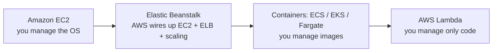

# Compute: AWS services explained for beginners
> [Home](../../README.md) · [Beginner track](../README.md) · [All services A–Z](README.md) · Deep dive: [Notes 03](../../notes/03-compute-containers.md)

Compute services are where your code actually runs. They form a spectrum: at one end you rent a virtual machine and manage everything on it; at the other you upload a function and AWS handles servers, scaling and patching. A good exam habit is to pick the option furthest to the right that still meets the requirements, because it usually means less operational work. Containers ([ECS, EKS, Fargate](containers.md)) sit in the middle and have their own page. A few services in this category exist to run AWS compute **somewhere other than an AWS Region**: in your data center, in a city, or inside a mobile network.

| Service | One-liner | Exam importance |
|---|---|---|
| Amazon EC2 | Rent virtual machines by the second | ★★★ |
| Amazon EC2 Auto Scaling | Keeps the right number of healthy EC2 instances running | ★★★ |
| AWS Auto Scaling | One place to set scaling for several services together | ★ |
| AWS Lambda | Run code in response to events, with no servers to manage | ★★★ |
| AWS Elastic Beanstalk | Upload app code; AWS builds and runs the EC2/ELB stack for you | ★★ |
| AWS Batch | Managed job queues that run large numbers of batch jobs | ★★ |
| Amazon Lightsail | Simple, fixed-price virtual private servers | ★ |
| AWS Outposts | AWS hardware and services installed in your own data center | ★★ |
| AWS Local Zones | AWS compute placed in specific metro areas for low latency | ★ |
| AWS Wavelength | AWS compute inside telecom 5G networks | ★ |
| VMware Cloud on AWS | Run your existing VMware environment on AWS hardware | ★ |
| AWS Serverless Application Repository | A catalog of ready-made serverless apps to deploy | ★ |

---

## Amazon EC2

> **In one line:** rent virtual machines ("instances") in seconds, choose their CPU, memory, storage and networking, and pay only while they run.

| Exam importance | Kubernetes / everyday analogy | Pricing model (rough) |
|---|---|---|
| ★★★ High | **Your EKS worker nodes are EC2 instances.** Every `kubectl get nodes` line you've seen is (usually) one. Everyday: renting a fully furnished flat by the hour. | Per second while running (On-Demand), with big discounts for commitments or for spare capacity (Spot) |

### What an instance is

Amazon EC2 (Elastic Compute Cloud) gives you **instances**: virtual machines on AWS hardware in one AZ (Availability Zone) of your chosen Region, placed in a subnet of your [VPC](networking.md#amazon-vpc). AWS handles the physical servers and hypervisor; you own everything **inside**: OS patches, software and security group rules. In Kubernetes terms, an instance is a **node** running the kubelet, the container runtime and your pods.

### AMIs

An **AMI (Amazon Machine Image)** is the template an instance boots from (OS, preinstalled software, disk layout): the VM equivalent of a container **base image**. Use AWS or vendor AMIs (Amazon Linux, Ubuntu, Windows, the EKS-optimized AMI) or bake your own "golden" AMI so new instances start fast. AMIs are Regional; copy them to use elsewhere.

### Instance types and families

The **instance type** sets the hardware shape. Types are grouped into families by what they're good at:

| Family | Optimised for | Typical use |
|---|---|---|
| **t** (e.g. `t3`, `t4g`) | Burstable: low baseline CPU that can burst using credits | Dev/test, small websites, low-traffic services |
| **m** | General purpose, balanced CPU and memory | App servers, most EKS node groups |
| **c** | Compute (more CPU per GB of memory) | Batch processing, video encoding, high-traffic web front ends |
| **r** (and x) | Memory (more RAM per CPU) | In-memory caches, large databases, analytics |
| **i** (and d) | Storage: fast local disks | NoSQL databases, data warehouses, high local IOPS |
| **g / p** | Accelerated: GPUs | **g** graphics and ML inference; **p** ML training and HPC (high-performance computing) |

**Reading a name:** `m7g.large` = family **m** (general purpose) · generation **7** · attribute **g** (AWS Graviton, an Arm-based processor) · size **large** (2 vCPUs, 8 GiB). Other attribute letters: **a** = AMD, **i** = Intel, **d** = local NVMe disk, **n** = extra network bandwidth. Each size step up (`large` → `xlarge` → `2xlarge`) roughly doubles vCPUs (virtual CPUs), memory and price.

### Key pairs and connecting

A **key pair** is an SSH (Secure Shell) key pair: AWS puts the public key on the instance at launch, and you keep the private `.pem` file to log in. The modern way is **Session Manager** (part of [AWS Systems Manager](management-monitoring.md#aws-systems-manager)): a shell through the console or CLI authorised by IAM, with **no open inbound ports, no SSH keys and no bastion host**, and sessions can be logged. Think `kubectl exec` for VMs. "Most secure way to access instances" means Session Manager.

### User data

**User data** is a script passed at launch that runs **once, as root, on first boot** (via cloud-init on Linux) to install packages, pull config or join a cluster; EKS nodes use it to bootstrap. Think of it as an **init container for the whole VM**, except that it runs only on first boot by default and is readable from inside the instance, so **never put secrets in it**.

### Storage: EBS vs instance store

- **[Amazon EBS](storage.md#amazon-ebs) (Elastic Block Store):** network-attached virtual disks that **survive** stop/start and can be snapshotted. Root volumes are usually EBS. It's the backend for many EKS PersistentVolumes.
- **[EC2 instance store](storage.md#ec2-instance-store):** disks physically attached to the host. Very fast and included in the price, but the data is **lost when the instance stops or terminates**. Good for caches and scratch space only.

### Elastic IPs and public IPs

A public-subnet instance can get an **auto-assigned public IPv4 address**, but it **changes** on every stop/start. An **Elastic IP (EIP)** is a static public IPv4 address you keep and can move between instances. All public IPv4 addresses, EIPs included, are **billed hourly**. App servers usually need neither: put them in private subnets behind a [load balancer](networking.md#elastic-load-balancing-elb).

### IMDS and instance profiles

Code on an instance needs AWS credentials, but you never store access keys there. Instead you attach an **instance profile** (a wrapper around an [IAM role](identity-governance.md#aws-iam)); the instance fetches **temporary, auto-rotated credentials** from the **IMDS (Instance Metadata Service)** at `169.254.169.254`, and AWS SDKs find them automatically.

**Kubernetes bridge:** this is how a pod gets credentials, one level down. IRSA (IAM Roles for Service Accounts) or EKS Pod Identity map a ServiceAccount to a role per pod; without them, pods fall back to the **node's** instance profile, sharing its permissions. Require **IMDSv2** (token-based) to block credential theft via request-forgery bugs.

### Pricing options

| Option | Discount vs On-Demand (approx.) | Commitment | Best for |
|---|---|---|---|
| **On-Demand** | None | None; pay per second | Unpredictable or short-term workloads, new apps |
| **Savings Plans** | Up to ~72% | A $/hour spend for 1 or 3 years | Steady baseline usage; Compute Savings Plans also cover Fargate and Lambda |
| **Reserved Instances** | Up to ~72% | A specific instance configuration for 1 or 3 years | Very stable workloads (and RDS and other non-EC2 services) |
| **Spot** | Up to ~90% | None, but AWS can reclaim the instance with a **2-minute warning** | Fault-tolerant, stateless or checkpointed work: batch jobs, CI, EKS worker pools |
| **Dedicated Hosts / Instances** | Premium | Optional | Licensing tied to physical cores/sockets (Hosts) or compliance needing single-tenant hardware |

**Use it when / don't use it when**
- ✅ You need full control of the OS, special software, or long-running servers.
- ✅ Lift-and-shift migrations of existing servers.
- ❌ Short, event-driven tasks → [Lambda](#aws-lambda). Containerised apps without node management → [AWS Fargate](containers.md#aws-fargate).

**Exam hot spots**
- Match the workload to the purchase option: steady → Savings Plans/RIs; interruptible → **Spot**; licence-bound → **Dedicated Hosts**.
- Match the workload to the family: memory-hungry → **r**, CPU-bound → **c**, GPU → **g/p**, huge local IOPS → **i**.
- "Give the app access to S3" → **IAM role via instance profile**, never access keys in code or user data.
- Data on instance store is lost on stop; data that must persist goes on EBS.

**Try it** (uses a little of your credits): first create an IAM role for EC2 with the `AmazonSSMManagedInstanceCore` policy. Then EC2 console → **Launch instance** → Amazon Linux, `t3.micro`, **Proceed without a key pair**, default VPC, and under **Advanced details** pick that role as the instance profile. Use **Connect → Session Manager**, then terminate the instance.

**Go deeper:** [Notes 03: instance families](../../notes/03-compute-containers.md#1-ec2-instance-families-and-naming) · [purchasing options](../../notes/03-compute-containers.md#2-purchasing-options) · related services: [Amazon EBS](storage.md#amazon-ebs), [Amazon EKS](containers.md#amazon-eks), [Savings Plans](cost-management.md#savings-plans)

---

## Amazon EC2 Auto Scaling

> **In one line:** keeps a group of EC2 instances at the right size, replacing unhealthy ones and adding or removing instances as load changes.

| Exam importance | Kubernetes / everyday analogy | Pricing model (rough) |
|---|---|---|
| ★★★ High | The Cluster Autoscaler (or HPA) idea, applied to VMs. In fact, **an EKS managed node group is an Auto Scaling group** underneath. Everyday: a shop manager calling in extra staff when the queue grows. | Free; you pay for the instances it launches |

**What it is.** An **Auto Scaling group (ASG)** is a set of identical instances that EC2 Auto Scaling manages as one unit. It launches instances from a template, spreads them across AZs, replaces any that fail health checks, and changes the count based on rules you set. Like a Deployment's ReplicaSet, it constantly reconciles "actual" towards "desired". Without it, you'd write scripts to detect failures and launch replacements yourself.

**Key ideas to know**
- **Launch template:** the instance recipe (AMI, instance type, security groups, instance profile, user data). It's the equivalent of a Pod template inside a Deployment. Launch configurations are the legacy version.
- **Min / desired / max:** the floor, the current target and the ceiling. Scaling policies move *desired* between min and max.
- **Multi-AZ:** one ASG spans several AZs in one Region and rebalances across them.
- **Health checks:** EC2 status checks by default. Turn on **ELB health checks** so an instance whose app is failing (but whose VM is fine) gets replaced, like a failing liveness probe restarting a pod.
- **Health check grace period:** time for a new instance to boot before it's judged.

| Scaling policy | How it works | Use when |
|---|---|---|
| **Target tracking** | Keep a metric at a target, e.g., average CPU at 50% | The default choice, much like HPA |
| **Step scaling** | Add more instances for bigger alarm breaches | You want graduated reactions |
| **Simple scaling** | One change per alarm, then a cooldown | Legacy; prefer the others |
| **Scheduled** | Change capacity at set times | Known patterns: business hours, Monday 9 a.m. spike |
| **Predictive** | Machine-learning forecast launches capacity ahead of load | Recurring daily or weekly cycles, slow-booting apps |

**Use it when / don't use it when**
- ✅ Any EC2 fleet that must be highly available or elastic, usually behind an ALB.
- ✅ Even a single instance: an ASG with min = max = 1 gives automatic replacement.
- ❌ Scaling DynamoDB, ECS services or Aurora replicas → Application Auto Scaling / [AWS Auto Scaling](#aws-auto-scaling).

**Exam hot spots**
- "Highly available web tier" → ALB + ASG across **at least two AZs**.
- "Instances fail the app health check but aren't replaced" → enable **ELB health checks** on the ASG.
- "Traffic spikes every weekday at 9 a.m." → **scheduled** (or predictive) scaling. "Keep CPU near 50%" → **target tracking**.
- "Workers process an SQS queue" → scale on **backlog per instance**.
- "New instances take too long to be ready" → golden AMI or warm pools.

**Go deeper:** [Notes 03: EC2 Auto Scaling](../../notes/03-compute-containers.md#7-ec2-auto-scaling) · [Lab 03: ALB + ASG](../../labs/lab-03-alb-asg.md) · related services: [Elastic Load Balancing (ELB)](networking.md#elastic-load-balancing-elb), [Amazon CloudWatch](management-monitoring.md#amazon-cloudwatch)

---

## AWS Auto Scaling

> **In one line:** a single console and "scaling plan" to configure scaling across several resource types at once: EC2 Auto Scaling groups, ECS services, DynamoDB tables, Aurora replicas and Spot Fleets.

| Exam importance | Kubernetes / everyday analogy | Pricing model (rough) |
|---|---|---|
| ★ Low | One control panel for the thermostats in every room of a building. | Free; you pay for the resources scaled |

**What it is.** It discovers an application's scalable resources and applies one strategy (optimise for availability, cost or a balance) to all of them. Under the hood it uses EC2 Auto Scaling and **Application Auto Scaling** (which scales non-EC2 resources).

**Exam hot spots**
- "Scale an application's EC2, DynamoDB and Aurora resources together from one place" → **AWS Auto Scaling**.
- Don't confuse it with **EC2 Auto Scaling**, which manages only EC2 instance groups.

**Go deeper:** [Notes 03: scaling policies](../../notes/03-compute-containers.md#72-scaling-policies) · related services: [Amazon EC2 Auto Scaling](#amazon-ec2-auto-scaling), [Amazon DynamoDB](databases.md#amazon-dynamodb)

---

## AWS Lambda

> **In one line:** run a function in response to an event, without provisioning or managing any servers, and pay only for the milliseconds it runs.

| Exam importance | Kubernetes / everyday analogy | Pricing model (rough) |
|---|---|---|
| ★★★ High | Like a Kubernetes Job that an event creates automatically, scales out instantly and scales to zero (Knative-style), with no cluster or nodes to manage. Everyday: a taxi you pay per ride, instead of owning a car. | Per request + per GB-second (memory × duration); a generous always-free monthly allowance |

**What it is.** You upload code (a zip or a container image) as a **function** and connect it to a **trigger**. When an event arrives, Lambda starts an execution environment, runs your handler and bills you for the duration. Many events at once means many parallel environments; no events means no cost. AWS patches the OS and runtime, spreads functions across AZs and scales them for you. Lambda is the glue of most serverless designs on the exam.

**Key ideas to know**
- **Triggers:** API Gateway or an ALB (HTTP), S3 uploads, SQS queues, SNS topics, EventBridge rules and schedules, DynamoDB and Kinesis streams, and many more.
- **15-minute limit:** a single invocation can run for at most **15 minutes**. Longer jobs belong elsewhere.
- **Memory controls CPU:** you set memory from **128 MB to 10,240 MB**, and CPU is allocated in proportion (about 1 vCPU at 1,769 MB). A CPU-bound function can be faster *and* cheaper with more memory.
- **Cold start:** the first request on a new environment pays extra startup time (download code, start runtime, run init code). **Provisioned concurrency** keeps environments warm; **SnapStart** speeds up Java, Python and .NET starts.
- **Concurrency:** the number of invocations running at the same moment. The default is **1,000 per Region** per account (adjustable). **Reserved concurrency** caps or guarantees capacity for one function.
- **Execution role:** an IAM role the function assumes; the same pattern as a ServiceAccount bound to an IAM role.
- **VPC access:** attach a function to your subnets to reach private resources like RDS. It then needs a NAT gateway or VPC endpoints for anything outside the VPC.

**Use it when / don't use it when**
- ✅ Event-driven processing: resize an image on upload, process queue messages, react to schedules.
- ✅ Spiky or low-traffic APIs where paying for idle servers is wasteful.
- ❌ Jobs longer than 15 minutes, needing GPUs or very large memory → [AWS Batch](#aws-batch), [Fargate](containers.md#aws-fargate) or [EC2](#amazon-ec2).
- ❌ Steady, high, constant load where an always-on container or instance is cheaper.
- ❌ Apps needing persistent local state or long-lived connections.

**Exam hot spots**
- "Run code when a file lands in S3", "no servers to manage", "minimal operational overhead" → **Lambda**.
- "Job runs 40 minutes" → **not Lambda** (Fargate, Batch or EC2).
- "Latency-sensitive API suffers cold starts" → **provisioned concurrency**; Java with low cost → **SnapStart**.
- "Thousands of functions overwhelm the database" → **RDS Proxy** (a connection pooler for Amazon RDS databases) and/or reserved concurrency.
- Lambda in a VPC has no public IP, even in a public subnet: use a **NAT gateway** or endpoints.

**Try it** (free tier): Lambda console → **Create function** → **Author from scratch**, Python runtime → **Test** with the sample event. Look at the **Monitor** tab for duration and memory used, then delete the function.

**Go deeper:** [Notes 03: AWS Lambda](../../notes/03-compute-containers.md#9-aws-lambda) · related services: [Amazon API Gateway](integration.md#amazon-api-gateway), [Amazon SQS](integration.md#amazon-sqs), [Amazon EventBridge](integration.md#amazon-eventbridge)

---

## AWS Elastic Beanstalk

> **In one line:** a platform as a service (PaaS): upload your application code, and Beanstalk creates and manages the EC2 instances, load balancer, scaling and monitoring for it.

| Exam importance | Kubernetes / everyday analogy | Pricing model (rough) |
|---|---|---|
| ★★ Medium | Like installing a Helm chart that sets up a Deployment, Service, Ingress and HPA for you, except the "chart" builds real EC2, ELB and Auto Scaling resources. Everyday: a serviced apartment. | Free; you pay for the underlying resources |

**What it is.** You choose a platform (Java, .NET, Node.js, Python, Ruby, PHP, Go or Docker) and upload a code bundle. Beanstalk provisions an **environment**: EC2 instances in an Auto Scaling group, an ELB, CloudWatch alarms, and log and health monitoring. It also handles deployments and platform updates. Unlike a fully managed black box, all the resources stay visible in your account, and you can tune them.

**Key ideas to know**
- **Environment tiers:** a **web server** tier (ELB + ASG) and a **worker** tier that pulls jobs from an SQS queue.
- **Deployment policies:** all at once, rolling, rolling with an additional batch, immutable, traffic splitting, and blue/green by swapping environment URLs.
- **Configuration:** `.ebextensions` files and saved configurations customise the resources.
- ⚠️ A database created *inside* an environment is deleted with it. For production, create RDS separately.

**Use it when / don't use it when**
- ✅ A team wants to deploy a standard web app quickly without learning EC2, ELB and ASG wiring.
- ❌ You need fine-grained infrastructure control or complex, multi-service architectures → CloudFormation, ECS or EKS.

**Exam hot spots**
- "Developers want to deploy a web app with minimal infrastructure knowledge/management" → **Elastic Beanstalk**.
- "Zero-downtime deployment with quick rollback" → **immutable** or **blue/green**.
- "Long-running tasks slow the web tier" → move them to a **worker environment**.

**Go deeper:** [Notes 03: Elastic Beanstalk](../../notes/03-compute-containers.md#12-aws-elastic-beanstalk) · related services: [Amazon EC2 Auto Scaling](#amazon-ec2-auto-scaling), [AWS CloudFormation](management-monitoring.md#aws-cloudformation)

---

## AWS Batch

> **In one line:** a fully managed service that queues batch jobs and runs them on automatically provisioned compute, scaling to zero when the work is done.

| Exam importance | Kubernetes / everyday analogy | Pricing model (rough) |
|---|---|---|
| ★★ Medium | Kubernetes Jobs plus a job queue and a node autoscaler (like Kueue + Karpenter), managed for you. Everyday: a print shop that brings in extra printers for a big order. | Free; you pay for the EC2, Spot or Fargate capacity used |

**What it is.** You package each job as a container image with a command, submit jobs to a **job queue**, and Batch launches the right amount of compute in a **compute environment** to work through the queue. It handles retries, priorities and dependencies between jobs. Without it you'd build your own scheduler and autoscaling for thousands of jobs. Unlike Lambda, there's no 15-minute limit and GPUs are available.

**Key ideas to know**
- **Job definition:** the container image, command, vCPU and memory for a job (like a Job spec).
- **Job queue:** where submitted jobs wait, with priorities.
- **Compute environment:** EC2 On-Demand, **EC2 Spot**, Fargate or EKS capacity that Batch scales up and down.
- **Array jobs:** run the same job across thousands of inputs. **Multi-node parallel jobs** handle HPC-style workloads.

**Use it when / don't use it when**
- ✅ Large numbers of long-running or compute-heavy jobs: rendering, genomics, simulations, nightly processing.
- ❌ Short event-driven tasks → [Lambda](#aws-lambda). Spark/Hadoop big-data frameworks → [Amazon EMR](analytics.md#amazon-emr).

**Exam hot spots**
- "Thousands of batch jobs, minimise cost and management" → **Batch with a Spot compute environment**.
- "Processing takes over 15 minutes" → Batch (or Fargate/ECS), not Lambda.

**Go deeper:** [Notes 03: AWS Batch](../../notes/03-compute-containers.md#11-aws-batch) · related services: [AWS Step Functions](integration.md#aws-step-functions), [AWS Fargate](containers.md#aws-fargate)

---

## Amazon Lightsail

> **In one line:** simple virtual private servers (VPS) with storage, networking and a fixed monthly price bundled together.

| Exam importance | Kubernetes / everyday analogy | Pricing model (rough) |
|---|---|---|
| ★ Low (mostly a distractor) | A basic web-hosting plan: pick a bundle, get a server. | Fixed monthly bundles |

**What it is.** Lightsail packages a small server, disk, data allowance and a static IP into one easy plan, aimed at simple websites, blogs and small apps. It hides most AWS concepts, so it's great for beginners but too limited for the scalable, highly available designs the exam asks about.

**Exam hot spots**
- Appears mainly as a **wrong answer**. Pick it only when the question stresses "simple website, small business, predictable low cost, no AWS expertise".

**Go deeper:** [Notes 03](../../notes/03-compute-containers.md) · related services: [Amazon EC2](#amazon-ec2)

---

## AWS Outposts

> **In one line:** AWS-owned, AWS-managed racks or servers installed in your own data center, running EC2 and other AWS services with the same APIs.

| Exam importance | Kubernetes / everyday analogy | Pricing model (rough) |
|---|---|---|
| ★★ Medium | Like EKS Anywhere's goal, but AWS delivers and maintains the hardware too. Everyday: a franchise kiosk inside your building, stocked and serviced by head office. | Capacity purchased up front (e.g., a 3-year term) |

**What it is.** Outposts brings a slice of an AWS Region on-premises: you order racks or servers, AWS installs and maintains them, and you use EC2, EBS, S3 on Outposts, ECS, EKS, RDS and more through the usual console and APIs. It stays linked to its parent Region for management. Capacity is fixed to what you ordered, so it doesn't scale elastically like a Region.

**Key ideas to know**
- Built for **data residency** (data must stay on site), **low latency to on-premises systems** (factories, hospitals, trading floors) and local data processing.
- Needs reliable connectivity back to the parent Region.

**Exam hot spots**
- "Data must remain in our data center for regulatory reasons, but we want AWS services and APIs" → **Outposts**.
- "Low-latency access to on-premises systems" → Outposts. "Low latency to users in a city" is **Local Zones** instead.

**Go deeper:** [Notes 03: hybrid and edge compute](../../notes/03-compute-containers.md#13-hybrid-and-edge-compute) · related services: [AWS Local Zones](#aws-local-zones), [Amazon EKS Anywhere](containers.md#amazon-eks-anywhere)

---

## AWS Local Zones

> **In one line:** AWS infrastructure placed in large metro areas, close to end users, as an extension of a parent Region.

| Exam importance | Kubernetes / everyday analogy | Pricing model (rough) |
|---|---|---|
| ★ Low | A branch office of the Region in your city. | Per-service pricing, set per Local Zone (it can differ from the parent Region) |

**What it is.** You opt in to a Local Zone and create a subnet there in your VPC, then run EC2, EBS, ECS, EKS and some other services in that city for **single-digit-millisecond latency** to local users. It's used for real-time gaming, live video, media rendering and latency-sensitive hybrid apps.

**Exam hot spots**
- "Ultra-low latency for users in a specific city, where there's no full Region" → **Local Zones**.

**Go deeper:** [Notes 03: hybrid and edge compute](../../notes/03-compute-containers.md#13-hybrid-and-edge-compute) · related services: [AWS Wavelength](#aws-wavelength), [AWS Outposts](#aws-outposts)

---

## AWS Wavelength

> **In one line:** AWS compute and storage embedded inside telecom providers' 5G networks, for ultra-low latency to mobile devices.

| Exam importance | Kubernetes / everyday analogy | Pricing model (rough) |
|---|---|---|
| ★ Low | A food stall inside the train station, so commuters don't have to leave it. | Per-service pricing in the Wavelength Zone |

**What it is.** A **Wavelength Zone** sits in a carrier's data center, so traffic from 5G phones and devices reaches your app without leaving the mobile network. You extend a VPC subnet into it and use a **carrier gateway** for mobile traffic.

**Exam hot spots**
- "Single-digit-millisecond latency for **5G** mobile devices" (AR/VR, connected cars, live video) → **Wavelength**.

**Go deeper:** [Notes 03: hybrid and edge compute](../../notes/03-compute-containers.md#13-hybrid-and-edge-compute) · related services: [AWS Local Zones](#aws-local-zones)

---

## VMware Cloud on AWS

> **In one line:** VMware's full virtualization stack (vSphere, vSAN, NSX) running on dedicated bare-metal hosts inside AWS Regions.

| Exam importance | Kubernetes / everyday analogy | Pricing model (rough) |
|---|---|---|
| ★ Low | Moving house with all your furniture as is, rather than buying new furniture to fit the new place. | Per host, bought from Broadcom/VMware (AWS stopped reselling it in 2024) |

**What it is.** Organisations with large VMware estates can move virtual machines to AWS without converting them, keep using their VMware tools and skills, and reach native AWS services from the same environment. It's used for data center exits, quick migrations and VMware-based disaster recovery.

**Exam hot spots**
- "Migrate hundreds of vSphere VMs quickly and keep existing VMware tools and processes" → **VMware Cloud on AWS**.

**Go deeper:** [Notes 03: hybrid and edge compute](../../notes/03-compute-containers.md#13-hybrid-and-edge-compute) · related services: [AWS Application Migration Service](migration-transfer.md#aws-application-migration-service)

---

## AWS Serverless Application Repository

> **In one line:** a catalog where you can find, share and deploy ready-made serverless applications built from Lambda functions and related resources.

| Exam importance | Kubernetes / everyday analogy | Pricing model (rough) |
|---|---|---|
| ★ Low | Like Artifact Hub for Helm charts, but for serverless apps. | Free; you pay for the resources deployed |

**What it is.** Publishers package apps with the **AWS SAM (Serverless Application Model)** template format, and others deploy them into their accounts in a few clicks. Apps can be public or shared privately within your organization, which is useful for reusing standard components across teams.

**Exam hot spots**
- "Share and reuse serverless applications across teams or accounts" → **Serverless Application Repository**.

**Go deeper:** [Notes 03: AWS Lambda](../../notes/03-compute-containers.md#9-aws-lambda) · related services: [AWS Lambda](#aws-lambda), [AWS CloudFormation](management-monitoring.md#aws-cloudformation)

---

**Next:** [Containers](containers.md)
