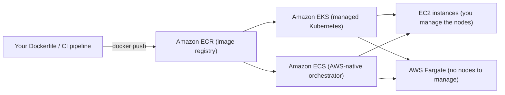
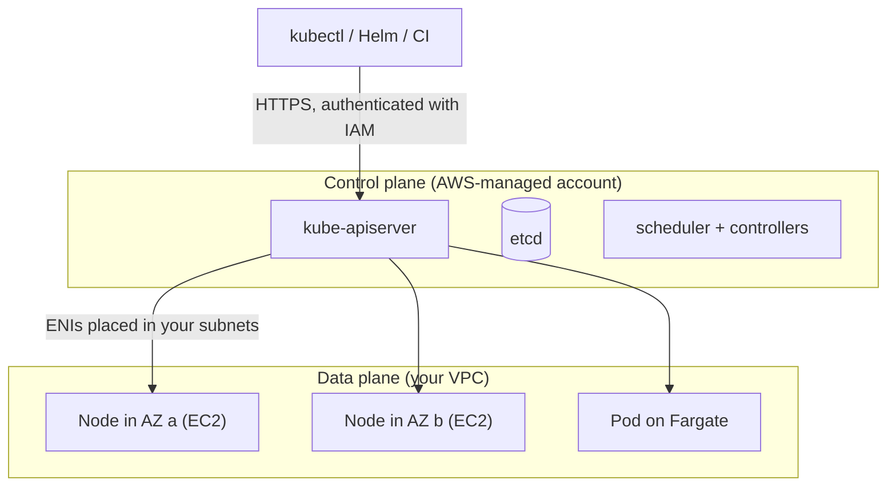

# Containers: AWS services explained for beginners
> [Home](../../README.md) · [Beginner track](../README.md) · [All services A–Z](README.md) · Deep dive: [Notes 03](../../notes/03-compute-containers.md)

This is the category you already half-know. You build a container image, store it in a registry, and an orchestrator decides where it runs. On AWS the registry is **Amazon ECR**, and you choose between two orchestrators: **Amazon EKS** (managed Kubernetes, which you've used through `kubectl`) and **Amazon ECS** (AWS's own, simpler orchestrator). Both can run containers on EC2 (Elastic Compute Cloud) virtual machines you manage, or on **AWS Fargate**, where there are no servers for you to see at all.

| Service | One-liner | Exam importance |
|---|---|---|
| [Amazon EKS](#amazon-eks) | Managed Kubernetes: AWS runs the control plane, you run (or delegate) the nodes | ★★★ |
| [Amazon ECS](#amazon-ecs) | AWS's own container orchestrator; simpler than Kubernetes, no control-plane fee | ★★★ |
| [AWS Fargate](#aws-fargate) | Serverless compute for containers: pay per task or pod, no nodes | ★★★ |
| [Amazon ECR](#amazon-ecr) | Private container image registry | ★★ |
| [AWS App Runner](#aws-app-runner) | "Give me an image, get a URL" web hosting (closed to new customers) | ★ |
| [Amazon ECS Anywhere](#amazon-ecs-anywhere) | ECS control plane in AWS, containers on your own servers | ★ |
| [Amazon EKS Anywhere](#amazon-eks-anywhere) | EKS-style Kubernetes clusters that you run on-premises | ★ |
| [Amazon EKS Distro](#amazon-eks-distro) | The open-source Kubernetes build that EKS itself uses | ★ |

---

## Amazon EKS

> **In one line:** Amazon Elastic Kubernetes Service (EKS) runs the Kubernetes control plane for you, and plugs Kubernetes into AWS networking, load balancing, storage and identity.

| Exam importance | Kubernetes / everyday analogy | Pricing model (rough) |
|---|---|---|
| ★★★ High | It *is* Kubernetes. Your manifests, Helm charts and `kubectl` work unchanged | Hourly fee per cluster (approx. $0.10/h in standard support) **plus** whatever the nodes cost (EC2, Fargate, or Auto Mode's extra per-node fee) |

**What it is.** When you ran `kubectl get pods`, the request went to a Kubernetes API server that someone else was running. That "someone" was EKS. EKS operates the parts of Kubernetes you never touched, and the AWS plumbing underneath your cluster is what turns a `Service`, an `Ingress` or a `PersistentVolumeClaim` into real AWS resources. Without EKS you'd install, patch, back up and make highly available your own API servers and etcd, which is a full-time job.

### Control plane vs data plane

| | **Control plane** | **Data plane** |
|---|---|---|
| What it is | The Kubernetes "brain": `kube-apiserver`, etcd (the cluster database), scheduler, controller manager | The worker nodes where your pods actually run |
| Who runs it | **AWS**, across multiple Availability Zones (AZs, separate data centers in one Region), in an AWS-owned account | **You** (or AWS, if you choose Fargate or Auto Mode) |
| What you see | An API endpoint (public, private, or both) and a Kubernetes version | EC2 instances in *your* VPC (Virtual Private Cloud, your private network in AWS) |
| What you do | Pick the version and trigger upgrades | Size, patch, scale and upgrade nodes |

Kubernetes versions get about 14 months of standard support. After that the cluster moves into paid **extended support** at a much higher hourly fee, so you have a real cost reason to keep upgrading.

### Node options (the data plane)

| Option | What it means | Kubernetes angle |
|---|---|---|
| **Managed node groups** | EKS creates and updates an EC2 Auto Scaling group (ASG, a self-healing fleet of instances) for you; On-Demand or Spot | The usual default; node upgrades are a button or API call |
| **Self-managed nodes** | Your own ASG and AMI (Amazon Machine Image, the disk image an instance boots from) | Maximum control, maximum toil |
| **Fargate profiles** | Pods that match a namespace/label selector run on Fargate, one pod per isolated micro-VM | No nodes to patch. ⚠️ No DaemonSets, privileged pods, GPUs or EBS volumes |
| **Karpenter** | Open-source autoscaler that launches right-sized EC2 instances (often Spot) when pods are pending, and consolidates idle nodes | A smarter, faster replacement for Cluster Autoscaler |
| **EKS Auto Mode** | AWS runs the nodes too, using Karpenter-based scaling, plus built-in load balancing, pod networking, CoreDNS and EBS storage | Closest thing to "serverless Kubernetes" while keeping EC2 choice; nodes are locked down (no SSH) and replaced at least every 21 days |

### Networking: the VPC CNI

The **Amazon VPC CNI** (Container Network Interface plugin) gives **every pod a real IP address from your VPC subnet**, attached to the node through extra ENIs (elastic network interfaces, virtual network cards). This is different from overlay networks you may know, where pod IPs are invisible outside the cluster.

- ✅ Pods are first-class VPC citizens: security groups, VPC Flow Logs and routing all see pod IPs.
- ⚠️ **Subnet sizing matters.** 30 nodes × 30 pods eats 900+ IPs. A `/24` subnet (256 addresses) runs out fast. Fixes: bigger subnets, **prefix delegation** (assigns /28 blocks per ENI), or a secondary CIDR such as `100.64.0.0/10` with custom networking.
- The number of ENIs and IPs an instance type supports caps how many pods fit on a node.

### Load balancing: AWS Load Balancer Controller

Install the **AWS Load Balancer Controller** (or use Auto Mode, which has it built in) and Kubernetes objects become Elastic Load Balancing resources:

| You create | AWS creates | Layer |
|---|---|---|
| `Ingress` | **Application Load Balancer (ALB)**: HTTP/HTTPS, path and host routing | 7 |
| `Service` of `type: LoadBalancer` (with the controller's annotations / `loadBalancerClass`) | **Network Load Balancer (NLB)**: TCP/UDP, static IPs, very high throughput | 4 |

Without the controller, the old in-tree cloud provider creates a legacy Classic Load Balancer for a `LoadBalancer` Service. See [Elastic Load Balancing (ELB)](networking.md#elastic-load-balancing-elb).

### Storage: CSI drivers

- **EBS CSI driver** (Container Storage Interface): a `PersistentVolumeClaim` becomes an EBS volume. It's **ReadWriteOnce** and **tied to one AZ**, so the pod can only be rescheduled to nodes in that AZ. Use `WaitForFirstConsumer` in the StorageClass. Good for databases in StatefulSets.
- **EFS CSI driver**: the PVC is backed by EFS, a managed NFS share that is **ReadWriteMany** and spans AZs. Good for shared content.
- Details: [Amazon EBS](storage.md#amazon-ebs) and [Amazon EFS](storage.md#amazon-efs).

### Identity: who can call AWS from a pod, and who can call the cluster

**Pod → AWS APIs.** Never let pods borrow the node's IAM (Identity and Access Management) role, because every pod on that node would get its permissions. Map a Kubernetes ServiceAccount to an IAM role instead:

| | **IRSA** (IAM Roles for Service Accounts) | **EKS Pod Identity** (newer, recommended) |
|---|---|---|
| How | Cluster has an OIDC (OpenID Connect) identity provider registered in IAM; the role's trust policy names that provider and ServiceAccount; the ServiceAccount carries a role annotation | A **Pod Identity association** (EKS API) links namespace + ServiceAccount → role; the Pod Identity Agent DaemonSet hands out credentials |
| Trust policy | Different per cluster | One generic principal (`pods.eks.amazonaws.com`), so one role is reusable across clusters |
| Works on Fargate | ✅ | ❌ (EC2 Linux nodes only) |

**Humans/CI → the Kubernetes API.** EKS authenticates `kubectl` with IAM. To authorize who can do what:
- **Access entries** (current, recommended): grant an IAM role cluster or namespace access through the EKS API, console or CloudFormation, using AWS-provided access policies or your own RBAC (role-based access control) groups. Auto Mode requires them.
- **`aws-auth` ConfigMap** (legacy): a YAML mapping inside `kube-system`. One bad edit could lock everyone out. Migrate to access entries.

### Add-ons

**EKS add-ons** are AWS-curated, versioned installs of cluster components: VPC CNI, CoreDNS, kube-proxy, EBS CSI driver, EFS CSI driver, Pod Identity Agent, the AWS Distro for OpenTelemetry collector and others. EKS checks version compatibility and can update them for you. Think of them as Helm releases AWS maintains.

**Use it when / don't use it when**
- ✅ The team already runs Kubernetes, has Helm charts or operators, or needs portability across clouds or on-premises.
- ✅ You need the Kubernetes ecosystem (service meshes, Argo CD, custom controllers).
- ❌ You just need to run some containers with the least effort → use [Amazon ECS](#amazon-ecs) on [AWS Fargate](#aws-fargate).
- ❌ Short event-driven functions → use [AWS Lambda](compute.md#aws-lambda).

**Exam hot spots**
- **EKS only wins when Kubernetes is a stated requirement** ("existing Kubernetes manifests", "Helm", "open-source tooling", "avoid lock-in"). Otherwise "least operational overhead" for containers is ECS on Fargate.
- Pod permissions → **IRSA or EKS Pod Identity**, never the node instance role or access keys in a Secret.
- Ingress → ALB; Service type LoadBalancer → NLB, via the AWS Load Balancer Controller.
- Shared storage across pods in different AZs → **EFS CSI**; EBS is single-AZ.
- "Pods failing to get IP addresses" → subnet exhaustion from the VPC CNI.

**Try it** (read-only): open the EKS console for the cluster you already use. Look at the **Compute** tab (node groups / Fargate profiles), **Networking** (subnets, endpoint access), **Access** (access entries vs ConfigMap mode) and **Add-ons**. Then run `kubectl get nodes -o wide` and match the node IPs to the subnets.

**Go deeper:** [Notes 03: Amazon EKS](../../notes/03-compute-containers.md#102-amazon-eks) · related services: [Amazon EC2](compute.md#amazon-ec2) · [Amazon VPC](networking.md#amazon-vpc) · [AWS IAM](identity-governance.md#aws-iam) · [Amazon Managed Service for Prometheus](management-monitoring.md#amazon-managed-service-for-prometheus)

---

## Amazon ECS

> **In one line:** Amazon Elastic Container Service (ECS) is AWS's own container orchestrator: you describe containers in a task definition, and ECS keeps the right number of copies running.

| Exam importance | Kubernetes / everyday analogy | Pricing model (rough) |
|---|---|---|
| ★★★ High | A slimmed-down, AWS-only Kubernetes with fewer moving parts and no control plane to upgrade | **No charge for ECS itself**; you pay for the EC2 instances or Fargate capacity the tasks use |

**What it is.** ECS answers the same question as Kubernetes ("run 6 copies of this container behind a load balancer and replace any that die") with far fewer concepts. There's no API server, no etcd, no version upgrades and no add-ons to manage; AWS runs the orchestration and doesn't bill for it. The trade-off is that it only exists on AWS and has no Kubernetes ecosystem.

**Translate from Kubernetes**

| ECS term | Closest Kubernetes idea | Where the analogy breaks |
|---|---|---|
| **Cluster** | Cluster | Just a logical grouping; no control plane you see or pay for |
| **Task definition** | Pod spec / pod template | A versioned JSON document (revision 1, 2, 3…) listing containers, CPU/memory, ports, roles, logging |
| **Task** | Pod | One running copy of a task definition |
| **Service** | Deployment + Service | Keeps N tasks running, does rolling deployments **and** registers tasks with a load balancer target group. No ClusterIP; service-to-service discovery uses Service Connect / Cloud Map |
| **Container instance** | Node | An EC2 instance running the ECS agent |
| **Capacity provider** | Node pool + Cluster Autoscaler / Karpenter | Links a service to an ASG or to Fargate / Fargate Spot, and scales the instances to fit tasks |
| **Task role** | ServiceAccount with IRSA / Pod Identity | The IAM role your *application code* uses |
| **Task execution role** | What the kubelet uses to pull images and read Secrets | Used by ECS itself to **pull from ECR, send logs and fetch secrets** before your code starts |
| **Launch type: EC2 vs Fargate** | Normal nodes vs Fargate profile | Fargate = no instances; EC2 = you manage them |
| **`awsvpc` network mode** | The VPC CNI | Each task gets its own ENI, private IP and security group |
| **Service auto scaling** | HorizontalPodAutoscaler | Target tracking on CPU, memory or ALB requests per target |
| **Scheduled task** (EventBridge) | CronJob | |
| **Daemon** scheduling strategy | DaemonSet | EC2 launch type only |

**Key ideas to know**
- **Two launch types.** EC2 (cheaper for big steady fleets, needed for GPUs) or Fargate (least operations). You can mix them through capacity providers.
- **Task role vs task execution role** is a classic trap: "task fails to start, `CannotPullContainerError`" → execution role; "app gets AccessDenied calling S3" → task role.
- **Secrets** from Secrets Manager or SSM Parameter Store are injected as environment variables by reference in the task definition.
- **ALB integration**: one ALB can route paths (`/api`, `/images`) to different ECS services, using dynamic ports on EC2.
- **ECS Express Mode** (newer): one call with an image and two roles creates a Fargate service, ALB, scaling and networking for you. No extra charge.

**Use it when / don't use it when**
- ✅ Containerized apps on AWS with the least operational overhead (especially with Fargate).
- ✅ Teams without Kubernetes skills, or "migrate a monolith to containers quickly".
- ❌ Kubernetes is required, or must run the same way on other clouds → [Amazon EKS](#amazon-eks).
- ❌ Short event-driven code with no container to maintain → [AWS Lambda](compute.md#aws-lambda).

**Exam hot spots**
- "Containers, least operational overhead, no servers" → **ECS on Fargate**.
- Permissions for code inside a task → **task role**. Pulling private images and secrets → **task execution role**.
- Scale on queue depth: service auto scaling with a custom metric (backlog per task) from [Amazon SQS](integration.md#amazon-sqs).
- Long-running job (>15 min) triggered by an event → ECS/Fargate task started by [Amazon EventBridge](integration.md#amazon-eventbridge), not Lambda.

**Try it** (≤10 min, Fargate costs a few cents if stopped promptly): ECS console → **Clusters → Create cluster** (Fargate only) → **Task definitions → Create** with the `public.ecr.aws/nginx/nginx` image → **Run task** in a public subnet with a public IP → open the IP in a browser → stop the task and delete the cluster.

**Go deeper:** [Notes 03: Amazon ECS](../../notes/03-compute-containers.md#101-amazon-ecs) · related services: [Elastic Load Balancing (ELB)](networking.md#elastic-load-balancing-elb) · [AWS Secrets Manager](security.md#aws-secrets-manager)

---

## AWS Fargate

> **In one line:** a serverless compute engine for containers: you say how much CPU and memory each task or pod needs, and AWS finds somewhere to run it.

| Exam importance | Kubernetes / everyday analogy | Pricing model (rough) |
|---|---|---|
| ★★★ High | Like a node pool that has exactly one pod per node, where AWS owns and patches every node. Everyday: a taxi instead of owning a car | Per second for the vCPU and memory you request (1-minute minimum); Fargate Spot is much cheaper for interruptible ECS tasks |

**What it is.** Fargate isn't an orchestrator. It's the "where does the container run" part, and it plugs into either ECS or EKS. Each task or pod gets its own isolated micro-VM with its own kernel, so there are no EC2 instances to choose, patch, scale or bin-pack. You pay for what each task requests rather than for half-empty nodes.

**Key ideas to know**
- **Works with ECS (launch type / capacity provider) and EKS (Fargate profiles).**
- **Sizing per task/pod**: you pick vCPU and memory from fixed combinations. You're billed for that size even if the app uses less, so right-size it.
- **Networking**: always `awsvpc` on ECS, so every task gets its own ENI and **security group**.
- **Storage**: ephemeral storage of 20 GiB by default (expandable on ECS). For persistence, mount **EFS**; ECS tasks can also attach EBS volumes.
- **Fargate Spot** (ECS): spare capacity at a big discount, with a 2-minute interruption warning. Fits stateless or batch work.
- **Savings Plans**: Compute Savings Plans cover Fargate.
- **Graviton (ARM64)**: cheaper per vCPU if your image is built for `arm64`.

**Use it when / don't use it when**
- ✅ Spiky or unpredictable container workloads; small teams; per-task isolation.
- ✅ "No servers to manage" combined with containers.
- ❌ GPUs, privileged containers, DaemonSets, or host-level access → EC2 nodes.
- ❌ Very large, steady fleets where you can pack instances tightly and buy Reserved/Savings → EC2 is usually cheaper.

**Exam hot spots**
- "Serverless containers" = **Fargate**. "Serverless functions" = Lambda. Don't mix them up.
- Fargate removes *host* management, not *application* scaling: you still configure service auto scaling.
- Need shared persistent storage for Fargate tasks → **EFS**.

**Go deeper:** [Notes 03: Containers](../../notes/03-compute-containers.md#101-amazon-ecs) · related services: [Savings Plans](cost-management.md#savings-plans) · [Amazon EFS](storage.md#amazon-efs)

---

## Amazon ECR

> **In one line:** Amazon Elastic Container Registry (ECR) is a private, managed Docker/OCI (Open Container Initiative) image registry integrated with IAM.

| Exam importance | Kubernetes / everyday analogy | Pricing model (rough) |
|---|---|---|
| ★★ Medium | Docker Hub or Harbor, but private, inside your AWS account; where your EKS nodes have been pulling images from | Per GB-month stored, plus data transfer out of the Region |

**What it is.** ECR stores your container images in **repositories** (one per app, usually). Access is controlled with IAM and repository policies instead of registry passwords, so an EKS node or ECS task pulls images using its role. You avoid running and securing your own registry.

**Key ideas to know**
- **Repository policy**: resource-based policy that allows other accounts to pull.
- **Image scanning**: basic scanning, or **enhanced** continuous scanning through [Amazon Inspector](security.md#amazon-inspector).
- **Lifecycle policies**: auto-delete untagged or old images to save storage cost.
- **Tag immutability**: stops someone overwriting `v1.2.3` with a different image.
- **Replication**: copy images to other Regions or accounts. **Pull-through cache** mirrors upstream registries (Docker Hub, ECR Public, GitHub).
- **Private subnets with no NAT**: you need VPC interface endpoints for `ecr.api` and `ecr.dkr`, **plus an S3 gateway endpoint** because image layers live in S3.

**Exam hot spots**
- "Containers in private subnets can't pull images, no internet" → ECR interface endpoints **and** the S3 gateway endpoint ([AWS PrivateLink](networking.md#aws-privatelink)).
- "Scan images for vulnerabilities" → ECR scanning / Inspector. "Clean up old images" → lifecycle policy.

**Go deeper:** [Notes 03: Amazon ECR](../../notes/03-compute-containers.md#103-amazon-ecr) · related services: [Amazon VPC](networking.md#amazon-vpc)

---

## AWS App Runner

> **In one line:** a fully managed service that turned a container image or source repo into a running HTTPS web app with scaling, with almost no configuration.

| Exam importance | Kubernetes / everyday analogy | Pricing model (rough) |
|---|---|---|
| ★ Low (not in the SAA-C03 in-scope list) | Like Knative or a PaaS (Heroku-style) on top of a cluster you never see | Per vCPU and memory used while active, plus a small charge for provisioned idle memory |

**What it is.** App Runner handled build, deploy, load balancing, TLS and auto scaling for web apps and APIs. ⚠️ **AWS closed App Runner to new customers on April 30, 2026.** Existing customers can keep using it, but no new features are planned; AWS recommends **ECS Express Mode** for new workloads.

**Exam hot spots**
- If it appears, it's a distractor or the "simplest web app from an image" answer. Prefer ECS on Fargate (or Elastic Beanstalk) for in-scope answers.

**Go deeper:** [Notes 03: AWS App Runner](../../notes/03-compute-containers.md#105-aws-app-runner-brief) · related services: [AWS Elastic Beanstalk](compute.md#aws-elastic-beanstalk)

---

## Amazon ECS Anywhere

> **In one line:** run ECS tasks on your own on-premises servers or VMs while the ECS control plane stays in an AWS Region.

| Exam importance | Kubernetes / everyday analogy | Pricing model (rough) |
|---|---|---|
| ★ Low | Joining your own machines as worker nodes to a cloud-hosted control plane | Per registered on-premises instance per hour |

**What it is.** You install the SSM Agent (from AWS Systems Manager) and the ECS agent on your servers, register them, and they show up as `EXTERNAL` capacity in an ECS cluster. You manage workloads with the same ECS APIs and console you'd use in the cloud, but the servers need a connection back to the Region.

**Exam hot spots**
- "Run containers on existing on-premises hardware, managed centrally from AWS, minimal effort" → **ECS Anywhere**.

**Go deeper:** [Notes 03: Containers on-premises](../../notes/03-compute-containers.md#104-containers-on-premises-and-at-the-edge) · related services: [AWS Systems Manager](management-monitoring.md#aws-systems-manager) · [AWS Outposts](compute.md#aws-outposts)

---

## Amazon EKS Anywhere

> **In one line:** tooling to create and operate EKS-compatible Kubernetes clusters on your own infrastructure (VMware vSphere, bare metal, Nutanix and others).

| Exam importance | Kubernetes / everyday analogy | Pricing model (rough) |
|---|---|---|
| ★ Low | Like running your own kubeadm/Rancher clusters, but with AWS's tested distribution and tooling | Free to use; optional paid AWS support subscription per cluster |

**What it is.** Unlike ECS Anywhere, **you run the control plane** too, on your own hardware. Clusters can run fully disconnected (air-gapped) and still look and behave like EKS.

**Exam hot spots**
- "Kubernetes on-premises, consistent with EKS, may be disconnected from AWS" → **EKS Anywhere**.

**Go deeper:** [Notes 03: Containers on-premises](../../notes/03-compute-containers.md#104-containers-on-premises-and-at-the-edge)

---

## Amazon EKS Distro

> **In one line:** the open-source Kubernetes distribution (same versions and security patches) that EKS runs, which you can install anywhere yourself.

| Exam importance | Kubernetes / everyday analogy | Pricing model (rough) |
|---|---|---|
| ★ Low | A Kubernetes "distro", like choosing a Linux distribution; just the packaged bits, no management | Free (open source) |

**What it is.** EKS Distro (EKS-D) gives you the exact Kubernetes binaries and dependencies EKS uses. Everything else (installation, upgrades, high availability, support) is on you.

**Exam hot spots**
- "Do-it-yourself Kubernetes anywhere, matching EKS versions" → EKS Distro. "Managed tooling on-premises" → EKS Anywhere instead.

**Go deeper:** [Notes 03: Containers on-premises](../../notes/03-compute-containers.md#104-containers-on-premises-and-at-the-edge)

---

**Next:** [Storage services](storage.md)
