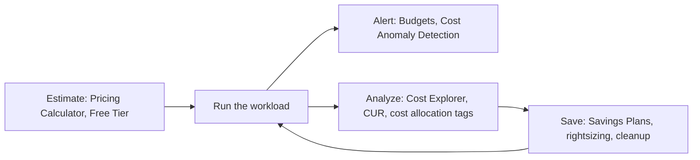

# Cost management: AWS services explained for beginners
> [Home](../../README.md) · [Beginner track](../README.md) · [All services A–Z](README.md) · Deep dive: [Notes 10](../../notes/10-cost-optimization.md)

AWS bills you for what you use, by the second, the gigabyte and the request. That's great for experiments, but it also means a forgotten resource keeps charging until you delete it. The cost services fall into four jobs: **estimate** before you build (Pricing Calculator, Free Tier), **alert** while you run (Budgets, Cost Anomaly Detection), **analyze** what you spent (Cost Explorer, Cost and Usage Report, cost allocation tags), and **save** by committing to steady usage (Savings Plans).

| Service | One-liner | Exam importance |
|---|---|---|
| [AWS Free Tier](#aws-free-tier) | The free-credits starter plan (Free plan or Paid plan) for new accounts | ★ |
| [AWS Pricing Calculator](#aws-pricing-calculator) | Estimate the monthly cost of an architecture before building it | ★ |
| [AWS Budgets](#aws-budgets) | Alerts (and optional automatic actions) when cost or usage passes a threshold | ★★★ |
| [AWS Cost Explorer](#aws-cost-explorer) | Charts and forecasts of what you've spent, plus savings recommendations | ★★★ |
| [AWS Cost Anomaly Detection](#aws-cost-anomaly-detection) | ML that spots unusual spending spikes | ★★ |
| [AWS Cost and Usage Report](#aws-cost-and-usage-report) | The most detailed billing data, delivered to S3 for SQL analysis | ★★ |
| [Savings Plans](#savings-plans) | Commit to an hourly spend for 1 or 3 years in exchange for a big discount | ★★★ |
| [Cost allocation tags](#cost-allocation-tags) | Tags that split the bill by team, app or environment | ★★ |

### How AWS charges you, in plain English

Almost every AWS price is built from four ingredients:

| Ingredient | How it's measured | Examples | Everyday analogy |
|---|---|---|---|
| **Compute time** | Per second or hour that something **runs**, whether busy or idle | EC2 instances, EKS worker nodes, Fargate pods, RDS databases, NAT gateways, load balancers. Lambda bills per request plus memory × duration (GB-seconds). | A taxi meter that runs while the taxi waits for you |
| **Storage** | Per **GB-month**: GB stored × how long you keep it | EBS volumes (billed on **provisioned** size, even if empty), S3 objects, snapshots, logs | Renting a storage unit by size and by month |
| **Requests** | Per API call or operation, often per million or per 1,000 | S3 GET/PUT, SQS messages, API Gateway calls, KMS operations | Paying per letter at the post office |
| **Data transfer** | Per GB, depending on **direction and path** | See the next table | A toll road: entering is free, leaving costs money |

**Data transfer rules of thumb**

| Path | Cost |
|---|---|
| Internet → AWS (**in**) | **Free** |
| AWS → internet (**out**) | **Paid** per GB (after a small monthly free allowance) |
| Between **Availability Zones (AZs)** in the same Region | **Paid in both directions** (approx. 0.01 USD/GB each way) |
| Same AZ, using private IP addresses | Free |
| Between Regions | Paid per GB |
| EC2 → S3 or DynamoDB in the same Region through a **gateway VPC endpoint** | Free (and it avoids NAT gateway charges) |

Kubernetes angle: a chatty microservice whose pods sit in different AZs pays cross-AZ charges on every call, and your kubectl view never shows it. Topology-aware routing in Kubernetes exists partly for this reason.

### The top 8 beginner bill surprises

| # | Surprise | Why it costs money | How to avoid it |
|---|---|---|---|
| 1 | **NAT gateway** | Charged **every hour** it exists (approx. 30+ USD/month) **plus per GB processed**. One per AZ multiplies that. | Delete lab NAT gateways right after use. In production, add free **gateway endpoints** for S3/DynamoDB so that traffic skips the NAT. |
| 2 | **Idle load balancer** | ALBs and NLBs bill hourly even with zero traffic. Each Kubernetes `Service` of type `LoadBalancer` or `Ingress` on EKS can create one. | Delete LoadBalancer Services and Ingresses **before** deleting an EKS cluster, or the load balancers can be orphaned and keep billing. |
| 3 | **Unattached EBS volumes** (and old snapshots) | You pay for provisioned GB-months whether or not anything is attached. A PersistentVolume with `reclaimPolicy: Retain` leaves its EBS volume behind after the PVC is gone. | Check **EC2 → Volumes** for the "available" state. Delete PVCs before clusters. Use lifecycle policies for snapshots. |
| 4 | **Public IPv4 addresses** | Every public IPv4 address, including Elastic IPs (attached or idle), is billed hourly (approx. 3.6 USD/month each) since Feb 2024. | Release unused Elastic IPs. Keep instances in private subnets behind a load balancer. |
| 5 | **Forgotten RDS database** | Databases bill per hour, and Multi-AZ roughly doubles it. ⚠️ A **stopped** RDS instance **starts again automatically after 7 days**. | Delete lab databases (take a final snapshot if needed) instead of just stopping them. |
| 6 | **Data transfer** | Internet egress, cross-AZ traffic and cross-Region replication add up quietly. | Use CloudFront for public content, keep chatty traffic in one AZ where resilience allows, and watch the "Data Transfer" line in Cost Explorer. |
| 7 | **CloudWatch Logs retention** | Logs are charged per GB ingested and per GB-month stored, and the default retention is **never expire**. EKS control-plane logs and debug-level app logs grow fast. | Set retention on every log group (e.g., 7–30 days for dev). Lower log levels. |
| 8 | **KMS keys** | Each customer managed KMS key costs approx. 1 USD/month, plus per-request charges. Tests that create a key per run pile them up. | Reuse keys, use AWS managed keys where acceptable, and schedule unused keys for deletion (7–30 day waiting period). |

---

## AWS Free Tier

> **In one line:** the free starter offer for new AWS accounts: credits to spend while you learn, plus a set of always-free services.

| Exam importance | Kubernetes / everyday analogy | Pricing model (rough) |
|---|---|---|
| ★ Low | A gym trial membership that comes with a prepaid voucher | Free credits; charges only if you choose the Paid plan and go beyond them |

**What it is.** Accounts created on or after **July 15, 2025** choose a **Free plan** or a **Paid plan** at sign-up. Both start with **100 USD in credits**, plus up to **100 USD more** for completing onboarding activities. Credits are used up by billable usage, including the lab favourites NAT gateway, ALB and Multi-AZ RDS.

**Key ideas to know**
- **Free plan**: no charges to you. It ends after **6 months or when the credits run out, whichever comes first**. Then the account **closes**, and you have **90 days** to upgrade to the Paid plan to get back in. Some expensive services are restricted on this plan.
- **Paid plan**: the same credits, applied to your bill, with access to all services. Usage beyond the credits is charged normally.
- **Always free**: 30+ services keep a monthly free allowance on any plan (for example, small amounts of Lambda requests and DynamoDB storage).
- Older accounts (created before July 15, 2025) stay on the legacy 12-month free tier model, so older blog posts describing "750 hours of t2.micro" describe that model.

**Exam hot spots**
- Rarely tested directly. For you, the practical rule: **create an AWS Budgets alert on day one** and delete lab resources when you finish.

**Try it** (free): open **Billing and Cost Management → Free Tier** (or **Credits**) to see how much of your allowance and credits remain.

**Go deeper:** [AWS Free Tier](https://aws.amazon.com/free/) · [Beginner 01: cloud and AWS basics](../01-cloud-and-aws-basics.md) · related services: [AWS Budgets](#aws-budgets)

## AWS Pricing Calculator

> **In one line:** a free web tool for estimating the monthly cost of an architecture before you build it.

| Exam importance | Kubernetes / everyday analogy | Pricing model (rough) |
|---|---|---|
| ★ Low | Sizing a cluster on paper before buying nodes. Everyday: a builder's quote before renovation. | Free |

**What it is.** You add services (e.g., 3 × m7g.large EC2, a 200 GB gp3 volume, an ALB, 1 TB of internet egress), pick a Region and options, and it produces a shareable estimate with monthly and upfront totals. It helps compare designs, such as On-Demand vs Savings Plans, or one NAT gateway vs three.

**Exam hot spots**
- "**Estimate** the cost of a **planned** workload before deployment" → Pricing Calculator. ⚠️ Trap: Cost Explorer analyzes **past** spending of things that already exist.

**Go deeper:** [Notes 10: 8. Cost management tools](../../notes/10-cost-optimization.md#8-cost-management-tools) · related services: [AWS Cost Explorer](#aws-cost-explorer)

## AWS Budgets

> **In one line:** set a spending or usage limit and get an alert (or trigger an automatic action) when actual or **forecasted** spend crosses it.

| Exam importance | Kubernetes / everyday analogy | Pricing model (rough) |
|---|---|---|
| ★★★ High | Like a ResourceQuota that **warns** rather than blocks (unless you add actions). Everyday: your bank texting you when the card hits a limit. | Basic budgets free; small charges for some advanced features |

**What it is.** You define a budget (say, 50 USD per month for the whole account, or 2,000 USD for the `team=payments` tag) and set alert thresholds such as 80% of actual or 100% of forecasted. AWS emails you or publishes to an SNS topic when a threshold is crossed. **Budget actions** can go further and apply a restrictive IAM policy or SCP, or stop specific EC2 or RDS instances. Without Budgets, you'd only notice an overspend when the invoice arrives.

**Key ideas to know**
- **Budget types**: **cost**, **usage** (e.g., hours of a resource), **Savings Plans / RI utilization and coverage** (are you using what you committed to?).
- **Actual vs forecasted** alerts: forecasted alerts warn you *before* you overspend, based on the trend.
- **Filters**: scope a budget by account, service, Region, tag or cost category.
- **Notifications**: email, [Amazon SNS](integration.md#amazon-sns), or chat channels.
- **Budget actions**: automatic responses (apply an IAM policy, apply an SCP, stop instances), with or without approval.
- **Not real-time**: billing data refreshes a few times a day, so a budget is an early-warning system, not an instant kill switch.

**Use it when / don't use it when**
- ✅ "**Alert** when spending exceeds or is **forecast** to exceed X", per account, team or project.
- ✅ "Alert when Savings Plans utilization drops below 90%."
- ❌ Investigating *why* spend rose → [Cost Explorer](#aws-cost-explorer).
- ❌ Catching a spike you didn't think to set a threshold for → [Cost Anomaly Detection](#aws-cost-anomaly-detection).

**Exam hot spots**
- "Notify the team when monthly costs are **forecast** to exceed the budget" → AWS Budgets with a forecasted-cost alert + SNS/email.
- "Automatically **stop** resources or **restrict permissions** when the budget is exceeded" → **budget actions**.
- ⚠️ Trap: Cost Explorer shows and forecasts spend, but it **doesn't send threshold alerts**. That's Budgets.

**Try it** (≤5 min, free; do it today): **Billing and Cost Management → Budgets → Create budget → Use a template → Monthly cost budget**, enter something like 10 USD and your email address. This is your safety net for every lab.

**Go deeper:** [Notes 10: 8. Cost management tools](../../notes/10-cost-optimization.md#8-cost-management-tools) · related services: [AWS Cost Explorer](#aws-cost-explorer), [AWS Organizations](identity-governance.md#aws-organizations)

## AWS Cost Explorer

> **In one line:** interactive charts of what you've spent, broken down any way you like, plus forecasts and recommendations for saving money.

| Exam importance | Kubernetes / everyday analogy | Pricing model (rough) |
|---|---|---|
| ★★★ High | Like Kubecost or OpenCost dashboards, but for the whole AWS bill. Everyday: a bank app's spending-by-category charts. | Console use free; API requests charged per call |

**What it is.** Cost Explorer turns your bill into graphs you can filter and group by **service, account, Region, usage type, tag** or **cost category**, daily or monthly. It answers questions like "why did EC2 cost double last month?" or "how much does the `env=dev` tag cost us?" It also **forecasts** future spend and gives **Savings Plans and Reserved Instance purchase recommendations** based on your actual usage.

**Key ideas to know**
- **Group by / filter**: slice costs by dimension. Grouping by **usage type** reveals hidden items like `NatGateway-Bytes` or `DataTransfer-Regional-Bytes` (cross-AZ).
- **Forecast**: projected spend based on history.
- **Savings Plans and RI recommendations**: how much to commit, based on your steady baseline usage.
- **Utilization and coverage reports**: are your commitments fully used, and how much usage they cover.
- **Rightsizing recommendations**: idle or oversized EC2 instances. [Compute Optimizer](management-monitoring.md#aws-compute-optimizer) goes deeper.
- **Granularity**: hourly and resource-level data are optional extras.

**Use it when / don't use it when**
- ✅ "**Visualize** and **analyze** cost trends", "find which service or team drove a cost increase", "recommend a Savings Plan".
- ❌ Alerts on thresholds → [Budgets](#aws-budgets).
- ❌ Line-item data you want to query with SQL or feed into your own BI tool → [Cost and Usage Report](#aws-cost-and-usage-report).
- ❌ Estimating something you haven't built → [Pricing Calculator](#aws-pricing-calculator).

**Exam hot spots**
- "**Visualize, understand and manage** costs and usage over time" → Cost Explorer.
- "How much should we commit to a Savings Plan?" → Cost Explorer's **Savings Plans recommendations**.
- Breaking costs down by team requires [cost allocation tags](#cost-allocation-tags) (or separate accounts) to be in place first.

**Try it** (free): open **Billing and Cost Management → Cost Explorer**, set "Group by" to **Service**, then switch it to **Usage type** and look for the items behind your biggest service.

**Go deeper:** [Notes 10: 8. Cost management tools](../../notes/10-cost-optimization.md#8-cost-management-tools) · related services: [AWS Budgets](#aws-budgets), [Savings Plans](#savings-plans)

## AWS Cost Anomaly Detection

> **In one line:** machine learning watches your spending patterns and alerts you to unusual spikes, with a hint about the root cause.

| Exam importance | Kubernetes / everyday analogy | Pricing model (rough) |
|---|---|---|
| ★★ Medium | Like an anomaly-detection alert rule in Prometheus, but on your bill. Everyday: your bank's fraud alert on an unusual purchase. | Free |

**What it is.** You create **cost monitors** (per service, per account, per cost category or per tag) and **alert subscriptions** (immediate, daily or weekly, via email or SNS). The ML model learns your normal pattern, so you don't have to guess fixed thresholds. When something abnormal happens, like a runaway loop of Lambda invocations or a test cluster left on, it alerts you with the likely service, account, Region and usage type.

**Key ideas to know**
- **Monitor types**: AWS services, linked account, cost category, cost allocation tag.
- **Alert thresholds**: only alert when the anomaly's impact exceeds an amount or percentage, to cut noise.
- **Root-cause analysis**: points to the service, account, Region and usage type behind the spike.

**Use it when / don't use it when**
- ✅ "Detect **unexpected** or **unusual** spending" with minimal setup.
- ❌ A fixed, known limit ("tell me at 500 USD") → [Budgets](#aws-budgets).

**Exam hot spots**
- Signal words: "**anomalous**", "unusual spend", "unexpected spike", "machine learning" → Cost Anomaly Detection.
- Budgets = fixed thresholds you choose; Anomaly Detection = learned patterns.

**Go deeper:** [Notes 10: 8. Cost management tools](../../notes/10-cost-optimization.md#8-cost-management-tools) · related services: [AWS Budgets](#aws-budgets)

## AWS Cost and Usage Report

> **In one line:** the most detailed billing data AWS offers, with line items per resource per hour or day, delivered as files to an S3 bucket for analysis.

| Exam importance | Kubernetes / everyday analogy | Pricing model (rough) |
|---|---|---|
| ★★ Medium | Like exporting raw Prometheus data to a data warehouse instead of looking at Grafana. Everyday: the itemized receipt rather than the card statement total. | Free to generate; you pay for S3 storage and for queries (e.g., Athena) |

**What it is.** CUR (Cost and Usage Report) writes your billing data to S3 with every detail: resource IDs, usage amounts, prices, discounts, Savings Plans applied, tags and cost categories. Today you create it as **CUR 2.0 through Data Exports** in the Billing console, typically in **Parquet** format, then query it with **[Athena](analytics.md#amazon-athena)** using SQL and visualize it with **[Amazon Quick](analytics.md#amazon-quick)**. It's the raw material for chargeback systems and FinOps dashboards. Data Exports can also produce exports in the FOCUS open billing format, and the legacy CUR still exists.

**Key ideas to know**
- **Granularity**: hourly, daily or monthly line items, optionally with resource IDs.
- **Delivery**: files land in your S3 bucket and refresh through the month.
- **Split cost allocation data for EKS**: an option that apportions EC2 node costs to the pods running on them, which is useful for per-namespace chargeback.

**Use it when / don't use it when**
- ✅ "**Most granular** cost data", "query billing with SQL", "build custom cost dashboards", "chargeback per resource".
- ❌ Quick visual answers → [Cost Explorer](#aws-cost-explorer).

**Exam hot spots**
- "Most detailed / comprehensive cost and usage data", "analyze with Athena" → **CUR (Data Exports) → S3 → Athena → Amazon Quick**.
- ⚠️ Trap: Cost Explorer is the easy chart tool. CUR is the detailed raw data.

**Go deeper:** [Notes 10: 8. Cost management tools](../../notes/10-cost-optimization.md#8-cost-management-tools) · related services: [Amazon Athena](analytics.md#amazon-athena), [Amazon S3](storage.md#amazon-s3), [Amazon Quick](analytics.md#amazon-quick)

## Savings Plans

> **In one line:** promise to spend a fixed amount per hour on compute (or databases) for 1 or 3 years, and AWS discounts that usage heavily.

| Exam importance | Kubernetes / everyday analogy | Pricing model (rough) |
|---|---|---|
| ★★★ High | Committing to a baseline of node capacity you know you'll always run. Everyday: a phone contract (a cheaper rate for a 1–3 year commitment) vs pay-as-you-go. | A committed USD/hour, paid all upfront, partly upfront or monthly |

**What it is.** If your cluster always runs at least 20 nodes, paying the On-Demand price for them is wasteful. With a Savings Plan you commit to, say, "10 USD/hour of compute for 3 years". Any eligible usage up to that amount is charged at the discounted rate, and usage above it is charged On-Demand. AWS applies the discount automatically to whichever eligible usage saves the most, so you don't have to match it to specific instances.

**Key ideas to know**
- **Compute Savings Plans**: the most flexible (approx. up to 66% off). They apply to **EC2 in any family, size, OS or Region**, plus **Fargate and Lambda**. They survive changes like moving from m5 to Graviton m7g, or from EC2 nodes to Fargate pods.
- **EC2 Instance Savings Plans**: a deeper discount (approx. up to 72%), locked to **one instance family in one Region** (e.g., m7g in eu-west-1), flexible on size, OS and AZ.
- **Database Savings Plans** (launched Dec 2025): a **1-year**, no-upfront commitment covering managed databases such as Aurora, RDS, DynamoDB, ElastiCache, DocumentDB, Neptune, Keyspaces, Timestream and DMS (OpenSearch Service was added in 2026). Discounts are smaller (up to approx. 35%) and apply to current-generation instances and serverless options. The classic exam answer for a steady database is still **Reserved Instances**.
- **SageMaker AI Savings Plans**: the same idea for ML instances.
- **Terms and payment**: 1 or 3 years. All Upfront gives the biggest discount, then Partial Upfront, then No Upfront.
- **Commit to the baseline only**: cover the steady minimum with a Savings Plan, and the peaks with On-Demand or Spot. Cost Explorer recommends the amount.
- With AWS Organizations, Savings Plans and RI discounts are **shared across accounts** by default.

**Savings Plans vs Reserved Instances vs Spot**

| | Savings Plans | Reserved Instances (RIs) | Spot Instances |
|---|---|---|---|
| You commit to | USD per hour, 1 or 3 years | A specific instance configuration, 1 or 3 years | Nothing |
| Discount (approx.) | Up to 66–72% (compute) | Up to 72% | Up to 90% |
| Flexibility | High (Compute SP), medium (EC2 Instance SP) | Lower (Convertible RIs can be exchanged) | Any type, but AWS can reclaim the instance with a **2-minute warning** |
| Covers | EC2, Fargate, Lambda; databases via Database SP; SageMaker AI | EC2, and the classic way to discount **RDS, ElastiCache, Redshift, OpenSearch** | EC2 (and Fargate Spot on ECS) |
| Capacity guarantee | No | Only zonal RIs | No |
| Best for | Steady compute whose shape may change | Steady databases (exam classic), "zonal capacity reservation" | **Interruptible, stateless** work: batch, CI, stateless pods on Spot node groups |

**Use it when / don't use it when**
- ✅ Steady, predictable usage for at least a year.
- ❌ Short-lived, new or spiky workloads → On-Demand (and Spot where interruption is fine).
- ❌ Fault-tolerant batch jobs → [Spot Instances](compute.md#amazon-ec2) are cheaper still.

**Exam hot spots**
- "Steady usage, flexibility to change instance family, Region, **or move to Fargate/Lambda**" → **Compute Savings Plan**.
- "Steady usage of one known instance family in one Region, maximum discount" → **EC2 Instance Savings Plan** (or a Standard RI).
- "Steady RDS database for 3 years" → **RDS Reserved Instances**. (Database Savings Plans are 1-year only and newer than most questions.)
- "Can be interrupted, lowest cost" → **Spot**. ⚠️ Trap: never Spot for a database or anything that can't handle interruption.

**Go deeper:** [Notes 10: 3.1 purchasing options](../../notes/10-cost-optimization.md#31-the-comparison) · [3.2 Savings Plans vs RIs](../../notes/10-cost-optimization.md#32-savings-plans-vs-ris-the-decision) · related services: [Amazon EC2](compute.md#amazon-ec2), [AWS Fargate](containers.md#aws-fargate), [Amazon RDS](databases.md#amazon-rds)

## Cost allocation tags

> **In one line:** key-value tags (like `team=payments`) that, once **activated** in Billing, let you split your AWS bill by team, application or environment.

| Exam importance | Kubernetes / everyday analogy | Pricing model (rough) |
|---|---|---|
| ★★ Medium | Kubernetes **labels**, but for the bill. Everyday: colour-coded stickers on shared office supplies so each department pays for its own. | Free |

**What it is.** It's a feature of Billing, not a separate service. You tag resources (`project`, `env`, `cost-center`), then the **management account activates** those tag keys as cost allocation tags. From then on, Cost Explorer, Budgets and the CUR can group and filter costs by them. Without tags (or separate AWS accounts per team), a shared account's bill is one big number that nobody owns.

**Key ideas to know**
- **User-defined tags**: your own keys, e.g., `team`, `env`.
- **AWS-generated tags**: e.g., `aws:createdBy`, added by AWS and also needing activation.
- **Activation is required**, and tags apply **from activation onward**, not retroactively. They take up to about 24 hours to appear.
- **Enforcement**: tag policies (in AWS Organizations), SCPs that deny untagged creation, and Config's `required-tags` rule.
- **Cost categories**: rules that group costs (e.g., "Team A = these accounts + tag X").
- Kubernetes labels on pods **don't** appear on the AWS bill by themselves. Tag the AWS resources (node groups, load balancers, volumes), or use EKS split cost allocation data in the [CUR](#aws-cost-and-usage-report).

**Exam hot spots**
- "Allocate or **charge back** costs per department or project" → **cost allocation tags** (activated) + Cost Explorer or CUR, or separate accounts per team via AWS Organizations.
- ⚠️ Trap: tagging alone isn't enough; the tags must be **activated** in the Billing console, and history before activation isn't tagged.

**Go deeper:** [Notes 10: 8. Cost management tools](../../notes/10-cost-optimization.md#8-cost-management-tools) · related services: [AWS Organizations](identity-governance.md#aws-organizations), [AWS Config](management-monitoring.md#aws-config)

---

**Next:** [AI & ML services](ai-ml.md)
