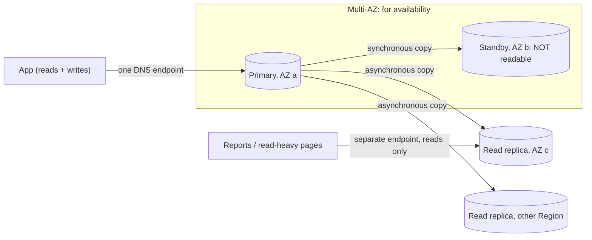

# Databases: AWS services explained for beginners
> [Home](../../README.md) · [Beginner track](../README.md) · [All services A–Z](README.md) · Deep dive: [Notes 05](../../notes/05-databases.md)

AWS doesn't offer "a database"; it offers a family of **managed, purpose-built databases**, each tuned for one data shape and access pattern. "Managed" means AWS installs, patches, backs up, replicates and fails over the database, while you design the schema and queries. On the exam, most database questions come down to matching keywords in the scenario to the right engine.

| Service | One-liner | Exam importance |
|---|---|---|
| [Amazon RDS](#amazon-rds) | Managed MySQL, PostgreSQL, MariaDB, Oracle, SQL Server and Db2 | ★★★ |
| [Amazon Aurora](#amazon-aurora) | AWS's cloud-native MySQL/PostgreSQL-compatible database with shared storage across 3 Availability Zones (AZs) | ★★★ |
| [Amazon DynamoDB](#amazon-dynamodb) | Serverless key-value / document NoSQL database, single-digit-ms at any scale | ★★★ |
| [Amazon ElastiCache](#amazon-elasticache) | Managed in-memory cache (Valkey, Redis OSS, Memcached) | ★★★ |
| [Amazon MemoryDB](#amazon-memorydb) | Durable, Redis-compatible in-memory primary database | ★ |
| [Amazon Redshift](#amazon-redshift) | Columnar data warehouse for analytics and BI | ★★★ |
| [Amazon DocumentDB](#amazon-documentdb) | MongoDB-compatible document database | ★★ |
| [Amazon Neptune](#amazon-neptune) | Graph database for highly connected data | ★★ |
| [Amazon Keyspaces](#amazon-keyspaces) | Serverless Apache Cassandra-compatible database | ★★ |
| [Amazon Timestream](#amazon-timestream) | Time-series database (not on the exam's explicit in-scope list) | ★ |
| [Amazon OpenSearch Service](#amazon-opensearch-service) | Managed OpenSearch for full-text search and log analytics | ★★ |

### Relational vs NoSQL vs in-memory vs warehouse, in plain English

- **Relational (SQL)**: data in tables with fixed columns, linked by keys, queried with SQL joins, protected by ACID transactions (all-or-nothing, consistent updates). Think of a well-organised accounting ledger. → RDS, Aurora.
- **NoSQL**: a family of non-table models that trade joins and flexible queries for massive scale and predictable speed.
  - *Key-value / document*: look up an item by its key, like a giant `HashMap` or a coat check ticket. → DynamoDB, DocumentDB.
  - *Graph*: people and things connected by relationships. → Neptune.
  - *Wide-column*: Cassandra-style. → Keyspaces.
- **In-memory**: data held in RAM for microsecond reads, usually as a **cache** in front of a slower database. Like keeping the most-asked-for files on your desk instead of in the archive room. → ElastiCache, MemoryDB.
- **Data warehouse (OLAP, online analytical processing)**: built for big analytical queries over years of data ("revenue by region by month"), not for the app's per-click reads and writes (OLTP, online transaction processing). → Redshift.

**Which database?**

| If the question says… | Pick |
|---|---|
| SQL, joins, transactions, "existing MySQL/PostgreSQL/Oracle/SQL Server app" | **RDS** (or **Aurora** for higher performance and availability) |
| "Millions of requests per second", "single-digit millisecond", "serverless", key lookups, unpredictable scale | **DynamoDB** |
| "Microsecond", "cache", "session store", "leaderboard", "reduce database read load" | **ElastiCache** (or **DAX** for DynamoDB) |
| "Redis-compatible but must not lose data" | **MemoryDB** |
| "Analytics", "BI" (business intelligence), "data warehouse", "complex queries over petabytes" | **Redshift** |
| "MongoDB" | **DocumentDB** |
| "Relationships", "social graph", "fraud rings", "recommendations" | **Neptune** |
| "Cassandra", "CQL" | **Keyspaces** |
| "Full-text search", "log analytics", "search the product catalog" | **OpenSearch Service** |
| "Time-series", "IoT sensor readings" | **Timestream** (check availability) |

**The Kubernetes angle.** On EKS you *could* run a Postgres StatefulSet with an EBS-backed PersistentVolume, plus an operator for failover, backups and upgrades. Every one of these services is the "instead of running a Postgres StatefulSet yourself" option: AWS operates the database, and your pods just get a connection endpoint (often stored in a Secret or fetched from [AWS Secrets Manager](security.md#aws-secrets-manager)).

---

## Amazon RDS

> **In one line:** Amazon Relational Database Service (RDS) runs a standard relational database engine for you, handling installation, patching, backups and failover.

| Exam importance | Kubernetes / everyday analogy | Pricing model (rough) |
|---|---|---|
| ★★★ High | A Postgres/MySQL StatefulSet plus an operator (like CloudNativePG or Zalando), but AWS is the operator and on-call team | Per DB instance-hour (size, Multi-AZ doubles the instances) + GB-month storage + backup storage beyond the free allowance |

**What it is.** RDS gives you a real MySQL, PostgreSQL, MariaDB, Oracle, SQL Server or Db2 database, reachable at a DNS endpoint inside your VPC (Virtual Private Cloud, your private network in AWS). Your app connects with the normal driver and SQL; nothing about your code changes. What changes is who does the operational work.

**What "managed" means**

| AWS does | You still do |
|---|---|
| Provisions the server and storage | Choose the engine, instance size and storage type |
| Installs and patches the OS and engine (in a maintenance window you pick) | Design the schema, indexes and queries |
| Runs automated backups and point-in-time restore | Decide retention, Multi-AZ, read replicas |
| Detects failure and fails over (Multi-AZ) | Configure security groups, encryption, parameters |
| Monitors basic metrics | Tune performance (Performance Insights helps) |

You get **no SSH or OS access** (RDS Custom, for Oracle and SQL Server, is the exception for apps that need OS-level changes).

### Multi-AZ vs read replicas

This is the most-tested RDS idea. They solve **different** problems.

| | **Multi-AZ** (standby) | **Read replicas** |
|---|---|---|
| Purpose | **High availability**: survive an instance or AZ failure | **Read scaling** (and cross-Region disaster recovery, DR) |
| Copy method | **Synchronous**: every commit is stored in both AZs | **Asynchronous**: replicas can lag a little behind |
| Can apps read it? | ❌ **No**, the standby is idle until failover | ✅ Yes, each replica has its own endpoint |
| Failover | **Automatic**, about 1–2 minutes; the same DNS endpoint now points at the standby | **Manual promotion** to a standalone database |
| Cross-Region? | ❌ | ✅ |
| How many | One standby | Up to 15 for MySQL, MariaDB and PostgreSQL (fewer for other engines) |

A newer option, the **Multi-AZ DB cluster** (MySQL and PostgreSQL), has two *readable* standbys in three AZs and fails over faster. It's still worth learning the classic rule above first.

**Analogy:** Multi-AZ is a **spare tyre**: it does nothing until you need it, then it takes over. A read replica is **a second cashier**: it shares the work all day, but only for reads.

### Backups, PITR and snapshots

- **Automated backups**: daily snapshot plus transaction logs, kept **1 to 35 days**. They enable **point-in-time recovery (PITR)**, restoring to any second within the retention window (typically up to the last 5 minutes).
- **Manual snapshots**: taken by you, kept **until you delete them**, and can be copied to other Regions or shared with other accounts.
- ⚠️ A restore always creates a **new DB instance with a new endpoint**. It never overwrites the existing one, so the app's connection string must change.

### Encryption

- Encryption at rest uses [AWS KMS](security.md#aws-kms) and must be chosen **at creation**. It covers storage, backups, snapshots and replicas.
- To encrypt an existing unencrypted database: **snapshot → copy the snapshot with encryption on → restore** from the encrypted copy.
- In transit: enforce TLS (for example `rds.force_ssl` on PostgreSQL).

### RDS Proxy

A managed **connection pool** in front of RDS or Aurora. Thousands of short-lived connections (classic with [AWS Lambda](compute.md#aws-lambda)) get multiplexed onto a few database connections. It also **cuts failover time**, because the proxy holds client connections while the database switches over, and it can enforce IAM (Identity and Access Management) authentication with credentials from Secrets Manager. Think of it as PgBouncer as a service.

### Storage autoscaling

Turn on **storage autoscaling** with a maximum size, and RDS grows the disk automatically when free space runs low. No downtime, no midnight "disk full" pages. (Storage can grow but not shrink.)

**Use it when / don't use it when**
- ✅ Existing relational apps, lift-and-shift of on-premises MySQL/Oracle/SQL Server, anything needing SQL joins and transactions.
- ❌ Massive scale of simple key lookups, or unpredictable spikes with zero ops → [Amazon DynamoDB](#amazon-dynamodb).
- ❌ Need full OS control or an unsupported engine → self-managed on [Amazon EC2](compute.md#amazon-ec2).
- ❌ Heavy analytics over years of data → [Amazon Redshift](#amazon-redshift).

**Exam hot spots**
- "High availability / survive AZ failure" → **Multi-AZ**. "Read-heavy, offload reporting" → **read replicas**. ⚠️ Trap: the Multi-AZ standby **can't** serve reads.
- "DR in another Region at low cost" → **cross-Region read replica**, promoted on disaster.
- "Lambda exhausts database connections" → **RDS Proxy**.
- "Encrypt an existing unencrypted RDS database" → snapshot, encrypted copy, restore.
- Steady 24/7 database cost → **Reserved Instances** (the classic exam answer; Database Savings Plans also exist since Dec 2025).

**Try it** (read-only, or ≤10 min on a free-tier-eligible `db.t4g.micro` Single-AZ, deleted right after): RDS console → **Create database → Easy create** to see the choices for engine, instance size, Multi-AZ, backups and encryption. Cancel before creating if you just want to look.

**Go deeper:** [Notes 05: Amazon RDS](../../notes/05-databases.md#2-amazon-rds-engines-and-deployment-options) · related services: [AWS DMS](migration-transfer.md#aws-dms) · [AWS Backup](storage.md#aws-backup) · [AWS Secrets Manager](security.md#aws-secrets-manager)

---

## Amazon Aurora

> **In one line:** a MySQL- and PostgreSQL-compatible relational database rebuilt by AWS for the cloud, with a shared storage layer copied across three AZs.

| Exam importance | Kubernetes / everyday analogy | Pricing model (rough) |
|---|---|---|
| ★★★ High | Like RDS, but the "PersistentVolume" is a distributed, self-healing storage cluster that every instance shares | Per instance-hour (or per ACU-hour for Serverless v2) + GB-month storage + I/O (or the I/O-Optimized option) |

**What it is.** Your app talks to Aurora with a normal MySQL or PostgreSQL driver. Under the hood, the compute instances (one writer, up to 15 readers) all share **one storage volume that keeps 6 copies across 3 AZs** and grows automatically. Because replicas read the same storage, they lag very little and failover is fast.

**Key ideas to know**
- **Endpoints**: a **writer (cluster) endpoint** for writes, a **reader endpoint** that load-balances across replicas, and optional custom endpoints.
- **Aurora Replicas**: up to 15, readable, and also the **failover targets** (usually about 30 seconds). Unlike RDS Multi-AZ, your HA copies also do useful read work.
- **Aurora Serverless v2**: capacity scales automatically in ACUs (Aurora Capacity Units), good for spiky or unpredictable workloads.
- **Aurora Global Database**: one primary Region plus read-only secondary Regions, with typically sub-second replication; a secondary can be promoted in about a minute for disaster recovery.
- **Cloning**: create a copy-on-write test copy of a big database in minutes. **Backtrack** (MySQL) rewinds the database in place.

**Use it when / don't use it when**
- ✅ MySQL/PostgreSQL apps that need higher throughput, faster failover, many read replicas or cross-Region DR.
- ❌ Oracle, SQL Server or Db2 → [Amazon RDS](#amazon-rds). Tiny, cheap dev databases → RDS may cost less.

**Exam hot spots**
- "MySQL/PostgreSQL compatible, highest availability and performance, minimal ops" → **Aurora**.
- "Cross-Region DR with an RPO (recovery point objective, how much data you can lose) of about a second and an RTO (recovery time objective, how long until you're back) of about a minute" → **Aurora Global Database**.
- "Unpredictable or intermittent database load" → **Aurora Serverless v2**.

**Go deeper:** [Notes 05: Aurora architecture](../../notes/05-databases.md#6-amazon-aurora-architecture) · related services: [Amazon RDS](#amazon-rds)

---

## Amazon DynamoDB

> **In one line:** a fully managed, serverless NoSQL key-value and document database that delivers single-digit-millisecond responses at virtually any scale.

| Exam importance | Kubernetes / everyday analogy | Pricing model (rough) |
|---|---|---|
| ★★★ High | No in-cluster equivalent you'd want to run; think "a Cassandra or Redis-like store that never needs nodes, upgrades or capacity planning". Everyday: a coat check, where you hand in a ticket number and instantly get exactly one coat back | **On-demand**: per million read/write requests. **Provisioned**: per RCU/WCU-hour. Plus GB-month storage |

**What it is.** DynamoDB stores **items** in **tables** and finds them by key, very fast, no matter how big the table grows. There are no servers, no versions and no connections to pool; you call an HTTPS API. The trade-off is that you must design the table around your **access patterns** up front, because there are no joins and flexible queries are expensive.

### Tables, items and attributes

- A **table** holds **items** (like rows). Each item is a set of **attributes** (like columns), but items in the same table can have different attributes; only the key is mandatory.
- An item can be at most **400 KB**. For bigger data (images, documents), store the object in [Amazon S3](storage.md#amazon-s3) and keep the S3 key in the item.

### Partition key and sort key

- The **partition key** decides *where* an item lives (DynamoDB hashes it across storage partitions). Pick a key with many distinct values so load spreads evenly; a "hot" key that everyone reads causes throttling.
- An optional **sort key** orders items that share a partition key and lets you query ranges.

Example: an `Orders` table with partition key `CustomerId` and sort key `OrderDate`.

| CustomerId (partition key) | OrderDate (sort key) | Total | Status |
|---|---|---|---|
| `C-17` | `2026-10-02` | 42.00 | SHIPPED |
| `C-17` | `2026-11-05` | 18.50 | PENDING |
| `C-88` | `2026-11-01` | 99.90 | SHIPPED |

"All orders for C-17 in November" is a fast **Query** (one partition, sort-key range). "All orders with Status = PENDING" is not; without an index it needs a **Scan** that reads the whole table.

### Capacity modes

| | **On-demand** | **Provisioned** |
|---|---|---|
| How it works | Pay per request; scales instantly | You set read and write capacity units (RCU/WCU), optionally with auto scaling |
| Best for | New, spiky or unpredictable traffic; the default for most new tables | Steady, predictable traffic where you can commit to cheaper capacity |

(1 WCU = one write per second of up to 1 KB; 1 RCU = one strongly consistent read per second of up to 4 KB, or two eventually consistent reads.)

### Indexes in plain words

- **GSI (global secondary index)**: a second copy of the table re-organised by a *different* partition key (and sort key). Example: index on `Status` so "all PENDING orders" becomes a Query. Can be added any time; reads are eventually consistent.
- **LSI (local secondary index)**: same partition key, *different sort key* (e.g., `CustomerId` + `Total`). Must be created **with the table**; supports strongly consistent reads.

### Features that show up in questions

- **DAX (DynamoDB Accelerator)**: an in-memory cache in front of DynamoDB that turns milliseconds into **microseconds**, using the same API, so it needs **minimal code changes**.
- **DynamoDB Streams**: an ordered log of item changes (kept 24 hours) that can trigger [AWS Lambda](compute.md#aws-lambda): "when an order is inserted, send an email".
- **Global tables**: multi-Region, **multi-active** replication, so users in several Regions read and write locally.
- **TTL (time to live)**: set an expiry timestamp attribute and DynamoDB deletes expired items for free. Ideal for sessions and temporary data.
- **Backups**: on-demand backups and **point-in-time recovery** (up to 35 days).
- Security: IAM policies (down to item level), encryption at rest by default, and a **gateway VPC endpoint** for private access.

**Use it when / don't use it when**
- ✅ Known access patterns at huge scale: carts, user profiles, sessions, gaming state, IoT metadata, serverless back ends.
- ✅ "Serverless", "no capacity planning", "single-digit milliseconds".
- ❌ Ad-hoc queries, joins, complex reporting → [Amazon RDS](#amazon-rds) / [Amazon Aurora](#amazon-aurora) or [Amazon Redshift](#amazon-redshift).
- ❌ Items larger than 400 KB → S3, with a pointer in DynamoDB.

**Exam hot spots**
- "Microsecond reads for DynamoDB, minimal code changes" → **DAX** (not ElastiCache).
- "React to every table change" → **Streams + Lambda**.
- "Multi-Region, active-active, low latency for global users" → **global tables**.
- "Automatically delete old sessions at no cost" → **TTL**.
- "Unpredictable traffic" → **on-demand**; "steady and cost-sensitive" → **provisioned + auto scaling** (and reserved capacity).

**Try it** (≤10 min, free at this scale): DynamoDB console → **Create table** `Orders` (partition key `CustomerId`, sort key `OrderDate`, on-demand) → **Explore items → Create item** for a few rows → run a **Query** for one customer, then a **Scan**, and compare → delete the table.

**Go deeper:** [Notes 05: DynamoDB data model](../../notes/05-databases.md#8-amazon-dynamodb-data-model-and-capacity) · related services: [AWS Lambda](compute.md#aws-lambda) · [Amazon API Gateway](integration.md#amazon-api-gateway)

---

## Amazon ElastiCache

> **In one line:** a managed in-memory data store (Valkey, Redis OSS or Memcached) used mostly as a cache and session store.

| Exam importance | Kubernetes / everyday analogy | Pricing model (rough) |
|---|---|---|
| ★★★ High | The Redis Deployment/StatefulSet you'd run beside your app, but managed and highly available | Per node-hour, or Serverless per GB stored + compute units used |

**What it is.** Reading from RAM is far faster than reading from a database's disk. ElastiCache holds frequently read data (product pages, query results, user sessions) in memory so the database sees fewer requests and users see faster pages. Your **application code** decides what to cache and when.

**Key ideas to know**
- **Engines**: **Valkey** (the open-source Redis fork; cheaper on ElastiCache and the usual default), **Redis OSS**, and **Memcached** (simple, multi-threaded, no replication or persistence).
- **Lazy loading (cache-aside)**: read the cache; on a miss, read the database and fill the cache.
- **Write-through**: update the cache whenever you write to the database, so it's never stale.
- **TTL**: an expiry on each key that limits staleness.
- **Session store**: keeping sessions in ElastiCache makes web servers **stateless**, so any instance or pod can serve any user.
- Valkey/Redis OSS support **replicas and Multi-AZ failover**, snapshots, sorted sets (leaderboards) and cross-Region Global Datastore.
- **ElastiCache Serverless** removes node sizing.

**Use it when / don't use it when**
- ✅ Read-heavy apps, repeated identical queries, sessions, leaderboards, rate limiting.
- ❌ Caching DynamoDB with no code changes → DAX. ❌ The data must be durable as a primary database → [Amazon MemoryDB](#amazon-memorydb).

**Exam hot spots**
- "Reduce read load on RDS / improve latency of repeated queries" → **ElastiCache** (requires app code changes).
- "Store session state so instances can scale in and out" → **ElastiCache** (or DynamoDB).
- "Leaderboard / sorted rankings" → **Valkey/Redis sorted sets**. Need HA or persistence → Valkey/Redis, not Memcached.

**Go deeper:** [Notes 05: ElastiCache and MemoryDB](../../notes/05-databases.md#11-amazon-elasticache-and-amazon-memorydb) · related services: [Amazon RDS](#amazon-rds)

---

## Amazon MemoryDB

> **In one line:** a durable, Valkey- and Redis OSS-compatible in-memory database that you can use as your primary database, not just a cache.

| Exam importance | Kubernetes / everyday analogy | Pricing model (rough) |
|---|---|---|
| ★ Low | Redis with persistence guaranteed by a Multi-AZ transaction log, so a node loss doesn't lose data | Per node-hour + per GB of data written |

**What it is.** MemoryDB gives microsecond reads like ElastiCache, but every write is stored durably across multiple AZs before it's acknowledged. Use it when you want Redis data structures as the system of record.

**Exam hot spots**
- "Redis-compatible, microsecond reads, must not lose data / primary database" → **MemoryDB**. "Just a cache" → ElastiCache (cheaper).

**Go deeper:** [Notes 05: ElastiCache and MemoryDB](../../notes/05-databases.md#11-amazon-elasticache-and-amazon-memorydb)

---

## Amazon Redshift

> **In one line:** a fully managed, columnar data warehouse that runs SQL analytics over terabytes to petabytes of data.

| Exam importance | Kubernetes / everyday analogy | Pricing model (rough) |
|---|---|---|
| ★★★ High | No good K8s equivalent (you wouldn't run this in a cluster). Everyday: the company archive and statistics office, not the shop till | Provisioned: per node-hour (reserved nodes cheaper). Serverless: per RPU-hour (Redshift Processing Unit) while queries run. Plus managed storage; Spectrum per TB scanned |

**What it is.** Your app database (OLTP) is great at "fetch order 42". A warehouse is built for "total sales by product, region and week for 3 years". Redshift stores data **by column** and spreads each query across many nodes in parallel (MPP, massively parallel processing), so big scans and aggregations are fast. BI tools such as [Amazon Quick](analytics.md#amazon-quick) connect to it with SQL.

**Key ideas to know**
- **Loading**: bulk-load with `COPY` from S3 (parallel); streaming ingestion from Kinesis or MSK. Avoid many single-row inserts.
- **Redshift Spectrum**: query files sitting in S3 without loading them, and join them with warehouse tables.
- **Redshift Serverless**: no cluster to size; good for intermittent analytics.
- **Concurrency Scaling**: adds temporary capacity when many users query at once.
- **RA3 nodes**: compute and storage scale separately.
- **Snapshots** go to S3 automatically and can be copied to another Region for DR.

**Use it when / don't use it when**
- ✅ Data warehouse, BI dashboards, complex analytical SQL over large historical data.
- ❌ App transactions (OLTP) → RDS/Aurora/DynamoDB. ❌ Occasional queries on S3 data with no warehouse → [Amazon Athena](analytics.md#amazon-athena).

**Exam hot spots**
- "Data warehouse", "OLAP", "BI on petabytes", "columnar" → **Redshift**.
- "Query S3 data from Redshift without loading" → **Spectrum**.
- "Many concurrent BI users, consistent performance" → **Concurrency Scaling**.

**Go deeper:** [Notes 05: Amazon Redshift](../../notes/05-databases.md#12-amazon-redshift) · related services: [AWS Glue](analytics.md#aws-glue) · [Amazon Athena](analytics.md#amazon-athena)

---

## Amazon DocumentDB

> **In one line:** a managed document database compatible with the MongoDB API, for storing and querying JSON-like documents.

| Exam importance | Kubernetes / everyday analogy | Pricing model (rough) |
|---|---|---|
| ★★ Medium | The MongoDB StatefulSet/operator you'd otherwise run in-cluster | Per instance-hour + GB-month storage + I/O (or I/O-Optimized); Elastic Clusters priced by shard capacity |

**What it is.** Many apps store data as flexible JSON documents and query nested fields, using MongoDB drivers. DocumentDB lets those apps keep their MongoDB drivers and queries while AWS runs the database. Its storage works like Aurora's: 6 copies across 3 AZs, with up to 15 read replicas.

**Key ideas to know**
- **Document**: a JSON-style record; documents in one collection can have different fields.
- **MongoDB compatibility**: existing apps and tools usually connect with few or no changes.
- **Elastic Clusters**: shard data for very high throughput.
- **Global Clusters**: cross-Region replication for DR and low-latency reads.

**Exam hot spots**
- "Migrate MongoDB to a managed AWS service" or "MongoDB-compatible" → **DocumentDB**.
- A generic "store JSON at massive scale, serverless" with no MongoDB mention often points to **DynamoDB** instead.

**Go deeper:** [Notes 05: DocumentDB, Neptune, Keyspaces](../../notes/05-databases.md#13-documentdb-neptune-keyspaces) · related services: [AWS DMS](migration-transfer.md#aws-dms)

---

## Amazon Neptune

> **In one line:** a managed graph database for data where the relationships matter as much as the records.

| Exam importance | Kubernetes / everyday analogy | Pricing model (rough) |
|---|---|---|
| ★★ Medium | Like running Neo4j or JanusGraph in the cluster, but managed. Everyday: a map of who knows whom | Per instance-hour (or Neptune Serverless capacity) + storage + I/O |

**What it is.** In a graph database, data is stored as **nodes** (people, accounts, products) and **edges** (follows, paid, bought). Questions like "friends of friends who bought this" or "accounts linked to a known fraudster within 3 hops" would need many slow SQL joins, but a graph traverses them directly.

**Key ideas to know**
- Query languages: **Gremlin** and **openCypher** (property graphs) and **SPARQL** (RDF, the Resource Description Framework, used for knowledge graphs).
- Aurora-style storage: 6 copies across 3 AZs, up to 15 read replicas.
- **Neptune Serverless** and **Global Database** options exist.

**Exam hot spots**
- "Social network", "fraud detection across relationships", "recommendation engine", "knowledge graph" → **Neptune**.

**Go deeper:** [Notes 05: DocumentDB, Neptune, Keyspaces](../../notes/05-databases.md#13-documentdb-neptune-keyspaces)

---

## Amazon Keyspaces

> **In one line:** a serverless, managed database compatible with Apache Cassandra, so Cassandra apps run without Cassandra clusters.

| Exam importance | Kubernetes / everyday analogy | Pricing model (rough) |
|---|---|---|
| ★★ Medium | The Cassandra StatefulSet (and its painful node repairs) you no longer have to run | On-demand per read/write request, or provisioned capacity, + GB-month storage |

**What it is.** Apache Cassandra is a wide-column NoSQL database known for very high write throughput, but running Cassandra rings yourself is hard work. Keyspaces speaks the Cassandra Query Language (CQL), so existing apps and drivers keep working, while AWS handles servers, scaling and replication (3 copies across AZs).

**Key ideas to know**
- **Serverless**: no nodes; on-demand or provisioned capacity, much like DynamoDB.
- **CQL compatible**: reuse existing Cassandra code and tools.
- **Multi-Region replication** is available for active-active global apps.

**Exam hot spots**
- "Migrate Cassandra workloads", "CQL", "without managing Cassandra" → **Keyspaces**.

**Go deeper:** [Notes 05: DocumentDB, Neptune, Keyspaces](../../notes/05-databases.md#13-documentdb-neptune-keyspaces)

---

## Amazon Timestream

> **In one line:** a managed time-series database for data points stamped with a time, such as sensor readings and metrics.

| Exam importance | Kubernetes / everyday analogy | Pricing model (rough) |
|---|---|---|
| ★ Low (not on the SAA-C03 explicit in-scope list) | Like running InfluxDB or Prometheus' storage in your cluster | Timestream for InfluxDB: per instance-hour + storage |

**What it is.** Time-series databases are optimised for appending timestamped values and querying them by time window. ⚠️ **Timestream for LiveAnalytics stopped accepting new customers on June 20, 2025**; existing customers can keep using it. **Timestream for InfluxDB** (managed open-source InfluxDB) is the current option for new workloads.

**Exam hot spots**
- "Time-series / IoT telemetry database" → **Timestream**, if it appears at all. Older questions may describe the LiveAnalytics serverless version.

**Go deeper:** [Notes 05: Choosing a purpose-built database](../../notes/05-databases.md#1-choosing-a-purpose-built-database)

---

## Amazon OpenSearch Service

> **In one line:** managed OpenSearch (the open-source fork of Elasticsearch) for full-text search, log analytics and dashboards.

| Exam importance | Kubernetes / everyday analogy | Pricing model (rough) |
|---|---|---|
| ★★ Medium | The Elasticsearch/OpenSearch part of the EFK logging stack you might run in a cluster, but managed. Everyday: a library's card catalogue that finds any word in any book | Per instance-hour + storage (EBS or UltraWarm/cold tiers); OpenSearch Serverless per compute unit-hour + storage |

**What it is.** Databases are good at exact lookups, but bad at "find products matching *red runing shoes*" (typo included) or "show error logs mentioning `timeout` in the last hour". OpenSearch builds inverted indexes for fast full-text search and aggregations, and includes **OpenSearch Dashboards** for visualising logs. AWS runs the cluster, patches it and replaces failed nodes.

**Key ideas to know**
- **Domain**: an OpenSearch cluster, deployed across AZs inside your VPC (or with a public endpoint).
- **Ingestion**: from [Amazon Data Firehose](analytics.md#amazon-data-firehose), OpenSearch Ingestion pipelines, CloudWatch Logs subscriptions, or Lambda.
- **Storage tiers**: hot (EBS), **UltraWarm** and cold storage (S3-backed) to keep older logs cheaply.
- **OpenSearch Serverless**: no cluster sizing.
- Common pattern: keep the source of truth in DynamoDB or RDS, and copy data into OpenSearch for **search**.

**Exam hot spots**
- "Full-text search", "search the catalog", "log analytics with dashboards" → **OpenSearch Service**.
- "Add search to DynamoDB data" → stream changes into OpenSearch.

**Go deeper:** [Notes 09: Amazon OpenSearch Service](../../notes/09-data-analytics-migration.md#84-amazon-opensearch-service) · related services: [Amazon CloudWatch](management-monitoring.md#amazon-cloudwatch) · [Amazon Kinesis Data Streams](analytics.md#amazon-kinesis-data-streams)

---

**Next:** [Integration & messaging](integration.md)
