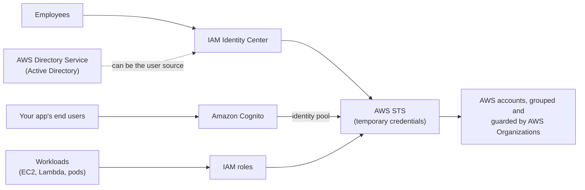
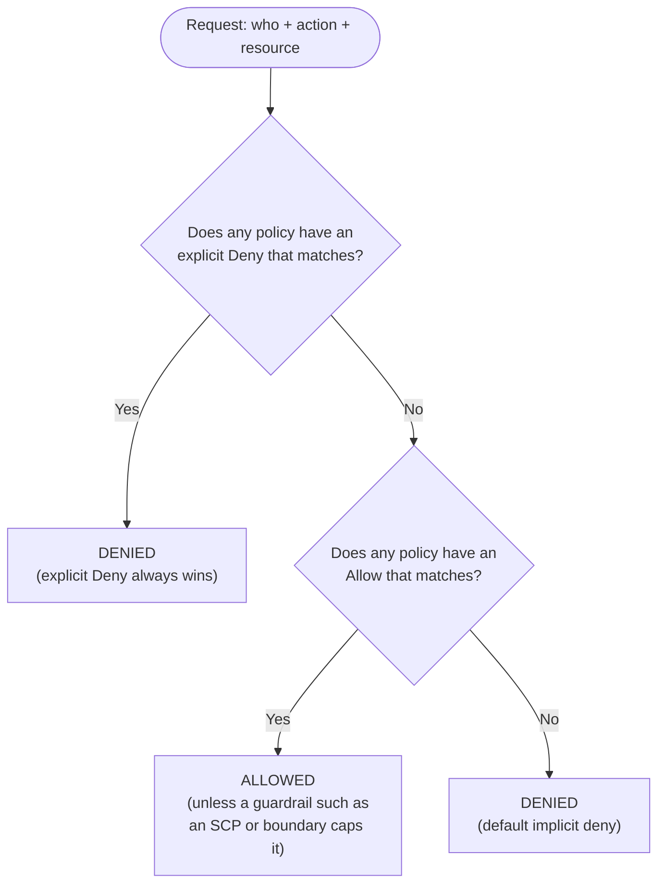

# Identity & governance: AWS services explained for beginners
> [Home](../../README.md) · [Beginner track](../README.md) · [All services A–Z](README.md) · Deep dive: [Notes 01](../../notes/01-iam-multi-account.md)

Every request to AWS, whether it's a console click, a CLI (command line interface) command or an SDK (software development kit) call from your code, has to answer two questions: *who are you?* (authentication) and *are you allowed to do this?* (authorization). This category holds the services that answer them. **IAM** is the foundation. The other services either hand out temporary IAM credentials (STS, IAM Identity Center, Cognito), plug in an existing user directory (Directory Service), or govern many AWS accounts at once (Organizations, Control Tower, RAM).



| Service | One-liner | Exam importance |
|---|---|---|
| [AWS IAM](#aws-iam) | Users, groups, roles and the JSON policies that say who may do what | ★★★ |
| [AWS STS](#aws-sts) | Issues short-lived credentials when someone assumes a role | ★★ |
| [AWS IAM Identity Center](#aws-iam-identity-center) | Single sign-on for employees into many AWS accounts | ★★★ |
| [AWS Organizations](#aws-organizations) | Groups many AWS accounts, with one bill and account-wide guardrails (SCPs) | ★★★ |
| [AWS Control Tower](#aws-control-tower) | Sets up a best-practice multi-account environment for you | ★★ |
| [AWS Resource Access Manager (AWS RAM)](#aws-resource-access-manager-aws-ram) | Shares resources such as subnets or a Transit Gateway with other accounts | ★★ |
| [AWS Directory Service](#aws-directory-service) | Microsoft Active Directory in AWS, or a bridge to your on-prem one | ★★ |
| [Amazon Cognito](#amazon-cognito) | Sign-up and sign-in for *your app's* customers | ★★★ |

---

## AWS IAM

> **In one line:** IAM (Identity and Access Management) decides who can call which AWS action on which resource, in one AWS account.

| Exam importance | Kubernetes / everyday analogy | Pricing model (rough) |
|---|---|---|
| ★★★ High (the most important service in this guide) | Kubernetes RBAC: a `Role` lists allowed verbs on resources, a `RoleBinding` attaches it to a subject. An IAM policy attached to an identity is the same idea. | Free |

**What it is.** IAM is AWS's built-in permission system. Every API call, such as "start this EC2 (Elastic Compute Cloud) instance" or "read this S3 (Simple Storage Service) object", is checked against IAM before anything happens. You define *identities* (users, groups, roles) and attach *policies* (JSON documents) that list what they may do. IAM is global: it isn't tied to a Region, but it is scoped to one AWS account. Without it you would be building your own auth layer in front of every service.

You've already used IAM without noticing. When you run `kubectl` against EKS (Elastic Kubernetes Service), your kubeconfig calls `aws eks get-token`, which proves your IAM identity to the cluster. EKS then maps that IAM identity to Kubernetes users and groups (through access entries or the older `aws-auth` ConfigMap), and Kubernetes RBAC (role-based access control) takes over inside the cluster.

### Users

An **IAM user** is a long-lived identity for one person or one application, with a console password and/or **access keys**. AWS now recommends *not* creating users for people (use [IAM Identity Center](#aws-iam-identity-center)) or for code running on AWS (use roles). Users are the exception, not the default.

### Groups

An **IAM group** is a bag of users that share policies, for example `Developers`. Attach a policy to the group and every member gets it. Groups can't be nested, and a group is **not** an identity: you can't log in as a group or name it in a resource's policy.

### Roles

An **IAM role** is an identity with permissions but **no password and no permanent keys**. Someone or something *assumes* the role and receives temporary credentials from [AWS STS](#aws-sts) that expire after a set time (one hour by default). Roles are the right answer for:
- code on AWS: an EC2 **instance profile**, a Lambda **execution role**, an ECS task role, or an EKS pod through IRSA (IAM Roles for Service Accounts) or EKS Pod Identity ([Amazon EKS](containers.md#amazon-eks));
- people and systems from **another account** (cross-account access);
- people signing in through a corporate login (federation).

A role has two policies: a **trust policy** (*who may assume me?*) and **permissions policies** (*what can I do once assumed?*).

### Policies

A **policy** is a JSON document of statements. Here is a small identity-based policy:

```json
{
  "Version": "2012-10-17",
  "Statement": [
    {
      "Sid": "ReadFinanceReportsOverHttps",
      "Effect": "Allow",
      "Action": ["s3:GetObject"],
      "Resource": "arn:aws:s3:::acme-reports/finance/*",
      "Condition": {
        "Bool": { "aws:SecureTransport": "true" }
      }
    }
  ]
}
```

| Field | What it means here |
|---|---|
| `Version` | The policy *language* version. Always this exact string; it isn't today's date. |
| `Sid` | Optional label for the statement, for humans. |
| `Effect` | `Allow` or `Deny`. |
| `Action` | The API calls covered, written `service:Operation`. Wildcards work (`s3:Get*`, `s3:*`). |
| `Resource` | Which resources, by **ARN** (Amazon Resource Name, AWS's globally unique ID format). Here: every object under `finance/` in the `acme-reports` bucket. |
| `Condition` | Extra "only if" checks on the request. Here: only over HTTPS. Others: source IP, MFA used, Region, tags. |

Policies come as **AWS managed** (written by AWS, broad, e.g., `ReadOnlyAccess`), **customer managed** (yours, reusable) or **inline** (embedded in one identity).

### Identity-based vs resource-based policies

- **Identity-based**: attached to a user, group or role. "*This identity* may do X to Y."
- **Resource-based**: attached to a resource, such as an S3 **bucket policy**, an SQS queue policy or a KMS key policy. It has an extra `Principal` field: "*These identities*, possibly in other accounts, may do X to *me*."

Within one account, either kind of Allow is enough. Across accounts, **both sides** must allow: the caller's identity policy *and* the resource's policy.

### How AWS decides: allow or deny



1. **Default deny.** A brand-new role can do nothing.
2. **An explicit Allow** opens a specific door.
3. **An explicit Deny beats every Allow**, even `AdministratorAccess`.

Guardrails such as **SCPs** (service control policies, see [AWS Organizations](#aws-organizations)) and **permissions boundaries** never grant anything. They only set a ceiling. The full flowchart is in [Notes 01 §4](../../notes/01-iam-multi-account.md#4-policy-evaluation-logic).

### Where the RBAC analogy breaks

| Kubernetes RBAC | IAM | Watch out |
|---|---|---|
| `Role` = a set of permissions | **Policy** = a set of permissions | An IAM **role** is an *identity you become*, not a permission list. Same word, different meaning. |
| `RoleBinding` | Attaching a policy to a user, group or role | Close match |
| `ServiceAccount` for pods | IAM role for workloads | Close match (IRSA links the two) |
| Allow-only rules | Allow **and** Deny | No Deny exists in K8s RBAC |
| No equivalent | Resource-based policies | The resource itself can say who may use it |
| Namespace boundary | Account boundary | Accounts are much harder walls than namespaces |

### Least privilege

Grant only the actions and resources a job needs, then tighten using evidence. IAM's **last accessed information** shows which services an identity never uses, and **IAM Access Analyzer** can generate a policy from real activity or flag resources shared outside your account.

### MFA

**MFA** (multi-factor authentication) adds a second proof, such as an authenticator app code or a passkey/security key, on top of a password. Turn it on for every human. Policies can require it with the condition `aws:MultiFactorAuthPresent`.

### The root user

The **root user** is the email address that created the account. It can do everything, and IAM policies can't restrict it. Protect it with MFA, never create access keys for it, and use it only for the few root-only tasks, such as closing the account or changing the support plan. In daily work, sign in some other way.

### Access keys vs roles

**Access keys** (an access key ID plus a secret) are permanent until someone rotates them, so they leak into Git repos, AMIs and laptops. **Roles** hand out credentials that expire on their own. Exam rule: when an answer says "store access keys on the instance / in the code / in environment variables", it's wrong. The right answer is a role.

**Use it when / don't use it when**
- ✅ Always. Every AWS design uses IAM roles and policies.
- ❌ Employees signing in to many accounts → [IAM Identity Center](#aws-iam-identity-center), not one IAM user per person per account.
- ❌ Your app's customers signing in → [Amazon Cognito](#amazon-cognito), not IAM users.

**Exam hot spots**
- "App on EC2 needs to read S3" → an **IAM role via instance profile**, never access keys.
- **Explicit Deny wins** over any Allow, including admin permissions.
- Cross-account access needs **both** the caller's identity policy and the resource policy (or the caller assumes a role in the other account).
- Groups can't be named as a principal in a bucket policy.
- "Audit which users lack MFA or have old keys" → the IAM **credential report**.

**Try it** (free, 10 min): In the console, open **IAM → Policies**, search `AmazonS3ReadOnlyAccess`, and open the **JSON** tab to read a real policy. Then go back to the **IAM dashboard** and read its *Security recommendations*, which flag a root user without MFA. [Lab 01](../../labs/lab-01-account-iam.md) goes further.

**Go deeper:** [Notes 01: IAM building blocks](../../notes/01-iam-multi-account.md#2-iam-building-blocks) · related services: [AWS STS](#aws-sts) · [AWS IAM Identity Center](#aws-iam-identity-center) · [Amazon EKS](containers.md#amazon-eks)

---

## AWS STS

> **In one line:** STS (Security Token Service) hands out temporary credentials when someone assumes an IAM role.

| Exam importance | Kubernetes / everyday analogy | Pricing model (rough) |
|---|---|---|
| ★★ Medium | A projected ServiceAccount token that expires; or a hotel key card that stops working at checkout | Free |

**What it is.** STS is the machine behind every IAM role. When a principal calls `AssumeRole`, STS checks the role's trust policy and returns three values: an access key ID, a secret key and a **session token**, all valid for a limited time. You rarely call STS directly. The console's "Switch role", the SDK on EC2, IRSA in EKS and IAM Identity Center all use it under the hood.

**Key ideas to know**
- **`AssumeRole`**: a user or role becomes another role, often in another account.
- **`AssumeRoleWithWebIdentity`**: trades an OIDC (OpenID Connect) token for AWS credentials. This is how IRSA works: the pod's ServiceAccount token goes in, AWS credentials come out. GitHub Actions uses it too.
- **`AssumeRoleWithSAML`**: the same for SAML 2.0 (Security Assertion Markup Language) logins from a corporate identity provider (IdP).
- **`GetCallerIdentity`**: "who am I?" Run `aws sts get-caller-identity`, the AWS version of `kubectl auth whoami`.
- **Session duration**: 1 hour by default, configurable on the role from 1 to 12 hours. **Role chaining** (a role assuming another role) is capped at 1 hour.
- **External ID**: a secret value a third-party vendor must pass when assuming your role. It stops the "confused deputy" problem, where another customer of the vendor tricks it into using your role.

**Use it when / don't use it when**
- ✅ Cross-account access, federation, any workload credentials. You get it automatically by using roles.
- ❌ Don't build a custom token broker for app end users → [Amazon Cognito](#amazon-cognito) identity pools do it for you.

**Exam hot spots**
- "Give a SaaS vendor access to our account" → a cross-account role with an **external ID**.
- Temporary credentials are always preferred over long-lived access keys.
- Assuming a role means you **give up** your original permissions for that session.

**Go deeper:** [Notes 01: Roles and AWS STS](../../notes/01-iam-multi-account.md#6-roles-and-aws-sts) · related services: [AWS IAM](#aws-iam)

---

## AWS IAM Identity Center

> **In one line:** one login for employees that gives them the right access in many AWS accounts (the successor to AWS SSO).

| Exam importance | Kubernetes / everyday analogy | Pricing model (rough) |
|---|---|---|
| ★★★ High | Like signing in to many clusters through one OIDC login (Dex, Okta) that maps your groups to ClusterRoles; or one company badge that opens the right doors in every building | No extra charge |

**What it is.** With dozens of AWS accounts, creating an IAM user per person per account is unmanageable. IAM Identity Center gives every employee **one sign-in**, a portal listing the accounts they may use, and temporary credentials for the console or CLI. You manage access in one place: "group *Developers* gets *ReadOnly* in the *prod* account". When someone leaves the company, disabling them in the corporate directory removes their AWS access everywhere.

**Key ideas to know**
- **SSO** (single sign-on): log in once, reach many systems.
- **Identity source**: where users live. The built-in Identity Center directory, Active Directory (via [AWS Directory Service](#aws-directory-service)), or an external IdP such as Microsoft Entra ID, Okta or Google Workspace.
- **SAML 2.0** handles the sign-in. **SCIM** (System for Cross-domain Identity Management) automatically creates and removes users and groups in Identity Center as they change in your IdP.
- **Permission set**: a reusable bundle of policies. Assign *group + permission set + account*, and Identity Center creates a matching IAM role in that account.
- **AWS access portal**: the web page where users pick an account and permission set. For the CLI, `aws configure sso` sets up short-term credentials.
- It works best with [AWS Organizations](#aws-organizations), and lives in the management account (administration can be delegated).

**Use it when / don't use it when**
- ✅ Employees or contractors need access to one or more AWS accounts.
- ✅ "We already use Okta / Entra ID" → connect it as the external IdP.
- ❌ Your app's customers need to sign in → [Amazon Cognito](#amazon-cognito).
- ❌ Code needs credentials → IAM roles.

**Exam hot spots**
- "Centrally manage workforce access to many accounts with the existing corporate IdP" → **Identity Center + SAML + SCIM**.
- "Users must use on-prem Active Directory credentials" → Identity Center with **AD Connector** as the identity source.
- Prefer it over per-account IAM users or per-account SAML setups.

**Try it** (read-only): open the **IAM Identity Center** console and look at the *Settings → Identity source* page. Enabling it is free, but in a personal account it's fine to just look.

**Go deeper:** [Notes 01: Workforce identity](../../notes/01-iam-multi-account.md#8-workforce-identity-iam-identity-center-and-federation) · related services: [AWS Organizations](#aws-organizations) · [AWS Directory Service](#aws-directory-service)

---

## AWS Organizations

> **In one line:** groups many AWS accounts into a tree, with one combined bill and guardrails that apply to whole branches.

| Exam importance | Kubernetes / everyday analogy | Pricing model (rough) |
|---|---|---|
| ★★★ High | Think of each account as a separate cluster. Organizations is the fleet manager, and SCPs act like a cluster-wide admission policy (Gatekeeper/Kyverno) that even `cluster-admin` can't bypass | Free |

**What it is.** Serious AWS users don't run everything in one account. Separate accounts for prod, dev, security and logging give the strongest isolation AWS offers: a mistake or breach in one account doesn't spill into another. Organizations ties those accounts together. You get **consolidated billing** (one bill, combined volume discounts) and **policies** that cap what any account can do, applied to folders of accounts at once.

**Key ideas to know**
- **Management account**: the account that created the organization and pays the bill. Run no workloads in it, because SCPs don't apply to it.
- **Member accounts**: every other account in the organization.
- **OU** (organizational unit): a folder of accounts, such as `Prod` or `Sandbox`. OUs can be nested, and policies on a parent OU flow down to everything below.
- **SCP** (service control policy): a ceiling on what IAM users, roles and even the **root user** in member accounts can do. Example: "nobody may use Regions outside the EU" or "nobody may turn off CloudTrail". SCPs **never grant**; IAM policies still have to allow the action.
- **RCP** (resource control policy, newer): a ceiling on what anyone, including people outside your organization, can do *to* your resources.
- **Consolidated billing**: Reserved Instance and Savings Plans discounts can be shared across accounts.
- **Delegated administrator**: lets a member account (such as a Security account) run services like GuardDuty for the whole organization.

**Use it when / don't use it when**
- ✅ You have more than one AWS account (almost every company).
- ✅ "Prevent every account, including admins, from doing X" → an SCP.
- ❌ You want a ready-made best-practice setup with little effort → [AWS Control Tower](#aws-control-tower), which builds on Organizations.

**Exam hot spots**
- **SCPs don't grant permissions** and **don't affect the management account**.
- SCPs **do** restrict a member account's root user, which IAM policies can't.
- "One bill and volume discounts across accounts" → consolidated billing.
- "Allow every account in our organization to read this bucket" → a bucket policy with the `aws:PrincipalOrgID` condition.

**Go deeper:** [Notes 01: AWS Organizations](../../notes/01-iam-multi-account.md#11-aws-organizations) · related services: [AWS Control Tower](#aws-control-tower) · [Cost allocation tags](cost-management.md#cost-allocation-tags)

---

## AWS Control Tower

> **In one line:** a wizard and ongoing governance layer that sets up a secure, best-practice multi-account AWS environment for you.

| Exam importance | Kubernetes / everyday analogy | Pricing model (rough) |
|---|---|---|
| ★★ Medium | Like a platform team's starter kit that stands up clusters with logging, policies and access already wired; or a housing developer handing you a finished estate with fences and cameras in place | No charge for Control Tower itself; you pay for the services it turns on (Config, CloudTrail, etc.) |

**What it is.** Setting up Organizations, central logging, single sign-on and guardrails by hand takes weeks. Control Tower does it in about an hour and keeps watching afterwards. It wires together Organizations, IAM Identity Center, CloudTrail, AWS Config and other services into a **landing zone**, a pre-built, well-architected starting layout.

**Key ideas to know**
- **Landing zone**: the baseline. It creates a Security OU with a **Log Archive** account (central logs) and an **Audit** account (security team access).
- **Controls** (formerly "guardrails"): **preventive** (implemented with SCPs; block the action), **detective** (implemented with AWS Config rules; flag it afterwards) and **proactive** (CloudFormation Hooks; stop a bad resource before CloudFormation creates it).
- **Account Factory**: self-service creation of new accounts that come out pre-configured.
- **Drift detection**: warns when someone changes the setup outside Control Tower.

**Use it when / don't use it when**
- ✅ "Quickly set up a governed multi-account environment following best practices."
- ❌ You need a fully custom design → Organizations plus your own tooling.

**Exam hot spots**
- "Set up multi-account best practices with minimal effort" → **Control Tower**.
- Preventive = SCP, detective = Config rule, proactive = CloudFormation Hooks.

**Go deeper:** [Notes 01: AWS Control Tower](../../notes/01-iam-multi-account.md#12-aws-control-tower) · related services: [AWS Organizations](#aws-organizations) · [AWS Config](management-monitoring.md#aws-config)

---

## AWS Resource Access Manager (AWS RAM)

> **In one line:** shares resources you own, such as subnets or a Transit Gateway, with other AWS accounts without copying them.

| Exam importance | Kubernetes / everyday analogy | Pricing model (rough) |
|---|---|---|
| ★★ Medium | Like a cluster-scoped `IngressClass` or `StorageClass` that every namespace may use but not edit; or a shared laundry room the landlord owns and tenants use | Free (you pay for the shared resources as usual) |

**What it is.** In a multi-account setup, a central Network account often owns the VPCs (Virtual Private Clouds) and network hub. Other accounts need to use them without each building their own. RAM lets the owner share specific resources with chosen accounts, OUs or the whole organization. The owner keeps control, and consumers can use the resource but not modify or delete it.

**Key ideas to know**
- **Resource share**: the list of resources plus who they're shared with.
- **VPC sharing**: share subnets so other accounts launch EC2 instances or databases into a centrally managed VPC.
- Commonly shared: subnets, [AWS Transit Gateway](networking.md#aws-transit-gateway), Route 53 Resolver rules, prefix lists, License Manager configurations.
- Within an organization (with RAM's Organizations integration turned on), no invitation step is needed.

**Use it when / don't use it when**
- ✅ "Share a Transit Gateway / subnets / DNS resolver rules with other accounts."
- ❌ Share an S3 bucket or KMS key → use a **resource-based policy** on it instead. RAM doesn't share those.

**Exam hot spots**
- Keyword "share across accounts" + network resource → **RAM**.
- S3 buckets, KMS keys, AMIs and EBS snapshots are **not** shared through RAM.

**Go deeper:** [Notes 01: AWS RAM](../../notes/01-iam-multi-account.md#13-aws-resource-access-manager-ram) · related services: [Amazon VPC](networking.md#amazon-vpc)

---

## AWS Directory Service

> **In one line:** gives you Microsoft Active Directory in AWS, or connects AWS to the Active Directory you already run on-premises.

| Exam importance | Kubernetes / everyday analogy | Pricing model (rough) |
|---|---|---|
| ★★ Medium | No real K8s equivalent. Everyday: a company's staff directory and badge office, either moved into the new building or reached by phone from it | Per directory, per hour (varies by type and size) |

**What it is.** Many companies keep employee accounts in **Microsoft Active Directory (AD)**, and many Windows apps (SQL Server, file shares, .NET apps) expect an AD to exist. Directory Service lets AWS workloads use AD without you building and patching domain controllers on EC2.

**Key ideas to know**
- **AWS Managed Microsoft AD**: real AD domain controllers run by AWS across two AZs (Availability Zones). Supports **trusts** with your on-prem AD, MFA, and AD-aware services such as Amazon RDS for SQL Server and Amazon FSx for Windows File Server.
- **AD Connector**: a proxy that forwards login requests to your **on-prem AD**. It stores no user data in AWS, and it needs a VPN (virtual private network) or Direct Connect link. If that link is down, logins fail.
- **Simple AD**: a small, cheap AD-compatible directory (Samba-based) with no trusts and no MFA. ⚠️ It entered maintenance mode and has been closed to new customers since July 30, 2026, but it may still appear in exam questions as the "low-cost basic directory" answer.
- **Trust**: a link that lets users of one AD domain be recognized by another.

**Use it when / don't use it when**
- ✅ Windows workloads that need AD in AWS → Managed Microsoft AD.
- ✅ "Use existing on-prem AD credentials; keep no identity data in AWS" → AD Connector.
- ❌ App customers signing up → [Amazon Cognito](#amazon-cognito).

**Exam hot spots**
- AD Connector **needs** connectivity to on-prem; Managed Microsoft AD keeps working if the link drops.
- Needs a trust or MFA → **Managed Microsoft AD**, not Simple AD.

**Go deeper:** [Notes 01: AWS Directory Service](../../notes/01-iam-multi-account.md#9-aws-directory-service) · related services: [AWS IAM Identity Center](#aws-iam-identity-center) · [Amazon FSx](storage.md#amazon-fsx)

---

## Amazon Cognito

> **In one line:** a managed user directory and login service for *your application's* customers, plus a way to give them temporary AWS credentials.

| Exam importance | Kubernetes / everyday analogy | Pricing model (rough) |
|---|---|---|
| ★★★ High | Like running Keycloak or Auth0 for your app in the cluster, but AWS operates it; or a hotel front desk that checks guests in and hands out room key cards | Per monthly active user (MAU), with a free tier |

**What it is.** IAM and Identity Center are for *your staff*. Cognito is for *your users*: the people who sign up for your mobile or web app. Without it you'd build password storage, email verification, password reset, MFA and "Sign in with Google" yourself. Cognito has two separate parts, and the exam loves to test the difference.

**Key ideas to know**
- **User pool**: a user directory that handles **authentication** (sign-up, sign-in, MFA, social and enterprise logins). After login it issues **JWTs** (JSON Web Tokens): an ID token, an access token and a refresh token.
- **Identity pool**: handles **AWS authorization**. It swaps a login token for **temporary AWS credentials** (via STS) for an IAM role, so the app can call S3 or DynamoDB directly. It can also give limited credentials to guest (unauthenticated) users.
- **Federation**: users can sign in with Google, Apple, Facebook, Amazon, or a company's SAML/OIDC IdP.
- **Managed login** (hosted UI): a ready-made sign-in page, so you don't have to build one.
- **Integrations**: an ALB (Application Load Balancer) can authenticate users against a user pool before traffic reaches your app, and Amazon API Gateway can use a user pool as an authorizer.
- **Per-user isolation**: an identity pool role can use a policy variable so each user only reaches their own S3 folder.

**Use it when / don't use it when**
- ✅ Sign-up/sign-in for a customer-facing web or mobile app.
- ✅ "Mobile users upload photos straight to S3 with no backend" → user pool + identity pool.
- ❌ Employees accessing AWS accounts → [IAM Identity Center](#aws-iam-identity-center).

**Exam hot spots**
- **User pool = who are you (JWTs). Identity pool = AWS credentials.**
- "Add login to an app behind an ALB with minimal code" → ALB authentication with a Cognito user pool.
- "Secure an API Gateway API for app users" → Cognito user pool authorizer ([Amazon API Gateway](integration.md#amazon-api-gateway)).

**Try it** (free tier, 10 min): in the Cognito console, create a user pool with the quick-start wizard, then open its managed login page and sign yourself up. Delete the pool afterwards.

**Go deeper:** [Notes 01: Amazon Cognito](../../notes/01-iam-multi-account.md#10-customer-identity-amazon-cognito) · related services: [AWS STS](#aws-sts) · [Elastic Load Balancing (ELB)](networking.md#elastic-load-balancing-elb)

---

**Next:** [Security services](security.md)
