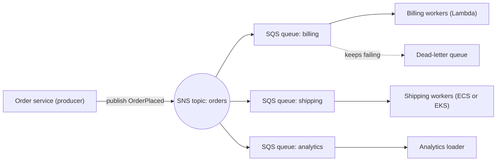

# Application integration & messaging: AWS services explained for beginners
> [Home](../../README.md) · [Beginner track](../README.md) · [All services A–Z](README.md) · Deep dive: [Notes 06](../../notes/06-decoupling-serverless.md)

These services let the parts of a system talk to each other **without being glued together**. Instead of service A calling service B directly and waiting, A drops a message into a queue, a topic or an event bus, and B picks it up when it's ready. The exam calls this **loose coupling**, and task 2.1 ("design scalable and loosely coupled architectures") is built around it. Most questions boil down to choosing between a queue (SQS), a topic (SNS), an event bus (EventBridge), a stream (Kinesis) or a workflow (Step Functions). "SaaS" (software as a service) below means hosted business apps such as Salesforce or Zendesk.

| Service | One-liner | Exam importance |
|---|---|---|
| [Amazon SQS](#amazon-sqs) | A managed message queue: one producer hands work to one consumer, later | ★★★ |
| [Amazon SNS](#amazon-sns) | A managed pub/sub topic that pushes one message to many subscribers | ★★★ |
| [Amazon EventBridge](#amazon-eventbridge) | An event bus that routes events from AWS, SaaS apps and your code by their content | ★★★ |
| [AWS Step Functions](#aws-step-functions) | A visual workflow engine that runs multi-step processes with retries and branching | ★★ |
| [Amazon MQ](#amazon-mq) | Managed ActiveMQ / RabbitMQ brokers for apps that already speak standard messaging protocols | ★★ |
| [Amazon API Gateway](#amazon-api-gateway) | A managed front door for HTTP, REST and WebSocket APIs | ★★★ |
| [Amazon AppFlow](#amazon-appflow) | No-code data sync between SaaS apps (Salesforce, SAP…) and AWS | ★ |
| [AWS Amplify](#aws-amplify) | Tools and hosting to build and ship web and mobile front ends fast | ★ |
| [AWS Device Farm](#aws-device-farm) | Test your app on real phones, tablets and browsers in the cloud | ★ |

---

### Why decouple? (read this first)

#### The restaurant analogy

Picture a busy restaurant.

- **Tight coupling (synchronous).** The waiter takes your order, walks into the kitchen, and **stands there until the dish is ready**. Only then does the waiter go to the next table. If the kitchen is slow, every table waits. If the cook goes home sick, the waiter is stuck and the whole dining room stops.
- **Loose coupling (asynchronous).** The waiter writes an **order ticket**, clips it on the rail, and walks off to serve the next table. Cooks take tickets off the rail **when they are free**. A rush of orders just makes the rail longer for a while. You can add a second cook without retraining the waiters, and a cook's bad day doesn't stop new orders being taken.

The ticket rail is a **queue**. Now imagine the ticket printer prints **copies** of each ticket: one for the grill, one for the bar, one for the dessert station. That is **fan-out** through a **topic**: one message, many independent receivers.

| | Synchronous (request/response) | Asynchronous (queue, topic, event bus, stream) |
|---|---|---|
| Does the caller wait? | Yes, until the answer comes back | No, it hands off the message and moves on |
| If the receiver is slow or down | The caller is slow or fails too (failures cascade) | Messages wait safely in a buffer and are retried |
| Traffic spikes | Overload the slowest component | Absorbed by the buffer ("load leveling") |
| Scaling | Every tier must be sized for peak | Each side scales on its own (e.g., on queue length) |
| Good for | "I need the answer now" (log in, show a page) | "This can finish a bit later" (send email, resize images, process an order) |

**Kubernetes bridge.** Inside your EKS cluster, a Pod calling another Service over HTTP is synchronous. If you have ever run RabbitMQ, Kafka or NATS in the cluster, or scaled a worker Deployment with KEDA based on queue length, you have already used the asynchronous style. On AWS you don't run those brokers yourself; you rent them as managed services.

**The price of decoupling.** Results arrive later (eventual consistency), messages can occasionally be **delivered twice** (so consumers must be **idempotent**: processing the same message twice must do no harm), and tracing a request across services gets harder.

#### SNS → SQS fan-out, the pattern you'll see most

The producer publishes **once**. Each consumer gets its **own queue**, so it can be slow, crash or be redeployed without affecting the others. Adding a fourth consumer means adding a fourth subscription; the producer's code doesn't change.

#### Queue vs topic vs event bus vs stream

| | **Queue**: [Amazon SQS](#amazon-sqs) | **Topic**: [Amazon SNS](#amazon-sns) | **Event bus**: [Amazon EventBridge](#amazon-eventbridge) | **Stream**: [Kinesis Data Streams](analytics.md#amazon-kinesis-data-streams) |
|---|---|---|---|---|
| Everyday picture | Ticket rail in a kitchen | Mailing list / PA announcement | A mailroom that sorts letters by what's written on them | A security-camera recording you can rewind |
| Who receives a message? | **One** consumer (whoever processes and deletes it) | **Every** subscriber gets a copy | Every **rule** whose pattern matches sends it to its targets | **Many** readers, each keeping its own bookmark |
| Push or pull? | Consumers **pull** | SNS **pushes** | EventBridge **pushes** | Consumers **pull** |
| Does it keep messages? | Yes, up to 14 days, until deleted | No (retries, then a dead-letter queue) | No (optional archive and replay) | Yes, 24 hours by default, up to 365 days; **replayable** |
| Ordering | Only with FIFO queues | Only with FIFO topics | Not guaranteed | Ordered **per shard** |
| Classic exam clue | "buffer", "decouple", "process later", "work queue" | "notify many", "fan-out", "email/SMS" | "react to AWS service or SaaS events", "route by content", "schedule" | "real-time", "multiple consumers read the same data", "replay" |

---

## Amazon SQS

> **In one line:** a fully managed message queue that lets one part of your system hand work to another without waiting.

| Exam importance | Kubernetes / everyday analogy | Pricing model (rough) |
|---|---|---|
| ★★★ High | Like a job queue a worker Deployment pulls from (the RabbitMQ or Redis queue you'd otherwise run in the cluster, often scaled with KEDA), but run by AWS. Everyday: the ticket rail in a kitchen | Per million requests |

**What it is.** Amazon SQS (Simple Queue Service) is a durable buffer between a **producer** (which sends messages) and a **consumer** (which receives and processes them). The producer doesn't need the consumer to be running, and the consumer works at its own pace. Without SQS you would run, patch, scale and back up a message broker yourself. SQS has no servers to size: it scales from a handful of messages to huge volumes automatically.

**Key ideas to know**
- **Standard vs FIFO queue.** A *standard* queue has nearly unlimited throughput but delivers **at least once** (rare duplicates) and in **best-effort order**. A *FIFO* (first-in, first-out) queue keeps **strict order** within a *message group* and removes duplicates, at lower throughput. FIFO queue names end in `.fifo`. You can't convert one type into the other.
- **Polling.** Consumers **pull** messages. **Long polling** (wait up to 20 s for a message) cuts empty responses and cost; short polling returns immediately even when empty.
- **Visibility timeout.** When a consumer receives a message, SQS **hides** it for this long (30 s default, up to 12 h). If the consumer deletes it in time, it's done. If the consumer crashes, the message reappears and another consumer retries it. Set it longer than your processing time.
- **Dead-letter queue (DLQ).** After a message fails a set number of times (`maxReceiveCount`), SQS moves it to a separate queue so one "poison" message doesn't block the rest.
- **Retention.** Unprocessed messages are kept 4 days by default, configurable from 1 minute to **14 days**.
- **Message size.** Up to **1 MiB** (older questions say 256 KB). For bigger payloads, store the data in Amazon S3 (Simple Storage Service, AWS's object storage) and send a pointer (the **claim-check** pattern; the Extended Client Library does this for you).

**Use it when / don't use it when**
- ✅ You want to absorb traffic spikes so a database or slow worker isn't overwhelmed.
- ✅ Work can be done later (image resizing, order processing, sending emails).
- ✅ You want to scale workers on backlog (Amazon EC2, Elastic Compute Cloud, virtual servers, with Auto Scaling on "messages per instance", or AWS Lambda, AWS's run-code-without-servers service, reading the queue).
- ❌ Several different systems must each get every message → use [Amazon SNS](#amazon-sns) in front (fan-out) or [Amazon EventBridge](#amazon-eventbridge).
- ❌ You need replay, or several readers on the same ordered data → use [Kinesis Data Streams](analytics.md#amazon-kinesis-data-streams).
- ❌ An existing app speaks JMS or AMQP and you can't change code → use [Amazon MQ](#amazon-mq).

**Exam hot spots**
- "Decouple tiers", "handle spikes without losing orders", "the database can't keep up" → put **SQS** between the tiers.
- "Order matters and no duplicates" → **FIFO**. ⚠️ Trap: FIFO has throughput limits (300 messages/s per API action without batching, 3,000 with batching; high-throughput mode goes much higher).
- Messages processed twice → **visibility timeout too short**. Too many empty responses or high cost → **long polling**.
- "Isolate messages that keep failing" → **DLQ**. It must be the same type (FIFO→FIFO) in the same account and Region.
- Lambda + SQS: Lambda polls the queue for you (an *event source mapping*); cap its concurrency to protect a downstream database.

**Try it** (≈5 min, negligible cost): SQS console → **Create queue** → Standard → name it `test-queue` → Create. Click **Send and receive messages**, send "hello", then **Poll for messages** and open it. Notice the receive count. Delete the queue afterwards.

**Go deeper:** [Notes 06: Amazon SQS](../../notes/06-decoupling-serverless.md) · related services: [Amazon SNS](#amazon-sns) · [AWS Lambda](compute.md#aws-lambda) · [Amazon EC2 Auto Scaling](compute.md#amazon-ec2-auto-scaling)

---

## Amazon SNS

> **In one line:** a managed publish/subscribe service: publish a message to a topic once, and SNS pushes a copy to every subscriber.

| Exam importance | Kubernetes / everyday analogy | Pricing model (rough) |
|---|---|---|
| ★★★ High | Like a NATS or Redis pub/sub channel you'd run in the cluster. Everyday: a mailing list or a public-address announcement: you speak once, everyone subscribed hears it | Per million publishes, plus per delivery (SMS and email priced separately) |

**What it is.** Amazon SNS (Simple Notification Service) has **topics**. Publishers send messages to a topic; **subscribers** (SQS queues, Lambda functions, HTTP/S endpoints, email addresses, phone numbers for SMS, mobile push, Data Firehose) each receive a copy. SNS **pushes** immediately and **doesn't store** messages: if a subscriber can't be reached after retries, the message is lost unless you attached a dead-letter queue. Without SNS you'd write code that loops over every interested system and calls each one, which recouples them.

**Key ideas to know**
- **Topic.** A named channel. Publishers don't know who the subscribers are.
- **Subscription.** One endpoint attached to a topic (e.g., an SQS queue or an email address).
- **Fan-out.** SNS → several SQS queues, so each consumer gets its own buffer and retries (diagram at the top of this page).
- **Message filtering.** A **filter policy** on a subscription means that subscriber only receives matching messages (e.g., `country = US`). No separate topic per message type is needed.
- **FIFO topics.** Strict ordering and deduplication, delivering to SQS FIFO queues. A standard topic can't deliver to a FIFO queue.
- **Application-to-person (A2P).** SMS, email and mobile push notifications to humans.
- **Access policy.** A topic policy controls who may publish (e.g., S3, CloudWatch alarms, another account). For fan-out, each SQS queue policy must allow the topic to send to it.

**Use it when / don't use it when**
- ✅ One event must reach several independent systems.
- ✅ You need to alert people (CloudWatch alarm → SNS → email/SMS).
- ✅ S3 must send the same event to several destinations (S3 → SNS → many).
- ❌ You need messages to wait until a consumer is ready → put [Amazon SQS](#amazon-sqs) behind SNS.
- ❌ You need rich routing on any field, SaaS events or schedules → use [Amazon EventBridge](#amazon-eventbridge).
- ❌ You need replay → [Kinesis Data Streams](analytics.md#amazon-kinesis-data-streams).

**Exam hot spots**
- "Process the same message in several independent ways" → **SNS + SQS fan-out**. This is one of the most frequently tested patterns.
- "Each consumer only wants some messages" → **subscription filter policies**, not extra topics and not filtering in code.
- "Send an email/SMS when an alarm fires" → **CloudWatch alarm → SNS**.
- ⚠️ Trap: SNS on its own is **not a buffer**. If the scenario worries about losing messages while consumers are down, add SQS.

**Try it** (≈5 min, free at this volume): SNS console → **Topics** → Create topic (Standard) → **Create subscription** → protocol Email → your address → confirm the email. Back on the topic, **Publish message**. Delete the topic afterwards.

**Go deeper:** [Notes 06: SNS and the fan-out pattern](../../notes/06-decoupling-serverless.md) · related services: [Amazon SQS](#amazon-sqs) · [Amazon CloudWatch](management-monitoring.md#amazon-cloudwatch) · [Amazon EventBridge](#amazon-eventbridge)

---

## Amazon EventBridge

> **In one line:** a serverless event bus that receives events from AWS services, SaaS apps and your own code, and routes each one to targets based on what's inside it.

| Exam importance | Kubernetes / everyday analogy | Pricing model (rough) |
|---|---|---|
| ★★★ High | Like Knative Eventing (a broker plus triggers with filters) or Argo Events. Also like a controller watching the API server for changes, but for the whole AWS account. Everyday: a mailroom that reads each envelope and forwards it to the right departments | Per million custom/partner events published (AWS service events to the default bus are free); Scheduler per invocation |

**What it is.** Amazon EventBridge collects **events** (small JSON documents saying "something happened": an EC2 instance stopped, an S3 object was created, a Zendesk ticket was opened, an order was placed) on an **event bus**. **Rules** compare each event against a **pattern**, and matching events go to **targets** such as Lambda, SQS, SNS, Step Functions or an ECS (Elastic Container Service, AWS's own container orchestrator) task. Without it, you'd poll AWS APIs or SaaS APIs yourself and write the routing logic. It's the backbone of "event-driven architecture" on AWS.

**Key ideas to know**
- **Event bus.** The **default** bus receives AWS service events automatically. **Custom** buses carry your app's events. **Partner** buses receive SaaS events (e.g., Datadog, Shopify, Zendesk) with no polling code.
- **Rule and event pattern.** A rule matches events on **any field** (source, type, values, prefixes, numeric ranges). Each rule can send to up to 5 targets.
- **Target.** Where a matching event goes. An **input transformer** can reshape the event per target. **API destinations** call any HTTPS endpoint.
- **EventBridge Scheduler.** Serverless cron or one-time schedules ("run this Lambda every weekday at 06:00 in Europe/Paris"). It replaces a cron job on an always-on server.
- **EventBridge Pipes.** Point-to-point: one source (e.g., SQS, Kinesis, DynamoDB Streams) → optional filter and enrichment → one target, without glue code.
- **Archive and replay.** Store events and replay them later, e.g., after fixing a bug in a consumer.
- **Size and delivery.** Events up to **1 MB**; delivery is at least once with retries, and each target can have its own DLQ.

**Use it when / don't use it when**
- ✅ React to something happening in AWS (an EC2 state change, a GuardDuty finding, an API call recorded by CloudTrail).
- ✅ Receive events from SaaS partners.
- ✅ Route events between microservices by content, or across accounts to a central bus.
- ✅ Run scheduled tasks without servers.
- ❌ You need a buffer that consumers pull at their own pace → [Amazon SQS](#amazon-sqs) (often as an EventBridge target).
- ❌ You need strict ordering or replay of a high-volume stream → [Kinesis Data Streams](analytics.md#amazon-kinesis-data-streams).
- ❌ You're sending SMS, email or mobile push to people → [Amazon SNS](#amazon-sns).

**Exam hot spots**
- "When an EC2 instance changes state / a resource is created / a security finding appears, automatically do X" → **EventBridge rule**.
- "Run a job every night with the least operational overhead" → **EventBridge Scheduler** → Lambda or an ECS task (not a cron server on EC2).
- "Integrate events from a SaaS application" → **partner event bus**.
- ⚠️ Trap: EventBridge doesn't guarantee ordering. If order matters, look for SQS FIFO or Kinesis.

**Try it** (≈5 min, negligible cost): EventBridge console → **Rules** → Create rule on the default bus → "Rule with an event pattern" → AWS events → service **EC2**, event type **EC2 Instance State-change Notification** → target an SNS topic you created above. Read the generated JSON pattern, then delete the rule.

**Go deeper:** [Notes 06: Amazon EventBridge, and choosing between EventBridge, SNS, SQS and Kinesis](../../notes/06-decoupling-serverless.md) · related services: [Amazon SNS](#amazon-sns) · [AWS Step Functions](#aws-step-functions) · [AWS Lambda](compute.md#aws-lambda)

---

## AWS Step Functions

> **In one line:** a serverless workflow engine that runs a multi-step process as a visual state machine, with retries, branching and waiting built in.

| Exam importance | Kubernetes / everyday analogy | Pricing model (rough) |
|---|---|---|
| ★★ Medium | A workflow engine like **Argo Workflows**: a declared graph of steps, run and tracked for you. Breaks down: steps are AWS API calls (Lambda, ECS, DynamoDB…), not Pods. Everyday: a recipe card with checkpoints | Standard: per state transition. Express: per request and duration |

**What it is.** AWS Step Functions lets you describe a business process ("validate order → reserve stock → charge card → ship") as a **state machine** in JSON (Amazon States Language) or in a drag-and-drop designer. It calls each step, passes data along, retries failures and records every execution. Without it, you'd hand-code this orchestration and its error handling, which is fragile and hard to see.

**Key ideas to know**
- **State machine and states.** Steps are *Task* (do work), *Choice* (if/else), *Parallel*, *Map* (loop over items), *Wait*, *Succeed* and *Fail*.
- **Standard vs Express workflows.** *Standard*: up to **1 year**, exactly-once, full visual history; for long business processes. *Express*: up to **5 minutes**, very high volume, cheaper; for short event processing.
- **Retry and Catch.** Declare retries with backoff per error type, and a fallback step when retries run out (e.g., a compensating "refund payment" step, known as the **saga** pattern).
- **Wait for callback.** A step can pause (in Standard, for up to a year) until an external system or a human calls back with a token: **human approval**.
- **Direct service integrations.** Call 200+ AWS services without a Lambda in between.

**Use it when / don't use it when**
- ✅ A process has several steps, branches, retries or human approval.
- ✅ You want the workflow's state stored outside your code, with an audit trail.
- ❌ You just need to pass one message from A to B → [Amazon SQS](#amazon-sqs) or [Amazon EventBridge](#amazon-eventbridge).

**Exam hot spots**
- "Coordinate multiple Lambda functions / microservices with error handling and least code" → **Step Functions**.
- "Manual approval step" → callback with a task token.
- Long-running (hours to months) → **Standard**; high-volume, short → **Express**.

**Go deeper:** [Notes 06: AWS Step Functions and the saga example](../../notes/06-decoupling-serverless.md) · related services: [AWS Lambda](compute.md#aws-lambda) · [Amazon EventBridge](#amazon-eventbridge)

---

## Amazon MQ

> **In one line:** managed Apache ActiveMQ and RabbitMQ message brokers, so existing apps that use standard messaging protocols can move to AWS without code changes.

| Exam importance | Kubernetes / everyday analogy | Pricing model (rough) |
|---|---|---|
| ★★ Medium | Like the RabbitMQ or ActiveMQ StatefulSet you'd install with a Helm chart, but AWS patches it and handles failover | Per broker instance-hour plus storage |

**What it is.** Many older enterprise apps talk to a message broker using open protocols: **JMS** (Java Message Service), **AMQP** (Advanced Message Queuing Protocol), **MQTT** (a lightweight IoT protocol), **STOMP** or OpenWire. SQS and SNS use AWS's own APIs, so moving such apps to them means rewriting code. Amazon MQ runs the same broker software for you, so you just point the app at a new endpoint.

**Key ideas to know**
- **Broker.** A server (you pick the instance size) running ActiveMQ or RabbitMQ inside your VPC (Virtual Private Cloud: your private network in AWS).
- **High availability.** ActiveMQ uses an **active/standby** pair across two Availability Zones (AZs); RabbitMQ uses a **3-node cluster** across AZs.
- **Not serverless.** It scales by choosing bigger brokers, not automatically like SQS/SNS.

**Use it when / don't use it when**
- ✅ Migrating an on-premises app that already uses JMS, AMQP, MQTT or STOMP, with no code changes.
- ❌ A new cloud-native design → [Amazon SQS](#amazon-sqs), [Amazon SNS](#amazon-sns) or [Amazon EventBridge](#amazon-eventbridge) (cheaper and less to manage).

**Exam hot spots**
- Keywords "JMS", "AMQP", "MQTT", "existing broker", "without changing code" → **Amazon MQ**.
- ⚠️ Trap: picking SQS for a lift-and-shift of a JMS app. SQS would require code changes.

**Go deeper:** [Notes 06: Amazon MQ](../../notes/06-decoupling-serverless.md) · related services: [Amazon SQS](#amazon-sqs) · [Amazon MSK](analytics.md#amazon-msk)

---

## Amazon API Gateway

> **In one line:** a fully managed "front door" that publishes HTTP, REST and WebSocket APIs and forwards each call to Lambda, containers, other AWS services or any HTTP backend.

| Exam importance | Kubernetes / everyday analogy | Pricing model (rough) |
|---|---|---|
| ★★★ High | ≈ an **Ingress** (or an API gateway like Kong or Envoy Gateway in the cluster) **with auth, throttling and caching built in**. Breaks down: it isn't tied to a cluster; it's a Regional AWS service that can front Lambda or call AWS APIs directly. Everyday: a building's reception desk that checks badges, limits visitors and sends them to the right office | Per million API calls (plus an hourly fee if you enable caching; WebSocket per message and connection-minute) |

**What it is.** Amazon API Gateway receives requests from clients (browsers, mobile apps, partners), checks who they are, applies rate limits, optionally serves cached answers, and passes the request to a backend. The classic serverless app is **API Gateway → Lambda → DynamoDB** (AWS's serverless NoSQL database). Without it, you'd run and scale your own proxy fleet, write auth and throttling yourself, and manage TLS (Transport Layer Security) certificates and DNS for it.

**The three API types**

| | **REST API** | **HTTP API** | **WebSocket API** |
|---|---|---|---|
| What it is | Request/response, the full feature set | Request/response, lean and cheaper | A persistent, two-way connection |
| Price and latency | Higher | **Lower** (much cheaper per call) | Per message and connection-minute |
| Caching | ✅ | ❌ | ❌ |
| Usage plans and API keys (per-client quotas) | ✅ | ❌ | ❌ |
| AWS WAF (web application firewall) attached directly | ✅ | ❌ (put CloudFront + WAF in front) | ❌ |
| Private API (reachable only from your VPC) | ✅ | ❌ | ❌ |
| Auth options | IAM (Identity and Access Management), Cognito user pools, Lambda authorizer | IAM, **JWT** (JSON Web Token) authorizer, Lambda authorizer | IAM, Lambda authorizer |
| Pick it when | You need caching, quotas per customer, WAF, private APIs or request transformation | A simple, cheap proxy to Lambda or HTTP backends | Chat, live dashboards, multiplayer games, push notifications to browsers |

**Key ideas to know**
- **Endpoint types.** *Edge-optimized* (requests enter via CloudFront edge locations; good for global clients), *Regional* (clients in the same Region, or your own CloudFront in front), *Private* (only from inside a VPC through an interface VPC endpoint).
- **Throttling.** A default account limit of 10,000 requests/s (burst 5,000) per Region; over the limit, clients get **HTTP 429**. You can set limits per stage, method or client.
- **Usage plans and API keys.** Give each partner its own rate and monthly quota. ⚠️ API keys **identify** callers; they don't **authenticate** them.
- **Authorizers.** IAM (for AWS callers), **Amazon Cognito** (for your app's users), JWT/OIDC (OpenID Connect) tokens, or a **Lambda authorizer** for custom logic.
- **Caching** (REST only). Stores responses for a TTL (time to live, default 300 s) so repeated reads don't hit the backend.
- **Integrations.** Lambda proxy, HTTP proxy, **direct AWS service calls** (e.g., write straight to SQS or start a Step Functions workflow with no Lambda), and **VPC link** to private load balancers.
- **Timeout.** The default integration timeout is **29 seconds**, so long jobs should return "202 Accepted" and finish asynchronously.

**Use it when / don't use it when**
- ✅ Exposing Lambda functions or microservices as a public or partner API with auth and rate limiting.
- ✅ Real-time two-way messaging with browsers → WebSocket API.
- ❌ A plain web app on containers/EC2 that only needs HTTP routing → an [Application Load Balancer](networking.md#elastic-load-balancing-elb) is simpler and cheaper at steady high traffic.
- ❌ Requests that take minutes → accept the request and process asynchronously via [Amazon SQS](#amazon-sqs) or [AWS Step Functions](#aws-step-functions).

**Exam hot spots**
- "Serverless REST API with least operational overhead" → **API Gateway + Lambda**.
- "Different request quotas per customer / monetize the API" → **REST API with usage plans and API keys**.
- "Cache responses / reduce backend calls" → REST API **caching**. "Cheapest, simple proxy" → **HTTP API**.
- "Protect the API from SQL injection or bad IPs" → **AWS WAF** on a REST API.
- Spiky writes that overwhelm the backend → **API Gateway → SQS** (direct integration) to buffer them.

**Try it** (≈10 min, negligible cost): API Gateway console → **Create API** → HTTP API → add no integration yet → read the routes and stages screens. Delete it afterwards.

**Go deeper:** [Notes 06: Amazon API Gateway](../../notes/06-decoupling-serverless.md) · related services: [AWS Lambda](compute.md#aws-lambda) · [Amazon Cognito](identity-governance.md#amazon-cognito) · [AWS WAF](security.md#aws-waf) · [Amazon CloudFront](networking.md#amazon-cloudfront)

---

## Amazon AppFlow

> **In one line:** a no-code service that moves data between SaaS (software as a service) apps such as Salesforce, SAP, ServiceNow or Zendesk and AWS services such as S3 and Redshift.

| Exam importance | Kubernetes / everyday analogy | Pricing model (rough) |
|---|---|---|
| ★ Low | Like a CronJob that runs a sync script from Salesforce to S3, but you configure it in a few screens instead of writing it | Per flow run plus per GB processed |

**What it is.** You define a **flow**: source app, destination, field mapping and filters, and a trigger (on demand, on a schedule, or on an event in the SaaS app). AppFlow handles authentication, paging and retries, and can keep the traffic private with PrivateLink for supported sources.

**Exam hot spots**
- "Copy Salesforce (or other SaaS) data into S3/Redshift regularly with the least effort and no code" → **AppFlow**.

**Go deeper:** [Notes 06: AppFlow and friends](../../notes/06-decoupling-serverless.md) · related services: [Amazon S3](storage.md#amazon-s3) · [Amazon Redshift](databases.md#amazon-redshift)

---

## AWS Amplify

> **In one line:** a toolkit and hosting service that lets front-end and mobile developers build, deploy and host full-stack apps quickly.

| Exam importance | Kubernetes / everyday analogy | Pricing model (rough) |
|---|---|---|
| ★ Low | Like Vercel or Netlify on AWS: connect a Git repo and get a built, hosted site with preview environments. No real Kubernetes equivalent | Per build minute, plus storage and data served |

**What it is.** **Amplify Hosting** gives Git-based CI/CD (continuous integration and delivery) and managed hosting for single-page and server-rendered web apps (React, Next.js, Vue). Amplify's backend tooling provisions common pieces (Cognito sign-in, a GraphQL or REST API, DynamoDB, S3 storage) without deep AWS knowledge.

**Exam hot spots**
- "Web/mobile developers want to build and host a full-stack app quickly with little infrastructure work" → **Amplify**.

**Go deeper:** [Notes 06: AppFlow, SAM, SAR, Amplify](../../notes/06-decoupling-serverless.md) · related services: [Amazon Cognito](identity-governance.md#amazon-cognito) · [Amazon CloudFront](networking.md#amazon-cloudfront)

---

## AWS Device Farm

> **In one line:** an app-testing service that runs your tests on real mobile devices and desktop browsers hosted by AWS.

| Exam importance | Kubernetes / everyday analogy | Pricing model (rough) |
|---|---|---|
| ★ Low | Like renting a lab full of real phones by the minute, instead of buying and maintaining them | Per device-minute, or a flat monthly fee per dedicated device slot |

**What it is.** You upload an Android or iOS app (or point at a web app) plus automated tests, and Device Farm runs them in parallel on many real devices and browser versions, returning logs, screenshots and videos. You can also take remote control of a device for manual testing.

**Exam hot spots**
- "Test a mobile app on many real devices without buying them" → **Device Farm**. It's a distractor in most other scenarios.

**Go deeper:** [Notes 06](../../notes/06-decoupling-serverless.md) · related services: [AWS Amplify](#aws-amplify)

---

**Next:** [Analytics](analytics.md)
