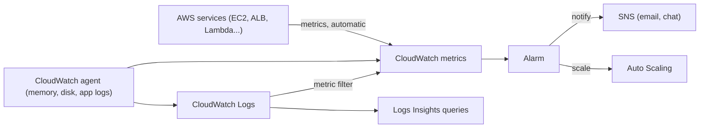

# Management, monitoring & governance: AWS services explained for beginners
> [Home](../../README.md) · [Beginner track](../README.md) · [All services A–Z](README.md) · Deep dive: [Notes 08](../../notes/08-ha-dr-edge-ops.md) · [Notes 07 (CloudTrail, Config)](../../notes/07-security-data-protection.md)

These are the services you use to **operate** AWS rather than to run your app on it. You talk to AWS through the Console, the CLI (command line interface) or CloudShell. You **build** with templates (CloudFormation, Service Catalog). You **watch** your systems (CloudWatch, X-Ray, Grafana, Prometheus), you **audit and govern** them (CloudTrail, Config), you **operate** servers (Systems Manager), and you **get advice** (Trusted Advisor, Compute Optimizer, Health Dashboard, Well-Architected Tool, License Manager).

```mermaid
flowchart LR
    subgraph T["Talk to AWS"]
        CON["Console"]
        CLI["AWS CLI"]
        CS["CloudShell"]
    end
    subgraph B["Build"]
        CFN["CloudFormation"]
        SC["Service Catalog"]
        PR["Proton (end of support)"]
    end
    subgraph W["Watch"]
        CW["CloudWatch"]
        XR["X-Ray"]
        GR["Managed Grafana"]
        PROM["Managed Prometheus"]
    end
    subgraph G["Audit and govern"]
        CT["CloudTrail"]
        CFG["Config"]
    end
    subgraph O["Operate and improve"]
        SSM["Systems Manager"]
        TA["Trusted Advisor"]
        CO["Compute Optimizer"]
        HD["Health Dashboard"]
        WAT["Well-Architected Tool"]
        LM["License Manager"]
    end
    T --> B --> W
    W --> G
    G --> O
```



| Service | One-liner | Exam importance |
|---|---|---|
| [AWS Management Console](#aws-management-console) | The web UI for AWS | ★ |
| [AWS CLI](#aws-cli) | Command-line tool that calls every AWS API | ★ |
| [AWS CloudShell](#aws-cloudshell) | A browser terminal with the CLI preinstalled and already logged in | ★ |
| [Amazon CloudWatch](#amazon-cloudwatch) | Metrics, logs, alarms and dashboards | ★★★ |
| [AWS CloudTrail](#aws-cloudtrail) | Audit log of every AWS API call: who did what, when, from where | ★★★ |
| [AWS Config](#aws-config) | History of each resource's configuration, plus compliance rules | ★★★ |
| [AWS Systems Manager](#aws-systems-manager) | Toolbox for running a server fleet: shell access, patching, commands, parameters | ★★★ |
| [AWS CloudFormation](#aws-cloudformation) | Infrastructure as code: YAML/JSON templates that create AWS resources | ★★★ |
| [AWS Service Catalog](#aws-service-catalog) | An internal "app store" of approved templates | ★★ |
| [AWS Proton](#aws-proton) | Platform-team templates for container/serverless apps (end of support Oct 2026) | ★ |
| [AWS Health Dashboard](#aws-health-dashboard) | AWS outages and maintenance that affect *your* resources | ★★ |
| [AWS Trusted Advisor](#aws-trusted-advisor) | Automated best-practice checks: cost, security, resilience, quotas | ★★ |
| [AWS Compute Optimizer](#aws-compute-optimizer) | ML-based rightsizing recommendations | ★★ |
| [AWS License Manager](#aws-license-manager) | Track and enforce software licenses (BYOL) | ★ |
| [Amazon Managed Grafana](#amazon-managed-grafana) | Hosted Grafana dashboards | ★ |
| [Amazon Managed Service for Prometheus](#amazon-managed-service-for-prometheus) | Hosted Prometheus-compatible metrics storage | ★ |
| [AWS X-Ray](#aws-x-ray) | Distributed tracing across microservices | ★★ |
| [AWS Well-Architected Tool](#aws-well-architected-tool) | Guided review of a workload against AWS best practices | ★ |

### CloudWatch vs CloudTrail vs Config: the #1 beginner confusion

All three "watch" your account, and their names sound alike. They answer **different questions**:

| | Amazon CloudWatch | AWS CloudTrail | AWS Config |
|---|---|---|---|
| Question it answers | "**How is it performing?** Is something broken right now?" | "**Who did what**, when, and from where?" | "**What does this resource look like** now and at any time in the past, and **is it compliant**?" |
| What it records | **Metrics** (CPU, latency, error counts) and **logs** (your app's output) | **API calls** to AWS (console clicks, CLI and SDK calls) | **Configuration snapshots** of resources and the relationships between them |
| Everyday analogy | The car dashboard and the black-box flight recorder | The building's visitor sign-in book and security camera | A photo album of every room after each renovation, plus an inspector with a checklist |
| Kubernetes analogy | metrics-server/Prometheus + `kubectl logs` + Alertmanager | The Kubernetes **API server audit log** | `kubectl get -o yaml` history for every object, plus Gatekeeper/Kyverno in *audit* mode |
| Typical exam phrase | "Alarm when CPU > 80%", "collect application logs", "memory metrics" | "Find out **who deleted** the bucket", "audit API activity" | "**Track configuration changes**", "check that all volumes are encrypted", "**compliance**" |

Memory trick: Cloud**Watch** watches **performance**, Cloud**Trail** follows the **trail of API calls** (people), and **Config** records **configuration** (resources).

---

## AWS Management Console

> **In one line:** the web interface where you click around to create, view and change AWS resources.

| Exam importance | Kubernetes / everyday analogy | Pricing model (rough) |
|---|---|---|
| ★ Low | Like the Kubernetes Dashboard or Lens, but for all of AWS | Free (you pay for the resources you create) |

**What it is.** The Console at `console.aws.amazon.com` is a browser UI over the same AWS APIs the CLI uses. Each console click is an API call, signed with your identity and recorded by [CloudTrail](#aws-cloudtrail).

**Exam hot spots**
- Know that the console, the CLI and the SDKs all hit the same APIs and the same IAM (Identity and Access Management) permissions. ⚠️ Trap: most services in the console are **Regional**, so check the Region selector (top right) if "your resources disappeared".

**Go deeper:** [Beginner 01: cloud and AWS basics](../01-cloud-and-aws-basics.md) · related services: [AWS CLI](#aws-cli), [AWS IAM](identity-governance.md#aws-iam)

## AWS CLI

> **In one line:** a command-line tool (`aws ...`) that can call every AWS API from your terminal or scripts.

| Exam importance | Kubernetes / everyday analogy | Pricing model (rough) |
|---|---|---|
| ★ Low | The `kubectl` of AWS: `aws ec2 describe-instances` ≈ `kubectl get pods` | Free |

**What it is.** The AWS CLI (version 2) wraps the AWS APIs as commands: `aws <service> <action> --options`. You've probably already run one: `aws eks update-kubeconfig --name my-cluster` writes your kubeconfig. Credentials come from **profiles** (like kubeconfig contexts), set up with `aws configure` (access keys) or, better, `aws configure sso` (short-lived IAM Identity Center credentials).

**Exam hot spots**
- `aws sts get-caller-identity` tells you who you are (≈ `kubectl auth whoami`). The exam cares that scripts on EC2 use an **IAM role (instance profile)** instead of long-term access keys stored on disk.

**Go deeper:** [Beginner 01: cloud and AWS basics](../01-cloud-and-aws-basics.md) · related services: [AWS CloudShell](#aws-cloudshell), [AWS IAM Identity Center](identity-governance.md#aws-iam-identity-center)

## AWS CloudShell

> **In one line:** a terminal in your browser, opened from the console, with the AWS CLI already installed and logged in as you.

| Exam importance | Kubernetes / everyday analogy | Pricing model (rough) |
|---|---|---|
| ★ Low | Like a throwaway admin pod you `kubectl exec` into, already holding your credentials | No extra charge; 1 GB of persistent home-directory storage per Region |

**What it is.** CloudShell is a small Linux environment that uses your console sign-in, so there are no keys to configure. It's handy for quick CLI commands and for following labs without installing anything locally.

**Exam hot spots**
- Rarely tested. If an option says "run CLI commands without installing or configuring credentials locally", CloudShell fits.

**Go deeper:** [AWS CloudShell docs](https://docs.aws.amazon.com/cloudshell/latest/userguide/welcome.html) · related services: [AWS CLI](#aws-cli)

## Amazon CloudWatch

> **In one line:** AWS's built-in monitoring service: it collects metrics and logs, raises alarms, and draws dashboards.

| Exam importance | Kubernetes / everyday analogy | Pricing model (rough) |
|---|---|---|
| ★★★ High | Prometheus + Alertmanager + a log stack (Loki/ELK) + Grafana, bundled and run by AWS. Everyday: a car's dashboard warning lights plus its trip recorder. | Basic metrics free; pay per custom metric, alarm, dashboard, and per GB of logs ingested and stored |

**What it is.** Almost every AWS service automatically publishes numbers (metrics) to CloudWatch: EC2 CPU, load balancer request counts, Lambda errors, SQS queue depth. You can also send your own metrics and log lines. CloudWatch stores them, lets you search and graph them, and fires **alarms** when a value crosses a line. Without it you'd run your own Prometheus, log pipeline and alerting stack, and still have no view inside AWS-managed services.

**Key ideas to know**
- **Metric**: a time series of numbers, identified by a **namespace** (e.g., `AWS/EC2`), a name (`CPUUtilization`) and **dimensions** (e.g., `InstanceId`), much like Prometheus labels.
- **EC2 monitoring frequency**: basic monitoring sends data every **5 minutes** (free); **detailed monitoring** sends it every **1 minute** (paid).
- **Custom metrics**: your own numbers, sent with the `PutMetricData` API or embedded in logs. **High-resolution** custom metrics go down to **1 second**.
- **Alarm**: watches one metric (or a math expression) and moves between `OK`, `ALARM` and `INSUFFICIENT_DATA`. Actions can notify [Amazon SNS](integration.md#amazon-sns), scale an [Auto Scaling group](compute.md#amazon-ec2-auto-scaling), or stop, reboot or **recover** an EC2 instance. **Composite alarms** combine alarms with AND/OR to cut noise.
- **CloudWatch Logs**: **log groups** (one per app or component) contain **log streams** (one per instance or container). ⚠️ The default retention is **never expire**, so set one.
- **Metric filter**: turns a log pattern (e.g., the word `ERROR`) into a metric you can alarm on. **Subscription filters** stream logs to Lambda, Kinesis or Firehose in near real time.
- **Logs Insights**: an interactive query language for searching and aggregating logs, e.g., "top 10 slowest requests in the last hour".
- **CloudWatch agent**: software you install on EC2 or on-premises servers. ⚠️ **Memory and disk-space usage are *not* collected by default.** You need the agent for them, because AWS sees the VM from the outside (hypervisor) and can't see inside the OS.
- **Dashboards**: shareable graphs, which can span accounts and Regions.
- **Container Insights**: for your EKS cluster. It collects CPU, memory, network and restart metrics per cluster, node, namespace, pod and container, plus container logs (via the CloudWatch agent and Fluent Bit, installable as the Amazon CloudWatch Observability EKS add-on). It's the AWS-managed alternative to wiring up kube-state-metrics and Prometheus yourself.

**How the pieces connect**



**Use it when / don't use it when**
- ✅ You need metrics, log collection, alerting or auto-scaling triggers for AWS resources. This is the default answer for "monitor X".
- ✅ You want EKS cluster visibility without running your own monitoring stack (Container Insights).
- ❌ You need to know **who** changed something → use [CloudTrail](#aws-cloudtrail).
- ❌ You need **configuration history or compliance** → use [Config](#aws-config).
- ❌ You need to trace one request across many microservices → use [X-Ray](#aws-x-ray).

**Exam hot spots**
- "Monitor **memory** usage on EC2" → install the **CloudWatch agent**. This is one of the most-tested CloudWatch facts.
- "React to an event within seconds" or "alert on a specific log message" → **metric filter + alarm + SNS**.
- "Recover an instance automatically when the underlying host fails" → CloudWatch alarm with the **EC2 recover** action (it keeps the same instance ID, private IP addresses, Elastic IPs and EBS volumes).
- Logs piling up and costing money → set **retention** on log groups, or export old logs to S3.
- ⚠️ Trap: CloudWatch alarms watch *metrics*. To react to *events* (an instance changed state, an API was called), use [EventBridge](integration.md#amazon-eventbridge).

**Try it** (≤10 min, free): open **CloudWatch → Metrics → All metrics**, pick a namespace such as `AWS/EC2` or `AWS/Usage`, and graph something. Then open **Logs → Log groups**, sort by "Stored bytes", and check the **Retention** column; anything that says "Never expire" is a future cost.

**Go deeper:** [Notes 08: 8.1 Amazon CloudWatch](../../notes/08-ha-dr-edge-ops.md#81-amazon-cloudwatch) · related services: [Amazon SNS](integration.md#amazon-sns), [Amazon EventBridge](integration.md#amazon-eventbridge), [Amazon EKS](containers.md#amazon-eks)

## AWS CloudTrail

> **In one line:** a tamper-evident log of every API call made in your AWS account: who made it, when, from which IP address, and whether it succeeded.

| Exam importance | Kubernetes / everyday analogy | Pricing model (rough) |
|---|---|---|
| ★★★ High | The Kubernetes **API server audit log**, but for AWS APIs. Everyday: the building's sign-in book plus security camera. | 90-day event history free; trails pay mainly for S3 storage; data events and CloudTrail Lake are charged |

**What it is.** Everything in AWS is an API call: a console click, a CLI command, Terraform, even AWS services acting on your behalf. CloudTrail records each call with the identity, time, source IP, request parameters and result. When a production database disappears, CloudTrail is how you find out who deleted it. Without it you'd have no reliable record of who changed what.

**Key ideas to know**
- **Event history**: the last **90 days** of management events, on by default and free, viewable per Region in the console.
- **Trail**: a configuration that delivers events continuously to an **S3 bucket** (and optionally CloudWatch Logs) for long-term keeping. Create one for anything beyond 90 days.
- **Management events**: control-plane actions that create, change or delete resources (`RunInstances`, `CreateBucket`, `DeleteDBInstance`, console sign-in). Logged by default.
- **Data events**: high-volume operations *on the data* (S3 `GetObject`/`PutObject`, Lambda `Invoke`). **Off by default** and charged extra.
- **Organization trail**: one trail, created in the management account, that logs **every account** in your AWS Organization. Member accounts can't turn it off.
- **Log file integrity validation**: CloudTrail writes signed digest files, so you can prove the logs weren't altered or deleted.
- **CloudTrail Lake**: a managed store where you query events with SQL and keep them for years.
- **CloudTrail Insights**: flags unusual spikes in API call or error rates.

**Kubernetes bridge.** Your `kubectl apply` calls go to the Kubernetes API server, **not** to AWS APIs, so they don't appear in CloudTrail. They appear in the EKS control plane **audit log** (which you can send to CloudWatch Logs). CloudTrail does record the AWS-level EKS calls, such as `CreateCluster` or `CreateNodegroup`.

**Use it when / don't use it when**
- ✅ "Who stopped this instance?", security investigations, compliance audit trails.
- ✅ Near-real-time alerts on sensitive actions (root sign-in, security group change) via CloudWatch Logs metric filters or EventBridge rules.
- ❌ Performance or application logs → [CloudWatch](#amazon-cloudwatch).
- ❌ "What did this resource look like last week?" → [Config](#aws-config).

**Exam hot spots**
- "**Who** made this change / **audit** API activity" → CloudTrail. "Keep logs longer than 90 days" → a **trail to S3**.
- "Log all accounts centrally and prevent tampering" → **organization trail** to a bucket in a separate log-archive account, with **log file integrity validation** (plus S3 Object Lock or MFA Delete).
- "Track who read objects in S3" → enable **data events** (they're off by default).
- ⚠️ Trap: CloudTrail *records*; it doesn't *block*. Prevention comes from IAM policies and SCPs (service control policies).

**Try it** (free): open **CloudTrail → Event history**, filter by "Event name" or "User name", and find the events from your own console sign-in.

**Go deeper:** [Notes 07: 8.1 AWS CloudTrail](../../notes/07-security-data-protection.md#81-aws-cloudtrail-who-did-what-when-from-where) · related services: [AWS Config](#aws-config), [AWS Organizations](identity-governance.md#aws-organizations), [Amazon S3](storage.md#amazon-s3)

## AWS Config

> **In one line:** records how each AWS resource is configured over time, and checks those configurations against rules you define.

| Exam importance | Kubernetes / everyday analogy | Pricing model (rough) |
|---|---|---|
| ★★★ High | A history of `kubectl get -o yaml` for every object, plus OPA Gatekeeper or Kyverno running in **audit** mode. Everyday: a building inspector with a checklist and a photo archive. | Per configuration item recorded + per rule evaluation |

**What it is.** Config takes a snapshot (a **configuration item**) every time a supported resource changes: a security group rule, a bucket policy, an EBS volume's encryption setting. That lets you answer "what did this look like last Tuesday, and what is it attached to?" **Config rules** then mark each resource compliant or non-compliant, e.g., "all EBS volumes must be encrypted". Without it you'd write and schedule your own scripts to poll and diff every resource.

**Key ideas to know**
- **Configuration recorder**: the switch that turns recording on, per Region. Nothing is recorded until you enable it.
- **Configuration item**: a point-in-time record of one resource's settings and **relationships** (this instance uses this ENI, which is in this subnet).
- **Managed rules**: ready-made checks such as `s3-bucket-public-read-prohibited`, `encrypted-volumes`, `restricted-ssh` and `required-tags`. **Custom rules** run your own logic in Lambda or Guard.
- **Remediation**: a non-compliant resource can trigger a Systems Manager **Automation runbook** that fixes it, manually or automatically.
- **Conformance pack**: a bundle of rules and remediations (for example, for CIS or PCI DSS) deployed as a unit, even across an organization.
- **Aggregator**: one compliance view across many accounts and Regions.

**Where the analogy breaks.** Gatekeeper can *reject* a bad manifest at admission time. Config **can't block** anything: it detects after the fact and can trigger a fix. Prevention on AWS comes from IAM policies, SCPs, and features like S3 Block Public Access.

**Use it when / don't use it when**
- ✅ Configuration history, change tracking, continuous compliance, auto-remediation of drift from your security baseline.
- ❌ "Who made the change?" → [CloudTrail](#aws-cloudtrail) (Config shows *what* changed and links to the CloudTrail event).
- ❌ Stopping a change before it happens → IAM, SCPs ([AWS Organizations](identity-governance.md#aws-organizations)).

**Exam hot spots**
- "**Track configuration changes**", "configuration history", "**audit compliance** of resources" → Config.
- "Automatically fix non-compliant resources" (e.g., close open SSH, re-enable encryption) → **Config rule + SSM Automation remediation**.
- "Compliance across all accounts" → **conformance packs** and an **aggregator**.
- ⚠️ Trap: Config is Regional, and you have to enable it. It's not on by default like CloudTrail's event history.

**Go deeper:** [Notes 07: 8.2 AWS Config](../../notes/07-security-data-protection.md#82-aws-config-what-does-it-look-like-and-is-it-compliant) · related services: [AWS Systems Manager](#aws-systems-manager), [AWS Security Hub](security.md#aws-security-hub), [AWS Control Tower](identity-governance.md#aws-control-tower)

## AWS Systems Manager

> **In one line:** a toolbox for operating fleets of servers (EC2 and on-premises): shell access without SSH, patching, running commands, automation runbooks, and a parameter store.

| Exam importance | Kubernetes / everyday analogy | Pricing model (rough) |
|---|---|---|
| ★★★ High | `kubectl exec` + a DaemonSet that runs admin jobs + ConfigMaps/Secrets, but for VMs. Everyday: a building's facilities-management office. | Most core features free (Session Manager, Run Command, Patch Manager, standard parameters); some advanced features charged |

**What it is.** Systems Manager (often shortened to **SSM**, its old name) manages servers through the **SSM Agent**, which runs on the machine and calls out to the SSM service. Because the agent connects *outward*, you can administer machines with **no inbound ports, no SSH keys and no bastion host**. It also stores configuration values for apps. Without it you'd run Ansible, a bastion host, a patching tool and a config server yourself.

**Key ideas to know**
- **Managed node**: an EC2 instance or on-premises server that SSM can control. It needs **three things**: the SSM Agent (preinstalled on Amazon Linux and many AMIs), an **IAM role** (instance profile with `AmazonSSMManagedInstanceCore`), and a **network path** to the SSM endpoints (internet/NAT, or interface VPC endpoints in private subnets).
- **Session Manager**: a shell or port-forward to an instance from the console or CLI. Access is controlled by IAM, and sessions can be logged to S3 or CloudWatch Logs. It's the `kubectl exec` of EC2, without opening port 22.
- **Run Command**: run a script on hundreds of instances at once, selected by tag, with rate limits and error thresholds.
- **Patch Manager**: patch operating systems on a schedule using **patch baselines** (which patches are approved) and **maintenance windows** (when), with compliance reports.
- **Automation**: multi-step **runbooks** (e.g., "snapshot, stop, change instance type, start"). Config remediation and EventBridge rules can trigger them.
- **State Manager**: keeps a node in a desired state on a schedule (agent installed, setting applied). It's a gentle cousin of a Kubernetes controller's reconcile loop.
- **Parameter Store**: hierarchical key-value storage for configuration and simple secrets, e.g., `/myapp/prod/db-url`.

**Parameter Store vs Kubernetes ConfigMaps and Secrets**

| | K8s ConfigMap | K8s Secret | Parameter Store `String` | Parameter Store `SecureString` | [Secrets Manager](security.md#aws-secrets-manager) |
|---|---|---|---|---|---|
| Holds | Non-secret config | Sensitive values | Non-secret config | Sensitive values | Sensitive values with a lifecycle |
| Protection | Plaintext | Base64 (encryption at rest depends on cluster setup) | Plaintext | **Encrypted with KMS** | **Encrypted with KMS** |
| Scope | One namespace in one cluster | One namespace in one cluster | Account + Region; any service with IAM access | Same | Same, plus cross-Region replicas |
| Automatic rotation | No | No | No | No | **Yes** |
| Cost | Free | Free | Standard tier free | Standard tier free | Per secret per month |

Bridge for EKS: the **Secrets Store CSI Driver** with the AWS provider mounts Parameter Store and Secrets Manager values into pods as files, and the open-source **External Secrets Operator** syncs them into Kubernetes Secrets. Either way, the pod's ServiceAccount maps to an IAM role that's allowed to read them.

**Use it when / don't use it when**
- ✅ "Remove the bastion host", "no SSH keys", "audit shell sessions" → Session Manager.
- ✅ "Patch a fleet of EC2 and on-premises servers on a schedule" → Patch Manager + maintenance windows.
- ✅ "Store config values and AMI IDs cheaply" → Parameter Store.
- ❌ Secrets that need **automatic rotation** (database passwords) → [Secrets Manager](security.md#aws-secrets-manager).
- ❌ Containers on Fargate or Lambda: there's no server to patch, so most SSM fleet features don't apply.

**Exam hot spots**
- "Secure shell access to private instances **without opening inbound ports** or managing keys" → **Session Manager**.
- Instances in a private subnet with no internet don't show up in SSM → add **interface VPC endpoints** (`ssm`, `ssmmessages`, `ec2messages`) and check the IAM role.
- "Run the same command on many instances" → **Run Command**. "Auto-remediate" → **Automation** (often triggered by Config).
- Parameter Store vs Secrets Manager: "**rotate automatically**" → Secrets Manager; "cheap config, no rotation" → Parameter Store.

**Try it** (free): open **Systems Manager → Parameter Store → Create parameter**, create a `String` named `/demo/greeting`, then run `aws ssm get-parameter --name /demo/greeting` in [CloudShell](#aws-cloudshell). Delete it afterwards.

**Go deeper:** [Notes 08: 9. AWS Systems Manager](../../notes/08-ha-dr-edge-ops.md#9-aws-systems-manager) · [Notes 07: 5.1 secrets comparison](../../notes/07-security-data-protection.md#51-comparison) · related services: [AWS Secrets Manager](security.md#aws-secrets-manager), [AWS Config](#aws-config), [Amazon EC2](compute.md#amazon-ec2)

## AWS CloudFormation

> **In one line:** infrastructure as code (IaC): you describe AWS resources in a YAML or JSON template, and CloudFormation creates, updates and deletes them as one unit.

| Exam importance | Kubernetes / everyday analogy | Pricing model (rough) |
|---|---|---|
| ★★★ High | A **Helm chart / `kubectl apply -f`** for AWS resources: template ≈ chart, parameters ≈ `values.yaml`, stack ≈ Helm release. Everyday: an architect's blueprint the builder follows exactly. | Free for AWS resource types (you pay for what it creates) |

**What it is.** Instead of clicking through the console, you write a **template** listing the resources you want (a VPC, subnets, an ALB, an RDS database) and how they connect. CloudFormation works out the order, creates everything, and tracks the result as a **stack**. To change the infrastructure, you edit the template and update the stack. To tear it all down, you delete the stack. Without it, environments drift apart, nobody remembers which clicks built production, and rebuilding in another Region is guesswork.

**A tiny template**

```yaml
AWSTemplateFormatVersion: "2010-09-09"
Description: A versioned S3 bucket for application logs
Parameters:
  Env:
    Type: String
    AllowedValues: [dev, prod]
Resources:
  LogsBucket:
    Type: AWS::S3::Bucket
    Properties:
      BucketName: !Sub "myapp-${Env}-logs-${AWS::AccountId}"
      VersioningConfiguration:
        Status: Enabled
Outputs:
  BucketArn:
    Value: !GetAtt LogsBucket.Arn
```

Deploy it with `aws cloudformation deploy --template-file bucket.yaml --stack-name myapp-logs --parameter-overrides Env=dev`, roughly what `helm upgrade --install myapp-logs ./chart --set env=dev` does for a chart. The `Type: AWS::S3::Bucket` line plays the role of `kind: Deployment` in a manifest.

**Key ideas to know**
- **Template sections**: `Parameters` (inputs), `Mappings` (lookup tables, e.g., per-Region values), `Conditions`, **`Resources`** (the only required section) and `Outputs` (values to show or export). Intrinsic functions like `!Ref`, `!Sub` and `!GetAtt` wire resources together.
- **Stack**: one deployed instance of a template. CloudFormation manages every resource in it as a group, ≈ a Helm release.
- **Rollback**: if any resource fails during create or update, CloudFormation rolls the whole stack back to the last working state by default (like `helm upgrade --atomic`).
- **Change set**: a preview of what an update will add, modify or **replace** before you run it, ≈ `kubectl diff` or `helm diff`. Replacement matters: changing some properties (such as an RDS instance identifier) creates a new resource and deletes the old one.
- **Drift detection**: finds resources someone changed by hand outside CloudFormation, like Argo CD showing "OutOfSync".
- **StackSets**: deploy one template to **many accounts and Regions** at once. With AWS Organizations, it can auto-deploy to new accounts (e.g., a baseline IAM role or Config rules everywhere).
- **Nested stacks and exports**: reuse templates inside other templates, or share outputs (like a VPC ID) between stacks with `Export` and `Fn::ImportValue`.
- **DeletionPolicy**: `Retain` or `Snapshot` keeps a resource (or a snapshot of it) when the stack is deleted, so you don't lose a database by deleting a stack.

**Where the Helm analogy breaks.** Kubernetes controllers **reconcile continuously**: delete a pod and the Deployment recreates it. CloudFormation acts **only when you create, update or delete a stack**. Drift detection only *reports* hand-made changes; it doesn't undo them. (AWS Controllers for Kubernetes and Crossplane bring the reconcile style to AWS resources, but the exam doesn't cover them.)

**Related tools.** The **AWS CDK** (Cloud Development Kit) lets you write infrastructure in TypeScript, Python, Java, C# or Go and *synthesizes* a CloudFormation template. **AWS SAM** (Serverless Application Model) is shorthand for Lambda/API Gateway/DynamoDB stacks. Terraform is the popular third-party alternative. Both CDK and SAM deploy through CloudFormation.

**Use it when / don't use it when**
- ✅ Repeatable environments (dev/test/prod), identical stacks in many Regions for DR, multi-account baselines.
- ✅ "Developers want to define infrastructure in a programming language" → CDK, which still deploys via CloudFormation.
- ❌ Managing what runs *inside* your EKS cluster (Deployments, Services) → keep using Helm/kubectl/GitOps. CloudFormation (or `eksctl`, which uses it) is for the cluster, node groups and surrounding AWS resources.
- ❌ Letting non-experts self-serve only approved stacks → put templates in [Service Catalog](#aws-service-catalog).

**Exam hot spots**
- "Provision the **same infrastructure repeatedly** / in another Region quickly / reduce manual errors" → CloudFormation.
- "Deploy to **multiple accounts and Regions**" → **StackSets**.
- "Preview changes before applying" → **change sets**. "Someone edited resources by hand" → **drift detection**.
- "Keep the database when the stack is deleted" → `DeletionPolicy: Retain` or `Snapshot`.
- ⚠️ Trap: deleting a stack fails on a **non-empty S3 bucket** unless you empty or retain it.

**Try it** (≤10 min, free): save the template above as `bucket.yaml`, upload it in **CloudFormation → Create stack**, watch the **Events** tab, then **Delete** the stack and confirm the bucket is gone.

**Go deeper:** [Notes 08: 7.1 AWS CloudFormation](../../notes/08-ha-dr-edge-ops.md#71-aws-cloudformation) · related services: [AWS Service Catalog](#aws-service-catalog), [AWS Organizations](identity-governance.md#aws-organizations), [AWS Elastic Beanstalk](compute.md#aws-elastic-beanstalk)

## AWS Service Catalog

> **In one line:** a curated "app store" where admins publish approved infrastructure templates and teams launch them self-service.

| Exam importance | Kubernetes / everyday analogy | Pricing model (rough) |
|---|---|---|
| ★★ Medium | An internal catalog of vetted Helm charts that teams can install, but not edit. Everyday: a company's approved-laptop ordering page. | Per API call (small); you pay for launched resources |

**What it is.** Platform or security teams package CloudFormation (or Terraform) templates as **products**, group them into **portfolios**, and grant teams access. Users launch a product with a few parameters and don't need broad IAM permissions, because a **launch constraint** makes Service Catalog provision with a pre-approved IAM role. This gives you governance (only compliant, tagged, approved setups) without a ticket queue.

**Key ideas to know**
- **Product**: a versioned template, e.g., "standard encrypted RDS database" or "team VPC".
- **Portfolio**: a collection of products plus who can use them. Portfolios can be shared across accounts.
- **Launch constraint**: the IAM role Service Catalog uses to create resources, so end users need only permission to launch the product.
- **TagOptions** and template constraints enforce tags and allowed parameter values.

**Use it when / don't use it when**
- ✅ "Let developers provision only **approved**, compliant resources **without giving them admin permissions**."
- ❌ You just want IaC for your own team → use [CloudFormation](#aws-cloudformation) directly.

**Exam hot spots**
- Signal words: "self-service", "approved products/templates", "governance", "users lack permissions to create the underlying resources" → Service Catalog with a **launch constraint**.
- Don't confuse it with [AWS Control Tower](identity-governance.md#aws-control-tower), which sets up and governs a multi-account landing zone.

**Go deeper:** [Notes 08: 7.3 Service Catalog and Proton](../../notes/08-ha-dr-edge-ops.md#73-service-catalog-and-proton-briefly) · related services: [AWS CloudFormation](#aws-cloudformation), [AWS Organizations](identity-governance.md#aws-organizations)

## AWS Proton

> **In one line:** a service where platform teams published versioned environment and service templates that developers deployed containers and serverless apps against. **AWS ended support on Oct 7, 2026.**

| Exam importance | Kubernetes / everyday analogy | Pricing model (rough) |
|---|---|---|
| ★ Low (still in the exam guide) | An internal developer platform like Backstage golden-path templates | No longer relevant for new projects |

**What it is.** Proton let a platform team define standard infrastructure ("environment") and app ("service") templates, then roll template updates out to every app that used them. It reached **end of support on Oct 7, 2026**, but it's still listed in the SAA-C03 exam guide, so recognize it.

**Exam hot spots**
- If an option offers "platform team publishes standardized templates for **container and serverless** deployments that developers self-serve", that was Proton. For new real-world work, use Service Catalog, CDK/CloudFormation pipelines, or an internal developer platform.

**Go deeper:** [Notes 08: 7.3 Service Catalog and Proton](../../notes/08-ha-dr-edge-ops.md#73-service-catalog-and-proton-briefly) · related services: [AWS Service Catalog](#aws-service-catalog)

## AWS Health Dashboard

> **In one line:** shows AWS service problems and scheduled maintenance, and specifically which ones affect **your** resources.

| Exam importance | Kubernetes / everyday analogy | Pricing model (rough) |
|---|---|---|
| ★★ Medium | Like your cloud provider's status page plus a personal notice that "node X will be retired next week". Everyday: a utility company's outage map plus a letter about planned works on your street. | Free |

**What it is.** It has two views. **Service health** is the public status of every AWS service in every Region. **Your account health** lists events tied to your account, such as an EC2 instance scheduled for retirement because its host is degrading, an RDS maintenance window, or a Regional issue hitting your resources. Without it you'd learn about these only when something broke.

**Key ideas to know**
- **Account-specific events**: scheduled changes, issues and notifications, with the affected resource IDs.
- **EventBridge integration**: Health events are delivered to [EventBridge](integration.md#amazon-eventbridge), so you can automate responses (e.g., notify a chat channel, or trigger a Lambda function to replace an instance before its scheduled retirement).
- **Organizational view**: see events across all accounts in AWS Organizations.
- **AWS Health API**: programmatic access, which requires a business-tier or higher paid support plan.

**Use it when / don't use it when**
- ✅ "Get notified about AWS maintenance or issues that affect our resources, and automate the response."
- ❌ Monitoring your own application's health → [CloudWatch](#amazon-cloudwatch) and Route 53 health checks.

**Exam hot spots**
- "Automatically respond when AWS schedules maintenance on our instances" → **Health events → EventBridge → Lambda/SNS**.
- It was formerly called the Personal Health Dashboard. Older questions may use that name.

**Go deeper:** [Notes 08: 8.2 Health Dashboard](../../notes/08-ha-dr-edge-ops.md#82-x-ray-managed-grafana-managed-service-for-prometheus-health-dashboard) · related services: [Amazon EventBridge](integration.md#amazon-eventbridge)

## AWS Trusted Advisor

> **In one line:** runs automated checks on your account and flags waste, security gaps, resilience risks and service limits you're about to hit.

| Exam importance | Kubernetes / everyday analogy | Pricing model (rough) |
|---|---|---|
| ★★ Medium | Like running Polaris or kube-bench against your cluster, but account-wide and including cost. Everyday: a home inspector's report. | Core checks free for everyone; the full set needs a business-tier or higher paid support plan |

**What it is.** Trusted Advisor inspects your account against AWS best practices in several categories: **cost optimization**, **performance**, **security**, **fault tolerance**, **service limits (quotas)** and **operational excellence**. Examples: an idle load balancer, an EC2 instance at 2% CPU, a security group open to the world on port 22, an unassociated Elastic IP, an RDS instance without Multi-AZ, or a quota at 80% use.

**Key ideas to know**
- **Check categories**: the six listed above.
- **Support plan matters**: every account gets a core set of checks (service limits and selected security checks). The full set, plus API access, needs a business-tier or higher paid support plan.
- **Organizational view**: aggregate results across accounts.

**Use it when / don't use it when**
- ✅ A broad "what's wrong or wasteful in this account?" health check, including **quota warnings**.
- ❌ Detailed rightsizing for specific instances, Lambda functions or volumes → [Compute Optimizer](#aws-compute-optimizer).
- ❌ Ongoing compliance rules you define yourself → [Config](#aws-config).

**Exam hot spots**
- "Check for idle resources, open security groups and **service quota** usage across the account" → Trusted Advisor.
- ⚠️ Trap: "the full set of checks" implies a business-tier or higher support plan, not the free Basic Support.

**Go deeper:** [Notes 10: 8. Cost management tools](../../notes/10-cost-optimization.md#8-cost-management-tools) · related services: [AWS Compute Optimizer](#aws-compute-optimizer), [AWS Cost Explorer](cost-management.md#aws-cost-explorer)

## AWS Compute Optimizer

> **In one line:** uses machine learning on your CloudWatch history to tell you which resources are over- or under-sized, and what size to use instead.

| Exam importance | Kubernetes / everyday analogy | Pricing model (rough) |
|---|---|---|
| ★★ Medium | Like the Vertical Pod Autoscaler in recommendation mode, but for EC2 instances, volumes and functions. Everyday: a tailor telling you your suit is two sizes too big. | Free (paid enhanced metrics extend the look-back window) |

**What it is.** Compute Optimizer reads roughly the last two weeks of utilization by default and labels resources **over-provisioned**, **under-provisioned** or **optimized**. It suggests a specific new size or type, with projected savings and performance risk. It covers EC2 instances, Auto Scaling groups, EBS volumes, Lambda functions, ECS services on Fargate, and RDS/Aurora databases.

**Key ideas to know**
- It needs to be **opted in** and needs metric history before recommendations appear.
- **Memory-based recommendations need the CloudWatch agent**, for the same reason CloudWatch needs it for memory.

**Use it when / don't use it when**
- ✅ "Identify **over-provisioned** EC2 instances and recommend the right size."
- ❌ Discount purchasing advice (Savings Plans) → [Cost Explorer](cost-management.md#aws-cost-explorer).

**Exam hot spots**
- "**Rightsize** based on actual utilization" → Compute Optimizer (+ CloudWatch agent if memory matters).

**Go deeper:** [Notes 10: 4.1 Rightsizing](../../notes/10-cost-optimization.md#41-rightsizing) · related services: [Amazon EC2](compute.md#amazon-ec2), [AWS Trusted Advisor](#aws-trusted-advisor)

## AWS License Manager

> **In one line:** tracks your software licenses (Windows Server, SQL Server, Oracle and so on) across AWS and on-premises, and can block launches that would break license terms.

| Exam importance | Kubernetes / everyday analogy | Pricing model (rough) |
|---|---|---|
| ★ Low | Like a ResourceQuota, but counting licenses instead of CPU. Everyday: a library tracking how many copies are checked out. | No extra charge |

**What it is.** You define **license configurations** (e.g., "200 SQL Server cores") with rules, attach them to AMIs or launch templates, and License Manager counts usage and can stop over-use. It's often paired with **EC2 Dedicated Hosts** for BYOL (bring your own license) software licensed per socket or per core.

**Exam hot spots**
- "**Track license usage** / enforce license limits", or "BYOL with per-core licenses on Dedicated Hosts" → License Manager.

**Go deeper:** [Notes 10: 3.1 purchasing options](../../notes/10-cost-optimization.md#31-the-comparison) · related services: [Amazon EC2](compute.md#amazon-ec2)

## Amazon Managed Grafana

> **In one line:** fully managed Grafana workspaces for building dashboards over CloudWatch, Prometheus, X-Ray, OpenSearch and third-party data sources.

| Exam importance | Kubernetes / everyday analogy | Pricing model (rough) |
|---|---|---|
| ★ Low | The Grafana you'd install with a Helm chart, minus the upgrades, storage and login plumbing | Per active editor/admin and viewer user per month |

**What it is.** AWS runs, scales and patches the Grafana servers, and plugs sign-in into IAM Identity Center or SAML. You keep your existing dashboards and query languages.

**Exam hot spots**
- "Visualize operational metrics from **multiple sources** with Grafana, no servers to manage" → Managed Grafana. For business intelligence dashboards, choose [Amazon Quick](analytics.md#amazon-quick) instead.

**Go deeper:** [Notes 08: 8.2 Managed Grafana](../../notes/08-ha-dr-edge-ops.md#82-x-ray-managed-grafana-managed-service-for-prometheus-health-dashboard) · related services: [Amazon Managed Service for Prometheus](#amazon-managed-service-for-prometheus)

## Amazon Managed Service for Prometheus

> **In one line:** a Prometheus-compatible, fully managed place to store and query container metrics with PromQL.

| Exam importance | Kubernetes / everyday analogy | Pricing model (rough) |
|---|---|---|
| ★ Low | Your in-cluster Prometheus server's storage and query side, moved out of the cluster and run by AWS (like Thanos or Cortex as a service) | Per metric sample ingested, stored and queried |

**What it is.** You keep scraping metrics the Prometheus way (with an AWS managed collector, the ADOT collector, or Prometheus in agent mode) and **remote-write** them to a workspace. AWS handles scaling, high availability and long-term retention, and you query with PromQL or from Grafana.

**Exam hot spots**
- "Monitor **EKS/container** workloads with **Prometheus** without managing Prometheus servers" → Managed Service for Prometheus (often with Managed Grafana for dashboards).

**Go deeper:** [Notes 08: 8.2 Managed Service for Prometheus](../../notes/08-ha-dr-edge-ops.md#82-x-ray-managed-grafana-managed-service-for-prometheus-health-dashboard) · related services: [Amazon Managed Grafana](#amazon-managed-grafana), [Amazon EKS](containers.md#amazon-eks)

## AWS X-Ray

> **In one line:** distributed tracing that follows a single request through API Gateway, Lambda, containers and databases, and shows where the time and errors are.

| Exam importance | Kubernetes / everyday analogy | Pricing model (rough) |
|---|---|---|
| ★★ Medium | Like Jaeger or Zipkin in a service mesh. Everyday: a parcel tracking history showing each depot it passed through and how long it sat there. | Per trace recorded and scanned (free tier available) |

**What it is.** In a microservice app, one slow user request might touch five services. X-Ray collects **traces** made of **segments** (one per service) and **subsegments** (calls to databases or other APIs), then draws a **service map** showing latency and error rates between components. Without it, you'd grep through five services' logs and line up timestamps by hand.

**Key ideas to know**
- **Trace**: the full journey of one request. **Segment/subsegment**: the work one component did.
- **Service map / trace map**: a visual graph of your services and their health.
- **Annotations**: indexed key-value pairs you can filter traces by (e.g., `customer_tier=gold`).
- **Sampling**: records a percentage of requests to control cost.
- **Instrumentation is changing**: the X-Ray SDKs and daemon have been in **maintenance mode since Feb 25, 2026** (AWS lists end of support as Feb 25, 2027). AWS recommends **OpenTelemetry**, using **ADOT** (AWS Distro for OpenTelemetry) or the CloudWatch agent, to send traces to X-Ray. The X-Ray service itself continues.

**Use it when / don't use it when**
- ✅ "Find **which microservice** is causing latency or errors", "visualize service dependencies".
- ❌ Aggregate metrics and alarms → [CloudWatch](#amazon-cloudwatch). Audit of API calls → [CloudTrail](#aws-cloudtrail).

**Exam hot spots**
- Signal words: "**trace** requests", "end-to-end latency across microservices", "service map", "debug a distributed / serverless app" → X-Ray.
- Lambda and API Gateway can turn on X-Ray **active tracing** with a setting.

**Go deeper:** [Notes 08: 8.2 X-Ray](../../notes/08-ha-dr-edge-ops.md#82-x-ray-managed-grafana-managed-service-for-prometheus-health-dashboard) · related services: [AWS Lambda](compute.md#aws-lambda), [Amazon API Gateway](integration.md#amazon-api-gateway)

## AWS Well-Architected Tool

> **In one line:** a free console questionnaire that reviews one of your workloads against AWS's six Well-Architected pillars and produces an improvement plan.

| Exam importance | Kubernetes / everyday analogy | Pricing model (rough) |
|---|---|---|
| ★ Low | A production-readiness checklist review. Everyday: an annual health check-up with a doctor's report. | Free |

**What it is.** You answer structured questions about a workload. The tool records **high- and medium-risk issues**, **milestones** and an **improvement plan**. It covers the six pillars (operational excellence, security, reliability, performance efficiency, cost optimization, sustainability), plus optional **lenses** such as Serverless or SaaS.

**Exam hot spots**
- "Review an architecture against AWS best practices and track improvements over time" → Well-Architected Tool. The pillars themselves frame the whole exam.

**Go deeper:** [Notes 08: 12. AWS Well-Architected Framework](../../notes/08-ha-dr-edge-ops.md#12-aws-well-architected-framework) · related services: [AWS Trusted Advisor](#aws-trusted-advisor)

---

**Next:** [Cost management](cost-management.md)
