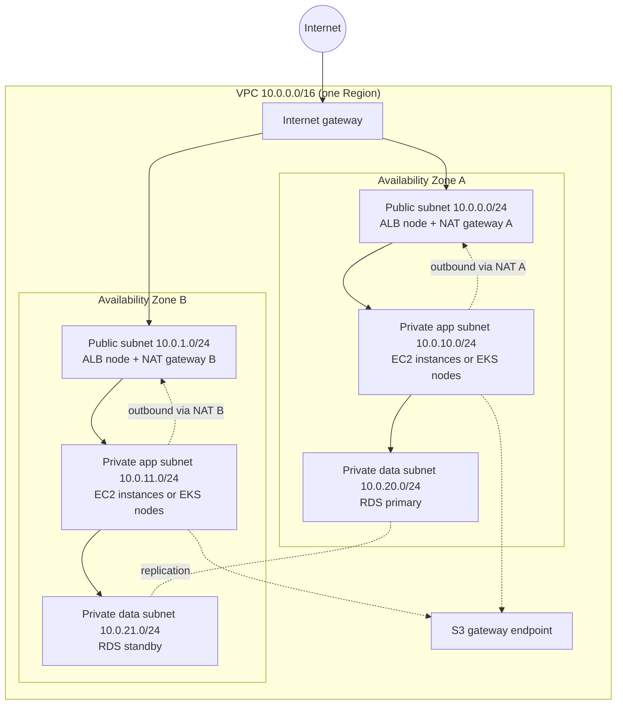

# Networking & content delivery: AWS services explained for beginners
> [Home](../../README.md) · [Beginner track](../README.md) · [All services A–Z](README.md) · Deep dive: [Notes 02](../../notes/02-networking-vpc.md) · [Notes 08](../../notes/08-ha-dr-edge-ops.md)

These services decide **how packets get to your workloads and back**: inside your private network, between networks, to your office or data center, and out to users around the world. On the exam this is the backbone of roughly a third of all questions, because every "secure", "highly available" or "cost-effective" design rests on a network. If terms like CIDR, subnet, NAT or DNS feel rusty, read [Networking basics](../02-networking-basics.md) first. This page assumes those ideas and shows how AWS implements them.

A useful way to sort the ten services is by *which boundary they cross*:

| Where the traffic goes | Services |
|---|---|
| Inside one private network | [Amazon VPC](#amazon-vpc) (subnets, routing, firewalls), [Elastic Load Balancing (ELB)](#elastic-load-balancing-elb) |
| From users on the internet, worldwide | [Amazon Route 53](#amazon-route-53) (DNS), [Amazon CloudFront](#amazon-cloudfront) (caching), [AWS Global Accelerator](#aws-global-accelerator) (fast path) |
| Between VPCs and accounts | VPC peering (part of VPC), [AWS PrivateLink](#aws-privatelink), [AWS Transit Gateway](#aws-transit-gateway) |
| Between AWS and your own premises | [AWS Site-to-Site VPN](#aws-site-to-site-vpn), [AWS Direct Connect](#aws-direct-connect), [AWS Client VPN](#aws-client-vpn) (for individual laptops) |

| Service | One-liner | Exam importance |
|---|---|---|
| Amazon VPC | Your own private, isolated network inside an AWS Region | ★★★ |
| Elastic Load Balancing (ELB) | Spreads incoming traffic across healthy servers, containers or functions | ★★★ |
| Amazon Route 53 | Managed DNS that can also route users by health, latency or location | ★★★ |
| Amazon CloudFront | Content delivery network (CDN) that caches content close to users | ★★★ |
| AWS Global Accelerator | Two fixed global IP addresses that carry users over the AWS backbone, with fast failover | ★★ |
| AWS PrivateLink | Private access to one specific service in another VPC or account | ★★ |
| AWS Transit Gateway | A regional hub router that connects many VPCs and on-premises networks | ★★ |
| AWS Site-to-Site VPN | Encrypted tunnels over the internet between your data center and AWS | ★★ |
| AWS Client VPN | Managed VPN for individual users' laptops | ★ |
| AWS Direct Connect | A private, dedicated network link from your data center to AWS | ★★★ |

---

## Amazon VPC

> **In one line:** a logically isolated private network that you define inside one AWS Region, where your servers, containers, databases and load balancers get their IP addresses.

| Exam importance | Kubernetes / everyday analogy | Pricing model (rough) |
|---|---|---|
| ★★★ High | A gated office park: one fence and gate around the whole site, separate buildings (subnets), signposted roads (route tables), and security desks at each door. Your EKS cluster already lives inside one. | The VPC, subnets, route tables, security groups and internet gateway are free. You pay for NAT gateways, interface endpoints, VPN/Transit Gateway attachments, public IPv4 addresses, and data transfer. |

### What a VPC is

A **VPC (Virtual Private Cloud)** is your own private slice of the AWS network in one **Region** (a geographic area such as `eu-west-1`). It spans every **Availability Zone (AZ)** in that Region; an AZ is one or more separate data centers with independent power and networking. When you create a VPC you pick an IP range in **CIDR** (Classless Inter-Domain Routing) notation, such as `10.0.0.0/16` (about 65,000 addresses). Nobody else's traffic can enter unless you build a gate.

Think of a gated office park. The perimeter fence is the VPC. Inside are buildings (subnets), roads with signposts (route tables), a main gate to the public road (the internet gateway), and security staff checking badges at each building and at each office door (network ACLs and security groups).

You have already used one without seeing it. Your EKS (Amazon Elastic Kubernetes Service) cluster's worker nodes are servers in a VPC, and with the default networking plugin (the VPC CNI) **every pod gets a real IP address from a VPC subnet**. That's why EKS clusters run out of IPs when subnets are too small.

### Subnets

A **subnet** is a smaller IP range carved out of the VPC's range, and it lives in **exactly one AZ**. You spread a workload across AZs by creating matching subnets in each AZ (for example `10.0.1.0/24` in AZ a and `10.0.2.0/24` in AZ b). AWS reserves 5 addresses in every subnet, so a `/24` gives you 251 usable IPs, not 256. ([Networking basics](../02-networking-basics.md) covers the CIDR math.)

- **Public subnet:** its route table sends internet-bound traffic (`0.0.0.0/0`) to an **internet gateway**. That route is the *only* thing that makes a subnet public. Put load balancers and NAT gateways here.
- **Private subnet:** no route to the internet gateway. Put application servers, EKS nodes and databases here. They can still reach out through a NAT gateway if you add one.

### Route tables

A **route table** is the list of signposts a subnet follows: "traffic for destination X goes to target Y". Every route table has a built-in `local` route so all subnets in the VPC can reach each other. Each subnet is associated with one route table; one route table can serve many subnets. When several routes match, the **most specific** one (the longest prefix, e.g. `/24` beats `/16`) wins.

### Internet gateway

An **internet gateway (IGW)** is the main gate between the VPC and the internet. You attach one per VPC. AWS runs it as a redundant, horizontally scaled component, so it's not a bottleneck or a single point of failure. An instance needs both a route to the IGW **and** a public IP address to be reachable from the internet.

### NAT gateway

A **NAT (Network Address Translation) gateway** lets resources in private subnets *start* outbound connections (to download patches or call an external API) while the internet can't start connections back to them. It's like an office mailroom: staff can send letters out, and replies come back, but strangers can't walk in.

- It sits in a **public subnet** and has an **Elastic IP** (a fixed public IPv4 address).
- It is **zonal**: if its AZ fails, it fails too. For high availability, put **one NAT gateway in each AZ** and point each AZ's private route table at its own NAT gateway.
- ⚠️ Cost: you pay per hour **and per GB processed**. One shared NAT gateway is cheaper but is a single-AZ failure point. Sending lots of S3 traffic through NAT is a classic waste; use a gateway endpoint (below) instead.
- AWS added a newer *regional* NAT gateway mode in late 2025. Exam questions still use the one-per-AZ pattern.

### Security groups

A **security group (SG)** is a virtual firewall attached to an **elastic network interface (ENI)**, the virtual network card of an instance, load balancer, database or Lambda function. Think of the badge reader on each office door.

- **Stateful:** if a request is allowed in, the response is automatically allowed out.
- **Allow rules only:** there is no "deny". Anything not allowed is blocked.
- Rules can name **another security group** as the source ("allow port 5432 from the app tier's SG"), so new instances are covered automatically.

**Kubernetes bridge:** this is the closest thing to a NetworkPolicy. Referencing a security group is like a `podSelector` in a policy. Where it breaks: NetworkPolicies select pods by label and can apply to whole namespaces, while SGs attach to network interfaces. EKS can also apply SGs to individual pods ("security groups for pods").

### Network ACLs

A **network ACL (NACL, network access control list)** is a firewall at the **subnet** boundary, like the guard at the building entrance rather than at each office door.

- **Stateless:** return traffic must be allowed explicitly, including the high "ephemeral" ports (1024–65535) that clients use for responses.
- Supports **allow and deny** rules, checked in number order; the first match wins. This is how you **block one specific IP address**, which a security group can't do.
- The default NACL allows everything, so most designs rely on SGs and use NACLs only as a coarse guardrail.

### VPC endpoints

A **VPC endpoint** lets private resources reach AWS services such as S3 without going through the internet or a NAT gateway.

| | Gateway endpoint | Interface endpoint |
|---|---|---|
| Services | **S3 and DynamoDB only** | Most AWS services, plus your own or partners' services ([PrivateLink](#aws-privatelink)) |
| How it works | A route in your route table | A network interface with a private IP in your subnet |
| Cost | **Free** | Per hour per AZ + per GB |

### VPC peering

**VPC peering** is a private, one-to-one link between two VPCs (same or different account or Region). It's **not transitive**: if A peers with B and B peers with C, A still can't reach C. CIDR ranges can't overlap. With more than a handful of VPCs, use [Transit Gateway](#aws-transit-gateway).

### VPC Flow Logs

**VPC Flow Logs** record metadata about IP traffic (source, destination, ports, bytes, ACCEPT or REJECT) for a VPC, subnet or ENI, and send it to CloudWatch Logs, S3 or Amazon Data Firehose. They don't capture packet contents. They are the first place to look when "the connection just times out".

### Default VPC

Every Region in a new account comes with a **default VPC**: a `/16` with a public subnet in each AZ and an internet gateway, so you can launch an instance instantly. It's handy for experiments, but production designs use a custom VPC with private subnets.

### Putting it together: a 2-AZ VPC

**Use it when / don't use it when**
- ✅ Always: almost everything that has an IP address runs in a VPC.
- ✅ Custom VPC with public and private subnets in at least two AZs for anything production.
- ❌ Don't put databases or app servers in public subnets "to make it work" → fix routing with a NAT gateway or endpoint instead.

**Exam hot spots**
- "Private instances need to download patches" → **NAT gateway in a public subnet**; "highly available" → **one per AZ**.
- "Block a specific IP address" → **NACL deny** (SGs can't deny). "Only the web tier may reach the database" → **SG referencing SG**.
- "Reduce NAT gateway charges for S3/DynamoDB traffic" → **gateway endpoint** (free).
- "Traffic gets in but responses never return" → a **stateless NACL** is missing outbound ephemeral ports.
- ⚠️ Trap: peering is not transitive, and peered VPCs can't use each other's internet gateway or NAT gateway.

**Try it** (free if you skip NAT gateways): VPC console → **Create VPC** → **VPC and more**. Choose 2 AZs, 2 public and 2 private subnets, **NAT gateways: None**, **VPC endpoints: S3 Gateway**. Study the preview diagram, create it, then open **Route tables** to see which subnets point to the IGW. Delete the VPC afterwards.

**Go deeper:** [Notes 02: reference 2-AZ design](../../notes/02-networking-vpc.md#4-reference-design-a-2-az-three-tier-vpc) · [Lab 02: custom VPC](../../labs/lab-02-custom-vpc.md) · related services: [Amazon EC2](compute.md#amazon-ec2), [Amazon EKS](containers.md#amazon-eks), [AWS Network Firewall](security.md#aws-network-firewall)

---

## Elastic Load Balancing (ELB)

> **In one line:** managed load balancers that receive client traffic and spread it across healthy targets in several AZs.

| Exam importance | Kubernetes / everyday analogy | Pricing model (rough) |
|---|---|---|
| ★★★ High | On EKS, the AWS Load Balancer Controller turns an **Ingress into an ALB** and a **Service of type LoadBalancer into an NLB**. Everyday: the host at a busy restaurant seating guests at free tables. | Per hour + per "capacity unit" (a blend of connections, requests and bytes) |

**What it is.** A load balancer gives clients one stable entry point and forwards each request or connection to a healthy backend. AWS runs the load balancer nodes for you across the AZs you choose, scales them automatically and replaces failed ones. Without it you'd run and patch your own HAProxy or NGINX fleet and solve its high availability yourself. There are several types, and picking the right one is a favourite exam question.

| | Application Load Balancer (ALB) | Network Load Balancer (NLB) | Gateway Load Balancer (GWLB) |
|---|---|---|---|
| Works at | Layer 7: HTTP, HTTPS, gRPC, WebSockets | Layer 4: TCP, UDP, TLS | Layer 3: IP packets |
| Routes by | URL path, hostname, headers, query string | Port and protocol | Sends all traffic through an appliance fleet |
| Static IP | ❌ (DNS name only) | ✅ one per AZ (can be your Elastic IPs) | n/a |
| Special powers | WAF integration, user login via Cognito/OIDC, Lambda targets | Extreme throughput, very low latency, client IP preserved, backs PrivateLink | Inserts third-party firewalls transparently |
| K8s equivalent | Ingress | Service `type: LoadBalancer` | None |

The **Classic Load Balancer (CLB)** is the legacy original. If a question mentions it, the answer is usually "migrate to ALB or NLB".

**Key ideas to know**
- **Listener:** the port and protocol the load balancer accepts (e.g., HTTPS 443), with rules about where to send traffic.
- **Target group:** a set of backends (instances, IP addresses, Lambda functions) plus how to health-check them. It's like a Kubernetes Service's endpoint list.
- **Health checks:** the load balancer probes each target (e.g., `GET /health`) and stops sending traffic to failing ones. This is the AWS version of a **readiness probe**.
- **Internet-facing vs internal:** internet-facing load balancers live in public subnets; internal ones have only private IPs for tier-to-tier traffic.
- **TLS termination:** the ALB or NLB can hold the certificate (from [ACM](security.md#aws-certificate-manager-acm)), decrypt HTTPS and forward to targets.
- **Cross-zone load balancing:** spreads traffic evenly across targets in all AZs; on by default for ALB, off by default for NLB.
- **Sticky sessions:** pin a client to one target. It works, but storing session state in ElastiCache or DynamoDB is the better design.

**Use it when / don't use it when**
- ✅ Any web or API tier with more than one server, or any Auto Scaling group.
- ✅ NLB when you need static IPs, UDP, or millions of requests per second.
- ❌ Global, multi-Region entry with fixed IPs → [Global Accelerator](#aws-global-accelerator). Caching static content → [CloudFront](#amazon-cloudfront).

**Exam hot spots**
- Path-based routing (`/api` vs `/images`) or host-based routing → **ALB**. Static IPs for a customer's firewall allow-list, or UDP → **NLB**.
- "Inspect all traffic with a third-party firewall appliance" → **GWLB**.
- Turn on **ELB health checks in the Auto Scaling group** so instances that run but fail the app check get replaced.
- An ALB needs subnets in **at least two AZs**. Targets can sit in private subnets; only the load balancer needs to be public.
- Block SQL injection at the ALB → attach [AWS WAF](security.md#aws-waf), not a NACL.

**Try it:** Read-only: open **EC2 console → Load Balancers → Create load balancer** and compare the three type cards without creating one. ALBs bill by the hour, so do the real build in [Lab 03](../../labs/lab-03-alb-asg.md).

**Go deeper:** [Notes 03: Elastic Load Balancing](../../notes/03-compute-containers.md#8-elastic-load-balancing) · related services: [Amazon EC2 Auto Scaling](compute.md#amazon-ec2-auto-scaling), [Amazon EKS](containers.md#amazon-eks), [AWS Certificate Manager (ACM)](security.md#aws-certificate-manager-acm)

---

## Amazon Route 53

> **In one line:** AWS's highly available DNS service: it registers domains, answers DNS queries, checks endpoint health and can steer users by health, latency, location or weight.

| Exam importance | Kubernetes / everyday analogy | Pricing model (rough) |
|---|---|---|
| ★★★ High | CoreDNS turns Service names into IPs inside a cluster; Route 53 does that for the internet (and, with private hosted zones, inside VPCs). If you've used `external-dns` on EKS, it was writing Route 53 records. Everyday: a phone directory that can also say "that branch is closed, call this one". | Per hosted zone per month + per million queries; health checks per month; domain registration per year |

**What it is.** DNS (Domain Name System) turns names like `shop.example.com` into IP addresses. Route 53 hosts your DNS records on a global network of name servers and is designed for very high availability (AWS offers a 100% availability SLA for it). On top of plain DNS, it can run **health checks** and give different answers depending on which endpoints are healthy or where the user is. That makes it a key building block for multi-Region and disaster-recovery designs.

**Key ideas to know**
- **Hosted zone:** the container for one domain's records. **Public** zones answer the internet; **private** zones answer only inside the VPCs you associate.
- **Record types:** **A** (name → IPv4), **AAAA** (name → IPv6), **CNAME** (name → another name), **MX** (mail), **TXT** (verification text), **NS** (which name servers own the zone).
- **Alias record:** a Route 53 extension that points a name at an AWS resource (ALB, CloudFront, S3 website, API Gateway, Global Accelerator). Unlike a CNAME, it works at the **zone apex** (`example.com` itself) and queries to AWS targets are free.
- **TTL (time to live):** how long resolvers cache an answer. Low TTLs make failover faster; some clients still cache longer.
- **Health checks:** Route 53 probes an endpoint (HTTP, HTTPS or TCP) from locations worldwide, or follows a CloudWatch alarm for private resources it can't reach.
- **Route 53 Resolver:** the DNS server built into every VPC. Its **inbound and outbound endpoints** let on-premises DNS and VPC DNS resolve each other's names.

**Routing policies**

| Policy | Answers with | Typical use |
|---|---|---|
| Simple | One record (or several, in random order) | A single resource |
| Weighted | Records in proportion to weights you set | Canary releases, blue/green, A/B tests |
| Latency | The Region with the lowest network latency for the user | Multi-Region app optimised for speed |
| Failover | Primary while healthy, secondary otherwise | **Active-passive disaster recovery** |
| Geolocation | Based on the user's continent, country or US state | Compliance, language, content rights |
| Geoproximity | Based on distance, adjustable with a "bias" | Shifting traffic gradually between locations |
| Multivalue answer | Up to 8 healthy records at random | Simple client-side spreading with health checks |
| IP-based | Based on the client's source IP range | Routing known ISPs or customers |

**Use it when / don't use it when**
- ✅ DNS for anything on AWS, especially when names must point to AWS resources at the apex.
- ✅ Health-aware failover between Regions.
- ❌ Failover that must happen in seconds regardless of client DNS caching → [Global Accelerator](#aws-global-accelerator).
- ❌ Spreading load across servers in one Region → [ELB](#elastic-load-balancing-elb) (multivalue isn't a load balancer).

**Exam hot spots**
- `example.com` (apex) → ALB or CloudFront: **alias record**, never a CNAME.
- "Active-passive DR" → **failover** routing + health check on the primary. "Lowest latency for global users" → **latency** routing. "Users in Germany must hit the EU deployment" → **geolocation** (not latency).
- "Send 10% of traffic to the new version" → **weighted**.
- Hybrid DNS between VPCs and on-premises → **Resolver inbound/outbound endpoints**.

**Try it:** Read-only: open the **Route 53 console → Hosted zones → Create hosted zone** and look at the public vs private choice and the "Create record" routing policy list. A hosted zone has a small monthly fee, so don't create one unless you'll use it.

**Go deeper:** [Notes 08: Amazon Route 53](../../notes/08-ha-dr-edge-ops.md#3-amazon-route-53) · related services: [Amazon CloudFront](#amazon-cloudfront), [Elastic Load Balancing (ELB)](#elastic-load-balancing-elb)

---

## Amazon CloudFront

> **In one line:** a content delivery network (CDN) that serves your website, API or video from hundreds of edge locations near your users, caching what it can.

| Exam importance | Kubernetes / everyday analogy | Pricing model (rough) |
|---|---|---|
| ★★★ High | No real K8s equivalent (it sits in front of everything). Everyday: a chain of local convenience stores stocking the most popular items, so customers don't drive to the central warehouse. | Per GB delivered to users (varies by geography) + per request; data from AWS origins to CloudFront is free |

**What it is.** CloudFront puts copies of your content in **edge locations** worldwide. A user's request goes to the nearest one; if the object is cached there, it's returned immediately, otherwise CloudFront fetches it from your **origin** (an S3 bucket, an ALB, an EC2 instance or any HTTP server) over the AWS network and caches it. This cuts latency for users, offloads your servers and often lowers data-transfer costs. Even uncacheable, dynamic requests benefit, because they travel the AWS backbone instead of the public internet.

**Key ideas to know**
- **Distribution:** your CloudFront configuration, reachable at a `*.cloudfront.net` name or your own domain (via a Route 53 alias).
- **Origin:** where the real content lives. You can have several and route by path (e.g., `/static/*` → S3, `/api/*` → ALB) using **cache behaviors**.
- **TTL and cache key:** how long objects stay cached and which parts of a request (headers, cookies, query strings) make a cached object unique.
- **Origin Access Control (OAC):** lets CloudFront read a **private** S3 bucket so users can't bypass CloudFront. (OAI is the older method.)
- **Signed URLs / signed cookies:** time-limited access to private content, such as paid videos.
- **Edge security:** HTTPS with an [ACM](security.md#aws-certificate-manager-acm) certificate (it must be in `us-east-1`), [AWS WAF](security.md#aws-waf) rules, geo restriction, and built-in [Shield Standard](security.md#aws-shield) DDoS protection.
- **Edge code:** **CloudFront Functions** (tiny, very fast header/URL tweaks) and **Lambda@Edge** (heavier logic).

**Use it when / don't use it when**
- ✅ Global users of a website, static assets, downloads, video, or APIs.
- ✅ Hiding an S3 bucket or ALB behind a protected front door.
- ❌ Non-HTTP traffic (gaming UDP, MQTT) or a need for fixed IPs → [Global Accelerator](#aws-global-accelerator).

**Exam hot spots**
- "Improve performance for global users of static content" / "reduce load on the origin" → **CloudFront**.
- "Only allow access to the S3 content through CloudFront" → **OAC** + bucket policy.
- "Premium content for paying users" → **signed URLs** (one file) or **signed cookies** (many files).
- "Block countries" → **geo restriction** (or WAF geo match). "Protect against SQL injection at the edge" → **WAF** on the distribution.
- Origin failover with an **origin group** (works for reads only).

**Try it:** Do [Lab 04: S3 + CloudFront](../../labs/lab-04-s3-cloudfront.md), which builds a private bucket with OAC.

**Go deeper:** [Notes 08: Amazon CloudFront](../../notes/08-ha-dr-edge-ops.md#4-amazon-cloudfront) · related services: [Amazon S3](storage.md#amazon-s3), [AWS WAF](security.md#aws-waf), [Amazon Route 53](#amazon-route-53)

---

## AWS Global Accelerator

> **In one line:** gives your application two fixed (anycast) IP addresses worldwide and carries user traffic over the AWS backbone to the closest healthy Regional endpoint.

| Exam importance | Kubernetes / everyday analogy | Pricing model (rough) |
|---|---|---|
| ★★ Medium | A toll-road on-ramp near every city: you join the private motorway early instead of crawling through local streets, and the same two phone numbers always reach you even if you move offices. | Fixed hourly fee per accelerator + a per-GB data-transfer premium |

**What it is.** Users connect to one of two **static anycast IP addresses**, which are advertised from AWS edge locations, so each user enters the AWS network close to home. From there, traffic rides the AWS backbone to endpoints (ALB, NLB, EC2 instances or Elastic IPs) in one or more Regions. Global Accelerator health-checks those endpoints and shifts traffic away from a failed Region in seconds, without waiting for DNS caches to expire, because the IPs never change. It works at layer 4 (TCP and UDP) and **does not cache** anything.

**Key ideas to know**
- **Anycast IPs:** the same IP address announced from many locations; the network delivers you to the nearest.
- **Endpoint groups:** one per Region, with a **traffic dial** to send a percentage of traffic there.
- **Fast failover:** health-based and independent of client DNS caching.
- **CloudFront vs Global Accelerator:** CloudFront caches HTTP content; Global Accelerator accelerates any TCP/UDP traffic and gives static IPs.

**Use it when / don't use it when**
- ✅ Non-HTTP workloads (gaming, VoIP, IoT), or clients that must allow-list fixed IPs.
- ✅ Multi-Region apps needing near-instant failover.
- ❌ Static or cacheable web content → [CloudFront](#amazon-cloudfront).

**Exam hot spots**
- "Static IP addresses" + "global users" + "multiple Regions" → **Global Accelerator**.
- "UDP gaming traffic, improve global performance" → Global Accelerator (CloudFront doesn't do UDP).
- "Failover faster than DNS TTLs allow" → Global Accelerator rather than Route 53 failover.

**Go deeper:** [Notes 08: AWS Global Accelerator](../../notes/08-ha-dr-edge-ops.md#5-aws-global-accelerator) · related services: [Amazon CloudFront](#amazon-cloudfront), [Elastic Load Balancing (ELB)](#elastic-load-balancing-elb)

---

## AWS PrivateLink

> **In one line:** lets a VPC reach one specific service (an AWS service, a SaaS product, or another team's app) through private IPs, without connecting the two networks.

| Exam importance | Kubernetes / everyday analogy | Pricing model (rough) |
|---|---|---|
| ★★ Medium | A service hatch in the wall between two offices: you can pass requests to one counter, but nobody can wander through the other office. Somewhat like exposing a single Service to another cluster rather than merging the cluster networks. | Consumer pays per interface endpoint per AZ per hour + per GB |

**What it is.** PrivateLink is the technology behind **interface VPC endpoints**. A provider puts a service behind a **Network Load Balancer** and publishes it as an **endpoint service**. Each consumer creates an interface endpoint, which appears as a network interface with a private IP in the consumer's own subnet. Traffic flows only from consumer to provider, stays on the AWS network, and works even when the two VPCs use **overlapping IP ranges**.

**Key ideas to know**
- **Interface endpoint:** the consumer side, an ENI with a private IP and its own security group.
- **Endpoint service:** the provider side, backed by an NLB (or a GWLB for security appliances).
- **One-way and service-scoped:** consumers reach just that service, not the provider's whole network.
- **Private DNS:** the normal service name (e.g., `secretsmanager.<region>.amazonaws.com`) can resolve to the endpoint's private IP inside the VPC.

**Use it when / don't use it when**
- ✅ Private subnets with no NAT gateway need to call AWS services such as Secrets Manager, ECR or SSM.
- ✅ A SaaS provider exposes an API to hundreds of customer VPCs.
- ❌ Full two-way connectivity between whole networks → [VPC peering](#vpc-peering) or [Transit Gateway](#aws-transit-gateway).
- ❌ S3 or DynamoDB from inside the VPC, with cost as the priority → the free **gateway endpoint**.

**Exam hot spots**
- "Expose a service to other VPCs/accounts privately, CIDRs overlap" → **PrivateLink** (peering and Transit Gateway can't handle overlap).
- "Keep traffic to AWS APIs off the internet" → **interface endpoint**.
- The provider side needs an **NLB**.

**Go deeper:** [Notes 02: PrivateLink](../../notes/02-networking-vpc.md#9-privatelink-exposing-your-own-service) · related services: [Amazon VPC](#amazon-vpc), [Elastic Load Balancing (ELB)](#elastic-load-balancing-elb)

---

## AWS Transit Gateway

> **In one line:** a managed regional hub that connects many VPCs, VPNs and Direct Connect links, with transitive routing between them.

| Exam importance | Kubernetes / everyday analogy | Pricing model (rough) |
|---|---|---|
| ★★ Medium | An airline hub airport: instead of direct flights between every pair of cities, everyone flies through the hub, and the hub's rules decide who can connect to whom. | Per attachment per hour + per GB processed |

**What it is.** With VPC peering, 10 VPCs need 45 separate connections for a full mesh, and none of them share a VPN. A Transit Gateway (TGW) replaces that mesh with hub-and-spoke: each VPC, VPN connection or Direct Connect gateway **attaches** once, and the TGW routes between them. Unlike peering, routing **is transitive**. One TGW can be shared across all accounts in your organization with [AWS RAM](identity-governance.md#aws-resource-access-manager-aws-ram).

**Key ideas to know**
- **Attachment:** a connection from the TGW to a VPC, VPN, Direct Connect gateway or another TGW (peering across Regions).
- **TGW route tables:** let you segment traffic, e.g., dev and prod VPCs can both reach shared services but not each other.
- **Shared hybrid link:** one VPN or Direct Connect into the TGW serves every attached VPC.
- **ECMP over VPN:** several VPN tunnels can be combined for more bandwidth.

**Use it when / don't use it when**
- ✅ Many VPCs (dozens to thousands), especially with on-premises connectivity.
- ✅ Centralised egress (shared NAT) or a central inspection VPC with a firewall.
- ❌ Just two or three VPCs with heavy traffic and cost pressure → **VPC peering** (no hourly or processing charge).

**Exam hot spots**
- "Hundreds of VPCs across accounts, plus on-premises, simplify management" → **Transit Gateway**.
- "Isolate dev from prod but share services" → **separate TGW route tables**.
- "Lowest cost between two VPCs" → peering, not TGW.

**Go deeper:** [Notes 02: connecting VPCs](../../notes/02-networking-vpc.md#10-connecting-vpcs-peering-transit-gateway-and-alternatives) · related services: [AWS Direct Connect](#aws-direct-connect), [AWS Site-to-Site VPN](#aws-site-to-site-vpn)

---

## AWS Site-to-Site VPN

> **In one line:** encrypted IPsec tunnels over the public internet between your office or data center and your VPCs.

| Exam importance | Kubernetes / everyday analogy | Pricing model (rough) |
|---|---|---|
| ★★ Medium | An armoured van on the public motorway: it uses ordinary roads, but the cargo is locked. | Per VPN connection per hour + data transfer out |

**What it is.** Site-to-Site VPN (virtual private network) connects a whole network, not a single person, to AWS. Your router (the **customer gateway**) builds **IPsec** (an encryption protocol suite) tunnels to either a **virtual private gateway** attached to one VPC or a [Transit Gateway](#aws-transit-gateway). You can set it up in hours, and it is encrypted by default, but its speed and latency depend on the internet.

**Key ideas to know**
- **Two tunnels per connection**, ending in different AZs on the AWS side. Configure both for redundancy.
- **BGP (Border Gateway Protocol) routing:** dynamic routing that fails over automatically; static routes also work.
- **Throughput:** approx. 1.25 Gbps per tunnel. Use Transit Gateway with ECMP to combine tunnels.
- **Accelerated VPN:** enters AWS at the nearest edge location via Global Accelerator for long-distance links (Transit Gateway only).

**Use it when / don't use it when**
- ✅ You need hybrid connectivity **quickly** or cheaply, or as a **backup** for Direct Connect.
- ❌ Consistent latency or very high, steady bandwidth → [Direct Connect](#aws-direct-connect).
- ❌ Individual remote workers → [Client VPN](#aws-client-vpn).

**Exam hot spots**
- "Connect the data center within days" → **Site-to-Site VPN** now, Direct Connect later.
- "Cost-effective backup for Direct Connect" → **VPN as backup**.
- "Encrypt traffic over Direct Connect" → IPsec VPN over DX (or MACsec).

**Go deeper:** [Notes 02: Site-to-Site VPN](../../notes/02-networking-vpc.md#111-aws-site-to-site-vpn) · related services: [AWS Direct Connect](#aws-direct-connect), [AWS Transit Gateway](#aws-transit-gateway)

---

## AWS Client VPN

> **In one line:** a managed, OpenVPN-based VPN that lets individual users connect their laptops securely to a VPC.

| Exam importance | Kubernetes / everyday analogy | Pricing model (rough) |
|---|---|---|
| ★ Low | The corporate VPN app you start when working from home, but the server side is run by AWS. | Per subnet association per hour + per active connection per hour |

**What it is.** Client VPN is for **people**, not sites. Users run an OpenVPN-compatible client and authenticate with Active Directory, SAML single sign-on or certificates; authorization rules decide which networks each group can reach.

**Exam hot spots**
- "Remote employees need secure access to resources in a VPC" → **Client VPN** (Site-to-Site VPN connects networks, not laptops).

**Go deeper:** [Notes 02: Client VPN](../../notes/02-networking-vpc.md#113-aws-client-vpn) · related services: [AWS Site-to-Site VPN](#aws-site-to-site-vpn), [AWS Directory Service](identity-governance.md#aws-directory-service)

---

## AWS Direct Connect

> **In one line:** a private, dedicated network connection from your data center to AWS that bypasses the public internet.

| Exam importance | Kubernetes / everyday analogy | Pricing model (rough) |
|---|---|---|
| ★★★ High | A private road from your warehouse straight into the AWS campus: predictable travel time, no public traffic, but it takes weeks to build. | Per port-hour (or partner fee) + data transfer out at a lower rate than internet egress; inbound is free |

**What it is.** Direct Connect (DX) is a physical fiber connection between your network and an AWS **Direct Connect location** (a colocation facility), either your own dedicated port or a slice from an AWS partner. Because it doesn't cross the internet, you get **consistent latency** and high bandwidth, and data leaving AWS costs less. The catch: it can take **weeks or months** to provision, and it is **not encrypted** by default.

**Key ideas to know**
- **Dedicated connection:** your own port at 1, 10, 100 or 400 Gbps. **Hosted connection:** provided through a partner, from 50 Mbps upward.
- **Virtual interfaces (VIFs):** logical channels on the link. A **private VIF** reaches your VPCs; a **public VIF** reaches AWS public services such as S3; a **transit VIF** reaches Transit Gateways.
- **Direct Connect gateway:** a global object that lets one connection reach VPCs in many Regions.
- **Encryption options:** **MACsec** on supported dedicated ports, or an **IPsec VPN over DX**.
- **Resilience:** one link is a single point of failure. Use two connections at two DX locations (high resiliency), four for maximum resiliency, or DX + Site-to-Site VPN as a cheaper backup.

**Use it when / don't use it when**
- ✅ Large, steady data transfers, or apps that need predictable latency to on-premises systems.
- ✅ Reducing data-transfer-out costs for heavy hybrid traffic.
- ❌ You need connectivity this week → [Site-to-Site VPN](#aws-site-to-site-vpn) first.
- ❌ A one-time bulk move of huge data over a slow link → offline transfer ([migration services](migration-transfer.md#aws-snow-family)).

**Exam hot spots**
- "Consistent network performance", "dedicated private connection" → **Direct Connect**.
- "Encrypted and private" → DX + **IPsec VPN** (or MACsec), because DX alone isn't encrypted.
- "Highly available hybrid link at the lowest cost" → DX primary + **VPN backup**. "Maximum resiliency" → connections at **multiple DX locations**.
- "One DX to VPCs in several Regions" → **Direct Connect gateway**.

**Go deeper:** [Notes 02: Direct Connect](../../notes/02-networking-vpc.md#112-aws-direct-connect-dx) · related services: [AWS Site-to-Site VPN](#aws-site-to-site-vpn), [AWS Transit Gateway](#aws-transit-gateway)

---

**Next:** [Compute services](compute.md)
