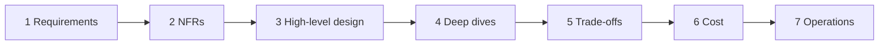

# After the Exam: Career Next Steps
> [Home](../README.md) · [Study plan](../00-study-plan.md)

You passed (or you're about to). This page turns the certificate into career momentum. Thirteen years of shipping software plus a fresh architecture credential is a strong combination, but only if you **show** architectural judgment, not just hold the badge.

**Sections:** [1. What the cert signals](#1-what-saa-c03-does-and-doesnt-signal) · [2. Target roles](#2-target-roles-and-what-changes-from-developer) · [3. 90-day plan](#3-the-90-day-post-cert-plan) · [4. Next certifications](#4-next-certifications) · [5. Resume & LinkedIn](#5-resume--linkedin-framing) · [6. Interview prep](#6-solutions-architect-interview-prep) · [7. Continuous learning](#7-continuous-learning-resources)

---

## 1. What SAA-C03 does (and doesn't) signal

**What it signals:**
- You know the AWS service catalog well enough to pick the right building block under constraints (HA, security, cost, performance).
- You speak the vocabulary architects and AWS account teams use: RPO/RTO, Multi-AZ vs multi-Region, least privilege, landing zones, purchasing models.
- You can learn a large body of material on a deadline. It's a respected, widely recognized associate-level credential, and recruiters filter on it.

**What it doesn't signal:**
- That you've **designed and operated** these systems under real constraints: budgets, legacy, politics, incidents.
- Depth in any one area (networking, security, data). The Professional and Specialty certs and real projects show that.
- Communication skill, the thing that separates architects from senior engineers.

**The honest framing:** hiring managers weigh **experience + portfolio + how you reason in interviews** well above certifications. The cert gets you past filters and earns credibility in the first conversation. What closes the offer is your 13 years of delivery, reframed as architecture decisions.

> Your advantage: most SAA holders are either junior (cert, little delivery) or ops-focused (infrastructure, little software design). A senior developer who can also reason about VPCs, DR and cost is rarer and more valuable. Lead with that combination.

---

## 2. Target roles and what changes from developer

### What changes in the job

| Dimension | As a senior developer | As an architect / principal |
|---|---|---|
| **Scope** | A service, feature or codebase | A system of systems, multiple teams, the whole lifecycle |
| **Main output** | Working code | **Decisions**, written down: diagrams, ADRs, design docs, reviews |
| **Success measure** | Features shipped, quality | Outcomes: availability, cost, time-to-market, risk reduced |
| **Trade-offs** | Mostly technical (library, pattern) | Technical + **business**: cost vs resilience, speed vs debt, build vs buy |
| **Non-functional requirements** | Often handed to you | **You elicit them**: "What's the RTO? What does an hour of downtime cost?" |
| **Cost** | Someone else's spreadsheet | A design input. You estimate it before building and review the bill after. |
| **Stakeholders** | Your team, your PM | Product, security, finance, ops, leadership, vendors, customers |
| **Influence** | Through code review | **Without authority**, through writing, data and relationships |
| **Communication** | Mostly synchronous, technical | Mostly **written**, tuned per audience (engineer vs VP vs CFO) |

### Roles to target

| Role | Focus | Typical day | Good next steps |
|---|---|---|---|
| **Solutions Architect** (AWS, partner or customer-facing) | Translate customer/business needs into AWS designs; pre-sales or delivery | Discovery calls, reference architectures, PoCs, Well-Architected reviews | SAP-C03, a domain specialty (Security, GenAI), public speaking/writing |
| **Cloud Architect** (internal, enterprise) | Landing zone, standards, platform guardrails, migration strategy | Design reviews, governance, cost reviews, migration waves | SAP-C03, SCS-C03, DOP-C02; FinOps exposure |
| **Principal / Staff Engineer** | Technical direction across teams, while staying hands-on | Design docs, hard technical problems, mentoring, setting cross-team standards | Portfolio of cross-team designs; DOP-C02 or AIP-C01 depending on domain |
| **Tech Lead / Engineering Lead** | One team's architecture and delivery | Planning, design, unblocking, reviewing, hiring | DVA-C03 (quick), DOP-C02; leadership skills |
| **Platform / DevOps Architect** | Internal developer platform, CI/CD, IaC, observability | Golden paths, pipelines, paved-road services | DOP-C02, CloudOps (SOA-C03), Kubernetes certs |
| **AI / GenAI Solutions Architect** | Architect apps on Bedrock/SageMaker AI: RAG, agents, evaluation, guardrails, cost | PoCs, model/vendor selection, data and security design | AIF-C01 → AIP-C01 (or MLA-C02) |

> Pick **one** primary target for the next 6–12 months. The 90-day plan below works for all of them, but the portfolio projects and next cert should point the same way.

---

## 3. The 90-day post-cert plan

### Days 1–30: apply it at work (credibility where you already have it)

- [ ] **Volunteer for a Well-Architected review** of a system your team owns, using the free [Well-Architected Tool](https://aws.amazon.com/well-architected-tool/). Produce a prioritized list of high-risk items with owners.
- [ ] **Draw the current-state architecture** of one important system (accounts, VPCs, data flows, dependencies). Most teams don't have an accurate diagram, so this alone gets noticed.
- [ ] **Do a cost review of your team's AWS bill** in Cost Explorer and the CUR. Find the top 5 cost drivers, then quick wins: gp2→gp3, idle resources, NAT traffic that should use gateway endpoints, Savings Plans coverage, log retention, public IPv4 cleanup. Report it in dollars.
- [ ] **Start writing ADRs** (architecture decision records) for decisions your team is making now. The template is below.
- [ ] Add your Credly badge to LinkedIn and your email signature (see [section 5](#5-resume--linkedin-framing)).

### Days 31–60: lead something and build in public

- [ ] **Lead a migration or modernization spike** (1–2 weeks): e.g., move a cron box to EventBridge Scheduler + Lambda/Fargate, or put a cache in front of a hot DB. Write the design doc first, then the outcome with numbers.
- [ ] **Draw a target-state architecture** for the system you reviewed, with a phased roadmap (what to do first and why).
- [ ] **Portfolio project #1** (see below). Ship it with IaC and a write-up.
- [ ] Present one lunch-and-learn internally ("What I learned about VPC design / DR tiers / cost that changes how we build").

### Days 61–90: widen your influence

- [ ] **Portfolio projects #2 and #3** (one can be smaller).
- [ ] **Publish 2–3 posts** about decisions, not tutorials: "Why we chose SQS over EventBridge for X", "What our NAT gateway bill taught us". Decision write-ups show architect thinking, and step-by-step guides don't.
- [ ] Join or start an **internal community of practice** (cloud guild, architecture review board). Offer to review other teams' designs.
- [ ] Book the next exam (see [section 4](#4-next-certifications)) and use the voucher before it expires.
- [ ] Update your resume and LinkedIn with the outcomes from days 1–60.

### Portfolio: 2–3 projects that show architecture, not tutorials

Each project ships with **an architecture diagram, 3–5 ADRs, a cost estimate (Pricing Calculator link plus the real bill after a week), and a Well-Architected self-review** (one paragraph per pillar). That package is what separates you from the many people with a "todo app on Lambda" repo.

| Project | Core services | What it proves | Builds on |
|---|---|---|---|
| **Multi-tier HA web app with IaC + CI/CD** | VPC across 2–3 AZs, ALB, ASG or ECS on Fargate, Aurora/RDS Multi-AZ, CloudFront + WAF, CloudFormation/CDK/Terraform, pipeline with automated tests and blue/green | Networking, HA, security layers, repeatable delivery | [lab-02](../labs/lab-02-custom-vpc.md), [lab-03](../labs/lab-03-alb-asg.md), [lab-05](../labs/lab-05-rds-ha.md), [lab-08](../labs/lab-08-iac-backup-dr.md) |
| **Event-driven serverless pipeline** | API Gateway, Lambda, SQS/SNS or EventBridge, Step Functions (retries, DLQs, human approval), DynamoDB, X-Ray | Decoupling, failure handling, idempotency, observability | [lab-06](../labs/lab-06-serverless-decoupled.md) |
| **Data lake with dashboards** | S3 (raw/curated zones), Glue crawlers + ETL to Parquet, Athena, Lake Formation permissions, Amazon Quick dashboards | Data architecture, governance, cost per query | [lab-07](../labs/lab-07-data-lake.md) |

Optional stretch goals: a DR drill (restore into a second Region and measure the actual RTO/RPO), a GenAI feature (RAG over your docs on Bedrock) with a cost and guardrails section, or a multi-account setup with Organizations + Identity Center + SCPs.

> ⚠️ Cost hygiene: tag everything, set a Budgets alert before you start, and tear down NAT gateways, ALBs and databases when you're not demoing. Record a short demo video so the project survives teardown.

### A minimal ADR template

```markdown
# ADR-007: Use SQS between the order API and fulfillment workers

Status: Accepted · Date: 2026-12-02 · Deciders: <names>

## Context
Order spikes (10x during promotions) overload fulfillment; failures lose orders.
NFRs: no order loss, p99 API latency < 300 ms, ops team of 2.

## Options considered
1. Synchronous call API → fulfillment (status quo)
2. SQS Standard queue + idempotent workers   <-- chosen
3. Kinesis Data Streams
4. EventBridge bus

## Decision
Option 2. Buffers spikes, durable, lowest ops; ordering not required.

## Consequences
+ API decoupled from worker capacity; workers scale on backlog per instance.
- At-least-once delivery → workers must be idempotent (dedupe on order ID).
- Adds a DLQ to monitor. Revisit if per-customer ordering becomes a requirement (→ FIFO).
```

---

## 4. Next certifications

### The current lineup (as of Nov 2026) that's relevant to you

| Certification | Code | Level | Why it fits a 13-year developer + SAA | Suggested timing |
|---|---|---|---|---|
| **Developer – Associate** | **DVA-C03** | Associate | **Quick win.** Heavy overlap with SAA (Lambda, DynamoDB, API Gateway, SQS/SNS, KMS) plus CI/CD and debugging you already know. DVA-C02's last day is **2026-11-30**, so plan for **DVA-C03**. | 3–6 weeks after SAA |
| **Solutions Architect – Professional** | **SAP-C03** | Professional | The natural architecture step: multi-account, hybrid networking, migrations, cost at org scale, complex trade-offs. **SAP-C02's last day is 2026-11-16**, so new prep should target **SAP-C03**. Early on, rely on the official exam guide and Skill Builder while third-party material catches up. | 3–9 months, ideally with real design work in between |
| **DevOps Engineer – Professional** | DOP-C02 | Professional | For tech lead / platform paths: CI/CD, IaC, observability, incident response, deployment strategies. | After DVA-C03 |
| **CloudOps Engineer – Associate** | SOA-C03 | Associate | Optional. Operations depth (monitoring, automation, networking ops). Formerly SysOps Administrator. | Only if you're targeting platform/ops roles |
| **Security – Specialty** | SCS-C03 | Specialty | Security is 30% of SAA and in every architecture conversation. Very valuable in regulated industries. | After SAP-C03, or right after SAA if security is your angle |
| **Advanced Networking – Specialty** | ANS-C01 | Specialty | Deep hybrid/multi-Region networking. ⚠️ **Check its status first.** Third-party sources say it retires on **2026-12-31** with no announced successor. Confirm on the [AWS Certification site](https://aws.amazon.com/certification/) before investing. | Only if it's still offered and networking is your niche |
| **AI Practitioner** | AIF-C01 | Foundational | A fast GenAI vocabulary refresh for architecture conversations about AI features. | Any time (a weekend or two) |
| **Machine Learning Engineer – Associate** | MLA-C02 | Associate | ML platform work: SageMaker AI pipelines, deployment, monitoring. | If moving into ML platforms |
| **Generative AI Developer – Professional** | AIP-C01 | Professional | Building production GenAI apps (RAG, agents, evaluation, guardrails, cost) on AWS. A strong 2026 market signal for a developer-turned-architect. | After AIF-C01 or with hands-on GenAI work |
| **Data Engineer – Associate** | DEA-C01 | Associate | Data platform roles: ingestion, Glue/EMR, Redshift, Lake Formation, streaming. | If data architecture is your target |

### Recommended paths

| Your target | Path |
|---|---|
| Solutions / cloud architect | SAA-C03 → *(DVA-C03 quick win)* → **SAP-C03** → SCS-C03 |
| Principal engineer / tech lead in product teams | SAA-C03 → **DVA-C03** → DOP-C02 |
| AI / GenAI architect | SAA-C03 → AIF-C01 → **AIP-C01** (or MLA-C02 for ML platforms) |
| Data platform architect | SAA-C03 → **DEA-C01** → (MLA-C02) |

### Validity, recertification and the voucher

- **Validity:** the certification is valid **3 years**. Recertify by passing the current version of the exam. AWS's policy has also let a higher-level exam in the same path (e.g., Solutions Architect – Professional) renew the lower one. Confirm the current rule on the [certification site](https://aws.amazon.com/certification/).
- **Voucher:** passing earns a **50% discount voucher** for another exam (or a recertification). Find it under **Benefits** in your AWS Certification account and note its **expiry date**.

**Using the voucher wisely:**
1. **It's worth the most on a Professional exam.** Half of a 300 USD Professional fee saves 150 USD, against 75 USD on a 150 USD Associate.
2. **But an expired voucher saves nothing.** If you won't realistically be ready for SAP-C03 before it expires, use it on DVA-C03 now. Passing DVA-C03 earns another voucher you can then put toward SAP-C03.
3. **Check other discounts first.** Employers that are AWS Partners often have exam vouchers or training credits, so ask before paying.
4. Don't book the next exam just to use the voucher. Book it when your study plan for that exam says you're ready (the [readiness criteria in the README](../README.md) adapt well to any exam).

---

## 5. Resume & LinkedIn framing

### Rewrite "built X" into "designed X achieving Y"

Architect resumes describe **decisions and outcomes**: availability, latency, cost, risk, time-to-market. Replace the brackets with your real numbers. If you don't have a number, estimate it honestly ("~", "about") or measure it now.

| Before (developer framing) | After (architect framing) |
|---|---|
| Built REST APIs using Lambda and DynamoDB. | **Designed** a serverless order API (API Gateway, Lambda, DynamoDB) serving [N] req/s at p99 [X] ms, **cutting compute cost [Y]%** against the EC2 baseline. |
| Migrated the app to AWS. | **Led the rehost of** [N] services from on-prem to AWS (MGN, DMS, Aurora), with **[X] minutes of cutover downtime** and **[Y]% lower** infrastructure cost after 3 months. |
| Worked on improving reliability. | **Raised availability from [99.5]% to [99.95]%** by redesigning the web tier across 3 AZs with ALB + Auto Scaling and moving the database to Aurora with automatic failover. |
| Set up queues between services. | **Decoupled** checkout from fulfillment with SQS + DLQs, **eliminating order loss** during [10x] promotional spikes and letting each side scale independently. |
| Reduced AWS costs. | **Cut monthly AWS spend [X]% ([$Y]/yr)** through rightsizing (Compute Optimizer), gp2→gp3, gateway endpoints for S3 traffic and a Compute Savings Plan at [Z]% coverage. |
| Helped with security. | **Introduced** least-privilege IAM roles, Secrets Manager rotation and KMS-encrypted data stores, **closing [N] audit findings** ahead of [SOC 2 / PCI]. |
| Wrote documentation. | **Authored [N] ADRs and the target-state architecture** adopted by [M] teams as the reference for new services. |

**Structure:** *Verb (Designed / Led / Decided / Reduced) + what + key services + measurable outcome + scope (teams, users, $).*

### LinkedIn checklist

- **Headline:** e.g., "Senior Software Engineer → Cloud Architecture | AWS Certified Solutions Architect – Associate | 13 yrs building distributed systems". Name the combination.
- **Credly badge:** AWS issues digital badges through Credly. Accept it, share it to LinkedIn, and add it under *Licenses & certifications* with the credential ID and verification URL. Recruiters search by certification.
- **About section:** 3–4 sentences on the kinds of systems you've built and the outcomes, then what you're moving toward ("designing resilient, cost-aware AWS architectures").
- **Featured:** pin your best portfolio repo (with the diagram visible in the README) and your best decision write-up.
- **Post once about the journey**, focusing on *what changed in how you design*, not just "I passed." It reaches far more people than the badge alone.

---

## 6. Solutions architect interview prep

SA interviews usually combine **system design on AWS**, **behavioral questions with a stakeholder focus**, and sometimes a **customer-scenario role-play** (for SA roles at AWS or partners).

### The system design framework



| Step | ~Time (45 min) | What to do | Example questions to ask aloud |
|---|---|---|---|
| **1. Requirements** | 5 min | Clarify users, core use cases, what's out of scope | "Who are the users? What are the 3 must-have flows? Is this greenfield or a migration?" |
| **2. Non-functional requirements** | 5 min | Quantify: scale, latency, availability, RPO/RTO, data size and growth, compliance, budget, team skills | "What does an hour of downtime cost? Peak req/s? Any data residency rules? Team size?" |
| **3. High-level design** | 10 min | Draw the boxes: edge → compute → data → async → observability. Name AWS services. | "Users hit CloudFront → ALB → ECS on Fargate across 3 AZs → Aurora; uploads go to S3 via presigned URLs…" |
| **4. Deep dives** | 10–15 min | Go deep on 1–2 risky areas: data model and partitioning, failure modes, security boundaries, scaling bottleneck | "The hot path is X; at 10x it breaks here; we'd shard on Y / add a cache / queue." |
| **5. Trade-offs** | 5 min | State the alternatives you rejected and why | Use the template below. |
| **6. Cost** | 3 min | Order of magnitude and the main drivers, plus cost levers | "Biggest costs are NAT data processing and Aurora; gateway endpoints and a Savings Plan cut ~30%." |
| **7. Operations** | 2–3 min | Deploy, observe, recover: IaC, CI/CD, alarms, runbooks, DR tests | "Blue/green via CodeDeploy, CloudWatch SLO alarms, quarterly restore test." |

### 10 whiteboard prompts to practice

Time-box each to 45 minutes, talking out loud, then write a one-page ADR afterward.

1. **URL shortener** serving 50,000 redirects/s globally with 99.99% availability and analytics on clicks.
2. **Lift-and-shift then modernize** a 3-tier .NET app with SQL Server and Windows file shares from a data center that closes in 6 months.
3. **Multi-tenant SaaS** platform: tenant isolation options (silo/pool/bridge), noisy neighbors, per-tenant cost attribution.
4. **Order processing** with payment exactly-once semantics, retries and a human-approval step for high-value orders.
5. **Photo/video upload and processing** pipeline for a social app (direct-to-S3 uploads, async processing, moderation, CDN delivery).
6. **Multi-Region payments API** with an RPO under 1 second and an RTO under 5 minutes. What changes compared with single-Region?
7. **Clickstream data lake** ingesting 5 TB/day with near-real-time dashboards and ad-hoc SQL for analysts.
8. **Landing zone for 50 accounts**: OUs, guardrails, central logging and security, shared networking, SSO.
9. **Real-time leaderboard** for a mobile game with 1 million concurrent players across 3 continents.
10. **Hybrid network** connecting 3 data centers and 40 VPCs with centralized egress inspection and DX resilience.

### Behavioral questions: STAR with a stakeholder lens

Use **STAR** (Situation, Task, Action, Result) and add a closing **Reflection**. Architect interviews probe *influence* and *judgment*, so make other people and trade-offs visible in every story. Prepare 6–8 stories that cover:

- Convincing leadership to invest in reliability, security or tech-debt work with no feature payoff.
- Disagreeing with a product manager or another architect, and how it resolved (including when you were wrong).
- Saying "no", or "not yet", to a stakeholder, and what you offered instead.
- A production incident: your role, the decision under pressure, and the systemic fix afterward.
- Cutting cost meaningfully without hurting reliability.
- Influencing teams you didn't manage to adopt a standard or platform.
- Making a decision with incomplete information, and how you de-risked it.
- Translating a technical risk for a non-technical executive.

For each story, know: **who the stakeholders were, what each one wanted, the trade-off you made, the measurable result, and what you'd do differently.**

### The "talk through the trade-off" template

> "Given **[requirement or constraint]**, I'd choose **[option A]** over **[option B]** because **[reason tied to an NFR: cost, latency, availability, ops effort, security]**.
> The cost of that choice is **[downside]**, which we'd mitigate by **[mitigation]**.
> I'd revisit this decision if **[trigger: scale threshold, new requirement, cost limit]**."

*Example:* "Given a two-person ops team and spiky traffic, I'd choose ECS on Fargate over EKS because it removes cluster management and scales per task. The cost of that choice is less portability and higher per-vCPU cost at steady scale, which we'd mitigate with a Compute Savings Plan. I'd revisit if we adopt Kubernetes-based tooling across the company or steady usage makes EC2 capacity providers clearly cheaper."

---

## 7. Continuous learning resources

These are all official AWS resources. Start with the first three.

| Resource | What to use it for | Link |
|---|---|---|
| **AWS Well-Architected Framework** (6 pillars) | The vocabulary of every design review. Read the pillar whitepapers once a year. | [aws.amazon.com/architecture/well-architected](https://aws.amazon.com/architecture/well-architected/) · [Framework docs](https://docs.aws.amazon.com/wellarchitected/latest/framework/welcome.html) |
| **Well-Architected Lenses** (Serverless, SaaS, Data Analytics, Generative AI, Financial Services, and more) | Domain-specific best practices for your portfolio's self-reviews | Linked from the [Well-Architected page](https://aws.amazon.com/architecture/well-architected/) |
| **Well-Architected Tool** | Run structured reviews of real workloads (free) | [aws.amazon.com/well-architected-tool](https://aws.amazon.com/well-architected-tool/) |
| **AWS Architecture Center** | Reference architectures, diagrams, patterns by industry and technology | [aws.amazon.com/architecture](https://aws.amazon.com/architecture/) |
| **This Is My Architecture** | Short videos of real customer/partner architectures. Good for interview pattern-matching. | [aws.amazon.com/architecture/this-is-my-architecture](https://aws.amazon.com/architecture/this-is-my-architecture/) |
| **AWS re:Invent / re:Inforce talks** | Deep-dive sessions (300/400-level). Search the official AWS Events channel on YouTube for session codes like `ARC3xx`, `SEC3xx`, `NET4xx`. | YouTube: AWS Events channel |
| **AWS Prescriptive Guidance** | Migration strategies, patterns and decision guides written by AWS consultants | [docs.aws.amazon.com/prescriptive-guidance](https://docs.aws.amazon.com/prescriptive-guidance/) |
| **AWS Skill Builder** | Official courses, labs, exam prep (including SAP-C03, DVA-C03 and AI paths) | [skillbuilder.aws](https://skillbuilder.aws/) |
| **AWS Builder Center** | Community articles, workshops and events; now also home of the **Amazon Builders' Library** (how Amazon builds and operates systems, ideal reading for senior engineers) | [builder.aws.com](https://builder.aws.com/) |
| **AWS Architecture Blog** | Ongoing patterns and case studies | [aws.amazon.com/blogs/architecture](https://aws.amazon.com/blogs/architecture/) |
| **AWS What's New** | Stay current. Skim weekly, since limits and features change often (as this guide's [numbers page](../cheatsheets/numbers-to-remember.md) shows). | [aws.amazon.com/new](https://aws.amazon.com/new/) |
| **AWS Certification** | Exam guides, retirement notices, recertification rules | [aws.amazon.com/certification](https://aws.amazon.com/certification/) |

**A sustainable habit:** spend **2 hours a week**. One deep-dive talk or Builders' Library article, plus one ADR or short write-up about something you decided at work. In a year, that's about 50 documented decisions, which is a stronger architect portfolio than any certificate.
