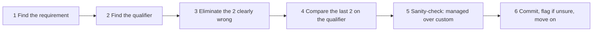

# Exam Keywords: Phrase → Likely Answer
> [Home](../README.md) · [Study plan](../00-study-plan.md) · [Exam strategy](../01-exam-strategy.md) · [Decision tables](decision-tables.md) · [Numbers to remember](numbers-to-remember.md)

SAA-C03 questions are written in a fairly consistent dialect. Certain phrases reliably point to a service, pattern or answer type. This page maps 275 of those phrases to the **likely** answer, with a one-line reason.

> ⚠️ "Likely" isn't "always." A phrase narrows the field, but the full scenario decides. If an option matches the keyword but breaks another stated constraint (Region, protocol, OS, budget, "no code changes"), it's wrong. Use this page to **generate candidates fast**, then check them against every constraint.

**Sections:** [1. Phrase → answer](#1-phrase--likely-answer) ([qualifiers](#11-qualifiers-the-words-that-decide-between-correct-answers) · [resilience](#12-resilience-ha--dr) · [compute](#13-compute--containers) · [storage](#14-storage) · [databases](#15-databases--caching) · [networking](#16-networking-edge--hybrid) · [integration](#17-integration--decoupling) · [security](#18-security-identity--governance) · [analytics/ML](#19-analytics-ml--data) · [migration](#110-migration--transfer) · [operations](#111-operations--monitoring) · [cost](#112-cost)) · [2. Distractor patterns](#2-common-distractor-patterns) · [3. Six-step dissection](#3-the-six-step-question-dissection-method)

---

## 1. Phrase → likely answer

### 1.1 Qualifiers: the words that decide between "correct" answers

Most questions have two plausible options. The qualifier picks between them.

| Phrase in the question | Likely answer | Why |
|---|---|---|
| **"LEAST operational overhead"** / "least management effort" | **Managed or serverless**: Lambda, Fargate, DynamoDB, Aurora Serverless, S3, a native feature toggle | AWS does the patching, scaling and HA. Anything with "EC2 + script" loses. |
| **"MOST cost-effective"** / "lowest cost" | The cheapest option that still meets **every** stated requirement | Cost never overrides a requirement. Eliminate non-compliant options first, then pick the cheapest. |
| **"MOST secure"** | Private path + least privilege + KMS encryption + temporary credentials | Layered controls beat one control. Long-lived keys and public paths lose. |
| **"with minimal changes to the application"** / **"no code changes"** | Compatible managed service: RDS (same engine), MQ (JMS/AMQP), EFS/FSx (same file protocol), MGN (rehost) | Re-architecting to DynamoDB/Lambda/SQS breaks the constraint, however elegant. |
| **"as quickly as possible"** (deliver/migrate) | Managed migration tool or rehost (MGN, DMS, DataSync); offline device for huge data on slow links | Time to deliver beats the ideal end state. |
| **"highly available"** | **Multi-AZ** + Auto Scaling + load balancer + health checks | Survives an AZ failure. A brief failover blip is acceptable. |
| **"fault tolerant"** | Redundant capacity **already running** (N+1 across AZs, active-active) | Stronger than HA: no degradation at all when a component fails. |
| **"near real-time"** | **Firehose**, EventBridge, S3 event → Lambda | Seconds to about a minute of buffering is acceptable. |
| **"real-time"** | **Kinesis Data Streams** (+ Lambda/Flink consumers), DynamoDB Streams | Sub-second, per-record processing. |
| **"durable"** (data) | S3 (11 9s), multi-AZ services; for messages, SQS | Durability = not losing data. It's different from availability. |
| **"unpredictable" / "spiky" traffic** | Lambda, DynamoDB on-demand, Aurora Serverless v2, SQS buffer, target-tracking ASG | Elastic, pay-per-use capacity. |
| **"steady-state" / "predictable" / "24×7 for 3 years"** | Savings Plans / Reserved Instances / provisioned capacity | Commitment discounts reward predictability. |
| **"minimize data loss"** | Lower **RPO**: synchronous/Multi-AZ replication, PITR, continuous replication | RPO is about data. |
| **"minimize downtime"** | Lower **RTO**: automatic failover, warm standby, blue/green | RTO is about time to recover. |
| **"without managing servers"** | Fargate, Lambda, serverless data services | Taken literally, it rules out EC2 and ECS on EC2. |
| **"reuse existing tools/skills"** (Kubernetes, Kafka, SQL, Spark) | EKS, MSK, Athena/Redshift, EMR | The stated tooling is a constraint. |
| **"decouple"** / "loosely coupled" | **SQS** between tiers, or SNS/EventBridge for pub/sub | Producers and consumers scale and fail independently. |
| **"simplest"** / "fewest steps" | A native setting (S3 replication, RDS Multi-AZ checkbox, Lambda destination) | One managed feature beats a pipeline of services. |

### 1.2 Resilience, HA & DR

| Phrase | Likely answer | Why |
|---|---|---|
| "survive the failure of an Availability Zone" | Spread across ≥2 AZs: ASG + ALB, RDS Multi-AZ, **NAT gateway per AZ** | The AZ is the standard failure domain. |
| "survive a Regional outage" | Multi-Region: Aurora Global Database, DynamoDB Global Tables, S3 CRR, Route 53 failover | Multi-AZ doesn't cover the loss of a Region. |
| "RTO of hours is acceptable", "lowest cost DR" | **Backup & restore** (AWS Backup cross-Region copies + IaC) | Cheapest strategy that meets a loose RTO. |
| "minimal resources running in DR until needed" | **Pilot light** | Data replicated live, compute off or minimal. |
| "scaled-down copy running, recover in minutes" | **Warm standby** | Functional but small. Scale out on failover. |
| "zero downtime, both Regions serve traffic" | **Multi-site active/active** | Highest cost, near-zero RPO/RTO. |
| "RPO of seconds, RTO of minutes for on-prem servers" | **Elastic Disaster Recovery (DRS)** | Continuous block replication to a low-cost staging area. |
| "relational DB, cross-Region DR, RPO ~1 s" | **Aurora Global Database** | Storage-level replication, typically <1 s lag. |
| "automatic database failover" | RDS Multi-AZ / Aurora | Managed failover behind the same endpoint. |
| "single point of failure" (one NAT instance, one EC2) | NAT gateway per AZ; ASG with min ≥2 across AZs | Remove the SPOF with managed, multi-AZ components. |
| "replace unhealthy instances automatically" | ASG with **ELB health checks** | EC2 status checks alone miss application failures. |
| "stateless web tier" / "users lose sessions when instances scale in" | Externalize sessions to **ElastiCache or DynamoDB** | Any instance can then serve any request. |
| "back up many accounts centrally with policies" | **AWS Backup** + Organizations backup policies, cross-account/Region copy | One policy-driven service across resources. |
| "backups must be immutable, even from admins" | **AWS Backup Vault Lock (compliance mode)** | WORM protection for recovery points. |
| "recover accidentally deleted EBS snapshots/AMIs" | **Recycle Bin** retention rules | Deleted resources stay recoverable for the retention period. |
| "recover accidentally deleted/overwritten S3 objects" | **S3 Versioning** (+ MFA Delete) | Previous versions remain. |
| "S3 replication within a predictable time / SLA" | **S3 Replication Time Control** | 99.99% of objects replicated within 15 minutes. |
| "deploy with no downtime and instant rollback" | **Blue/green** (Route 53 / ALB weighted target groups, Beanstalk URL swap) | The old environment stays intact for rollback. |

### 1.3 Compute & containers

| Phrase | Likely answer | Why |
|---|---|---|
| **"can tolerate interruption"** / "flexible start time" | **Spot** (in an ASG, EC2 Fleet or Batch) | Up to ~90% off. Interruptions are acceptable. |
| "baseline always on + unpredictable peaks" | Savings Plans/RIs for the baseline + On-Demand (or Spot) for peaks | A mixed purchasing model. |
| "instance families, Regions or Fargate/Lambda may change" | **Compute Savings Plans** | The most flexible commitment. |
| "job runs longer than 15 minutes" | **Not Lambda**: Fargate/ECS task, Batch, EC2, or split with Step Functions | Lambda has a hard 15-minute limit. |
| "batch jobs", "job queue", "HPC jobs at lowest cost" | **AWS Batch** with Spot | Managed scheduling and compute environments. |
| "tightly coupled HPC", "lowest network latency between nodes" | **Cluster placement group** (+ EFA) | Instances packed close together in one AZ. |
| "a few critical instances must not share hardware" | **Spread placement group** | Distinct racks, max 7 per AZ. |
| "HDFS/Cassandra/Kafka on EC2, rack-aware" | **Partition placement group** | Partitions map to separate racks. |
| "containers with least operational overhead" | **ECS on Fargate** | No hosts to patch or scale. |
| "already uses Kubernetes" / "Kubernetes manifests, Helm" | **EKS** | Keep the tooling. Pick ECS unless Kubernetes is stated. |
| "containers need GPUs" / "specific instance types" | ECS or EKS on **EC2** | Fargate has no GPUs. |
| "per-socket / per-core license (BYOL)" | **Dedicated Hosts** | Socket/core visibility for licensing. |
| "single-tenant hardware for compliance, no licensing need" | **Dedicated Instances** | Cheaper than Dedicated Hosts for isolation only. |
| "guarantee capacity in an AZ, no long-term commitment" | **On-Demand Capacity Reservation** | Reserves capacity with no term. |
| "instances take a long time to boot when scaling out" | **Warm pools** and/or golden AMIs (EC2 Image Builder) | Pre-initialized capacity cuts scale-out latency. |
| "scale workers on queue depth" | Target tracking on **backlog per instance** | CPU doesn't reflect queue lag. |
| "Lambda cold starts hurt latency" | **Provisioned concurrency**, or **SnapStart** (Java, Python, .NET) | Pre-initialized execution environments. |
| "Lambda overwhelms downstream DB/API" | **Reserved concurrency** to cap, SQS buffer in front | Limits parallelism. |
| "manipulate headers/redirect at the edge, very lightweight" | **CloudFront Functions** | Sub-ms, viewer events, cheapest. |
| "edge logic needing network calls/longer runtime" | **Lambda@Edge** | Origin events, up to 30 s, more runtimes. |
| "developers want to deploy a web app without managing infrastructure" | **Elastic Beanstalk** | Provisions ASG/ELB/monitoring for you. |
| "AWS services on-premises, low latency to local systems" | **Outposts** | AWS racks in your data center. |
| "ultra-low latency for 5G mobile devices" | **Wavelength** | Compute inside carrier networks. |
| "single-digit ms latency for users in one metro area" | **Local Zones** | AWS infrastructure in metro areas. |
| "run commands/patch fleet without SSH or bastion" | **Systems Manager** (Session Manager, Run Command, Patch Manager) | No inbound ports, IAM-controlled, logged. |
| "reduce compute cost without commitment" | **Graviton** (arm64) instances / Lambda on arm64 | Better price-performance. |

### 1.4 Storage

| Phrase | Likely answer | Why |
|---|---|---|
| **"shared file system" + Linux** | **EFS** | NFS, multi-AZ, thousands of clients, elastic. |
| **"shared file system" + Windows / SMB / Active Directory** | **FSx for Windows File Server** | Native SMB, NTFS ACLs, AD integration. |
| "HPC / ML training needs high-throughput access to data in S3" | **FSx for Lustre** (linked to S3) | Parallel file system, lazy-loads from S3. |
| "NetApp", "NFS + SMB + iSCSI on the same data" | **FSx for NetApp ONTAP** | Multi-protocol, SnapMirror, storage efficiency. |
| "migrate ZFS-based NAS" | **FSx for OpenZFS** | Same feature model (snapshots/clones). |
| "block storage for a database on EC2" | **EBS gp3** (io2 Block Express if very high IOPS/sub-ms) | Low-latency block, independent IOPS. |
| ">16,000 IOPS on one volume" / "sub-millisecond latency" | **io2 Block Express** | Classic exam rule of thumb. gp3 now reaches 80,000 IOPS, so sub-ms latency, 99.999% durability or Multi-Attach are the stronger io2 signals. |
| "temporary scratch, max IOPS, data can be lost" | **Instance store** | Physically attached, ephemeral. |
| "large sequential reads, cheap EBS" | **st1** | Throughput-optimized HDD. |
| "infrequent access, ms retrieval, must survive AZ loss" | **S3 Standard-IA** | Multi-AZ, cheaper storage, retrieval fee. |
| "infrequent, re-creatable, cheapest ms access" | **S3 One Zone-IA** | Single AZ, lower price. |
| **"unknown or changing access patterns"** | **S3 Intelligent-Tiering** | Auto-tiers with no retrieval fees. |
| "archive, accessed quarterly, needs ms access" | **S3 Glacier Instant Retrieval** | Cheapest storage with ms reads. |
| "archive, retrieval in minutes acceptable" | **Glacier Flexible Retrieval** (expedited 1–5 min) | Cheap archive with fast options. |
| "archive 7–10 years, retrieval within 12–48 h, lowest cost" | **Glacier Deep Archive** | Cheapest storage class. |
| **"compliance, WORM", "no one including root can delete"** | **S3 Object Lock – compliance mode** | Retention can't be shortened or bypassed. |
| "WORM but admins may need to override" | Object Lock – **governance mode** | Bypassable with special permission. |
| "legal hold until case closes" | Object Lock **legal hold** | Indefinite, independent of retention. |
| "global users upload large files to one bucket faster" | **S3 Transfer Acceleration** + multipart upload | Enters AWS at the nearest edge. |
| "upload objects >5 GB" / "resume failed uploads" | **Multipart upload** | Required above 5 GB; parallel, retryable parts. |
| "serve private S3 content only via CloudFront" | **Origin Access Control (OAC)** + bucket policy | Blocks direct S3 access. OAI is legacy. |
| "temporary access to one object for a user without AWS credentials" | **Presigned URL** | Time-limited, scoped to one object. |
| "copy objects to another Region automatically" | **S3 Cross-Region Replication** (versioning on both buckets) | Asynchronous, rule-based. |
| "very high request rates to S3" | Spread keys across **multiple prefixes** | Per-prefix rate limits scale linearly. |
| "on-prem apps write files that should land in S3" | **S3 File Gateway** | NFS/SMB front end, S3 back end. |
| "replace physical tape library, keep backup software" | **Tape Gateway** | Virtual tape library to S3/Glacier. |
| "EBS volume in another AZ/Region" | **Snapshot → copy → create volume** | EBS volumes are AZ-scoped. |

### 1.5 Databases & caching

| Phrase | Likely answer | Why |
|---|---|---|
| **"read-heavy"** relational workload | **Read replicas** / Aurora Replicas (+ ElastiCache) | Offload reads from the writer. |
| **"write-heavy, key-value, massive scale"** | **DynamoDB** | Horizontal partitioning, predictable latency. |
| **"sub-millisecond"** latency cache | **ElastiCache** (Valkey/Redis OSS) | In-memory. |
| **"microsecond"** reads on DynamoDB | **DAX** | Write-through in-memory cache for DynamoDB. |
| "microsecond reads **and** durable Redis-compatible primary DB" | **MemoryDB** | Multi-AZ transaction log gives durability. |
| **"session state"** | **ElastiCache** or **DynamoDB** (with TTL) | Shared, fast, externalized state. |
| **"connection limits from Lambda"** / "too many DB connections" | **RDS Proxy** | Pools and reuses connections; also faster failover. |
| **"graph relationships"**, "friends of friends", "fraud rings" | **Neptune** | Graph queries. |
| **"MongoDB compatible"** | **DocumentDB** | Managed MongoDB-compatible API. |
| **"Cassandra"**, "CQL" | **Keyspaces** | Serverless Cassandra-compatible. |
| "full-text search", "fuzzy search on product catalog" | **OpenSearch Service** | Inverted indexes. |
| "Oracle or SQL Server, managed" | **RDS for Oracle / SQL Server** | Aurora doesn't run these engines. |
| "need OS / host access to the database" | **RDS Custom** (or self-managed on EC2) | Managed with privileged access. |
| "relational, intermittent or unpredictable load" | **Aurora Serverless v2** | Scales capacity in fine increments; can pause. |
| "global users, low-latency reads, relational" | **Aurora Global Database** | Read replicas in up to 10 secondary Regions. |
| "multi-Region, multi-active writes" | **DynamoDB Global Tables** | Active-active replication. |
| "restore to any second in the last N days" | **RDS automated backups / DynamoDB PITR** (up to 35 days) | Point-in-time recovery. |
| "copy of production DB for testing in minutes" | **Aurora cloning** | Copy-on-write, fast and cheap. |
| "undo a bad change in minutes without restoring" | **Aurora Backtrack** (MySQL-compatible) | Rewinds the cluster in place. |
| "data warehouse", "complex analytical queries/joins" | **Redshift** | Columnar MPP. |
| "trigger processing on every DynamoDB item change" | **DynamoDB Streams** + Lambda | Ordered change log per item. |
| "delete items automatically after expiry" | **DynamoDB TTL** | Free background deletion. |
| "DynamoDB throttling on a few hot keys" | Higher-cardinality partition key / write sharding (DAX for hot reads) | Spread load across partitions. |
| "authenticate to RDS without stored passwords" | **IAM database authentication** | Short-lived auth tokens. |
| "relational DB, sudden read spikes on the same queries" | **ElastiCache** in front (lazy loading) | Cache absorbs repeated reads. |

### 1.6 Networking, edge & hybrid

| Phrase | Likely answer | Why |
|---|---|---|
| **"global users, low latency"** + web/static/HTTP | **CloudFront** | Edge caching close to users. |
| **"global users, low latency"** + TCP/UDP, non-HTTP | **Global Accelerator** | Anycast entry to the AWS backbone. |
| **"static IP"** for the application entry point | **NLB** (EIP per AZ) or **Global Accelerator** | ALB has no static IPs. |
| **"UDP"** | **NLB** or **Global Accelerator** | ALB is HTTP/HTTPS only. |
| "route by URL path or hostname" | **ALB** | Layer-7 rules. |
| "inline third-party firewall appliances" | **Gateway Load Balancer** | Transparent appliance insertion. |
| "instances in private subnets need outbound internet" | **NAT gateway** (one per AZ for HA) | Managed, scalable egress. |
| "IPv6 instances need outbound-only internet" | **Egress-only internet gateway** | The IPv6 equivalent of NAT. |
| "access S3/DynamoDB without internet or NAT" | **Gateway VPC endpoint** | Free and private. |
| "access SQS/KMS/Secrets Manager privately from a VPC" | **Interface endpoint** (PrivateLink) | ENI with a private IP. |
| "access S3 privately from on-premises" | **S3 interface endpoint** over DX/VPN | Gateway endpoints aren't reachable from on-prem. |
| "expose a service to many VPCs/accounts", "overlapping CIDRs" | **PrivateLink** (NLB + endpoint service) | Service-level, CIDR-independent. |
| "connect dozens/hundreds of VPCs + on-prem, transitive" | **Transit Gateway** | Hub-and-spoke with route tables. |
| "connect two VPCs at lowest cost" | **VPC peering** | No hourly fee, non-transitive. |
| "central networking team owns VPC; app accounts deploy into it" | **VPC sharing** via RAM | Shared subnets across accounts. |
| **"hybrid"** + "quickly" / "encrypted" / "low cost" | **Site-to-Site VPN** | Minutes to set up over the internet. |
| "consistent latency", "dedicated bandwidth", "large daily transfers" | **Direct Connect** | Private circuit. |
| "Direct Connect **and** encryption" | **VPN over DX** (or **MACsec** on dedicated links) | DX isn't encrypted by default. |
| "DX to VPCs in multiple Regions" | **Direct Connect Gateway** | One DX, many Regions. |
| "highly resilient DX" | 2 connections at **2 DX locations**; cost-effective: DX + VPN backup | Removes location and device SPOFs. |
| "DX taking weeks; need connectivity now" | **Site-to-Site VPN** now, DX later | VPN is immediate. |
| "remote employees access private resources" | **Client VPN** | User-level VPN. |
| "on-prem DNS must resolve Route 53 private zones" | **Route 53 Resolver inbound endpoint** (outbound for the reverse) | Hybrid DNS forwarding. |
| "point example.com (zone apex) to an ALB/CloudFront" | **Route 53 alias record** | CNAME can't be used at the apex. |
| "route users by country / comply with geo rules" | **Geolocation routing** | Country/continent-based. |
| "send users to the lowest-latency Region" | **Latency-based routing** | Measured network latency. |
| "send 10% of traffic to the new version" | **Weighted routing** (or ALB weighted target groups) | Proportional split. |
| "active-passive failover by DNS" | **Failover routing** + health checks | Secondary used when primary is unhealthy. |
| "troubleshoot rejected traffic / see accepted and rejected flows" | **VPC Flow Logs** | Network-level metadata. |
| "block a specific IP/CIDR" | **NACL deny rule** (or WAF IP set for HTTP) | SGs can't deny. |
| "restrict content by country at the CDN" | **CloudFront geo-restriction** | Edge-level allow/deny lists. |
| "only premium users may download files via CloudFront" | **CloudFront signed URLs / signed cookies** | Time- and policy-bound access. |

### 1.7 Integration & decoupling

| Phrase | Likely answer | Why |
|---|---|---|
| "decouple", "buffer spikes", "process later" | **SQS** | Durable buffer with competing consumers. |
| **"ordered"**, **"exactly-once"**, "no duplicates" | **SQS FIFO** (message group ID + dedup ID) | Strict per-group order, deduplication. |
| **"fan-out"** to multiple systems | **SNS → multiple SQS queues** (or EventBridge) | Each consumer gets its own durable copy. |
| **"replay"** past events/stream data | **Kinesis Data Streams** (retention) or **EventBridge archive & replay** | Data is retained and re-readable. |
| "multiple applications consume the same stream independently" | **Kinesis Data Streams** (enhanced fan-out) | Dedicated read throughput per consumer. |
| "load streaming data into S3/Redshift/OpenSearch with no code" | **Data Firehose** | Fully managed delivery, buffering, conversion. |
| "convert incoming JSON stream to Parquet in S3" | **Firehose** record format conversion | Built-in, uses the Glue schema. |
| **"SaaS integration"** (events from Zendesk, Datadog…) | **EventBridge partner event sources** | Native SaaS event ingestion. |
| "move data from Salesforce/SAP/SaaS to S3/Redshift, no code" | **AppFlow** | Managed SaaS data flows. |
| "react to AWS service events" (EC2 state change, GuardDuty finding) | **EventBridge rule** → target | AWS services emit events to the default bus. |
| "run a task on a cron schedule, serverless" | **EventBridge Scheduler** → Lambda/ECS/Step Functions | Managed scheduling. |
| **"orchestrate workflow with retries / human approval"** | **Step Functions Standard** (`.waitForTaskToken`) | Visual state machine, error handling, long waits. |
| "high-volume, short-lived workflows" | **Step Functions Express** | Cheap, ≤5 min, at-least-once. |
| "process large S3 datasets in parallel with orchestration" | **Step Functions Distributed Map** | Massive parallel child executions. |
| **"JMS / AMQP / MQTT / STOMP"**, "existing message broker" | **Amazon MQ** | Protocol compatibility without code changes. |
| "existing Apache Kafka" | **MSK** | Managed Kafka, same APIs. |
| "message larger than the limit" | **Payload in S3 + pointer in the message** (Extended Client Library) | Claim-check pattern. |
| "messages that repeatedly fail processing" | **Dead-letter queue** (+ redrive) | Isolates poison messages. |
| "message processed twice because work takes longer than expected" | Increase **visibility timeout** (or extend it per message) | The message became visible again mid-processing. |
| "reduce empty receives / polling cost" | **Long polling** (WaitTimeSeconds up to 20 s) | Fewer API calls. |
| "postpone delivery of new messages" | **Delay queue** / message timers (≤15 min) | Built-in delay. |
| "subscribers should only receive relevant messages" | **SNS filter policies** / EventBridge event patterns | Filtering without consumer code. |
| "per-customer throttling and API keys" | **API Gateway usage plans** (REST API) | Quotas and rate limits per key. |
| "real-time two-way messaging with clients" | **API Gateway WebSocket API** | Persistent connections, server push. |
| "cache API responses" | **API Gateway caching** (REST) or CloudFront | Fewer backend calls. |
| "on-success/on-failure routing for async Lambda" | **Lambda destinations** | Native, no extra code. |

### 1.8 Security, identity & governance

| Phrase | Likely answer | Why |
|---|---|---|
| **"temporary credentials"** | **IAM roles / STS** (AssumeRole, identity federation) | Auto-expiring, nothing stored. |
| "app on EC2 needs to call S3/DynamoDB" | **IAM role via instance profile** | Never put access keys on instances. |
| "pods on EKS need AWS permissions" | **EKS Pod Identity / IRSA** | Per-pod roles, not node roles. |
| **"least privilege"** | Specific actions + resources + conditions; **IAM Access Analyzer** to generate/validate | Grant only what's used. |
| **"cross-account access"** | **IAM role in the target account** with a trust policy (or a resource-based policy) | No shared users or keys. |
| "third party needs access to our account" | Cross-account role + **external ID** | Prevents the confused-deputy problem. |
| **"centrally manage multiple accounts"** | **Organizations** (consolidated billing, OUs, policies) | The native multi-account control plane. |
| "set up a governed multi-account landing zone quickly" | **Control Tower** | Automated account factory + guardrails. |
| **"prevent any account from…"** (even admins) | **SCP** in Organizations | Sets the maximum permissions; overrides account admins. |
| "resources must not be accessible from outside our organization" | **Resource control policies (RCPs)** or `aws:PrincipalOrgID` conditions | Org-wide guardrail on resource policies. |
| "restrict usage to approved Regions" | **SCP** with `aws:RequestedRegion` | Org-wide Region deny. |
| "employees need SSO to many AWS accounts" | **IAM Identity Center** | Permission sets across accounts. |
| "corporate IdP (Okta/Entra ID) users access AWS accounts" | **Identity Center** with external IdP (SAML + SCIM) | Central federation. |
| "customers sign up/sign in to the web or mobile app" | **Cognito user pool** | User directory + tokens. |
| "app users upload directly to S3 with their own credentials" | **Cognito identity pool** | Exchanges tokens for temporary AWS credentials. |
| "use existing on-prem AD for AWS logins, no directory sync" | **AD Connector** | Proxy to on-prem AD. |
| "need AD in AWS with a trust to on-prem" | **AWS Managed Microsoft AD** | Real AD, trust relationships. |
| **"audit who did what"**, "who deleted…" | **CloudTrail** | API activity log. |
| "track configuration changes and compliance over time" | **Config** | Config history + rules. |
| "auto-remediate non-compliant resources" | **Config rule + SSM Automation** remediation | Detect → fix automatically. |
| **"detect PII"** in S3 | **Macie** | Sensitive data discovery. |
| "detect malicious activity / compromised instances" | **GuardDuty** | Threat detection from logs. |
| "scan EC2/containers/Lambda for vulnerabilities (CVEs)" | **Inspector** | Continuous vulnerability scanning. |
| "investigate root cause of a security finding" | **Detective** | Graph-based investigation. |
| "aggregate findings across accounts, compliance score" | **Security Hub** | Central posture management. |
| **"SQL injection"**, **"cross-site scripting"** | **WAF** | L7 managed rules. |
| "throttle requests from a single IP" | **WAF rate-based rule** | Per-IP rate limiting. |
| **"DDoS"** (large-scale, with expert help and cost protection) | **Shield Advanced** (+ CloudFront, Route 53, WAF) | SRT, cost protection, L7 mitigation. |
| "apply WAF/SG policies across all accounts automatically" | **Firewall Manager** | Org-wide security policy enforcement. |
| **"customer-controlled encryption keys"** | **KMS customer managed key** | Your key policy, rotation, disable/delete. |
| **"FIPS 140-3 Level 3"** + **"single-tenant" / "dedicated HSM"** | **CloudHSM** | Customer-exclusive keys; AWS has no access. |
| "keys generated on-prem must be used in AWS" | KMS **imported key material** (BYOK) | You own key generation. |
| "encrypt data in one Region, decrypt in another" | **KMS multi-Region keys** | Same key material in several Regions. |
| "encrypt large payloads with KMS" | **Envelope encryption** (GenerateDataKey) | KMS Encrypt handles ≤4 KB. |
| **"rotate credentials automatically"** | **Secrets Manager** | Built-in rotation (RDS managed rotation). |
| "store config values/parameters cheaply" | **SSM Parameter Store** | Standard tier is free. |
| "HTTPS certificates, free, auto-renewing" | **ACM** on ALB/CloudFront/API Gateway | Managed public certificates. |
| "enforce HTTPS-only access to an S3 bucket" | Bucket policy denying `aws:SecureTransport = false` | Explicit deny on plain HTTP. |
| "audit trail of key usage for S3 encryption" | **SSE-KMS** | Each key use is logged in CloudTrail. |
| "reduce KMS request costs for S3" | **S3 Bucket Keys** | Bucket-level data key cuts KMS calls. |
| "encrypt an existing unencrypted EBS volume or RDS instance" | **Snapshot → encrypted copy → restore** | You can't encrypt in place. |
| "share TGW/subnets/resolver rules across accounts" | **RAM** | Native resource sharing. |
| "find resources shared outside the account/org" | **IAM Access Analyzer** | External access findings. |
| "auditor needs AWS's SOC 2 / PCI reports" | **Artifact** | AWS compliance documents. |
| "automate evidence collection for our audit" | **Audit Manager** | Maps evidence to frameworks. |
| "private connectivity to EC2 without bastion hosts" | **Session Manager** (or EC2 Instance Connect Endpoint) | No public IPs or open SSH. |

### 1.9 Analytics, ML & data

| Phrase | Likely answer | Why |
|---|---|---|
| **"SQL queries on S3"**, "ad-hoc", "serverless" | **Athena** | Pay per TB scanned, no infrastructure. |
| **"petabyte-scale analytics"**, "data warehouse", "BI on structured data" | **Redshift** | Columnar MPP warehouse. |
| "query S3 data from the warehouse without loading" | **Redshift Spectrum** | External tables on S3. |
| "Spark/Hadoop/Hive", "migrate on-prem Hadoop" | **EMR** | Managed open-source big data. |
| "serverless ETL", "crawl and catalog schemas" | **Glue** (crawlers + Data Catalog + jobs) | Managed Spark ETL + metastore. |
| "no-code data preparation for analysts" | **Glue DataBrew** | Visual data prep. |
| "column/row-level permissions on a data lake" | **Lake Formation** | Fine-grained data lake governance. |
| "dashboards for business users" | **Amazon Quick** (Quick Sight; formerly QuickSight) | Serverless BI. |
| "real-time analytics on streams with SQL/Flink" | **Managed Service for Apache Flink** | Stateful stream processing. |
| "reduce Athena cost and query time" | **Partition + columnar (Parquet/ORC) + compression** | Less data scanned. |
| "log analytics with search and dashboards" | **OpenSearch Service** | Indexing + OpenSearch Dashboards. |
| "subscribe to third-party datasets" | **Data Exchange** | Data marketplace. |
| "extract text and form fields from scanned documents" | **Textract** | OCR + forms/tables. |
| "sentiment, entities, key phrases, PII in text" | **Comprehend** | NLP. |
| "speech to text" / "call transcripts" | **Transcribe** | ASR. |
| "text to lifelike speech" | **Polly** | TTS. |
| "translate content between languages" | **Translate** | Neural machine translation. |
| "detect objects/faces/unsafe content in images or video" | **Rekognition** | Computer vision API. |
| "conversational chatbot (voice/text)" | **Lex** | Conversational interfaces. |
| "build, train and deploy custom ML models" | **SageMaker AI** | Full ML platform. |
| "ingest video from cameras for analysis" | **Kinesis Video Streams** | Video ingestion and storage. |

### 1.10 Migration & transfer

| Phrase | Likely answer | Why |
|---|---|---|
| **"limited bandwidth, 100s of TB"** (or PB) | **Snowball Edge** (offline) | Network transfer would take weeks or months. |
| **"lift-and-shift"** servers / VMs | **Application Migration Service (MGN)** | Continuous replication + cutover to EC2. |
| "migrate a database with minimal downtime" | **DMS** (full load + CDC) | Source stays live during migration. |
| "Oracle → Aurora PostgreSQL" (heterogeneous) | **DMS Schema Conversion / SCT + DMS** | Convert the schema, then move the data. |
| "discover on-prem servers and dependencies before migrating" | **Application Discovery Service** | Inventory + dependency mapping. |
| "migrate or sync NFS/SMB/HDFS data online" | **DataSync** | Managed, verified, scheduled transfers. |
| "partners send files via SFTP into S3" | **Transfer Family** | Managed SFTP/FTPS/FTP/AS2. |
| **"hybrid"**, **"on-premises NFS/SMB apps continue"** with cloud storage | **Storage Gateway** (S3 File Gateway) | Ongoing local access with an AWS backend. |
| "VMware workloads moved with existing VMware tools" | **VMware Cloud on AWS** | Same VMware stack on AWS. |
| "DR for on-prem servers into AWS" | **Elastic Disaster Recovery** | Continuous replication, quick recovery. |

### 1.11 Operations & monitoring

| Phrase | Likely answer | Why |
|---|---|---|
| "memory or disk utilization of EC2" | **CloudWatch agent** | Not collected by default. |
| "trace requests across microservices, find latency bottlenecks" | **X-Ray** | Distributed tracing. |
| "recover an instance automatically when hardware fails" | **CloudWatch alarm with EC2 recover action** (or ASG) | Same instance ID, new host. |
| "repeatable infrastructure across accounts/Regions" | **CloudFormation** (StackSets) | IaC with central deployment. |
| "teams may only launch approved products" | **Service Catalog** | Curated, governed templates. |
| "notified when an AWS issue affects our resources" | **AWS Health Dashboard** (+ EventBridge) | Account-specific events. |
| "managed Prometheus / Grafana dashboards for containers" | **Managed Service for Prometheus / Managed Grafana** | Managed open-source observability. |
| "track software license usage" | **License Manager** | License rules and tracking. |
| "query and analyze application logs interactively" | **CloudWatch Logs Insights** | Query language over log groups. |
| "review the architecture against best practices" | **Well-Architected Tool** | Structured review per pillar/lens. |
| "detect configuration drift from the template" | **CloudFormation drift detection** | Compares live resources with the stack. |

### 1.12 Cost

| Phrase | Likely answer | Why |
|---|---|---|
| "high NAT gateway charges for S3/DynamoDB traffic" | **Gateway VPC endpoint** | Free, bypasses NAT processing fees. |
| "alert when spend exceeds a threshold" | **Budgets** (+ Budget Actions) | Proactive alerts and actions. |
| "detect unusual spend automatically" | **Cost Anomaly Detection** | ML-based, no fixed thresholds. |
| "rightsize over-provisioned instances" | **Compute Optimizer** | Utilization-based recommendations. |
| "chargeback by department/project" | **Cost allocation tags** (activated) + Cost Explorer / CUR | Split costs by tag. |
| "dev/test environments idle nights and weekends" | Scheduled scaling / stop schedules (Instance Scheduler); Aurora Serverless v2 auto-pause | Don't pay for idle capacity. |
| "gp2 volumes, reduce cost" | **Migrate to gp3** (Elastic Volumes, no downtime) | Cheaper, decoupled IOPS. |
| "old snapshots kept for compliance, rarely restored" | **EBS Snapshots Archive** | Much cheaper tier; slower restore. |
| "DynamoDB table with steady, predictable traffic" | **Provisioned capacity + auto scaling** (+ reserved capacity) | On-demand costs more at steady load. |
| "DynamoDB data rarely accessed but must stay in the table" | **DynamoDB Standard-IA table class** | Lower storage cost. |
| "reduce internet egress for static content" | **CloudFront** | Caching + lower edge transfer rates. |
| "public IPv4 costs rising" | Release unused EIPs, use NAT/ALB, consider IPv6 | Public IPv4 is billed hourly. |
| "cross-AZ data transfer charges are high" | Keep chatty traffic in-AZ (per-AZ NAT GW, AZ-aware routing) | Inter-AZ traffic is billed both ways. |
| "estimate cost before migration" | **Pricing Calculator** | Pre-build estimates. |
| "Lambda + Fargate + EC2 steady baseline spend" | **Compute Savings Plans** | One commitment covers all three. |

---

## 2. Common distractor patterns

Wrong options are rarely nonsense. They're real services used in the wrong way. Learn to recognize these shapes.

| # | Pattern | How to spot it | What usually wins instead |
|---|---|---|---|
| 1 | **Technically possible, but needs custom code** | "Write a script/Lambda that polls…", "cron job on EC2 that copies…" | The native feature: S3 replication, lifecycle rules, Config remediation, Backup plans, EventBridge rules. |
| 2 | **Deprecated or legacy service** | CLB, OAI, simple scaling, gp2/io1 for new volumes, FSx File Gateway, QLDB, Snowcone, S3 Select | Current equivalent: ALB/NLB, OAC, target tracking, gp3/io2, FSx for Windows direct, Snowball Edge/DataSync. |
| 3 | **Data goes over the internet when a private path exists** | NAT gateway or public endpoints for S3 traffic; VPN over the internet when DX is available | VPC endpoints, PrivateLink, DX (+VPN/MACsec). |
| 4 | **More expensive than needed** | Multi-Region for a Multi-AZ requirement, io2 where gp3 suffices, Dedicated Hosts without a licensing need, Shield Advanced without a stated DDoS need | The cheapest option that meets the stated RPO/RTO/performance. |
| 5 | **Multi-AZ chosen for read scaling** | "Enable Multi-AZ to improve read performance" | **Read replicas** / Aurora Replicas. A Multi-AZ instance standby doesn't serve reads. |
| 6 | **CloudTrail vs Config confusion** | "Use Config to find who deleted…" or "CloudTrail to check compliance" | CloudTrail = who/when/API. Config = state/compliance/history. |
| 7 | **Right service, wrong feature or layer** | Global Accelerator to cache content, Route 53 to load-balance within a Region, CloudFront to fix database write load | CloudFront for caching, ELB for in-Region balancing, a DB-side fix for DB load. |
| 8 | **Long-lived credentials** | "Store access keys in the AMI / user data / environment", "create an IAM user for the app" | IAM roles (instance profile, task role, execution role), Secrets Manager. |
| 9 | **Misses one hidden constraint** | Lambda for a 40-minute job, EFS for Windows, gateway endpoint from on-prem, SQS Standard when order matters, One Zone-IA for data that must survive AZ loss | Re-read every constraint word (OS, protocol, duration, ordering, AZ, Region). |
| 10 | **Over-permissive access** | `AdministratorAccess`, `"Resource": "*"`, SG open to 0.0.0.0/0, public bucket "for simplicity" | Scoped policies, SG references, private access via OAC or endpoints. |
| 11 | **Wrong control type** | Security group "deny rule", NACL expected to be stateful, WAF for non-HTTP traffic | NACL for deny, ephemeral ports for NACL returns, Network Firewall/Shield for non-HTTP. |
| 12 | **Manual operations at scale** | "SSH into each instance", "manually copy snapshots every day", "email the team to rotate keys" | Systems Manager, AWS Backup, Secrets Manager rotation. |
| 13 | **Migration tool vs hybrid tool mix-up** | Storage Gateway for a one-time bulk move; DataSync for ongoing local file access | DataSync/Snowball to move. Storage Gateway to keep using on-prem protocols. |
| 14 | **Real-time vs near-real-time mismatch** | Firehose for sub-second processing; Kinesis Data Streams + custom consumers when "no code, land in S3" was asked | Kinesis Data Streams for real-time; Firehose for managed delivery. |
| 15 | **HA option where fault tolerance was asked** | ASG min 1, or a single instance with "automatic recovery" | N+1 capacity running across AZs. |
| 16 | **Changing the app when "no code changes" is required** | "Refactor to DynamoDB/Lambda/SQS" | Compatible managed service (RDS same engine, MQ, EFS/FSx, MGN). |
| 17 | **Impossible or non-existent feature** | Cross-Region EBS replication, attaching EBS across AZs, SCPs that *grant* permissions, encrypting an existing EBS volume in place, converting SQS Standard to FIFO in place | Snapshots/copies, new resources, SCP = guardrail only, create a new FIFO queue. |
| 18 | **Toy or under-scaled service** | Lightsail for an enterprise HA workload; a single NAT instance; Simple AD needing trusts | Services designed for the stated scale and features. |
| 19 | **Over-engineering** | Kubernetes, Kafka or multi-Region active/active for a simple, single-Region app | The simplest architecture meeting the requirements. |

---

## 3. The six-step question dissection method

This matches the method in [01-exam-strategy.md](../01-exam-strategy.md), condensed for the last week.

1. **Find the requirement.** What must be true when you're done? Write it in about 5 words ("Windows shared files, multi-AZ"). Underline the hard constraints: OS, protocol, duration, RPO/RTO, Region, "existing" tools, "no code changes".
2. **Find the qualifier.** It's usually the last sentence: LEAST overhead, MOST cost-effective, MOST secure, fastest, minimal changes. This is the tie-breaker you'll use in step 4.
3. **Eliminate the two clearly wrong.** Look for the wrong service category, a broken hard constraint, or something impossible (row 17 above). Usually two options die here within 30 seconds.
4. **Compare the last two on the qualifier only.** Both probably "work." Ask only: which has less ops, costs less, or is more secure, whichever the qualifier names? Don't re-argue functionality.
5. **Sanity-check: managed > custom.** Also private > public, temporary credentials > long-lived keys, native feature > script. If your pick includes "write a script/Lambda that…" and the other uses a built-in feature, switch.
6. **Commit and move on.** If you're unsure after about 2 minutes, choose, **flag**, and continue. A later question often jogs your memory. There's no guessing penalty, so never leave a blank.

**Multiple response ("Choose two/three"):** treat each option as an independent true/false against the requirement. Correct pairs are usually **complementary steps** (e.g., "create a gateway endpoint" + "update the bucket policy with `aws:sourceVpce`"), not two alternatives to the same step.

Worked example (original): try steps 1–5 before opening

*Scenario:* A company's Linux web servers in an Auto Scaling group across three AZs need a common directory for user-uploaded images. Uploads must be visible to every server immediately. The team wants the **LEAST operational overhead**. Options: (A) an EBS io2 volume with Multi-Attach, (B) Amazon EFS mounted on all instances, (C) an NFS server on a large EC2 instance, (D) FSx for Windows File Server.

1. Requirement: *shared Linux files across 3 AZs.*
2. Qualifier: *least operational overhead.*
3. Eliminate: **A** (Multi-Attach is single-AZ and needs a cluster-aware file system) and **D** (built for Windows/SMB with Active Directory, the wrong fit for a Linux fleet).
4. Compare B vs C on overhead: EFS is managed and elastic. The NFS server must be patched, sized, made HA, and is a SPOF.
5. Sanity check: managed beats custom. **Answer: B.**

