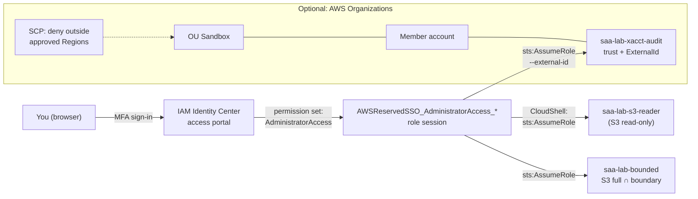
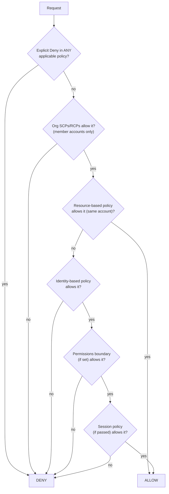

# Lab 01: Account foundations, IAM roles and policy evaluation

> [Home](../README.md) · [Labs index](README.md) · Notes: [IAM & multi-account](../notes/01-iam-multi-account.md) · Practice: [D1 Secure](../practice/d1-secure.md)

| Time | Cost risk | Task statements | Prereqs |
|---|---|---|---|
| 2 h core + 1 h optional | **$0**: IAM, IAM Identity Center, Organizations and SCPs have no charge | 1.1 | [Lab safety](README.md) sections 1–3 done; root MFA on |

## Objective

Set up the account the way the exam expects:

- humans sign in through **IAM Identity Center** with temporary credentials
- workloads use **roles**
- root is locked away

Then work through the policy evaluation logic yourself: build a role and its trust policy, assume it from the CLI, validate and simulate policies, and cap a role with a **permissions boundary**. The optional part adds a member account, a Region-restricting **SCP**, and a cross-account role protected by an **external ID**.

## Architecture



## Steps

### Part A: root check and IAM Identity Center

1. **Confirm root hygiene.** As root, open **IAM console → Dashboard**. *Security recommendations* should show root MFA as done and no root access keys. (You will repeat this check with the CLI in step 7.)

2. **Enable IAM Identity Center.** Switch the console to your lab Region first. Identity Center lives in one *home* Region. Open **IAM Identity Center console → Enable**.
   - Choose **Enable with AWS Organizations** (recommended). This quietly creates an organization with your account as the **management account**. Permission sets for AWS accounts need this *organization instance*. An *account instance* only supports application access.
   - ⚠️ If your account is on the **Free plan** and Organizations is blocked, you have two choices. You can upgrade to the Paid plan (remaining credits stay usable). Or, as a study-only fallback, create an IAM user with console access and MFA, put it in an `Admins` group with `AdministratorAccess`, and skip to Part B. Remember that the exam's answer for workforce access is still Identity Center.

3. **Create a group and a user.**
   - **Groups → Create group** → `Admins`.
   - **Users → Add user** → username `yourname`, your email (a plus-address is fine) → *Send an email to this user with password setup instructions* → add to `Admins` → **Add user**.
   - **Settings → Authentication → Multi-factor authentication**: confirm that users must register an MFA device at sign-in.

4. **Create two permission sets.** **Permission sets → Create permission set → Predefined permission set**:
   - `AdministratorAccess`, session duration **1 hour** (the maximum is 12 h). Shorter sessions limit the damage from a leaked token.
   - Repeat with `ReadOnlyAccess`.

5. **Assign them.** **AWS accounts → select your account → Assign users or groups → group `Admins` → select both permission sets → Submit.** Identity Center now creates two IAM roles in the account, named `AWSReservedSSO_AdministratorAccess_<hash>` and `AWSReservedSSO_ReadOnlyAccess_<hash>`. Look at them in **IAM → Roles**. Identity Center manages them, so do not edit them.

6. **Sign in via the access portal.** **Settings → Identity source** (or the Dashboard) shows the *AWS access portal URL*, `https://d-xxxxxxxxxx.awsapps.com/start`. Bookmark it.
   1. Accept the invitation email, set a password, and register MFA.
   2. In the portal, expand your account → **ReadOnlyAccess → Management console**. Try to create an S3 bucket: it is denied.
   3. Sign out, then sign in again with **AdministratorAccess**.
   4. **From now on you never sign in as root.**

   Open **CloudShell** and run the setup block from [Lab safety section 4](README.md#4-aws-cloudshell-conventions).

### Part B: a role, its trust policy, and `sts:AssumeRole`

7. **CLI check of root and your identity:**

   ```bash
   source ~/saa-lab.env
   aws sts get-caller-identity --query Arn --output text   # ...assumed-role/AWSReservedSSO_AdministratorAccess_.../yourname
   aws iam get-account-summary \
     --query 'SummaryMap.{RootMFA:AccountMFAEnabled,RootAccessKeys:AccountAccessKeysPresent}'
   # Expect RootMFA = 1, RootAccessKeys = 0
   ```

8. **Add the assume/unassume helpers to your environment.** You will reuse them in later labs.

   ```bash
   cat >> ~/saa-lab.env <<'EOF'
   # assume ROLE_ARN [EXTERNAL_ID] -> exports temporary credentials into this shell
   assume() {
     local out
     out=$(aws sts assume-role --role-arn "$1" --role-session-name saa-lab ${2:+--external-id "$2"} \
           --query 'Credentials.[AccessKeyId,SecretAccessKey,SessionToken]' --output text) || return 1
     read -r AWS_ACCESS_KEY_ID AWS_SECRET_ACCESS_KEY AWS_SESSION_TOKEN <<< "$out"
     export AWS_ACCESS_KEY_ID AWS_SECRET_ACCESS_KEY AWS_SESSION_TOKEN
     aws sts get-caller-identity --query Arn --output text
   }
   # unassume -> drop back to your CloudShell (Identity Center) credentials
   unassume() { unset AWS_ACCESS_KEY_ID AWS_SECRET_ACCESS_KEY AWS_SESSION_TOKEN; aws sts get-caller-identity --query Arn --output text; }
   EOF
   source ~/saa-lab.env
   ```

   Environment-variable credentials take precedence over CloudShell's built-in ones, which is why `unassume` works by simply unsetting them. Always `unassume` before you `assume` again. Otherwise you are *role chaining*: one role assuming another, which caps the session at 1 hour.

9. **Create a role that principals in this account may assume.**

   ```bash
   cat > trust-same-account.json <<EOF
   {
     "Version": "2012-10-17",
     "Statement": [{
       "Effect": "Allow",
       "Principal": {"AWS": "arn:aws:iam::${ACCOUNT_ID}:root"},
       "Action": "sts:AssumeRole"
     }]
   }
   EOF
   aws iam create-role --role-name saa-lab-s3-reader \
     --assume-role-policy-document file://trust-same-account.json \
     --max-session-duration 3600 --tags Key=project,Value=saa-lab --query Role.Arn --output text
   aws iam attach-role-policy --role-name saa-lab-s3-reader \
     --policy-arn arn:aws:iam::aws:policy/AmazonS3ReadOnlyAccess
   save READER_ROLE_ARN "arn:aws:iam::${ACCOUNT_ID}:role/saa-lab-s3-reader"
   ```

   `"Principal": {"AWS": "arn:aws:iam::<acct>:root"}` does **not** mean the root user. It means *this account*: the trust policy hands the decision to IAM, so any principal in the account whose own identity policy allows `sts:AssumeRole` on this role can assume it. Your admin session qualifies.

10. **Assume it and test.**

    ```bash
    assume "$READER_ROLE_ARN"           # if AccessDenied, wait ~10 s (IAM is eventually consistent) and retry
    aws s3 ls                           # allowed (may print nothing)
    aws ec2 describe-vpcs               # UnauthorizedOperation: no EC2 permissions on this role
    aws s3 mb "s3://saa-lab-nope-$ACCOUNT_ID"   # AccessDenied: read-only
    unassume
    ```

### Part C: validate and simulate before you deploy

11. **IAM policy simulator.**
    - Console: **IAM console → Dashboard → Policy simulator** (opens the simulator) → *Roles* → `saa-lab-s3-reader` → service S3 → choose actions → **Run simulation**.
    - CLI:

    ```bash
    aws iam simulate-principal-policy --policy-source-arn "$READER_ROLE_ARN" \
      --action-names s3:ListAllMyBuckets s3:GetObject s3:PutObject ec2:DescribeVpcs \
      --query 'EvaluationResults[].[EvalActionName,EvalDecision]' --output table
    # allowed / allowed / implicitDeny / implicitDeny
    ```

    `implicitDeny` (nothing allowed it) and `explicitDeny` (a Deny statement matched) are different outcomes. The exam relies on that difference.

12. **IAM Access Analyzer policy validation.** This checks a policy's grammar and security before it ever reaches production.

    ```bash
    cat > sloppy-policy.json <<'EOF'
    {
      "Version": "2012-10-17",
      "Statement": [
        {"Effect": "Allow", "Action": ["s3:GetObjects", "s3:ListBucket"], "Resource": "arn:aws:s3:::example-bucket/*"},
        {"Effect": "Allow", "Action": "iam:PassRole", "Resource": "*"}
      ]
    }
    EOF
    aws accessanalyzer validate-policy --policy-type IDENTITY_POLICY \
      --policy-document file://sloppy-policy.json \
      --query 'findings[].[findingType,issueCode]' --output table
    ```

    Expect three findings:
    - an **ERROR** for the misspelled action `s3:GetObjects`
    - a **WARNING** because `s3:ListBucket` applies to the bucket ARN, not `/*`
    - a **SECURITY_WARNING** for `iam:PassRole` on `*`, which would let the holder hand *any* role to a service

    The console's JSON policy editor (**IAM → Policies → Create policy → JSON**) runs the same checks as you type.

### Part D: permissions boundary

13. **Create a boundary that allows S3 work but no deletes, and a role capped by it.**

    ```bash
    cat > boundary.json <<'EOF'
    {
      "Version": "2012-10-17",
      "Statement": [{
        "Sid": "MaxPermissionsS3NoDelete",
        "Effect": "Allow",
        "Action": ["s3:CreateBucket", "s3:ListAllMyBuckets", "s3:ListBucket", "s3:GetObject", "s3:PutObject"],
        "Resource": "*"
      }]
    }
    EOF
    save BOUNDARY_ARN "$(aws iam create-policy --policy-name saa-lab-boundary-no-s3-delete \
      --policy-document file://boundary.json --query Policy.Arn --output text)"

    aws iam create-role --role-name saa-lab-bounded \
      --assume-role-policy-document file://trust-same-account.json \
      --permissions-boundary "$BOUNDARY_ARN" --tags Key=project,Value=saa-lab --query Role.Arn --output text
    aws iam attach-role-policy --role-name saa-lab-bounded \
      --policy-arn arn:aws:iam::aws:policy/AmazonS3FullAccess     # identity policy says s3:*
    save BOUNDED_ROLE_ARN "arn:aws:iam::${ACCOUNT_ID}:role/saa-lab-bounded"
    save TEST_BUCKET "saa-lab-boundary-$ACCOUNT_ID"
    ```

14. **Prove that the effective permissions are the intersection.**

    ```bash
    assume "$BOUNDED_ROLE_ARN"
    aws s3 mb "s3://$TEST_BUCKET"                         # allowed (in both policies)
    echo hello > hello.txt && aws s3 cp hello.txt "s3://$TEST_BUCKET/"   # allowed
    aws s3 rm "s3://$TEST_BUCKET/hello.txt"               # AccessDenied: identity allows, boundary does not
    unassume
    ```

    The identity policy grants `s3:*`, but the boundary never allows `s3:DeleteObject`, so the result is an implicit deny. A boundary **never grants** anything. It only sets the ceiling.

### Part E (optional): Organizations, a Region SCP, and a cross-account role with external ID

Skip this part if Organizations is unavailable on your plan. You can still read the policies; they are exam material either way.

15. **Create an OU and a member account.**

    ```bash
    save ROOT_ID "$(aws organizations list-roots --query 'Roots[0].Id' --output text)"
    save OU_ID "$(aws organizations create-organizational-unit --parent-id "$ROOT_ID" --name Sandbox \
      --query OrganizationalUnit.Id --output text)"
    REQ_ID=$(aws organizations create-account --email "you+saa-sandbox@example.com" \
      --account-name saa-sandbox --query CreateAccountStatus.Id --output text)
    # Wait until the request leaves IN_PROGRESS (1-3 minutes), then show the result:
    until [ "$(aws organizations describe-create-account-status --create-account-request-id "$REQ_ID" \
          --query CreateAccountStatus.State --output text)" != IN_PROGRESS ]; do sleep 10; done
    aws organizations describe-create-account-status --create-account-request-id "$REQ_ID" \
      --query 'CreateAccountStatus.[State,AccountId,FailureReason]' --output text   # expect SUCCEEDED
    save MEMBER_ID "$(aws organizations describe-create-account-status --create-account-request-id "$REQ_ID" \
      --query CreateAccountStatus.AccountId --output text)"
    aws organizations move-account --account-id "$MEMBER_ID" \
      --source-parent-id "$ROOT_ID" --destination-parent-id "$OU_ID"
    ```

    Organizations creates the role `OrganizationAccountAccessRole` in the new account. That role trusts the management account and has admin rights, which is how you get in without the member's root password.

16. **Enable SCPs and attach a Region guardrail to the OU.**

    ```bash
    aws organizations enable-policy-type --root-id "$ROOT_ID" --policy-type SERVICE_CONTROL_POLICY

    cat > scp-region.json <<EOF
    {
      "Version": "2012-10-17",
      "Statement": [{
        "Sid": "DenyOutsideApprovedRegions",
        "Effect": "Deny",
        "NotAction": [
          "iam:*", "organizations:*", "sts:*", "sso:*", "account:*",
          "cloudfront:*", "route53:*", "route53domains:*", "globalaccelerator:*",
          "waf:*", "wafv2:*", "shield:*", "health:*", "support:*", "trustedadvisor:*",
          "budgets:*", "ce:*", "cur:*", "pricing:*",
          "s3:ListAllMyBuckets", "s3:GetAccountPublicAccessBlock", "s3:PutAccountPublicAccessBlock"
        ],
        "Resource": "*",
        "Condition": {
          "StringNotEquals": {"aws:RequestedRegion": ["${REGION}", "${DR_REGION}"]}
        }
      }]
    }
    EOF
    save SCP_ID "$(aws organizations create-policy --name saa-lab-region-guardrail \
      --type SERVICE_CONTROL_POLICY --description "Deny regional actions outside approved Regions" \
      --content file://scp-region.json --query Policy.PolicySummary.Id --output text)"
    aws organizations attach-policy --policy-id "$SCP_ID" --target-id "$OU_ID"
    ```

    Why `NotAction`? Global services such as IAM, STS, CloudFront and Route 53 send their requests to us-east-1 whatever Region you are working in. Without the exemptions, the SCP would break them. AWS's documented example has a longer exemption list; start from that for real use. In production you would also exempt a break-glass role with a condition such as `"ArnNotLike": {"aws:PrincipalARN": "arn:aws:iam::*:role/BreakGlass"}`.

17. **Test it from inside the member account.**

    ```bash
    assume "arn:aws:iam::${MEMBER_ID}:role/OrganizationAccountAccessRole"
    aws ec2 describe-vpcs --region "$REGION" --query 'Vpcs[].VpcId'   # allowed
    aws ec2 describe-vpcs --region eu-west-1                          # UnauthorizedOperation (SCP explicit deny)
    aws iam list-roles --max-items 2 --query 'Roles[].RoleName'      # allowed: iam:* is exempt
    ```

    The EC2 error includes an *encoded authorization failure message*. You can decode it with `aws sts decode-authorization-message --encoded-message <blob>` to see which policy denied the call. The role needs `sts:DecodeAuthorizationMessage`, which admin has.

18. **Cross-account role with an external ID.** You are still assumed into the member account.

    ```bash
    save EXT_ID "saa-lab-7f3c9"
    cat > trust-xacct.json <<EOF
    {
      "Version": "2012-10-17",
      "Statement": [{
        "Effect": "Allow",
        "Principal": {"AWS": "arn:aws:iam::${ACCOUNT_ID}:root"},
        "Action": "sts:AssumeRole",
        "Condition": {"StringEquals": {"sts:ExternalId": "${EXT_ID}"}}
      }]
    }
    EOF
    aws iam create-role --role-name saa-lab-xacct-audit --assume-role-policy-document file://trust-xacct.json \
      --tags Key=project,Value=saa-lab --query Role.Arn --output text
    aws iam attach-role-policy --role-name saa-lab-xacct-audit --policy-arn arn:aws:iam::aws:policy/ReadOnlyAccess
    unassume                                                        # back in the management account

    XACCT_ARN="arn:aws:iam::${MEMBER_ID}:role/saa-lab-xacct-audit"
    assume "$XACCT_ARN"                 # AccessDenied: no external ID supplied
    assume "$XACCT_ARN" "$EXT_ID"       # works
    unassume
    ```

    No second account? Create the same role in your own account, with `${ACCOUNT_ID}` as the trusted principal. The external-ID behaviour is identical.

    The external ID solves the **confused deputy** problem. A third-party SaaS that assumes roles in many customers' accounts must present *your* unique ID, so another customer cannot trick it into assuming your role. It is not a secret and does not replace MFA.

### Part F: reflect on the policy evaluation logic

Map each result you saw to the step that decided it:



| What you saw | Deciding step |
|---|---|
| Reader role could not `DescribeVpcs` | No identity-policy allow → implicit deny |
| Bounded role could not delete | Boundary has no allow → implicit deny, even though the identity policy allows `s3:*` |
| Member account blocked in eu-west-1 | SCP explicit deny (wins over the member role's `AdministratorAccess`) |
| `AssumeRole` without external ID failed | The role's **trust policy** (a resource-based policy) did not allow it |

**Cross-account requests** need *both* sides to allow: the caller's identity policy **and** the resource policy or role trust policy in the other account.

## Verify

- [ ] `get-account-summary` shows `RootMFA=1`, `RootAccessKeys=0`.
- [ ] You can sign in to the access portal with MFA and choose between two permission sets.
- [ ] `assume` + `aws sts get-caller-identity` shows `assumed-role/saa-lab-s3-reader/saa-lab`.
- [ ] The simulator shows `implicitDeny` for `s3:PutObject` on the reader role.
- [ ] Access Analyzer returned at least an ERROR and a SECURITY_WARNING.
- [ ] The bounded role can create and put, but not delete.
- [ ] (Optional) The SCP blocks eu-west-1 in the member account, and the external ID is required.

## Break it

1. **A boundary alone grants nothing.** Detach `AmazonS3FullAccess` from `saa-lab-bounded`, then assume the role and run `aws s3 ls`: AccessDenied. The boundary allows `ListAllMyBuckets`, but no identity policy does. Re-attach the policy afterwards.
2. **Admin can't assume a role that doesn't trust it.** Edit the reader role's trust policy so the principal is `arn:aws:iam::<acct>:role/SomeOtherRole` (**IAM → Roles → saa-lab-s3-reader → Trust relationships → Edit**). Your admin session now gets AccessDenied on `AssumeRole`. IAM permissions on the caller's side are not enough. Restore the trust policy afterwards.
3. *(Optional)* **SCPs do not affect the management account.** Attach `saa-lab-region-guardrail` to the organization **root** for a moment, then run `aws ec2 describe-vpcs --region eu-west-1` from your management-account admin session. It still works. Detach it right away.

## Exam takeaways

- **Workforce access = IAM Identity Center** (permission sets → short-lived role sessions, MFA, one portal for many accounts). If an answer suggests long-lived IAM users with access keys for people, it is almost always wrong.
- **Workload access = IAM roles**: instance profiles, Lambda execution roles, cross-account roles. Roles issue temporary STS credentials, so nothing needs rotating.
- A role has two policies with different jobs: the **trust policy** says *who may assume it*; the **permissions policy** says *what the session can do*. Cross-account access needs both sides to allow.
- **Permissions boundaries** cap the maximum permissions and never grant. The classic scenario is "let developers create roles without escalating privileges": allow `iam:CreateRole` only with `"Condition": {"StringEquals": {"iam:PermissionsBoundary": "<boundary-arn>"}}`.
- **SCPs** filter what member accounts can do, including their root users. They grant nothing, **do not apply to the management account**, and do not affect service-linked roles. Use `aws:RequestedRegion` + `NotAction` for Region restrictions.
- **External ID** is the answer to the "third party assumes a role in your account" / confused deputy question.
- **Explicit deny always wins.** Without any allow, the default is implicit deny.
- Root: MFA on, no access keys, use it only for root-only tasks. Organizations can also manage member-account root access centrally, so member accounts need no root credentials at all.

## Cleanup ✅

Keep IAM Identity Center, your admin user, and the permission sets. Later labs use them, and they cost nothing.

- [ ] Delete the reader role:

  ```bash
  source ~/saa-lab.env; unassume 2>/dev/null
  aws iam detach-role-policy --role-name saa-lab-s3-reader --policy-arn arn:aws:iam::aws:policy/AmazonS3ReadOnlyAccess
  aws iam delete-role --role-name saa-lab-s3-reader
  ```

- [ ] Delete the bounded role, its boundary policy, and the test bucket:

  ```bash
  aws iam detach-role-policy --role-name saa-lab-bounded --policy-arn arn:aws:iam::aws:policy/AmazonS3FullAccess
  aws iam delete-role-permissions-boundary --role-name saa-lab-bounded
  aws iam delete-role --role-name saa-lab-bounded
  aws iam delete-policy --policy-arn "$BOUNDARY_ARN"
  aws s3 rb "s3://$TEST_BUCKET" --force
  ```

- [ ] (Optional part) Delete the cross-account role in the member account (`assume` into `OrganizationAccountAccessRole`, then detach `ReadOnlyAccess` and `delete-role`), and `unassume`.
- [ ] (Optional part) Remove the SCP:

  ```bash
  aws organizations detach-policy --policy-id "$SCP_ID" --target-id "$OU_ID"
  aws organizations delete-policy --policy-id "$SCP_ID"
  ```

- [ ] (Optional part) Keep the empty member account (it costs nothing), or close it: **Organizations console → AWS accounts → select → Close**. A closed account stays suspended for 90 days, and Organizations limits how many accounts you can close in a 30-day period.
- [ ] Remove the local JSON files: `rm -f trust-*.json boundary.json sloppy-policy.json scp-region.json hello.txt`.
