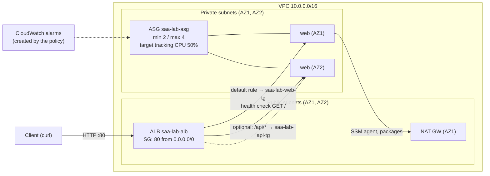

# Lab 03: ALB + Auto Scaling across two AZs

> [Home](../README.md) · [Labs index](README.md) · Notes: [Compute & containers](../notes/03-compute-containers.md) · Practice: [D2 Resilient](../practice/d2-resilient.md), [D3 High-performing](../practice/d3-high-performing.md), [D4 Cost-optimized](../practice/d4-cost-optimized.md)

| Time | Cost risk | Task statements | Prereqs |
|---|---|---|---|
| 2 h | ⚠️ **ALB** (hourly + LCU + a public IPv4 per AZ node) + **NAT GW** + 2–4 × t4g.micro. Roughly $0.11/h; about $2.60/day if forgotten | 2.1, 2.2, 3.2, 4.2 | [Lab 02](lab-02-custom-vpc.md) skeleton (VPC, 4 subnets, route tables, `saa-lab-ec2-ssm` instance profile) |

## Objective

Build the exam's default web tier: an internet-facing **Application Load Balancer (ALB)** in public subnets in front of an **Amazon EC2 Auto Scaling group** in private subnets across two AZs. Then:

- scale it with **target tracking**
- watch it **heal itself**
- see why **ELB health checks** matter more than EC2 status checks
- optionally add **path-based routing**

## Architecture



## Steps

0. **Prereqs and the NAT gateway.** The instances need outbound access to reach Systems Manager (for Run Command). The web server uses no packages.

   ```bash
   source ~/saa-lab.env
   echo "VPC=$VPC_ID PUB=$PUB_A,$PUB_B PRIV=$PRIV_A,$PRIV_B PRIV_RT=$PRIV_RT"
   aws iam get-instance-profile --instance-profile-name saa-lab-ec2-ssm --query InstanceProfile.Arn --output text
   nat_up     # recreates the NAT GW + EIP and fixes the private default route
   ```

   If you did Lab 02's full teardown, repeat its steps 1–5 first.

   > **No-NAT alternative (cheaper for a 2-hour lab, but not the production pattern).** Run the ASG in the public subnets with public IPs:
   > 1. In the step 2 JSON, replace `"SecurityGroupIds": [...]` with `"NetworkInterfaces": [{"DeviceIndex": 0, "AssociatePublicIpAddress": true, "Groups": ["$APP_SG"]}]`.
   > 2. In step 5, use `--vpc-zone-identifier "$PUB_A,$PUB_B"`.
   >
   > The instances are still unreachable from the internet because their SG only admits the ALB, but each public IPv4 address bills hourly.

1. **Security groups: chain them.** The app SG admits traffic only from the ALB's SG, never from `0.0.0.0/0`. Console: **EC2 console → Security Groups → Create security group**.

   ```bash
   save ALB_SG "$(aws ec2 create-security-group --vpc-id "$VPC_ID" --group-name saa-lab-alb-sg \
     --description "ALB: HTTP from internet" --tag-specifications "$(ts security-group saa-lab-alb-sg)" \
     --query GroupId --output text)"
   aws ec2 authorize-security-group-ingress --group-id "$ALB_SG" --protocol tcp --port 80 --cidr 0.0.0.0/0 --output text
   save APP_SG "$(aws ec2 create-security-group --vpc-id "$VPC_ID" --group-name saa-lab-app-sg \
     --description "app: HTTP from ALB SG only" --tag-specifications "$(ts security-group saa-lab-app-sg)" \
     --query GroupId --output text)"
   aws ec2 authorize-security-group-ingress --group-id "$APP_SG" --protocol tcp --port 80 --source-group "$ALB_SG" --output text
   ```

2. **Launch template.** It specifies Amazon Linux 2023 (always the latest AMI, through an SSM parameter), Graviton t4g.micro, **IMDSv2 required**, detailed monitoring (1-minute metrics, so scaling reacts faster; a few cents), and user data that prints the instance ID and AZ. Console: **EC2 console → Launch templates → Create launch template**.

   ```bash
   cat > app-userdata.sh <<'EOF'
   #!/bin/bash
   # IMDSv2: get a session token first, then send it with every metadata request
   TOKEN=$(curl -sX PUT "http://169.254.169.254/latest/api/token" -H "X-aws-ec2-metadata-token-ttl-seconds: 21600")
   md() { curl -s -H "X-aws-ec2-metadata-token: $TOKEN" "http://169.254.169.254/latest/meta-data/$1"; }
   IID=$(md instance-id); AZ=$(md placement/availability-zone)
   mkdir -p /srv/www/api
   echo "<h1>Hello from $IID in $AZ</h1>" > /srv/www/index.html
   echo "api handled by $IID ($AZ)" > /srv/www/api/index.html
   cat > /etc/systemd/system/web.service <<'UNIT'
   [Unit]
   Description=Lab web server
   After=network-online.target
   [Service]
   ExecStart=/usr/bin/python3 -m http.server 80 --directory /srv/www
   Restart=always
   [Install]
   WantedBy=multi-user.target
   UNIT
   systemctl daemon-reload && systemctl enable --now web.service
   EOF

   cat > lt-data.json <<EOF
   {
     "ImageId": "resolve:ssm:/aws/service/ami-amazon-linux-latest/al2023-ami-kernel-default-arm64",
     "InstanceType": "t4g.micro",
     "IamInstanceProfile": {"Name": "saa-lab-ec2-ssm"},
     "SecurityGroupIds": ["$APP_SG"],
     "MetadataOptions": {"HttpTokens": "required", "HttpEndpoint": "enabled", "HttpPutResponseHopLimit": 1},
     "Monitoring": {"Enabled": true},
     "UserData": "$(base64 -w0 app-userdata.sh)",
     "TagSpecifications": [
       {"ResourceType": "instance", "Tags": [{"Key": "Name", "Value": "saa-lab-web"}, {"Key": "project", "Value": "saa-lab"}]},
       {"ResourceType": "volume",   "Tags": [{"Key": "Name", "Value": "saa-lab-web"}, {"Key": "project", "Value": "saa-lab"}]}
     ]
   }
   EOF
   save LT_ID "$(aws ec2 create-launch-template --launch-template-name saa-lab-web \
     --launch-template-data file://lt-data.json --tag-specifications "$(ts launch-template saa-lab-web)" \
     --query LaunchTemplate.LaunchTemplateId --output text)"
   ```

   In launch template data, `UserData` must be base64-encoded. `run-instances --user-data` encodes it for you; launch templates do not.

3. **Target group** with a fast health check. The deregistration delay (connection draining) is cut from the default **300 s** to 30 s for the lab. Console: **EC2 console → Target groups → Create target group** (type *Instances*).

   ```bash
   save TG_ARN "$(aws elbv2 create-target-group --name saa-lab-web-tg --protocol HTTP --port 80 \
     --vpc-id "$VPC_ID" --target-type instance \
     --health-check-path / --health-check-interval-seconds 10 --health-check-timeout-seconds 5 \
     --healthy-threshold-count 2 --unhealthy-threshold-count 2 \
     --tags Key=project,Value=saa-lab --query 'TargetGroups[0].TargetGroupArn' --output text)"
   aws elbv2 modify-target-group-attributes --target-group-arn "$TG_ARN" \
     --attributes Key=deregistration_delay.timeout_seconds,Value=30 --output text
   ```

4. **ALB in the two public subnets, with an HTTP listener.** Console: **EC2 console → Load balancers → Create → Application Load Balancer**.

   ```bash
   save ALB_ARN "$(aws elbv2 create-load-balancer --name saa-lab-alb --type application --scheme internet-facing \
     --subnets "$PUB_A" "$PUB_B" --security-groups "$ALB_SG" --tags Key=project,Value=saa-lab \
     --query 'LoadBalancers[0].LoadBalancerArn' --output text)"
   save LISTENER_ARN "$(aws elbv2 create-listener --load-balancer-arn "$ALB_ARN" --protocol HTTP --port 80 \
     --default-actions Type=forward,TargetGroupArn="$TG_ARN" --query 'Listeners[0].ListenerArn' --output text)"
   save ALB_DNS "$(aws elbv2 describe-load-balancers --load-balancer-arns "$ALB_ARN" \
     --query 'LoadBalancers[0].DNSName' --output text)"
   aws elbv2 wait load-balancer-available --load-balancer-arns "$ALB_ARN" && echo "http://$ALB_DNS"
   ```

5. **Auto Scaling group in the private subnets.** It starts with **EC2** health checks on purpose (step 10 changes that). Console: **EC2 console → Auto Scaling groups → Create**.

   ```bash
   aws autoscaling create-auto-scaling-group --auto-scaling-group-name saa-lab-asg \
     --launch-template "LaunchTemplateName=saa-lab-web,Version=\$Latest" \
     --min-size 2 --max-size 4 --desired-capacity 2 \
     --vpc-zone-identifier "$PRIV_A,$PRIV_B" \
     --target-group-arns "$TG_ARN" \
     --health-check-type EC2 --health-check-grace-period 90 \
     --default-instance-warmup 60 \
     --tags Key=project,Value=saa-lab,PropagateAtLaunch=false
   aws autoscaling enable-metrics-collection --auto-scaling-group-name saa-lab-asg --granularity 1Minute
   ```

   The ASG spreads instances evenly across the subnets' AZs. If one AZ becomes unavailable, it launches replacements in the remaining AZ, and it rebalances when the AZ comes back.

6. **First check: the ALB spreads requests across AZs.** Targets take 1–2 minutes to become `healthy`.

   ```bash
   aws elbv2 describe-target-health --target-group-arn "$TG_ARN" \
     --query 'TargetHealthDescriptions[].[Target.Id,TargetHealth.State,TargetHealth.Reason]' --output table
   for i in $(seq 1 12); do curl -s "http://$ALB_DNS/"; echo; done | sort | uniq -c
   #   6 <h1>Hello from i-0aaa... in us-east-1a</h1>
   #   6 <h1>Hello from i-0bbb... in us-east-1b</h1>
   ```

   Cross-zone load balancing is on by default for ALBs (it can be turned off per target group), which is why the split is even. On NLBs it is off by default.

7. **Target tracking policy: keep average CPU at 50%.** Console: **ASG → Automatic scaling → Create dynamic scaling policy → Target tracking**.

   ```bash
   aws autoscaling put-scaling-policy --auto-scaling-group-name saa-lab-asg --policy-name cpu-50 \
     --policy-type TargetTrackingScaling \
     --target-tracking-configuration '{"PredefinedMetricSpecification":{"PredefinedMetricType":"ASGAverageCPUUtilization"},"TargetValue":50.0}' \
     --query 'Alarms[].AlarmName' --output text
   ```

   The policy **creates and owns two CloudWatch alarms** (`TargetTracking-saa-lab-asg-AlarmHigh-…` and `…-AlarmLow-…`). Don't edit them; edit the policy instead.

8. **Generate load with SSM Run Command, then watch it scale out.** The command burns every vCPU for 10 minutes on each current instance.

   ```bash
   cat > burn.json <<'EOF'
   {"commands": ["for i in $(seq $(nproc)); do timeout 600 yes > /dev/null & done; wait"]}
   EOF
   save LOAD_CMD_ID "$(aws ssm send-command --document-name AWS-RunShellScript \
     --targets Key=tag:aws:autoscaling:groupName,Values=saa-lab-asg \
     --parameters file://burn.json --comment "saa-lab cpu burn" --query Command.CommandId --output text)"

   watch_asg() {
     aws autoscaling describe-auto-scaling-groups --auto-scaling-group-names saa-lab-asg \
       --query 'AutoScalingGroups[0].{Desired:DesiredCapacity,InService:length(Instances[?LifecycleState==`InService`])}' --output table
     aws autoscaling describe-scaling-activities --auto-scaling-group-name saa-lab-asg --max-items 4 \
       --query 'Activities[].[StartTime,StatusCode,Description]' --output text
   }
   watch_asg      # repeat every minute or so
   ```

   (Alternative load generator: `dnf install -y stress-ng && stress-ng --cpu 0 --timeout 600s` in the command list.)

   Watch it in the console too:
   - **CloudWatch → Alarms**: *AlarmHigh* goes to **In alarm** after about 3 one-minute datapoints above 50%.
   - **ASG → Activity**: the desired capacity rises toward 4.
   - **ASG → Monitoring**: the CPU and group metrics.

   The new instances were not targeted by the burn command, so average CPU falls as they join. That is target tracking settling. When the load ends, **scale-in is deliberately slower**: the low alarm needs about 15 datapoints. Burstable T4g instances run in *unlimited* mode by default, so 10 minutes at 100% may add a few cents of surplus CPU credit charges.

9. **Self-healing: terminate an instance yourself.**

   ```bash
   VICTIM=$(aws autoscaling describe-auto-scaling-groups --auto-scaling-group-names saa-lab-asg \
     --query 'AutoScalingGroups[0].Instances[0].InstanceId' --output text)
   aws ec2 terminate-instances --instance-ids "$VICTIM" --output text
   for i in $(seq 1 20); do curl -s --max-time 2 "http://$ALB_DNS/" ; echo; sleep 3; done   # keeps answering
   watch_asg
   ```

   Within a minute or two the activity log shows a replacement launching *"in response to an EC2 health check indicating it has been terminated or stopped"*. The ALB kept answering from the remaining targets the whole time.

10. **ELB vs EC2 health check type.** Stop the web server on one instance. The OS stays healthy, but the application is dead.

    ```bash
    SICK=$(aws autoscaling describe-auto-scaling-groups --auto-scaling-group-names saa-lab-asg \
      --query 'AutoScalingGroups[0].Instances[?LifecycleState==`InService`]|[0].InstanceId' --output text)
    aws ssm send-command --document-name AWS-RunShellScript --instance-ids "$SICK" \
      --parameters '{"commands":["systemctl stop web.service"]}' --query Command.CommandId --output text
    sleep 40
    aws elbv2 describe-target-health --target-group-arn "$TG_ARN" --targets Id="$SICK" \
      --query 'TargetHealthDescriptions[0].TargetHealth.[State,Reason]' --output text       # unhealthy
    aws autoscaling describe-auto-scaling-instances --instance-ids "$SICK" \
      --query 'AutoScalingInstances[0].HealthStatus' --output text                          # HEALTHY (!)
    ```

    The ALB has stopped sending traffic to the instance, but the ASG, which only looks at EC2 status checks, keeps it forever. ⚠️ Trap: **your capacity has silently shrunk**, and nothing replaces the broken instance. Now switch the ASG to ELB health checks:

    ```bash
    aws autoscaling update-auto-scaling-group --auto-scaling-group-name saa-lab-asg \
      --health-check-type ELB --health-check-grace-period 90
    sleep 60; watch_asg
    ```

    The ASG marks the instance **Unhealthy** and replaces it *"in response to an ELB system health check failure"*. The **grace period** keeps a booting instance from being killed before user data finishes.

11. **(Optional) Path-based routing.** Send `/api/*` to a second target group. Here the same ASG registers in both target groups; in a real system each path would usually have its own service and ASG.

    ```bash
    save API_TG_ARN "$(aws elbv2 create-target-group --name saa-lab-api-tg --protocol HTTP --port 80 \
      --vpc-id "$VPC_ID" --health-check-path /api/ --health-check-interval-seconds 10 --healthy-threshold-count 2 \
      --tags Key=project,Value=saa-lab --query 'TargetGroups[0].TargetGroupArn' --output text)"
    aws autoscaling attach-traffic-sources --auto-scaling-group-name saa-lab-asg --traffic-sources "Identifier=$API_TG_ARN"
    aws elbv2 create-rule --listener-arn "$LISTENER_ARN" --priority 10 \
      --conditions Field=path-pattern,Values='/api/*' \
      --actions Type=forward,TargetGroupArn="$API_TG_ARN" --query 'Rules[0].RuleArn' --output text
    sleep 45
    curl -s "http://$ALB_DNS/api/"     # api handled by i-... (via saa-lab-api-tg)
    curl -s "http://$ALB_DNS/"         # default rule (saa-lab-web-tg)
    ```

    Listener rules are evaluated in **priority order** (lowest first). Each rule can also match on host header, HTTP header, method, query string or source IP. Its action can be forward, redirect (e.g., HTTP→HTTPS) or fixed-response.

## Verify

- [ ] `curl` through the ALB shows instance IDs from **two different AZs**.
- [ ] Under load, the ASG scaled out (Activity tab) and *AlarmHigh* fired.
- [ ] A terminated instance was replaced automatically, and the ALB kept serving.
- [ ] With **EC2** health checks, an instance with a dead web server stayed `HEALTHY` in the ASG while `unhealthy` in the target group. After switching to **ELB**, it was replaced.
- [ ] (Optional) `/api/` is routed to `saa-lab-api-tg`.

## Break it

1. **Break the SG chain and watch the churn.** Revoke the app SG's ingress from the ALB SG:

   ```bash
   aws ec2 revoke-security-group-ingress --group-id "$APP_SG" --protocol tcp --port 80 --source-group "$ALB_SG"
   ```

   - Every target turns unhealthy. The ALB *fails open*: when all targets are unhealthy it tries them all anyway, but the connections can't get through, so clients see 5xx errors.
   - Because the ASG now uses **ELB** health checks, it starts replacing instances that can never pass. A config error turns into an **instance-replacement loop**.

   Re-authorize the rule (same command with `authorize-security-group-ingress`) within a few minutes. Lesson: when "healthy instances are being replaced repeatedly", suspect a health check or network path problem, not the instances.

2. **Rolling deployment with instance refresh.** Publish launch template version 2 with a visible change, then roll it out while keeping at least half the capacity serving:

   ```bash
   aws ec2 create-launch-template-version --launch-template-name saa-lab-web --source-version 1 \
     --launch-template-data "{\"UserData\":\"$(sed 's/Hello from/v2 from/' app-userdata.sh | base64 -w0)\"}" \
     --query LaunchTemplateVersion.VersionNumber --output text
   aws autoscaling start-instance-refresh --auto-scaling-group-name saa-lab-asg \
     --preferences '{"MinHealthyPercentage":50,"InstanceWarmup":60}' --query InstanceRefreshId --output text
   for i in $(seq 1 60); do curl -s --max-time 2 "http://$ALB_DNS/"; echo; sleep 5; done   # watch v1 turn into v2
   ```

   The ASG uses `$Latest`, so the refresh replaces instances in batches until all of them run version 2.

## Exam takeaways

- **ALB in public subnets, instances in private subnets, at least 2 AZs, SG chaining (app SG trusts the ALB SG).** That is the reference answer for "highly available, secure web tier".
- **Use ELB health checks on an ASG behind a load balancer.** EC2 status checks only catch instance or hardware failures, not a dead application. The **grace period** protects booting instances.
- Scaling policy choice:
  - **target tracking** for "keep metric X at Y" (simplest, and usually right)
  - **step scaling** for different responses at different alarm breach sizes
  - **scheduled** for known peaks
  - **predictive** for recurring daily or weekly patterns

  Scale-in is conservative by design; warm-up keeps new instances out of the metric until they're ready.
- **ALB (layer 7):** routing by path, host, header or query string; redirects; fixed responses; Lambda targets; authentication through Cognito/OIDC. **NLB (layer 4):** TCP/UDP/TLS, ultra-low latency, **static IP / Elastic IP per AZ**, preserves the client IP. **GWLB:** inline third-party appliances.
- **Deregistration delay** (connection draining) defaults to **300 s**. Lower it for short-lived requests, raise it for long uploads.
- **Launch templates** (versioned, support mixed instance types and Spot) replace the legacy launch configurations. Require **IMDSv2** to defeat SSRF-style credential theft.
- Cost levers for compute (4.2):
  - right-size with Compute Optimizer
  - use **Graviton**
  - add **Spot** through a mixed instances policy for stateless fleets
  - use Savings Plans for the steady baseline
  - scale in aggressively when idle
- Keep instances **stateless**: put sessions in ElastiCache or DynamoDB rather than relying on sticky sessions, so that any instance can be terminated safely.

## Cleanup ✅

- [ ] Delete the ASG (`--force-delete` terminates its instances) and wait until it is gone:

  ```bash
  source ~/saa-lab.env
  aws autoscaling delete-auto-scaling-group --auto-scaling-group-name saa-lab-asg --force-delete
  until [ -z "$(aws autoscaling describe-auto-scaling-groups --auto-scaling-group-names saa-lab-asg \
        --query 'AutoScalingGroups[].AutoScalingGroupName' --output text)" ]; do sleep 15; done; echo "ASG gone"
  ```

- [ ] Delete the ALB (this also removes its listeners and rules), then the target groups:

  ```bash
  aws elbv2 delete-load-balancer --load-balancer-arn "$ALB_ARN"
  aws elbv2 wait load-balancers-deleted --load-balancer-arns "$ALB_ARN"
  aws elbv2 delete-target-group --target-group-arn "$TG_ARN"
  [ -n "$API_TG_ARN" ] && aws elbv2 delete-target-group --target-group-arn "$API_TG_ARN"
  ```

- [ ] Delete the launch template (all versions): `aws ec2 delete-launch-template --launch-template-name saa-lab-web --output text`
- [ ] Delete the SGs, app SG first because it references the ALB SG. If you get `DependencyViolation`, wait a minute for the ENIs to be released and retry.

  ```bash
  aws ec2 delete-security-group --group-id "$APP_SG"
  aws ec2 delete-security-group --group-id "$ALB_SG"
  ```

- [ ] Delete the NAT gateway and release its EIP: `nat_down`
- [ ] Confirm that the target-tracking alarms are gone: `aws cloudwatch describe-alarms --alarm-name-prefix TargetTracking-saa-lab --query 'MetricAlarms[].AlarmName'`
- [ ] Keep the free Lab 02 skeleton for Lab 05, or do Lab 02's Path B teardown now.
