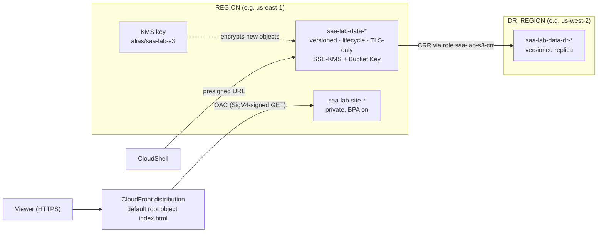

# Lab 04: S3 data protection, replication, and CloudFront with OAC

> [Home](../README.md) · [Labs index](README.md) · Notes: [Storage](../notes/04-storage.md), [Security & data protection](../notes/07-security-data-protection.md), [HA, DR, edge & ops](../notes/08-ha-dr-edge-ops.md) · Practice: [D3 High-performing](../practice/d3-high-performing.md), [D4 Cost-optimized](../practice/d4-cost-optimized.md)

| Time | Cost risk | Task statements | Prereqs |
|---|---|---|---|
| 2.5 h | Low. A **KMS customer managed key** costs about $1/month (prorated) until deleted; S3 and CloudFront usage at lab scale is cents or covered by always-free allowances | 1.3, 2.2, 3.1, 3.4, 4.1 | [Lab safety](README.md) setup (uses `empty_bucket`, `REGION`, `DR_REGION`) |

## Objective

Work through Amazon S3's data-protection and cost controls hands-on:

- Block Public Access defaults
- **versioning and delete markers**
- a **lifecycle** rule
- **presigned URLs**
- a **TLS-only** bucket policy
- **Cross-Region Replication**
- **SSE-KMS with a customer managed key + S3 Bucket Key**

Then serve a static site from a **private** bucket through **Amazon CloudFront with Origin Access Control (OAC)**. This is the pattern the exam prefers over S3 static website hosting.

## Architecture



## Steps

1. **Create a bucket and look at the secure defaults.** Console: **S3 console → Create bucket**. Look at *Object Ownership*, *Block Public Access* and *Default encryption* in the form.

   ```bash
   source ~/saa-lab.env
   save BUCKET "saa-lab-data-$ACCOUNT_ID"
   aws s3 mb "s3://$BUCKET"
   aws s3api put-bucket-tagging --bucket "$BUCKET" --tagging 'TagSet=[{Key=project,Value=saa-lab}]'
   aws s3api get-public-access-block --bucket "$BUCKET" --query PublicAccessBlockConfiguration      # all four true
   aws s3api get-bucket-ownership-controls --bucket "$BUCKET" \
     --query 'OwnershipControls.Rules[0].ObjectOwnership' --output text                            # BucketOwnerEnforced (ACLs disabled)
   aws s3api get-bucket-encryption --bucket "$BUCKET" \
     --query 'ServerSideEncryptionConfiguration.Rules[0].ApplyServerSideEncryptionByDefault'        # AES256 = SSE-S3
   ```

2. **Versioning: overwrite, delete, and recover.**

   ```bash
   aws s3api put-bucket-versioning --bucket "$BUCKET" --versioning-configuration Status=Enabled
   echo "v1" > note.txt && aws s3 cp note.txt "s3://$BUCKET/note.txt"
   echo "v2" > note.txt && aws s3 cp note.txt "s3://$BUCKET/note.txt"
   aws s3 rm "s3://$BUCKET/note.txt"
   aws s3 ls "s3://$BUCKET/"                     # nothing listed...
   aws s3api list-object-versions --bucket "$BUCKET" --prefix note.txt \
     --query '{versions: Versions[].[VersionId,IsLatest,Size], deleteMarkers: DeleteMarkers[].[VersionId,IsLatest]}'
   ```

   Both versions still exist. The "delete" only added a **delete marker**, which is now the latest version. Undo the delete by removing the marker, then fetch the old version:

   ```bash
   DM=$(aws s3api list-object-versions --bucket "$BUCKET" --prefix note.txt --query 'DeleteMarkers[0].VersionId' --output text)
   aws s3api delete-object --bucket "$BUCKET" --key note.txt --version-id "$DM" --output text
   aws s3 cp "s3://$BUCKET/note.txt" -           # v2 is back
   V1=$(aws s3api list-object-versions --bucket "$BUCKET" --prefix note.txt \
     --query 'Versions[?IsLatest==`false`]|[0].VersionId' --output text)
   aws s3api get-object --bucket "$BUCKET" --key note.txt --version-id "$V1" v1-copy.txt >/dev/null && cat v1-copy.txt   # v1
   ```

   A `DELETE` **without** a version ID adds a marker; a `DELETE` **with** a version ID removes that version permanently. To protect against the second kind, use MFA Delete (enabled by root, through the CLI only) or **S3 Object Lock**.

3. **Lifecycle rule: tier current objects, expire old versions.** Console: **Bucket → Management → Create lifecycle rule**.

   ```bash
   cat > lifecycle.json <<'EOF'
   {
     "Rules": [{
       "ID": "tier-then-clean-up",
       "Status": "Enabled",
       "Filter": {"Prefix": ""},
       "Transitions": [
         {"Days": 30, "StorageClass": "STANDARD_IA"},
         {"Days": 90, "StorageClass": "GLACIER"}
       ],
       "NoncurrentVersionExpiration": {"NoncurrentDays": 30},
       "Expiration": {"ExpiredObjectDeleteMarker": true},
       "AbortIncompleteMultipartUpload": {"DaysAfterInitiation": 7}
     }]
   }
   EOF
   aws s3api put-bucket-lifecycle-configuration --bucket "$BUCKET" --lifecycle-configuration file://lifecycle.json
   aws s3api get-bucket-lifecycle-configuration --bucket "$BUCKET" --query 'Rules[0].Transitions'
   ```

   The rule does the following:
   - `GLACIER` is the API name for **S3 Glacier Flexible Retrieval**.
   - Noncurrent versions are deleted 30 days after they are superseded. Without that, versioning silently multiplies your storage bill.
   - Leftover delete markers are cleaned up.
   - Failed multipart uploads, which are invisible but billed, are aborted.

   You will not see transitions during the lab: lifecycle runs asynchronously, about once a day. By default, objects smaller than 128 KB are not transitioned, because per-object overhead would outweigh the savings.

4. **Presigned URL: time-limited access to a private object.**

   ```bash
   echo "quarterly numbers" > report.txt && aws s3 cp report.txt "s3://$BUCKET/report.txt"
   URL=$(aws s3 presign "s3://$BUCKET/report.txt" --expires-in 300)
   curl -s "$URL"                                                        # quarterly numbers
   curl -s -o /dev/null -w '%{http_code}\n' "https://$BUCKET.s3.$REGION.amazonaws.com/report.txt"   # 403 unsigned
   ```

   The URL carries **your** permissions, signed with your credentials. It expires after `--expires-in`, which can be at most 7 days with IAM user keys. With temporary credentials (CloudShell, Identity Center, roles), it stops working when the session expires, whichever comes first. Presigned `PUT` URLs are the standard answer for "let users upload directly to S3 without AWS credentials".

5. **Bucket policy: require TLS.** First show that plain HTTP works, then deny it:

   ```bash
   curl -s -o /dev/null -w 'HTTP before policy: %{http_code}\n' "${URL/https:/http:}"   # 200
   cat > tls-only.json <<EOF
   {
     "Version": "2012-10-17",
     "Statement": [{
       "Sid": "DenyInsecureTransport",
       "Effect": "Deny",
       "Principal": "*",
       "Action": "s3:*",
       "Resource": ["arn:aws:s3:::${BUCKET}", "arn:aws:s3:::${BUCKET}/*"],
       "Condition": {"Bool": {"aws:SecureTransport": "false"}}
     }]
   }
   EOF
   aws s3api put-bucket-policy --bucket "$BUCKET" --policy file://tls-only.json
   curl -s -o /dev/null -w 'HTTP after policy: %{http_code}\n' "${URL/https:/http:}"    # 403
   curl -s "$URL"                                                                       # HTTPS still works
   ```

   Changing the scheme does not invalidate a SigV4 signature, which is why the same URL works over HTTP until the policy denies it. **An explicit deny in a bucket policy beats any allow**, including your admin's.

6. **Cross-Region Replication (CRR).** Versioning must be on in **both** buckets, and S3 needs a role to replicate as. Console: **Bucket → Management → Replication rules → Create**.

   ```bash
   save DR_BUCKET "saa-lab-data-dr-$ACCOUNT_ID"
   aws s3 mb "s3://$DR_BUCKET" --region "$DR_REGION"
   aws s3api put-bucket-tagging --bucket "$DR_BUCKET" --region "$DR_REGION" --tagging 'TagSet=[{Key=project,Value=saa-lab}]'
   aws s3api put-bucket-versioning --bucket "$DR_BUCKET" --region "$DR_REGION" --versioning-configuration Status=Enabled

   cat > s3-trust.json <<'EOF'
   {"Version": "2012-10-17", "Statement": [{"Effect": "Allow", "Principal": {"Service": "s3.amazonaws.com"}, "Action": "sts:AssumeRole"}]}
   EOF
   cat > crr-perms.json <<EOF
   {
     "Version": "2012-10-17",
     "Statement": [
       {"Effect": "Allow", "Action": ["s3:GetReplicationConfiguration", "s3:ListBucket"],
        "Resource": "arn:aws:s3:::${BUCKET}"},
       {"Effect": "Allow", "Action": ["s3:GetObjectVersionForReplication", "s3:GetObjectVersionAcl", "s3:GetObjectVersionTagging"],
        "Resource": "arn:aws:s3:::${BUCKET}/*"},
       {"Effect": "Allow", "Action": ["s3:ReplicateObject", "s3:ReplicateDelete", "s3:ReplicateTags"],
        "Resource": "arn:aws:s3:::${DR_BUCKET}/*"}
     ]
   }
   EOF
   save CRR_ROLE_ARN "$(aws iam create-role --role-name saa-lab-s3-crr --assume-role-policy-document file://s3-trust.json \
     --tags Key=project,Value=saa-lab --query Role.Arn --output text)"
   aws iam put-role-policy --role-name saa-lab-s3-crr --policy-name crr --policy-document file://crr-perms.json

   cat > replication.json <<EOF
   {
     "Role": "${CRR_ROLE_ARN}",
     "Rules": [{
       "ID": "crr-everything",
       "Status": "Enabled",
       "Priority": 1,
       "Filter": {},
       "DeleteMarkerReplication": {"Status": "Disabled"},
       "Destination": {"Bucket": "arn:aws:s3:::${DR_BUCKET}"}
     }]
   }
   EOF
   sleep 10    # role propagation
   aws s3api put-bucket-replication --bucket "$BUCKET" --replication-configuration file://replication.json
   ```

   Test it with a new object:

   ```bash
   echo "replicate me" > crr-test.txt && aws s3 cp crr-test.txt "s3://$BUCKET/crr-test.txt"
   sleep 30
   aws s3api head-object --bucket "$BUCKET" --key crr-test.txt --query ReplicationStatus --output text      # COMPLETED (PENDING at first)
   aws s3api head-object --bucket "$DR_BUCKET" --key crr-test.txt --region "$DR_REGION" \
     --query ReplicationStatus --output text                                                               # REPLICA
   aws s3api head-object --bucket "$DR_BUCKET" --key note.txt --region "$DR_REGION"                         # 404 Not Found
   ```

   `note.txt` was uploaded **before** the rule existed, so it was not replicated. Copying existing objects needs **S3 Batch Replication**. A destination can use a cheaper storage class (`"StorageClass": "STANDARD_IA"` in `Destination`). **S3 Replication Time Control** adds a 15-minute SLA when an RPO requires one.

7. **SSE-KMS with a customer managed key and an S3 Bucket Key.**

   ```bash
   save KEY_ID "$(aws kms create-key --description "saa-lab S3 key" --tags TagKey=project,TagValue=saa-lab \
     --query KeyMetadata.KeyId --output text)"
   save KEY_ARN "$(aws kms describe-key --key-id "$KEY_ID" --query KeyMetadata.Arn --output text)"
   aws kms create-alias --alias-name alias/saa-lab-s3 --target-key-id "$KEY_ID"
   aws kms enable-key-rotation --key-id "$KEY_ID"        # automatic rotation (yearly by default)

   cat > sse-kms.json <<EOF
   {"Rules": [{"ApplyServerSideEncryptionByDefault": {"SSEAlgorithm": "aws:kms", "KMSMasterKeyID": "${KEY_ARN}"}, "BucketKeyEnabled": true}]}
   EOF
   aws s3api put-bucket-encryption --bucket "$BUCKET" --server-side-encryption-configuration file://sse-kms.json

   echo "secret stuff" > kms-test.txt && aws s3 cp kms-test.txt "s3://$BUCKET/kms-test.txt"
   aws s3api head-object --bucket "$BUCKET" --key kms-test.txt \
     --query '{SSE:ServerSideEncryption,Key:SSEKMSKeyId,BucketKey:BucketKeyEnabled}'
   aws s3api head-object --bucket "$BUCKET" --key report.txt --query ServerSideEncryption --output text   # still AES256
   ```

   Changing default encryption affects **new objects only**. To re-encrypt existing objects, copy them over themselves or use S3 Batch Operations. The **Bucket Key** makes S3 fetch a bucket-level data key from KMS occasionally, instead of calling KMS for every object. That cuts KMS request costs and throttling risk dramatically. Every use of the key is logged in CloudTrail. That audit trail, plus a key policy you control, is the reason to pick SSE-KMS over SSE-S3.

8. **Static site through CloudFront with OAC, from a private bucket.**

   Console path: **CloudFront console → Create distribution** → Origin domain: pick the site bucket (not the *website* endpoint) → **Origin access: Origin access control settings** → *Create new OAC* → Viewer protocol policy *Redirect HTTP to HTTPS* → Cache policy *CachingOptimized* → Web Application Firewall: *do not enable* (avoids WAF charges for the lab) → Default root object `index.html` → **Create**. Then paste the bucket policy the console offers. If the console offers flat-rate pricing plans, pay-as-you-go is fine for this lab.

   CLI path:

   ```bash
   save SITE_BUCKET "saa-lab-site-$ACCOUNT_ID"
   aws s3 mb "s3://$SITE_BUCKET"
   aws s3api put-bucket-tagging --bucket "$SITE_BUCKET" --tagging 'TagSet=[{Key=project,Value=saa-lab}]'
   cat > index.html <<'EOF'
   <!doctype html><html><head><meta charset="utf-8"><title>saa-lab</title></head>
   <body><h1>Served by CloudFront from a private bucket (v1)</h1></body></html>
   EOF
   aws s3 cp index.html "s3://$SITE_BUCKET/index.html" --content-type text/html

   save OAC_ID "$(aws cloudfront create-origin-access-control --origin-access-control-config \
     Name=saa-lab-oac,SigningProtocol=sigv4,SigningBehavior=always,OriginAccessControlOriginType=s3 \
     --query OriginAccessControl.Id --output text)"

   # 658327ea-... is the AWS managed "CachingOptimized" cache policy
   cat > dist.json <<EOF
   {
     "CallerReference": "saa-lab-$(date +%s)",
     "Comment": "saa-lab static site",
     "Enabled": true,
     "DefaultRootObject": "index.html",
     "PriceClass": "PriceClass_100",
     "HttpVersion": "http2and3",
     "Origins": {"Quantity": 1, "Items": [{
       "Id": "site-bucket",
       "DomainName": "${SITE_BUCKET}.s3.${REGION}.amazonaws.com",
       "OriginAccessControlId": "${OAC_ID}",
       "S3OriginConfig": {"OriginAccessIdentity": ""}
     }]},
     "DefaultCacheBehavior": {
       "TargetOriginId": "site-bucket",
       "ViewerProtocolPolicy": "redirect-to-https",
       "CachePolicyId": "658327ea-f89d-4fab-a63d-7e88639e58f6",
       "Compress": true
     }
   }
   EOF
   read -r d_id d_dom d_arn <<< "$(aws cloudfront create-distribution --distribution-config file://dist.json \
     --query 'Distribution.[Id,DomainName,ARN]' --output text)"
   save DIST_ID "$d_id"; save CF_DOMAIN "$d_dom"; save DIST_ARN "$d_arn"
   aws cloudfront tag-resource --resource "$DIST_ARN" --tags 'Items=[{Key=project,Value=saa-lab}]'
   ```

   Allow **only this distribution** to read the bucket:

   ```bash
   cat > site-policy.json <<EOF
   {
     "Version": "2012-10-17",
     "Statement": [{
       "Sid": "AllowCloudFrontOACRead",
       "Effect": "Allow",
       "Principal": {"Service": "cloudfront.amazonaws.com"},
       "Action": "s3:GetObject",
       "Resource": "arn:aws:s3:::${SITE_BUCKET}/*",
       "Condition": {"StringEquals": {"AWS:SourceArn": "${DIST_ARN}"}}
     }]
   }
   EOF
   aws s3api put-bucket-policy --bucket "$SITE_BUCKET" --policy file://site-policy.json
   aws cloudfront wait distribution-deployed --id "$DIST_ID"      # 3-10 minutes
   curl -s "https://$CF_DOMAIN/"                                   # your page
   curl -sI "https://$CF_DOMAIN/" | grep -iE '^(x-cache|age|via):'  # Miss/Hit from cloudfront
   curl -s -o /dev/null -w '%{http_code}\n' "https://$SITE_BUCKET.s3.$REGION.amazonaws.com/index.html"   # 403: bucket stays private
   ```

   Block Public Access is still fully on. The policy grants access to a **service principal scoped by `AWS:SourceArn`**, which S3 does not count as public.

9. **Change the site and invalidate the cache.**

   ```bash
   sed -i 's/(v1)/(v2)/' index.html && aws s3 cp index.html "s3://$SITE_BUCKET/index.html" --content-type text/html
   curl -s "https://$CF_DOMAIN/" | grep -o '(v[12])'      # probably still (v1): CachingOptimized defaults to a 1-day TTL
   INV_ID=$(aws cloudfront create-invalidation --distribution-id "$DIST_ID" --paths "/" "/index.html" \
     --query Invalidation.Id --output text)
   aws cloudfront wait invalidation-completed --distribution-id "$DIST_ID" --id "$INV_ID"
   curl -s "https://$CF_DOMAIN/" | grep -o '(v[12])'      # (v2)
   ```

   Invalidations are free for the first 1,000 paths per month and billed per path after that. At scale, prefer **versioned file names** (`app.3f9c.js`), which need no invalidation.

10. **(Optional) Custom domain.** Only do this if you own a domain hosted in Route 53.
    1. Request a certificate **in us-east-1**, whatever Region your bucket is in. CloudFront only reads certificates from there:

       ```bash
       aws acm request-certificate --region us-east-1 --domain-name www.example.com \
         --validation-method DNS --query CertificateArn --output text
       ```

    2. **ACM console (us-east-1) → certificate → Create records in Route 53**, then wait for *Issued*.
    3. **CloudFront → distribution → Edit settings**: add *Alternate domain name* `www.example.com` and choose the custom SSL certificate.
    4. **Route 53 → hosted zone → Create record** `www` → **Alias** → *Alias to CloudFront distribution*.

## Verify

- [ ] `list-object-versions` showed 2 versions + 1 delete marker, and you restored the object by deleting the marker.
- [ ] The presigned URL worked over HTTPS; after the TLS policy, the same URL over HTTP returned **403**.
- [ ] `crr-test.txt` shows `COMPLETED` in the source and `REPLICA` in the DR bucket; `note.txt` was not replicated.
- [ ] `kms-test.txt` is `aws:kms` with `BucketKeyEnabled: true`; `report.txt` is still `AES256`.
- [ ] The site loads from `https://<id>.cloudfront.net/`, while the direct S3 URL returns 403.

## Break it

1. **KMS-encrypted objects are not replicated by default.**

   ```bash
   aws s3api head-object --bucket "$BUCKET" --key kms-test.txt --query ReplicationStatus --output text
   aws s3api head-object --bucket "$DR_BUCKET" --key kms-test.txt --region "$DR_REGION"   # 404
   ```

   `kms-test.txt` never reaches `COMPLETED`, and the DR bucket doesn't have it. Replicating SSE-KMS objects needs all three of these:
   - an opt-in in the rule: `"SourceSelectionCriteria": {"SseKmsEncryptedObjects": {"Status": "Enabled"}}`
   - a destination key: `"EncryptionConfiguration": {"ReplicaKmsKeyID": "<key ARN in DR_REGION>"}`
   - `kms:Decrypt` on the source key and `kms:Encrypt` on the destination key in the replication role

   This combination shows up in "replication isn't working" questions.

2. **OAC is the only way in.** Upload an object CloudFront has never cached, remove the bucket policy, then request the object:

   ```bash
   echo '<h1>never cached</h1>' > fresh.html
   aws s3 cp fresh.html "s3://$SITE_BUCKET/fresh.html" --content-type text/html
   aws s3api delete-bucket-policy --bucket "$SITE_BUCKET"
   curl -s -o /dev/null -w '%{http_code}\n' "https://$CF_DOMAIN/fresh.html"   # 403: CloudFront can't read the bucket
   aws s3api put-bucket-policy --bucket "$SITE_BUCKET" --policy file://site-policy.json   # restore
   sleep 15; curl -s -o /dev/null -w '%{http_code}\n' "https://$CF_DOMAIN/fresh.html"   # 200
   ```

   Use a fresh object because CachingOptimized leaves query strings out of the cache key: `index.html?x=1` would still be served from cache. CloudFront also caches error responses briefly (10 s by default), hence the `sleep`.

3. **Missing pages return 403, not 404.**

   ```bash
   curl -s -o /dev/null -w '%{http_code}\n' "https://$CF_DOMAIN/does-not-exist.html"   # 403
   ```

   CloudFront's principal has `s3:GetObject` but not `s3:ListBucket`, so S3 will not reveal whether a key exists. Fix it either by granting `s3:ListBucket` on the bucket ARN to the same principal and condition (you then get 404), or by adding a **custom error response** that maps 403 to `/index.html` with status 200. The second is the usual single-page-app pattern.

## Exam takeaways

- **Accidental deletes/overwrites → versioning** (plus MFA Delete or Object Lock). **WORM/compliance retention → S3 Object Lock** (compliance mode: nobody can shorten it, not even root). Control the extra cost with **noncurrent version expiration**.
- **Lifecycle rules** move data down the storage classes on a schedule. Mind the minimum storage durations (IA 30 d, Glacier IR/Flexible 90 d, Deep Archive 180 d) and the 128 KB transition default. **Unknown or changing access patterns → S3 Intelligent-Tiering.**
- **Temporary access to private objects for users without AWS credentials → presigned URL** (or CloudFront signed URLs/cookies when the content is served through CloudFront).
- **Enforce encryption in transit → deny when `aws:SecureTransport` is false.** S3 encrypts at rest by default (SSE-S3). Choose **SSE-KMS** when you need key policies, separation of duties, or a CloudTrail audit of key use, and add a **Bucket Key** to cut KMS costs. SSE-C means you supply the key on every request.
- **CRR**: versioning on both sides, an IAM role, **new objects only** (use Batch Replication for existing ones), SSE-KMS needs an opt-in, delete markers optional, version-specific deletes never replicated. **RTC** = 15-minute SLA. **SRR** for same-Region copies, e.g. log aggregation or a separate account.
- **Private S3 content through CloudFront → OAC** (OAI is legacy). S3 *website* endpoints are HTTP-only custom origins and can't use OAC, which is why the exam's secure answer is "private bucket + CloudFront + OAC", not "public website bucket".
- **CloudFront certificates live in ACM us-east-1.** ALB certificates live in the ALB's own Region.

## Cleanup ✅

- [ ] **CloudFront:** disable, wait, delete, then delete the OAC:

  ```bash
  source ~/saa-lab.env
  aws cloudfront get-distribution-config --id "$DIST_ID" > dc.json
  jq '.DistributionConfig | .Enabled = false' dc.json > dc-disabled.json
  aws cloudfront update-distribution --id "$DIST_ID" --if-match "$(jq -r .ETag dc.json)" \
    --distribution-config file://dc-disabled.json --query Distribution.Status --output text
  aws cloudfront wait distribution-deployed --id "$DIST_ID"
  aws cloudfront delete-distribution --id "$DIST_ID" \
    --if-match "$(aws cloudfront get-distribution --id "$DIST_ID" --query ETag --output text)"
  aws cloudfront delete-origin-access-control --id "$OAC_ID" \
    --if-match "$(aws cloudfront get-origin-access-control --id "$OAC_ID" --query ETag --output text)"
  ```

- [ ] **Buckets.** Versioned buckets must lose every version and delete marker before `rb` works. ⚠️ Trap: `aws s3 rb --force` and `aws s3 rm --recursive` only add delete markers; they do **not** remove old versions.

  ```bash
  aws s3api delete-bucket-replication --bucket "$BUCKET"
  empty_bucket "$BUCKET"                   && aws s3 rb "s3://$BUCKET"
  empty_bucket "$DR_BUCKET" "$DR_REGION"   && aws s3 rb "s3://$DR_BUCKET" --region "$DR_REGION"
  empty_bucket "$SITE_BUCKET"              && aws s3 rb "s3://$SITE_BUCKET"
  ```

- [ ] **Replication role:**

  ```bash
  aws iam delete-role-policy --role-name saa-lab-s3-crr --policy-name crr
  aws iam delete-role --role-name saa-lab-s3-crr
  ```

- [ ] **KMS key:** delete the alias and schedule key deletion. The waiting period is **7 days minimum** (30 by default). During that window, `aws kms cancel-key-deletion` can still save it; after it, anything encrypted under the key is unrecoverable.

  ```bash
  aws kms delete-alias --alias-name alias/saa-lab-s3
  aws kms schedule-key-deletion --key-id "$KEY_ID" --pending-window-in-days 7 --query DeletionDate --output text
  ```

- [ ] (Optional part) Delete the ACM certificate (`aws acm delete-certificate --region us-east-1 --certificate-arn ...`) and the Route 53 records you added.
- [ ] Remove the local files: `rm -f note.txt v1-copy.txt report.txt crr-test.txt kms-test.txt index.html fresh.html lifecycle.json tls-only.json s3-trust.json crr-perms.json replication.json sse-kms.json dist.json site-policy.json dc.json dc-disabled.json`
