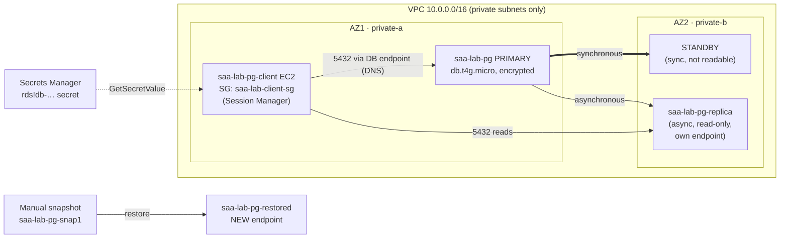

# Lab 05: RDS high availability, read replicas and restores

> [Home](../README.md) · [Labs index](README.md) · Notes: [Databases](../notes/05-databases.md), [Security & data protection](../notes/07-security-data-protection.md) · Practice: [D3 High-performing](../practice/d3-high-performing.md), [D4 Cost-optimized](../practice/d4-cost-optimized.md)

| Time | Cost risk | Task statements | Prereqs |
|---|---|---|---|
| 2.5 h, **in one sitting** (much of it is waiting for RDS) | ⚠️ **Highest of all the labs.** Multi-AZ doubles instance + storage cost; the read replica and the restored copy each add another instance; plus NAT GW + client EC2. About $2.80/day if forgotten. **Do it in one sitting and delete everything** | 1.3, 2.2, 3.3, 4.3 | [Lab 02](lab-02-custom-vpc.md) skeleton (VPC, private subnets, `saa-lab-client-sg`, `saa-lab-ec2-ssm`) |

> ⚠️ **Cost warning.** Every RDS step below creates or doubles a billed instance. Do not leave the lab half-finished overnight. If you must stop, run the Cleanup section first and redo the lab later. On the Free plan, Multi-AZ may be restricted; if it is blocked, read steps 8–9 and continue with step 10.

## Objective

Run an Amazon RDS for PostgreSQL database the way the exam expects:

- private subnets only
- encrypted at creation
- the master password in **AWS Secrets Manager**, managed by RDS
- accessed from an instance through Session Manager

Then **measure** a Multi-AZ failover, see why a **read replica** is a different tool from Multi-AZ, and restore a snapshot to learn what a restore really gives you (a *new* instance with a *new* endpoint).

## Architecture



## Steps

0. **Prereqs: load state and bring up the NAT gateway.** The client needs it to install the `psql` client and to reach Systems Manager.

   ```bash
   source ~/saa-lab.env
   echo "VPC=$VPC_ID PRIV=$PRIV_A,$PRIV_B CLIENT_SG=$CLIENT_SG"
   nat_up
   ```

   If `CLIENT_SG` is empty, you did Lab 02's full teardown. Redo its steps 1–6.

1. **Database security group: only the client SG may connect, on 5432.**

   ```bash
   save DB_SG "$(aws ec2 create-security-group --vpc-id "$VPC_ID" --group-name saa-lab-db-sg \
     --description "PostgreSQL from client SG only" --tag-specifications "$(ts security-group saa-lab-db-sg)" \
     --query GroupId --output text)"
   aws ec2 authorize-security-group-ingress --group-id "$DB_SG" --protocol tcp --port 5432 \
     --source-group "$CLIENT_SG" --output text
   ```

2. **DB subnet group in the two private subnets.** Console: **RDS console → Subnet groups → Create DB subnet group**. A Multi-AZ deployment needs subnets in at least two AZs; this group is what lets RDS place the standby in the other AZ.

   ```bash
   aws rds create-db-subnet-group --db-subnet-group-name saa-lab-db-subnets \
     --db-subnet-group-description "saa-lab private subnets" --subnet-ids "$PRIV_A" "$PRIV_B" \
     --tags Key=project,Value=saa-lab --query 'DBSubnetGroup.SubnetGroupStatus' --output text
   ```

3. **Create the database: single-AZ for now, encrypted, with the password managed in Secrets Manager.** Console: **RDS console → Create database → Standard create → PostgreSQL**:
   - template *Dev/Test*
   - credentials management **Managed in AWS Secrets Manager**
   - class **db.t4g.micro**, 20 GiB gp3
   - VPC `saa-lab-vpc`, subnet group `saa-lab-db-subnets`, **Public access: No**, SG `saa-lab-db-sg`
   - **Encryption: enabled**

   ```bash
   aws rds create-db-instance \
     --db-instance-identifier saa-lab-pg \
     --engine postgres \
     --db-instance-class db.t4g.micro \
     --allocated-storage 20 --storage-type gp3 \
     --master-username postgres \
     --manage-master-user-password \
     --db-name labdb \
     --db-subnet-group-name saa-lab-db-subnets \
     --vpc-security-group-ids "$DB_SG" \
     --no-multi-az --no-publicly-accessible \
     --storage-encrypted \
     --backup-retention-period 1 \
     --tags Key=project,Value=saa-lab \
     --query 'DBInstance.DBInstanceStatus' --output text
   ```

   Leaving out `--engine-version` gives you the current default version.
   - `--backup-retention-period 1` keeps automated backups on. Read replicas require them, and they also enable point-in-time restore.
   - `--storage-encrypted` with no key ID uses the AWS managed key `aws/rds`.

   Creation takes 5–15 minutes. Launch the client while you wait.

4. **Launch the client instance and let its role read the DB secret.**

   ```bash
   cat > client-userdata.sh <<'EOF'
   #!/bin/bash
   dnf install -y postgresql16 || dnf install -y postgresql15
   EOF
   save PG_CLIENT_ID "$(aws ec2 run-instances \
     --image-id resolve:ssm:/aws/service/ami-amazon-linux-latest/al2023-ami-kernel-default-arm64 \
     --instance-type t4g.micro --subnet-id "$PRIV_A" --security-group-ids "$CLIENT_SG" \
     --iam-instance-profile Name=saa-lab-ec2-ssm --metadata-options HttpTokens=required \
     --user-data file://client-userdata.sh \
     --tag-specifications "$(ts instance saa-lab-pg-client)" "$(ts volume saa-lab-pg-client)" \
     --query 'Instances[0].InstanceId' --output text)"

   aws rds wait db-instance-available --db-instance-identifier saa-lab-pg
   read -r h s <<< "$(aws rds describe-db-instances --db-instance-identifier saa-lab-pg \
     --query 'DBInstances[0].[Endpoint.Address,MasterUserSecret.SecretArn]' --output text)"
   save DB_HOST "$h"; save SECRET_ARN "$s"; echo "$DB_HOST"; echo "$SECRET_ARN"

   cat > client-db-read.json <<EOF
   {"Version": "2012-10-17", "Statement": [
     {"Effect": "Allow", "Action": "secretsmanager:GetSecretValue", "Resource": "${SECRET_ARN}"},
     {"Effect": "Allow", "Action": "rds:DescribeDBInstances", "Resource": "*"}]}
   EOF
   aws iam put-role-policy --role-name saa-lab-ec2-ssm --policy-name lab05-db-secret --policy-document file://client-db-read.json
   ```

   The secret RDS created is named `rds!db-<uuid>`. It is encrypted with the `aws/secretsmanager` key, which principals in your account may use through Secrets Manager. That is why `kms:Decrypt` is not in the policy. Secrets Manager rotates it automatically, every 7 days by default.

5. **Connect from the client.** **EC2 console → saa-lab-pg-client → Connect → Session Manager**, type `bash`, then **on the client instance**:

   ```bash
   export AWS_DEFAULT_REGION=us-east-1                 # your REGION
   dbinfo() { aws rds describe-db-instances --db-instance-identifier "$1" \
     --query 'DBInstances[0].[Endpoint.Address,MasterUserSecret.SecretArn]' --output text; }
   read -r DB_HOST SECRET_ARN <<< "$(dbinfo saa-lab-pg)"
   export PGPASSWORD=$(aws secretsmanager get-secret-value --secret-id "$SECRET_ARN" --query SecretString \
     --output text | python3 -c 'import sys,json; print(json.load(sys.stdin)["password"])')
   export PGUSER=postgres PGDATABASE=labdb PGSSLMODE=require PGCONNECT_TIMEOUT=2

   psql -h "$DB_HOST" -c "select version();" -c "select inet_server_addr() as server_ip;"
   psql -h "$DB_HOST" -c "create table if not exists heartbeat (id serial primary key, at timestamptz default now(), note text);" \
        -c "insert into heartbeat (note) values ('before snapshot');"
   ```

   The password never appears in code, user data or shell history. It is fetched at runtime, by an IAM role, from Secrets Manager. That is the exam's answer to "remove hard-coded database credentials".

6. **Manual snapshot.** From CloudShell:

   ```bash
   aws rds create-db-snapshot --db-instance-identifier saa-lab-pg --db-snapshot-identifier saa-lab-pg-snap1 \
     --tags Key=project,Value=saa-lab --query DBSnapshot.Status --output text
   aws rds wait db-snapshot-available --db-snapshot-identifier saa-lab-pg-snap1 && echo snapshot ready
   ```

   Then, **on the client instance**, write a row the snapshot will *not* contain:

   ```bash
   psql -h "$DB_HOST" -c "insert into heartbeat (note) values ('after snapshot');"
   ```

7. **Check encryption. It was a creation-time decision.**

   ```bash
   aws rds describe-db-instances --db-instance-identifier saa-lab-pg \
     --query 'DBInstances[0].{Encrypted:StorageEncrypted,Key:KmsKeyId}'
   ```

   Look at **RDS console → saa-lab-pg → Modify**: there is no option to turn encryption on or off for an existing instance. To encrypt an unencrypted database:
   1. snapshot it
   2. **copy the snapshot with a KMS key** (`aws rds copy-db-snapshot --kms-key-id ...`)
   3. restore the encrypted copy
   4. cut over to the new endpoint

8. **Convert to Multi-AZ.** ⚠️ Cost doubles from here. Console: **Modify → Multi-AZ deployment: Create a standby instance → Apply immediately**.

   ```bash
   aws rds modify-db-instance --db-instance-identifier saa-lab-pg --multi-az --apply-immediately \
     --query 'DBInstance.PendingModifiedValues' --output json
   sleep 60; aws rds wait db-instance-available --db-instance-identifier saa-lab-pg    # often 10-20 minutes
   aws rds describe-db-instances --db-instance-identifier saa-lab-pg \
     --query 'DBInstances[0].[MultiAZ,AvailabilityZone,SecondaryAvailabilityZone]' --output text
   ```

   The conversion builds the standby from a snapshot and does not take the primary offline. Note which AZ is primary and which is secondary.

9. **Fail over and measure it.** **On the client instance**, start a loop that writes every second and prints which server answered:

   ```bash
   while true; do
     r=$(psql -h "$DB_HOST" -tAc "insert into heartbeat(note) values('tick') returning inet_server_addr()" 2>&1 | head -1)
     echo "$(date +%T) dns=$(getent hosts "$DB_HOST" | awk '{print $1}') $r"
     sleep 1
   done
   ```

   In **CloudShell**:

   ```bash
   aws rds reboot-db-instance --db-instance-identifier saa-lab-pg --force-failover \
     --query DBInstance.DBInstanceStatus --output text
   ```

   Watch the loop:
   - writes succeed
   - then a run of `timeout expired` / connection errors
   - then writes resume, and **both the DNS answer and `inet_server_addr()` have changed** to an IP in the other AZ

   Stop the loop with Ctrl+C and measure the gap:

   ```bash
   psql -h "$DB_HOST" -c "select max(gap) as write_outage from (select at - lag(at) over (order by at) as gap from heartbeat where note='tick') s;"
   ```

   In CloudShell, see what RDS recorded:

   ```bash
   aws rds describe-events --source-type db-instance --source-identifier saa-lab-pg --duration 30 \
     --query 'Events[].[Date,Message]' --output text
   aws rds describe-db-instances --db-instance-identifier saa-lab-pg \
     --query 'DBInstances[0].[AvailabilityZone,SecondaryAvailabilityZone]' --output text     # swapped
   ```

   **The endpoint name never changed.** RDS flipped the DNS record to the standby, which became the primary. Typical Multi-AZ failover takes **60–120 seconds**. Your application must reconnect and retry, and must not cache the IP.

   *(Optional cost saver)* Once you have seen it, convert back to single-AZ before continuing: `aws rds modify-db-instance --db-instance-identifier saa-lab-pg --no-multi-az --apply-immediately`.

10. **Create a read replica and query it.**

    ```bash
    aws rds create-db-instance-read-replica --db-instance-identifier saa-lab-pg-replica \
      --source-db-instance-identifier saa-lab-pg --db-instance-class db.t4g.micro \
      --vpc-security-group-ids "$DB_SG" --no-publicly-accessible \
      --tags Key=project,Value=saa-lab --query DBInstance.DBInstanceStatus --output text
    aws rds wait db-instance-available --db-instance-identifier saa-lab-pg-replica && echo replica ready
    ```

    ⚠️ Trap: without `--vpc-security-group-ids`, the replica gets the VPC's *default* SG, and your client cannot connect. **On the client instance:**

    ```bash
    read -r REPLICA_HOST _ <<< "$(dbinfo saa-lab-pg-replica)"; echo "$REPLICA_HOST"     # a different endpoint
    psql -h "$REPLICA_HOST" -tAc "select note, count(*) from heartbeat group by note;"     # same data
    psql -h "$REPLICA_HOST" -tAc "select pg_is_in_recovery(), now() - pg_last_xact_replay_timestamp() as lag;"
    psql -h "$REPLICA_HOST" -c  "insert into heartbeat (note) values ('on replica');"
    # ERROR: cannot execute INSERT in a read-only transaction
    ```

    **Multi-AZ ≠ read scaling.** The Multi-AZ standby you failed over to in step 9 never served a single read. It exists only to take over. The replica is the read-scaling tool:
    - its own endpoint
    - **asynchronous** replication, so it can lag
    - can live in another Region
    - can be **promoted** to a standalone writable database

    (A *Multi-AZ DB cluster* deployment, a different RDS option, does have two readable standbys; Aurora replicas are both readers and failover targets.)

11. **Restore the snapshot to a new instance.**

    ```bash
    aws rds restore-db-instance-from-db-snapshot --db-instance-identifier saa-lab-pg-restored \
      --db-snapshot-identifier saa-lab-pg-snap1 --db-instance-class db.t4g.micro \
      --db-subnet-group-name saa-lab-db-subnets --vpc-security-group-ids "$DB_SG" \
      --no-multi-az --no-publicly-accessible --tags Key=project,Value=saa-lab \
      --query DBInstance.DBInstanceStatus --output text
    aws rds wait db-instance-available --db-instance-identifier saa-lab-pg-restored && echo restored
    ```

    **On the client instance:**

    ```bash
    read -r RESTORED_HOST _ <<< "$(dbinfo saa-lab-pg-restored)"; echo "$RESTORED_HOST"   # NEW endpoint
    psql -h "$RESTORED_HOST" -tAc "select note, count(*) from heartbeat group by note;"   # only 'before snapshot'
    ```

    The restored instance accepts the master password from the time of the snapshot. RDS-managed secrets rotate weekly by default, so within this lab the source's secret still works.

    A restore never overwrites the original. You get a **new instance with a new endpoint**, and only the data up to the snapshot (your RPO). Point-in-time restore works the same way, to any second within the backup retention window (max 35 days). Cutting over means repointing the application, often through a Route 53 CNAME you control.

12. **(Optional) RDS Proxy.** Billed per vCPU-hour of the target DB, with a minimum, so approx. a few cents per hour. Delete it right after.
    1. **RDS console → Proxies → Create proxy**:
       - engine PostgreSQL, target `saa-lab-pg`
       - Secrets Manager secret: the `rds!db-…` secret
       - IAM role: *Create IAM role*
       - subnets: private-a and private-b
       - SG: `saa-lab-db-sg`. Also add an inbound 5432 rule on `saa-lab-db-sg` *from itself*, so the proxy can reach the DB.
    2. Point the step 9 loop at the proxy endpoint and fail over again. The proxy keeps client connections open and usually shortens the visible outage.

    Main use cases: **connection pooling for Lambda** and other bursty clients, faster failover, and enforcing IAM authentication.

## Verify

- [ ] `psql` from the client worked with a password fetched from Secrets Manager.
- [ ] `StorageEncrypted` is `true`, and you confirmed that encryption can't be changed in Modify.
- [ ] After `--force-failover`, the endpoint name was unchanged, while the server IP and AZ swapped. You measured the write outage (`write_outage`).
- [ ] The replica has its own endpoint, serves reads, and rejects writes.
- [ ] The restored instance has a new endpoint and lacks the `after snapshot` row.

## Break it

1. **SG or password? Read the error.** Revoke the DB SG's inbound rule, then run `psql -h "$DB_HOST" -c 'select 1'` on the client:

   ```bash
   aws ec2 revoke-security-group-ingress --group-id "$DB_SG" --protocol tcp --port 5432 --source-group "$CLIENT_SG"
   ```

   You get `timeout expired`. Now restore the rule and use a wrong password: `PGPASSWORD=wrong psql -h "$DB_HOST" -c 'select 1'` gives `password authentication failed`.
   - A **timeout** means the network path: SG, NACL or route.
   - An **immediate rejection** means credentials or the `pg_hba` configuration.

   Re-authorize the rule with `authorize-security-group-ingress` and the same arguments.

2. **Don't connect by IP.** After step 9, try `psql -h <the old primary IP from before the failover> -c 'select 1'`. It fails: that host is now the hidden standby. Applications that resolve the endpoint once and cache the IP (watch out for JVM DNS caching) stay broken after a failover. Always use the endpoint name with a low DNS TTL.

3. **Promote the replica (the manual DR move).**

   ```bash
   aws rds promote-read-replica --db-instance-identifier saa-lab-pg-replica --query DBInstance.DBInstanceStatus --output text
   aws rds wait db-instance-available --db-instance-identifier saa-lab-pg-replica
   ```

   On the client, the `insert ... 'on replica'` now succeeds. Replication from the primary has stopped for good. This is how a **cross-Region read replica** becomes the new primary in a DR event: fast and cheap, but manual, and you lose whatever replication lag held. Aurora Global Database automates more of this.

## Exam takeaways

- **Multi-AZ (instance deployment)** = a synchronous standby in another AZ, automatic failover (about **1–2 min**), **same endpoint**, no read traffic. It protects against AZ, instance and storage failure and against maintenance downtime, and backups are taken from the standby. It is an HA feature, not a performance feature.
- **Read replicas** = asynchronous, separate endpoints, offload reads (reporting, analytics), can be **cross-Region**, can be promoted for DR. Replica lag means reads can be stale. "Reduce read load on the primary" → read replicas, or a cache (ElastiCache).
- **Secrets Manager with RDS-managed rotation** removes hard-coded credentials. Parameter Store SecureString has no built-in rotation. **IAM database authentication** is the token-based alternative.
- **Encryption at rest is set at creation.** Encrypting later means snapshot → encrypted copy → restore. Replicas and snapshots inherit encryption. **Sharing an encrypted snapshot requires a customer managed key**, not `aws/rds`.
- **Restores create a new instance with a new endpoint.** PITR goes back up to 35 days. Automated backups disappear with the instance unless you retain them; manual snapshots persist until you delete them, and they are billed.
- **RDS Proxy** = connection pooling (Lambda connection storms), faster and more transparent failover, IAM auth. **Aurora** = shared cluster storage, up to 15 low-lag replicas, reader endpoint, Global Database, Serverless v2.
- Cost levers (4.3):
  - right-size, and use **Graviton** classes
  - Reserved Instances for steady 24/7 databases
  - Aurora Serverless v2 for spiky or intermittent load
  - stop dev databases when idle; they restart automatically after 7 days
  - delete old manual snapshots

## Cleanup ✅

Delete replicas and copies before the source.

- [ ] Delete the replica and the restored copy, then the primary. Skip the final snapshot and delete the automated backups:

  ```bash
  source ~/saa-lab.env
  for db in saa-lab-pg-replica saa-lab-pg-restored; do
    aws rds delete-db-instance --db-instance-identifier "$db" --skip-final-snapshot --delete-automated-backups \
      --query DBInstance.DBInstanceStatus --output text
  done
  aws rds wait db-instance-deleted --db-instance-identifier saa-lab-pg-replica
  aws rds delete-db-instance --db-instance-identifier saa-lab-pg --skip-final-snapshot --delete-automated-backups \
    --query DBInstance.DBInstanceStatus --output text
  aws rds wait db-instance-deleted --db-instance-identifier saa-lab-pg
  aws rds wait db-instance-deleted --db-instance-identifier saa-lab-pg-restored
  ```

- [ ] Delete the manual snapshot (it bills until you do) and the subnet group:

  ```bash
  aws rds delete-db-snapshot --db-snapshot-identifier saa-lab-pg-snap1 --query DBSnapshot.Status --output text
  aws rds delete-db-subnet-group --db-subnet-group-name saa-lab-db-subnets
  ```

- [ ] (Optional part) Delete the RDS Proxy (**RDS console → Proxies → Delete**) and its IAM role.
- [ ] Confirm that the RDS-managed secret is gone (RDS deletes it with the instance): `aws secretsmanager list-secrets --query "SecretList[?starts_with(Name,'rds!')].Name"`
- [ ] Terminate the client, then delete the DB SG and the inline policy:

  ```bash
  aws ec2 terminate-instances --instance-ids "$PG_CLIENT_ID" --output text
  aws ec2 wait instance-terminated --instance-ids "$PG_CLIENT_ID"
  aws ec2 delete-security-group --group-id "$DB_SG"
  aws iam delete-role-policy --role-name saa-lab-ec2-ssm --policy-name lab05-db-secret
  ```

- [ ] Delete the NAT gateway and release its EIP: `nat_down`
- [ ] Done with the VPC labs? Run [Lab 02 Path B](lab-02-custom-vpc.md#cleanup-) for a full teardown, then the [leftover finder](README.md#7-universal-cleanup-checklist).
