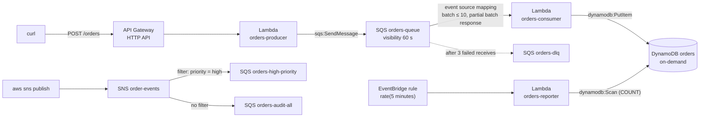

# Lab 06: Serverless and decoupled: API Gateway, Lambda, SQS, SNS, EventBridge

> [Home](../README.md) · [Labs index](README.md) · Notes: [Decoupling & serverless](../notes/06-decoupling-serverless.md) · Practice: [D2 Resilient](../practice/d2-resilient.md)

| Time | Cost risk | Task statements | Prereqs |
|---|---|---|---|
| 2.5 h | Very low. Everything here is pay-per-request (Lambda, SQS, SNS, API Gateway, DynamoDB on-demand), and lab volumes fit within the always-free allowances. The only thing that keeps running is the EventBridge schedule, so delete it | 1.2, 2.1, 3.2 | [Lab safety](README.md) setup. No VPC needed |

## Objective

Build an order pipeline that absorbs failure instead of spreading it:

- an **Amazon API Gateway HTTP API** hands requests to a **producer AWS Lambda function**
- the producer queues them in **Amazon SQS**
- a **consumer Lambda** writes them to **Amazon DynamoDB**, using **partial batch responses**
- poison messages go to a **DLQ**

Then add **Amazon SNS fan-out with a filter policy**, a scheduled **Amazon EventBridge** rule, and **AWS X-Ray** tracing. Every function gets its own **least-privilege** execution role.

## Architecture



## Steps

1. **DynamoDB table `orders` (on-demand).** Console: **DynamoDB console → Tables → Create table**, partition key `orderId` (String), *Customize settings → On-demand*.

   ```bash
   source ~/saa-lab.env
   mkdir -p ~/lab06 && cd ~/lab06
   aws dynamodb create-table --table-name orders \
     --attribute-definitions AttributeName=orderId,AttributeType=S \
     --key-schema AttributeName=orderId,KeyType=HASH \
     --billing-mode PAY_PER_REQUEST --tags Key=project,Value=saa-lab \
     --query TableDescription.TableStatus --output text
   aws dynamodb wait table-exists --table-name orders
   save TABLE_ARN "$(aws dynamodb describe-table --table-name orders --query Table.TableArn --output text)"
   ```

2. **SQS: a DLQ, and a main queue that redrives to it after 3 receives.**

   ```bash
   save DLQ_URL "$(aws sqs create-queue --queue-name orders-dlq \
     --attributes MessageRetentionPeriod=1209600 --tags project=saa-lab --query QueueUrl --output text)"
   save DLQ_ARN "$(aws sqs get-queue-attributes --queue-url "$DLQ_URL" --attribute-names QueueArn \
     --query Attributes.QueueArn --output text)"

   cat > queue-attrs.json <<EOF
   {
     "VisibilityTimeout": "60",
     "RedrivePolicy": "{\"deadLetterTargetArn\":\"${DLQ_ARN}\",\"maxReceiveCount\":\"3\"}"
   }
   EOF
   save Q_URL "$(aws sqs create-queue --queue-name orders-queue --attributes file://queue-attrs.json \
     --tags project=saa-lab --query QueueUrl --output text)"
   save Q_ARN "$(aws sqs get-queue-attributes --queue-url "$Q_URL" --attribute-names QueueArn \
     --query Attributes.QueueArn --output text)"
   ```

   Why these values:
   - **Visibility timeout 60 s.** AWS recommends at least **6× the function timeout** (10 s here) for Lambda consumers. ⚠️ Trap: if the visibility timeout is shorter than the processing time, a message becomes visible again while it is still being processed, and you process it twice.
   - **DLQ retention 14 days** (the maximum), longer than the source queue's. On a standard queue a message keeps its original enqueue timestamp when it moves to the DLQ, so a short DLQ retention can expire it almost immediately.
   - **maxReceiveCount 3** keeps the test fast. In production use 5 or more, so that brief throttling of the consumer doesn't push healthy messages into the DLQ.

3. **Least-privilege execution roles.** Each function gets:
   - `AWSLambdaBasicExecutionRole` (CloudWatch Logs only)
   - `AWSXRayDaemonWriteAccess` (to send traces)
   - an inline policy scoped to **exactly** the resource ARNs it touches

   ```bash
   cat > lambda-trust.json <<'EOF'
   {"Version": "2012-10-17", "Statement": [{"Effect": "Allow", "Principal": {"Service": "lambda.amazonaws.com"}, "Action": "sts:AssumeRole"}]}
   EOF

   cat > producer-policy.json <<EOF
   {
     "Version": "2012-10-17",
     "Statement": [
       {"Sid": "SendOrders", "Effect": "Allow", "Action": "sqs:SendMessage", "Resource": "${Q_ARN}"}
     ]
   }
   EOF

   cat > consumer-policy.json <<EOF
   {
     "Version": "2012-10-17",
     "Statement": [
       {"Sid": "ConsumeOrders", "Effect": "Allow",
        "Action": ["sqs:ReceiveMessage", "sqs:DeleteMessage", "sqs:GetQueueAttributes"],
        "Resource": "${Q_ARN}"},
       {"Sid": "WriteOrders", "Effect": "Allow", "Action": "dynamodb:PutItem", "Resource": "${TABLE_ARN}"}
     ]
   }
   EOF

   cat > reporter-policy.json <<EOF
   {
     "Version": "2012-10-17",
     "Statement": [
       {"Sid": "CountOrders", "Effect": "Allow", "Action": "dynamodb:Scan", "Resource": "${TABLE_ARN}"}
     ]
   }
   EOF

   mk_lambda_role() {   # $1 = role name, $2 = inline policy file -> prints role ARN
     aws iam create-role --role-name "$1" --assume-role-policy-document file://lambda-trust.json \
       --tags Key=project,Value=saa-lab --query Role.Arn --output text
     aws iam attach-role-policy --role-name "$1" --policy-arn arn:aws:iam::aws:policy/service-role/AWSLambdaBasicExecutionRole
     aws iam attach-role-policy --role-name "$1" --policy-arn arn:aws:iam::aws:policy/AWSXRayDaemonWriteAccess
     aws iam put-role-policy --role-name "$1" --policy-name least-privilege --policy-document "file://$2"
   }
   save PRODUCER_ROLE_ARN "$(mk_lambda_role saa-lab-orders-producer producer-policy.json)"
   save CONSUMER_ROLE_ARN "$(mk_lambda_role saa-lab-orders-consumer consumer-policy.json)"
   save REPORTER_ROLE_ARN "$(mk_lambda_role saa-lab-orders-reporter reporter-policy.json)"
   ```

   The managed `AWSLambdaSQSQueueExecutionRole` would also work for the consumer, but it allows those SQS actions on **every** queue (`"Resource": "*"`). On the exam, "least privilege" means scoping to specific ARNs, as above.

4. **Lambda code (Python 3.13).** Each function reads its configuration from environment variables.

   ```bash
   cat > producer.py <<'EOF'
   import base64
   import json
   import os
   import uuid

   import boto3

   sqs = boto3.client("sqs")
   QUEUE_URL = os.environ["QUEUE_URL"]


   def handler(event, context):
       raw = event.get("body") or "{}"
       if event.get("isBase64Encoded"):
           raw = base64.b64decode(raw).decode("utf-8")
       try:
           order = json.loads(raw)
       except json.JSONDecodeError:
           return {"statusCode": 400, "body": json.dumps({"error": "body must be JSON"})}
       if not isinstance(order, dict):
           return {"statusCode": 400, "body": json.dumps({"error": "body must be a JSON object"})}
       order["orderId"] = str(uuid.uuid4())
       # No validation of qty on purpose: the poison-message test needs bad data to reach the queue.
       sqs.send_message(QueueUrl=QUEUE_URL, MessageBody=json.dumps(order))
       return {"statusCode": 202, "body": json.dumps({"accepted": order["orderId"]})}
   EOF

   cat > consumer.py <<'EOF'
   import json
   import os
   from decimal import Decimal

   import boto3

   table = boto3.resource("dynamodb").Table(os.environ["TABLE_NAME"])
   WHOLE_BATCH_FAILS = os.environ.get("WHOLE_BATCH_FAILS") == "true"  # used in "Break it"


   def handler(event, context):
       failures = []
       for record in event["Records"]:
           try:
               order = json.loads(record["body"], parse_float=Decimal)
               qty = order.get("qty")
               if not isinstance(qty, int) or isinstance(qty, bool) or qty <= 0:
                   raise ValueError(f"invalid qty {qty!r}")
               table.put_item(Item=order)
               print(json.dumps({"stored": order["orderId"]}))
           except Exception as exc:
               print(json.dumps({"failed": record["messageId"], "error": str(exc)}))
               if WHOLE_BATCH_FAILS:
                   raise  # the whole batch is retried, including messages that already succeeded
               failures.append({"itemIdentifier": record["messageId"]})
       return {"batchItemFailures": failures}
   EOF

   cat > reporter.py <<'EOF'
   import json
   import os

   import boto3

   table = boto3.resource("dynamodb").Table(os.environ["TABLE_NAME"])


   def handler(event, context):
       # Scan is fine for a tiny lab table; never scan a large table on a schedule.
       count = table.scan(Select="COUNT")["Count"]
       print(json.dumps({"source": event.get("source"), "time": event.get("time"), "orders": count}))
       return {"orders": count}
   EOF
   for f in producer consumer reporter; do python3 -m zipfile -c "$f.zip" "$f.py"; done
   ```

   Two details in the code:
   - `parse_float=Decimal` is needed because the DynamoDB SDK rejects Python floats.
   - `batchItemFailures` lists **only** the failed message IDs. Lambda deletes the rest of the batch.

5. **Create the three functions** with arm64, 128 MB and active X-Ray tracing.

   ```bash
   mk_fn() {   # name handler-file role-arn env-json
     aws lambda create-function --function-name "$1" --runtime python3.13 --architectures arm64 \
       --handler "$2.handler" --zip-file "fileb://$2.zip" --role "$3" \
       --timeout 10 --memory-size 128 --tracing-config Mode=Active \
       --environment "$4" --tags project=saa-lab --query FunctionArn --output text
   }
   sleep 10   # new roles need a few seconds before Lambda can assume them
   save PRODUCER_ARN "$(mk_fn orders-producer producer "$PRODUCER_ROLE_ARN" "{\"Variables\":{\"QUEUE_URL\":\"$Q_URL\"}}")"
   save CONSUMER_ARN "$(mk_fn orders-consumer consumer "$CONSUMER_ROLE_ARN" '{"Variables":{"TABLE_NAME":"orders"}}')"
   save REPORTER_ARN "$(mk_fn orders-reporter reporter "$REPORTER_ROLE_ARN" '{"Variables":{"TABLE_NAME":"orders"}}')"
   for f in orders-producer orders-consumer orders-reporter; do aws lambda wait function-active-v2 --function-name "$f"; done
   ```

   If you get *"The role defined for the function cannot be assumed by Lambda"*, wait 10 seconds and rerun that line.

6. **Connect the consumer to the queue: an event source mapping with partial batch responses.** Console: **Lambda → orders-consumer → Add trigger → SQS** → batch size 10, batch window 5 s, **Report batch item failures** on.

   ```bash
   save ESM_UUID "$(aws lambda create-event-source-mapping --function-name orders-consumer \
     --event-source-arn "$Q_ARN" --batch-size 10 --maximum-batching-window-in-seconds 5 \
     --function-response-types ReportBatchItemFailures --query UUID --output text)"
   ```

   Lambda polls the queue for you. Every Lambda trigger you configure **must also be implemented in your code**: `ReportBatchItemFailures` only works because the handler returns `batchItemFailures`.

7. **Put the producer behind an HTTP API: `POST /orders`.** "Quick create" builds the API, the route, a Lambda proxy integration, and an auto-deploying `$default` stage.

   ```bash
   read -r a_id a_ep <<< "$(aws apigatewayv2 create-api --name orders-api --protocol-type HTTP \
     --route-key "POST /orders" --target "$PRODUCER_ARN" --tags project=saa-lab \
     --query '[ApiId,ApiEndpoint]' --output text)"
   save API_ID "$a_id"; save API_URL "$a_ep"
   aws lambda add-permission --function-name orders-producer --statement-id apigw-invoke \
     --action lambda:InvokeFunction --principal apigateway.amazonaws.com \
     --source-arn "arn:aws:execute-api:$REGION:$ACCOUNT_ID:$API_ID/*/*/orders" --query Statement --output text
   ```

   `add-permission` adds a statement to the function's **resource-based policy**. That is how one service (API Gateway, EventBridge, S3, SNS) is allowed to invoke a function. The `--source-arn` limits it to this API and route.

8. **Happy path.**

   ```bash
   curl -s -X POST "$API_URL/orders" -H 'content-type: application/json' -d '{"item":"book","qty":2}'; echo
   curl -s -X POST "$API_URL/orders" -H 'content-type: application/json' -d '{"item":"lamp","qty":1,"price":19.99}'; echo
   sleep 10
   aws dynamodb scan --table-name orders --query 'Items[].{id:orderId.S,item:item.S,qty:qty.N}' --output table
   ```

   The API returned `202 Accepted` **before** the order was stored. The caller never waits for, or depends on, the database. That is what decoupling means.

9. **Poison message → DLQ.**

   ```bash
   curl -s -X POST "$API_URL/orders" -H 'content-type: application/json' -d '{"item":"mystery","qty":"lots"}'; echo
   qdepth() { for u in "$Q_URL" "$DLQ_URL"; do printf '%-14s visible/in-flight: ' "${u##*/}"
     aws sqs get-queue-attributes --queue-url "$u" \
       --attribute-names ApproximateNumberOfMessages ApproximateNumberOfMessagesNotVisible \
       --query 'Attributes.[ApproximateNumberOfMessages,ApproximateNumberOfMessagesNotVisible]' --output text; done; }
   qdepth            # repeat every ~30 s; after ~3 minutes the DLQ shows 1
   aws logs tail /aws/lambda/orders-consumer --since 10m | grep failed
   aws sqs receive-message --queue-url "$DLQ_URL" --query 'Messages[].Body' --output text
   ```

   The consumer received the message three times. Each time it reported only that message as failed, and the message was hidden for the 60 s visibility timeout before the next attempt. On the 3rd failure, SQS moved it to the DLQ. Once you fix the bug, you would move it back with a **DLQ redrive**: `aws sqs start-message-move-task --source-arn "$DLQ_ARN"`. (Don't run it now; the message would fail again.)

10. **Partial batch response: one bad message doesn't sink its batch.** Send three messages directly to SQS in one call:

    ```bash
    cat > batch.json <<'EOF'
    [
      {"Id": "1", "MessageBody": "{\"orderId\": \"batch-1\", \"item\": \"pen\", \"qty\": 1}"},
      {"Id": "2", "MessageBody": "{\"orderId\": \"batch-2\", \"item\": \"ink\", \"qty\": -5}"},
      {"Id": "3", "MessageBody": "{\"orderId\": \"batch-3\", \"item\": \"pad\", \"qty\": 3}"}
    ]
    EOF
    aws sqs send-message-batch --queue-url "$Q_URL" --entries file://batch.json --query 'Successful[].Id' --output text
    sleep 15
    for k in batch-1 batch-2 batch-3; do
      printf '%s: ' "$k"; aws dynamodb get-item --table-name orders --key "{\"orderId\":{\"S\":\"$k\"}}" \
        --query 'Item.item.S' --output text
    done      # pen / None / pad
    ```

    `batch-1` and `batch-3` were stored and deleted from the queue once. Only `batch-2` is retried, and in about 3 minutes it joins the DLQ.

11. **SNS fan-out with a subscription filter policy.** One topic and two queues. `orders-audit-all` gets everything; `orders-high-priority` gets only messages whose `priority` attribute is `high`.

    ```bash
    save TOPIC_ARN "$(aws sns create-topic --name order-events --tags Key=project,Value=saa-lab --query TopicArn --output text)"
    mkq()  { aws sqs create-queue --queue-name "$1" --tags project=saa-lab --query QueueUrl --output text; }
    qarn() { aws sqs get-queue-attributes --queue-url "$1" --attribute-names QueueArn --query Attributes.QueueArn --output text; }
    save HIGH_Q_URL "$(mkq orders-high-priority)"
    save ALL_Q_URL  "$(mkq orders-audit-all)"
    ```

    Each queue needs a **queue policy** (resource-based) that lets *this topic* send to it:

    ```json
    {
      "Version": "2012-10-17",
      "Statement": [{
        "Effect": "Allow",
        "Principal": {"Service": "sns.amazonaws.com"},
        "Action": "sqs:SendMessage",
        "Resource": "<queue ARN>",
        "Condition": {"ArnEquals": {"aws:SourceArn": "<topic ARN>"}}
      }]
    }
    ```

    The `Policy` attribute must be that JSON *as a string*, so let `jq` do the escaping:

    ```bash
    allow_sns() {
      jq -n --arg q "$(qarn "$1")" --arg t "$TOPIC_ARN" '{Policy: ({Version: "2012-10-17", Statement: [{
        Effect: "Allow", Principal: {Service: "sns.amazonaws.com"}, Action: "sqs:SendMessage",
        Resource: $q, Condition: {ArnEquals: {"aws:SourceArn": $t}}}]} | tojson)}' > qpolicy.json
      aws sqs set-queue-attributes --queue-url "$1" --attributes file://qpolicy.json
    }
    allow_sns "$HIGH_Q_URL"; allow_sns "$ALL_Q_URL"

    cat > sub-high.json <<'EOF'
    {"RawMessageDelivery": "true", "FilterPolicy": "{\"priority\": [\"high\"]}"}
    EOF
    save HIGH_SUB_ARN "$(aws sns subscribe --topic-arn "$TOPIC_ARN" --protocol sqs \
      --notification-endpoint "$(qarn "$HIGH_Q_URL")" --attributes file://sub-high.json \
      --return-subscription-arn --query SubscriptionArn --output text)"
    aws sns subscribe --topic-arn "$TOPIC_ARN" --protocol sqs --notification-endpoint "$(qarn "$ALL_Q_URL")" \
      --attributes RawMessageDelivery=true --return-subscription-arn --query SubscriptionArn --output text

    pub() { aws sns publish --topic-arn "$TOPIC_ARN" --message "$1" \
      --message-attributes "{\"priority\":{\"DataType\":\"String\",\"StringValue\":\"$2\"}}" --query MessageId --output text; }
    pub '{"orderId":"sns-1","item":"server rack"}' high
    pub '{"orderId":"sns-2","item":"sticky notes"}' low
    sleep 3
    for u in "$HIGH_Q_URL" "$ALL_Q_URL"; do
      echo "== ${u##*/}"; aws sqs receive-message --queue-url "$u" --max-number-of-messages 10 --wait-time-seconds 2 \
        --query 'Messages[].Body' --output text
    done
    # orders-high-priority: only sns-1 · orders-audit-all: sns-1 and sns-2
    ```

    `RawMessageDelivery` delivers your message body as-is, without the SNS JSON envelope. Filtering happens **in SNS**, so the high-priority consumer never pays to receive and discard low-priority messages.

12. **EventBridge scheduled rule → Lambda.** Console: **EventBridge console → Rules → Create rule → Schedule**.

    ```bash
    save RULE_ARN "$(aws events put-rule --name saa-lab-orders-report --schedule-expression 'rate(5 minutes)' \
      --state ENABLED --tags Key=project,Value=saa-lab --query RuleArn --output text)"
    aws lambda add-permission --function-name orders-reporter --statement-id events-invoke \
      --action lambda:InvokeFunction --principal events.amazonaws.com --source-arn "$RULE_ARN" \
      --query Statement --output text
    aws events put-targets --rule saa-lab-orders-report --targets "Id=reporter,Arn=$REPORTER_ARN" \
      --query FailedEntryCount --output text
    # within 5 minutes:
    aws logs tail /aws/lambda/orders-reporter --since 10m
    ```

    For new schedules, AWS recommends **EventBridge Scheduler**: one-time schedules, time zones, many more targets. Rules on an event bus are the tool for *reacting to events*. For example, a rule matching `{"source": ["aws.s3"], "detail-type": ["Object Created"]}` fires when an object is created in a bucket that has EventBridge notifications turned on.

13. **X-Ray traces.** Send a few more `POST /orders`, then open **CloudWatch console → X-Ray traces → Trace map** (and *Traces*). You will see each function's invocation segment, including the time spent in the `SQS.SendMessage` and `DynamoDB.PutItem` calls.

    Two limits to notice:
    - **HTTP APIs don't support X-Ray tracing**; REST APIs do. So the trace starts at Lambda.
    - Producer and consumer appear as **separate traces**. Joining them across SQS requires instrumenting the SDK calls (AWS Distro for OpenTelemetry, or the X-Ray SDK) so that the trace header travels with the message.

## Verify

- [ ] `POST /orders` returns 202, and the order appears in DynamoDB within seconds.
- [ ] The `qty: "lots"` message ended up in `orders-dlq` after 3 receives.
- [ ] From the 3-message batch, `batch-1` and `batch-3` were stored; only `batch-2` was retried.
- [ ] `orders-high-priority` received only `sns-1`; `orders-audit-all` received both messages.
- [ ] `orders-reporter` logs a count every 5 minutes.
- [ ] Each role's inline policy names specific ARNs, with no `"Resource": "*"` for SQS or DynamoDB.

## Break it

1. **The consumer goes down; nothing is lost.** Disable the event source mapping, send orders, then re-enable it:

   ```bash
   aws lambda update-event-source-mapping --uuid "$ESM_UUID" --no-enabled --query State --output text
   for i in 1 2 3 4 5; do curl -s -X POST "$API_URL/orders" -H 'content-type: application/json' -d "{\"item\":\"outage-$i\",\"qty\":1}" >/dev/null; done
   sleep 20; qdepth                       # 5 messages waiting in orders-queue
   aws lambda update-event-source-mapping --uuid "$ESM_UUID" --enabled --query State --output text
   sleep 30; qdepth                       # drained
   ```

   The API never noticed the outage. The queue **buffered** the backlog until the consumer came back. This is the D2 decoupling answer: put SQS between tiers so that one failing or slow tier doesn't take the others down.

2. **Without partial batch responses, one bad message poisons the whole batch.** Make the consumer raise on any failure, then send a fresh mixed batch:

   ```bash
   aws lambda update-function-configuration --function-name orders-consumer \
     --environment '{"Variables":{"TABLE_NAME":"orders","WHOLE_BATCH_FAILS":"true"}}' --query LastUpdateStatus --output text
   aws lambda wait function-updated-v2 --function-name orders-consumer
   sed 's/batch-/strict-/g' batch.json > batch2.json
   aws sqs send-message-batch --queue-url "$Q_URL" --entries file://batch2.json --query 'Successful[].Id' --output text
   sleep 200; aws logs tail /aws/lambda/orders-consumer --since 5m | grep -E 'stored|failed'
   ```

   The logs show `strict-1` **stored three times** (`strict-3` may never be reached, because the handler raises at `strict-2`). In the end, the *whole* batch lands in the DLQ, including messages that were already written. Two lessons:
   - Enable partial batch responses.
   - Make consumers **idempotent**. SQS standard queues deliver *at least once* anyway.

   Revert with `--environment '{"Variables":{"TABLE_NAME":"orders"}}'`.

3. **Filter on the message body instead of attributes.** Switch the high-priority subscription to body filtering:

   ```bash
   aws sns set-subscription-attributes --subscription-arn "$HIGH_SUB_ARN" --attribute-name FilterPolicyScope --attribute-value MessageBody
   aws sns set-subscription-attributes --subscription-arn "$HIGH_SUB_ARN" --attribute-name FilterPolicy \
     --attribute-value '{"item": [{"prefix": "server"}]}'
   pub '{"orderId":"sns-3","item":"server blade"}' low
   pub '{"orderId":"sns-4","item":"pens"}' high
   sleep 3; aws sqs receive-message --queue-url "$HIGH_Q_URL" --max-number-of-messages 10 --query 'Messages[].Body' --output text
   # only sns-3: the attribute is ignored now, the body decides
   ```

## Exam takeaways

- **"Decouple tiers / absorb spikes / survive a downstream outage" → SQS** between them. **"One event, many independent consumers" → SNS → multiple SQS queues (fan-out)**. Use subscription **filter policies** rather than having consumers discard what they don't want. **"Route events by content between many sources and targets, including SaaS" → EventBridge**.
- **DLQ** after `maxReceiveCount` isolates poison messages. Give the DLQ a longer retention than the source queue, and use **redrive** after fixing the bug.
- **Visibility timeout ≥ 6× the Lambda timeout.** Turn on **partial batch responses** (`ReportBatchItemFailures` + `batchItemFailures`). Standard queues are **at-least-once** with best-effort ordering, so make consumers **idempotent**. When you need ordering + exactly-once processing, use **FIFO** (300 TPS per API action, 3,000 msg/s with batching, much more in high-throughput mode).
- SQS limits worth knowing:
  - message size **1 MiB**; use the Extended Client Library + S3 for up to 2 GB
  - retention 1 min–14 days (default 4 days)
  - delay up to 15 min
  - long polling up to 20 s, which cuts empty receives and cost
- **API Gateway:** HTTP APIs are cheaper and lower-latency. REST APIs add usage plans/API keys, request validation, caching, AWS WAF, X-Ray and private endpoints. Throttling defaults to 10,000 rps per Region.
- **Lambda:**
  - timeout up to 15 min, memory 128 MB–10,240 MB (CPU scales with memory)
  - payload 6 MB synchronous / 1 MB asynchronous
  - 1,000 concurrent executions per Region by default (new accounts may start lower)
  - longer or heavier work → Step Functions, ECS/Fargate, or Batch
- **Least privilege:** each function has its own execution role (identity policy), scoped to specific ARNs. Callers such as API Gateway, EventBridge and SNS get permission through the function's **resource-based policy** (`add-permission`).
- **DynamoDB on-demand** for unpredictable or spiky traffic and labs. **Provisioned + auto scaling** (plus reserved capacity) for steady, predictable load, where it is cheaper.

## Cleanup ✅

- [ ] EventBridge rule (remove the target first):

  ```bash
  source ~/saa-lab.env
  aws events remove-targets --rule saa-lab-orders-report --ids reporter --query FailedEntryCount --output text
  aws events delete-rule --name saa-lab-orders-report
  ```

- [ ] Event source mapping, API and functions, plus their log groups:

  ```bash
  aws lambda delete-event-source-mapping --uuid "$ESM_UUID" --query State --output text
  aws apigatewayv2 delete-api --api-id "$API_ID"
  for f in orders-producer orders-consumer orders-reporter; do
    aws lambda delete-function --function-name "$f"
    aws logs delete-log-group --log-group-name "/aws/lambda/$f" 2>/dev/null
  done
  ```

- [ ] SNS topic (deleting a topic also deletes its subscriptions), all four queues, and the table:

  ```bash
  aws sns delete-topic --topic-arn "$TOPIC_ARN"
  for u in "$Q_URL" "$DLQ_URL" "$HIGH_Q_URL" "$ALL_Q_URL"; do aws sqs delete-queue --queue-url "$u"; done
  aws dynamodb delete-table --table-name orders --query TableDescription.TableStatus --output text
  ```

- [ ] IAM roles:

  ```bash
  for r in saa-lab-orders-producer saa-lab-orders-consumer saa-lab-orders-reporter; do
    aws iam delete-role-policy --role-name "$r" --policy-name least-privilege
    aws iam detach-role-policy --role-name "$r" --policy-arn arn:aws:iam::aws:policy/service-role/AWSLambdaBasicExecutionRole
    aws iam detach-role-policy --role-name "$r" --policy-arn arn:aws:iam::aws:policy/AWSXRayDaemonWriteAccess
    aws iam delete-role --role-name "$r"
  done
  ```

- [ ] Local files: `rm -rf ~/lab06`
