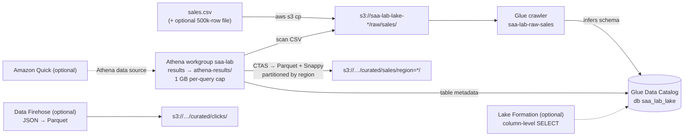

# Lab 07: A small data lake with Glue, Athena and Parquet

> [Home](../README.md) · [Labs index](README.md) · Notes: [Data, analytics & migration](../notes/09-data-analytics-migration.md) · Practice: [D3 High-performing](../practice/d3-high-performing.md)

| Time | Cost risk | Task statements | Prereqs |
|---|---|---|---|
| 2 h (+45 min optional parts) | Low. A Glue crawler run is billed per DPU-hour with a per-run minimum (approx. cents to ~$0.15 per run); Athena bills per TB scanned (10 MB minimum per query); Firehose per GB. ⚠️ **Amazon Quick** (optional part) is a per-user monthly subscription, so unsubscribe | 1.3, 3.5, 4.1 | [Lab safety](README.md) setup. No VPC needed |

## Objective

Build the smallest version of a real data lake:

- raw CSV in Amazon S3
- an **AWS Glue crawler** that infers the schema into the **Glue Data Catalog**
- serverless SQL with **Amazon Athena**
- a **CTAS** query that rewrites the data as **partitioned, compressed Parquet** in a curated zone

You will measure the drop in **data scanned**, which is what Athena bills. Optional parts:

- stream JSON into the lake with **Amazon Data Firehose** (with format conversion)
- restrict columns with **Lake Formation**
- put a dashboard on top with **Amazon Quick**

## Architecture



## Steps

1. **Create a bucket with `raw/` and `curated/` zones, and upload the sample data.**

   ```bash
   source ~/saa-lab.env
   mkdir -p ~/lab07 && cd ~/lab07
   save LAKE_BUCKET "saa-lab-lake-$ACCOUNT_ID"
   aws s3 mb "s3://$LAKE_BUCKET"
   aws s3api put-bucket-tagging --bucket "$LAKE_BUCKET" --tagging 'TagSet=[{Key=project,Value=saa-lab}]'

   cat > sales.csv <<'EOF'
   order_id,order_date,region,product,category,quantity,unit_price
   1001,2026-01-03,NA,Laptop Stand,Accessories,2,39.90
   1002,2026-01-03,EU,USB-C Hub,Accessories,1,54.00
   1003,2026-01-04,APAC,Mechanical Keyboard,Peripherals,1,129.00
   1004,2026-01-05,NA,27in Monitor,Displays,2,289.99
   1005,2026-01-06,EU,Webcam HD,Peripherals,3,69.50
   1006,2026-01-07,NA,Noise-Cancelling Headset,Audio,1,199.00
   1007,2026-01-08,APAC,USB-C Hub,Accessories,4,54.00
   1008,2026-01-09,EU,27in Monitor,Displays,1,289.99
   1009,2026-01-10,NA,Wireless Mouse,Peripherals,5,24.99
   1010,2026-01-11,APAC,Laptop Stand,Accessories,2,39.90
   1011,2026-02-01,EU,Noise-Cancelling Headset,Audio,2,199.00
   1012,2026-02-02,NA,Mechanical Keyboard,Peripherals,1,129.00
   1013,2026-02-03,APAC,Webcam HD,Peripherals,1,69.50
   1014,2026-02-04,EU,Wireless Mouse,Peripherals,6,24.99
   1015,2026-02-05,NA,USB-C Hub,Accessories,3,54.00
   EOF
   aws s3 cp sales.csv "s3://$LAKE_BUCKET/raw/sales/sales.csv"
   ```

   The data is synthetic. A data lake has no "create table" step before loading: you land the files first and apply a schema when you read them (*schema-on-read*).

2. **(Recommended) Add a bigger file, so that "data scanned" differences show up as megabytes rather than bytes.** This generates about 500,000 rows (about 25 MB) with the same schema:

   ```bash
   python3 - <<'PY'
   import csv, datetime, random
   random.seed(7)
   products = [("Laptop Stand", "Accessories", 39.90), ("USB-C Hub", "Accessories", 54.00),
               ("Mechanical Keyboard", "Peripherals", 129.00), ("27in Monitor", "Displays", 289.99),
               ("Webcam HD", "Peripherals", 69.50), ("Noise-Cancelling Headset", "Audio", 199.00),
               ("Wireless Mouse", "Peripherals", 24.99)]
   start = datetime.date(2025, 1, 1)
   with open("sales_big.csv", "w", newline="") as f:
       w = csv.writer(f)
       w.writerow(["order_id", "order_date", "region", "product", "category", "quantity", "unit_price"])
       for i in range(500_000):
           name, cat, price = random.choice(products)
           day = start + datetime.timedelta(days=random.randrange(365))
           w.writerow([100_000 + i, day.isoformat(), random.choice(["NA", "EU", "APAC"]),
                       name, cat, random.randint(1, 6), price])
   PY
   ls -lh sales_big.csv && aws s3 cp sales_big.csv "s3://$LAKE_BUCKET/raw/sales/sales_big.csv"
   ```

3. **IAM role for the Glue crawler.** The managed `AWSGlueServiceRole` only covers buckets whose names start with `aws-glue-`, so add read access to your raw zone.

   ```bash
   cat > glue-trust.json <<'EOF'
   {"Version": "2012-10-17", "Statement": [{"Effect": "Allow", "Principal": {"Service": "glue.amazonaws.com"}, "Action": "sts:AssumeRole"}]}
   EOF
   cat > glue-s3.json <<EOF
   {"Version": "2012-10-17", "Statement": [
     {"Effect": "Allow", "Action": "s3:ListBucket", "Resource": "arn:aws:s3:::${LAKE_BUCKET}"},
     {"Effect": "Allow", "Action": "s3:GetObject", "Resource": "arn:aws:s3:::${LAKE_BUCKET}/raw/*"}]}
   EOF
   save GLUE_ROLE_ARN "$(aws iam create-role --role-name saa-lab-glue-crawler \
     --assume-role-policy-document file://glue-trust.json --tags Key=project,Value=saa-lab --query Role.Arn --output text)"
   aws iam attach-role-policy --role-name saa-lab-glue-crawler \
     --policy-arn arn:aws:iam::aws:policy/service-role/AWSGlueServiceRole
   aws iam put-role-policy --role-name saa-lab-glue-crawler --policy-name lake-raw-read --policy-document file://glue-s3.json
   ```

4. **Glue database and crawler, then run it.** Console: **AWS Glue console → Data Catalog → Databases → Add database**, then **Crawlers → Create crawler** → data source S3 `s3://<bucket>/raw/sales/` → IAM role `saa-lab-glue-crawler` → target database `saa_lab_lake` → schedule *On demand*.

   ```bash
   aws glue create-database --database-input '{"Name":"saa_lab_lake","Description":"saa-lab data lake"}'
   sleep 10
   aws glue create-crawler --name saa-lab-raw-sales --role "$GLUE_ROLE_ARN" --database-name saa_lab_lake \
     --targets "{\"S3Targets\":[{\"Path\":\"s3://$LAKE_BUCKET/raw/sales/\"}]}" --tags project=saa-lab
   aws glue start-crawler --name saa-lab-raw-sales
   sleep 20
   until [ "$(aws glue get-crawler --name saa-lab-raw-sales --query Crawler.State --output text)" = READY ]; do sleep 15; done
   aws glue get-crawler --name saa-lab-raw-sales --query 'Crawler.LastCrawl.[Status,ErrorMessage]' --output text
   aws glue get-table --database-name saa_lab_lake --name sales --query \
     '{format: Table.Parameters.classification, skipHeader: Table.Parameters."skip.header.line.count", columns: Table.StorageDescriptor.Columns[].[Name,Type]}'
   ```

   The crawler classified the files as `csv`, detected the header row, and inferred types such as `bigint` and `double`. The table name comes from the folder: `sales`. The Data Catalog is a Hive-compatible metastore that Athena, EMR, Redshift Spectrum and Glue jobs all share.

5. **Athena workgroup: result location plus a cost guardrail.** Console: **Athena console → Workgroups → Create workgroup**:
   - query result location `s3://<bucket>/athena-results/`
   - **Override client-side settings** on
   - **Per query data usage control:** 1 GB

   Then pick the `saa-lab` workgroup in the Query editor.

   ```bash
   aws athena create-work-group --name saa-lab --tags Key=project,Value=saa-lab \
     --configuration "ResultConfiguration={OutputLocation=s3://$LAKE_BUCKET/athena-results/},EnforceWorkGroupConfiguration=true,PublishCloudWatchMetricsEnabled=true,BytesScannedCutoffPerQuery=1073741824"

   # run_q "SQL" -> waits, prints state + bytes scanned, then up to 20 result rows
   run_q() {
     local id state
     id=$(aws athena start-query-execution --work-group saa-lab --query-execution-context Database=saa_lab_lake \
          --query-string "$1" --query QueryExecutionId --output text) || return 1
     while state=$(aws athena get-query-execution --query-execution-id "$id" --query QueryExecution.Status.State --output text); \
           [ "$state" = QUEUED ] || [ "$state" = RUNNING ]; do sleep 1; done
     aws athena get-query-execution --query-execution-id "$id" --output table --query \
       'QueryExecution.{state: Status.State, error: Status.StateChangeReason, scannedBytes: Statistics.DataScannedInBytes, ms: Statistics.TotalExecutionTimeInMillis}'
     [ "$state" = SUCCEEDED ] && aws athena get-query-results --query-execution-id "$id" --max-items 20 \
       --query 'ResultSet.Rows[*].Data[*].VarCharValue' --output text
   }
   ```

6. **Query the raw CSV.** Write down `scannedBytes` for each query.

   ```bash
   run_q "SELECT region, count(*) AS orders, round(sum(quantity * unit_price), 2) AS revenue
          FROM sales GROUP BY region ORDER BY revenue DESC"
   run_q "SELECT round(sum(quantity * unit_price), 2) AS eu_revenue FROM sales WHERE region = 'EU'"
   ```

   Both queries scan **every byte of every file**. CSV is row-oriented and uncompressed, and the table has no partitions, so a `WHERE region = 'EU'` filter cannot skip anything.

7. **CTAS: rewrite as Parquet, Snappy-compressed, partitioned by `region`, into the curated zone.**

   ```bash
   run_q "CREATE TABLE sales_curated
          WITH (format = 'PARQUET', write_compression = 'SNAPPY',
                external_location = 's3://$LAKE_BUCKET/curated/sales/',
                partitioned_by = ARRAY['region'])
          AS SELECT order_id, CAST(order_date AS date) AS order_date, product, category,
                    quantity, unit_price, round(quantity * unit_price, 2) AS revenue, region
          FROM sales"
   aws s3 ls "s3://$LAKE_BUCKET/curated/sales/"                                      # region=APAC/ region=EU/ region=NA/
   aws s3 ls "s3://$LAKE_BUCKET/raw/sales/"     --recursive --summarize --human-readable | tail -2
   aws s3 ls "s3://$LAKE_BUCKET/curated/sales/" --recursive --summarize --human-readable | tail -2
   ```

   Partition columns must come **last** in the `SELECT`. CTAS also registered `sales_curated` in the Data Catalog, partitions included, so there is no crawler or `MSCK REPAIR TABLE` to run. Compare the total sizes: Parquet + Snappy is typically several times smaller than the CSV.

8. **Run the same questions against the curated table and compare `scannedBytes`.**

   ```bash
   run_q "SELECT round(sum(revenue), 2) AS eu_revenue FROM sales_curated WHERE region = 'EU'"
   run_q "SELECT count(DISTINCT product) AS products FROM sales"
   run_q "SELECT count(DISTINCT product) AS products FROM sales_curated"
   ```

   Results are identical; scanned bytes drop sharply, for two reasons:
   - **Partition pruning:** `WHERE region = 'EU'` reads only the `region=EU/` prefix.
   - **Columnar reads:** a query touching `revenue` or `product` reads only those column chunks.

   Athena bills by bytes scanned, so this *is* the cost optimization. The same applies to Redshift Spectrum, and it is also why queries get faster. With only the 15-row file you will see a few hundred bytes versus a few KB; Athena still bills a 10 MB minimum per query, but the ratio is the lesson.

9. **(Optional) Stream JSON into the lake with Amazon Data Firehose, converting it to Parquet on the way.** First create the target table, whose schema Firehose uses for the conversion:

   ```bash
   run_q "CREATE EXTERNAL TABLE clicks (user_id string, page string, event_time string)
          STORED AS PARQUET LOCATION 's3://$LAKE_BUCKET/curated/clicks/'"
   ```

   Console: **Amazon Data Firehose console → Create Firehose stream**:
   - Source **Direct PUT**, destination **Amazon S3**, name `saa-lab-clicks`
   - **Transform and convert records → Convert record format: Enabled**, output **Apache Parquet**, schema from AWS Glue: database `saa_lab_lake`, table `clicks`
   - Destination: your bucket, prefix `curated/clicks/`, error output prefix `errors/clicks/`
   - **Buffer hints:** size 64 MiB (the minimum when format conversion is on), interval **60 seconds**
   - Service access: *Create or update IAM role* → **Create Firehose stream**

   Then send 20 events:

   ```bash
   for i in $(seq 1 20); do
     rec=$(printf '{"user_id":"u%d","page":"/p/%d","event_time":"%s"}' $((i % 5)) $((i % 3)) "$(date -u +%FT%TZ)")
     aws firehose put-record --delivery-stream-name saa-lab-clicks --cli-binary-format raw-in-base64-out \
       --record "{\"Data\": $(jq -Rn --arg r "$rec" '$r')}" --query RecordId --output text >/dev/null
   done
   sleep 90
   aws s3 ls "s3://$LAKE_BUCKET/curated/clicks/" --recursive      # .../YYYY/MM/DD/HH/saa-lab-clicks-...parquet
   run_q "SELECT page, count(*) AS hits FROM clicks GROUP BY page ORDER BY hits DESC"
   ```

   Firehose writes when *either* buffer hint is reached, so tiny volumes arrive after the interval. That makes it **near real-time** (seconds to minutes), not real-time. When you need sub-second processing, multiple consumers or replay, use **Kinesis Data Streams**. Firehose is the zero-administration "load it into S3, Redshift or OpenSearch" service.

10. **(Optional) Lake Formation column-level permissions.** ⚠️ This changes who can read the table. Follow the cleanup notes carefully.
    1. **Lake Formation console → Administrative roles and tasks → Data lake administrators → Add**: your Identity Center admin role (`AWSReservedSSO_AdministratorAccess_*`).
    2. **Data lake locations → Register location**: `s3://<bucket>/curated`, using the service-linked role. Lake Formation now vends credentials for that S3 data.
    3. **Data permissions:** find `IAMAllowedPrincipals` on table `sales_curated` and **Revoke** it. Until you do, IAM policies alone still govern the table. Also grant *yourself* `SELECT` on the table, so you don't lose access.
    4. Create an analyst role and grant it only some columns:

       ```bash
       cat > analyst-policy.json <<EOF
       {"Version": "2012-10-17", "Statement": [
         {"Effect": "Allow", "Action": ["athena:StartQueryExecution", "athena:GetQueryExecution", "athena:GetQueryResults", "athena:GetWorkGroup"],
          "Resource": "arn:aws:athena:${REGION}:${ACCOUNT_ID}:workgroup/saa-lab"},
         {"Effect": "Allow", "Action": ["glue:GetDatabase", "glue:GetDatabases", "glue:GetTable", "glue:GetTables", "glue:GetPartitions", "lakeformation:GetDataAccess"],
          "Resource": "*"},
         {"Effect": "Allow", "Action": ["s3:GetBucketLocation", "s3:ListBucket"], "Resource": "arn:aws:s3:::${LAKE_BUCKET}"},
         {"Effect": "Allow", "Action": ["s3:GetObject", "s3:PutObject"], "Resource": "arn:aws:s3:::${LAKE_BUCKET}/athena-results/*"}]}
       EOF
       cat > trust-same-account.json <<EOF
       {"Version": "2012-10-17", "Statement": [{"Effect": "Allow", "Principal": {"AWS": "arn:aws:iam::${ACCOUNT_ID}:root"}, "Action": "sts:AssumeRole"}]}
       EOF
       save ANALYST_ROLE_ARN "$(aws iam create-role --role-name saa-lab-analyst \
         --assume-role-policy-document file://trust-same-account.json --tags Key=project,Value=saa-lab --query Role.Arn --output text)"
       aws iam put-role-policy --role-name saa-lab-analyst --policy-name athena-lake --policy-document file://analyst-policy.json
       aws lakeformation grant-permissions --principal DataLakePrincipalIdentifier="$ANALYST_ROLE_ARN" --permissions SELECT \
         --resource "{\"TableWithColumns\":{\"DatabaseName\":\"saa_lab_lake\",\"Name\":\"sales_curated\",\"ColumnNames\":[\"order_id\",\"region\",\"product\",\"quantity\"]}}"
       ```

    5. Test as the analyst. The role has **no S3 permission on `curated/`**; Lake Formation hands Athena temporary credentials scoped to the grant.

       ```bash
       sleep 10; assume "$ANALYST_ROLE_ARN"          # helper from Lab 01
       run_q "SELECT * FROM sales_curated LIMIT 3"   # only order_id, product, quantity, region
       run_q "SELECT unit_price FROM sales_curated LIMIT 1"   # fails: column not permitted
       unassume
       ```

    This is the answer to "give analysts access to some columns or rows of the lake without managing S3 bucket policies per team". Lake Formation also supports row-level filters and tag-based access control (LF-TBAC).

11. **(Optional) Amazon Quick dashboard.** Amazon Quick, formerly QuickSight (the BI part is *Amazon Quick Sight*), needs a **subscription billed per user per month**, possibly after a free trial. Only do this if you are happy to sign up and then cancel.
    1. Sign up, and in Quick's settings allow access to **Amazon Athena** and to your lake bucket.
    2. **Datasets → New dataset → Athena** → workgroup `saa-lab` → table `sales_curated` → *Directly query your data* (or import into SPICE).
    3. Build a bar chart of `sum(revenue)` by `region`, and publish it as a dashboard.

    On the exam, "serverless BI dashboards on data in S3/Athena/Redshift, with ML insights, for many users" → Amazon Quick (older questions say QuickSight).

## Verify

- [ ] The crawler created table `sales` with inferred column types and `skip.header.line.count = 1`.
- [ ] Athena results land in `athena-results/`, and the workgroup enforces a 1 GB per-query cap.
- [ ] `curated/sales/` contains `region=APAC/`, `region=EU/` and `region=NA/` Parquet files, much smaller in total than `raw/`.
- [ ] The EU query scanned far fewer bytes on `sales_curated` than on `sales`, with the same answer.
- [ ] (Optional) Firehose delivered Parquet files under `curated/clicks/YYYY/MM/DD/HH/` and Athena can query them.
- [ ] (Optional) The analyst role sees only the granted columns.

## Break it

1. **New data, stale partitions.** Add a file for a new region straight into the curated zone, as an upstream job might:

   ```bash
   run_q "SELECT region, count(*) FROM sales_curated GROUP BY region"           # 3 regions
   aws s3 cp "s3://$LAKE_BUCKET/curated/sales/region=EU/" "s3://$LAKE_BUCKET/curated/sales/region=LATAM/" --recursive
   run_q "SELECT region, count(*) FROM sales_curated GROUP BY region"           # still 3: LATAM is invisible
   run_q "ALTER TABLE sales_curated ADD PARTITION (region = 'LATAM') LOCATION 's3://$LAKE_BUCKET/curated/sales/region=LATAM/'"
   run_q "SELECT region, count(*) FROM sales_curated GROUP BY region"           # 4 regions
   ```

   Athena only reads partitions that the Data Catalog knows about. Your options:
   - `ALTER TABLE ADD PARTITION`
   - `MSCK REPAIR TABLE` for Hive-style `key=value` paths
   - a scheduled crawler
   - **partition projection** (partitions computed from table properties, with no catalog updates at all), which is the scalable answer for time-based partitions

2. **Hit the cost guardrail.** Lower the workgroup's per-query cap to the minimum (10 MB) and scan the big CSV:

   ```bash
   aws athena update-work-group --work-group saa-lab --configuration-updates BytesScannedCutoffPerQuery=10485760
   run_q "SELECT count(*) FROM sales"         # FAILED/CANCELLED: bytes scanned limit exceeded (with the 25 MB file)
   aws athena update-work-group --work-group saa-lab --configuration-updates BytesScannedCutoffPerQuery=1073741824
   ```

   Workgroups give you per-team result locations, encryption settings, per-query data limits, and CloudWatch metrics for chargeback.

## Exam takeaways

- **S3 + Glue Data Catalog + Athena = a serverless data lake with SQL and no infrastructure.** "Ad-hoc SQL on data in S3, pay per query" → Athena. "Discover the schema automatically" → Glue crawler. "Serverless ETL (Spark)" → Glue jobs. "Big managed Hadoop/Spark clusters with full control" → EMR.
- **Cut Athena cost and latency:** convert to **columnar formats (Parquet/ORC)**, **compress**, **partition** on common filters (date, region), and avoid many tiny files. **CTAS** or a Glue job does the conversion.
- **Partitions must be registered** in the catalog (ADD PARTITION, MSCK REPAIR, a crawler) or **projected**. Otherwise new data is invisible.
- **Ingestion:** **Data Firehose** = managed, buffered (near real-time) delivery to S3, Redshift, OpenSearch or Splunk, with optional format conversion and Lambda transforms. **Kinesis Data Streams** = real-time, ordered per shard, multiple consumers, replay, but you manage capacity (or use on-demand mode). **MSK** = managed Kafka.
- **Governance:** **Lake Formation** centralizes fine-grained (database, table, column, row, tag) permissions over the catalog and vends scoped credentials. Watch the `IAMAllowedPrincipals` default when moving a table from IAM-only access to Lake Formation.
- **BI:** **Amazon Quick** (formerly QuickSight) for dashboards; **Redshift** when you need a data warehouse with heavy joins and concurrency over curated data, with Spectrum to query S3 in place.
- Storage cost (4.1): raw data can transition to cheaper S3 classes with lifecycle rules once the curated zone exists.

## Cleanup ✅

- [ ] (Optional part) Amazon Quick: delete the dashboard and dataset, and **unsubscribe** or cancel the trial in Quick's account settings.
- [ ] (Optional part) Firehose stream and its console-created role:

  ```bash
  source ~/saa-lab.env
  aws firehose delete-delivery-stream --delivery-stream-name saa-lab-clicks
  ```

  Then delete the `KinesisFirehoseServiceRole-saa-lab-clicks-*` role in IAM.
- [ ] (Optional part) Lake Formation: deregister the location and remove the analyst role. Deleting the database (below) removes its grants. Also remove yourself from the data lake administrators if you like.

  ```bash
  aws lakeformation deregister-resource --resource-arn "arn:aws:s3:::$LAKE_BUCKET/curated"
  aws iam delete-role-policy --role-name saa-lab-analyst --policy-name athena-lake
  aws iam delete-role --role-name saa-lab-analyst
  ```

- [ ] Crawler, database (this deletes its tables), Athena workgroup (with its saved queries and history):

  ```bash
  aws glue delete-crawler --name saa-lab-raw-sales
  aws glue delete-database --name saa_lab_lake
  aws athena delete-work-group --work-group saa-lab --recursive-delete-option
  ```

- [ ] Bucket and the Glue role:

  ```bash
  empty_bucket "$LAKE_BUCKET" && aws s3 rb "s3://$LAKE_BUCKET"
  aws iam delete-role-policy --role-name saa-lab-glue-crawler --policy-name lake-raw-read
  aws iam detach-role-policy --role-name saa-lab-glue-crawler --policy-arn arn:aws:iam::aws:policy/service-role/AWSGlueServiceRole
  aws iam delete-role --role-name saa-lab-glue-crawler
  ```

- [ ] Glue crawler log group (if created): `aws logs delete-log-group --log-group-name /aws-glue/crawlers 2>/dev/null`
- [ ] Local files: `rm -rf ~/lab07`
