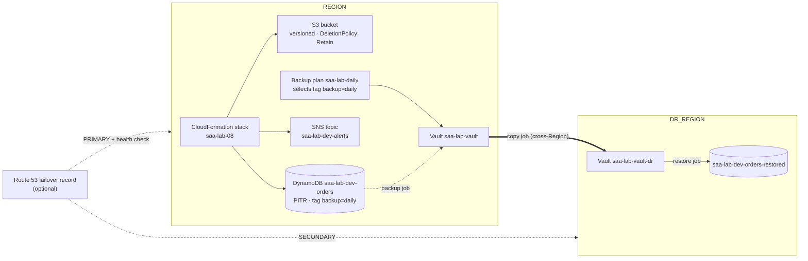

# Lab 08: Infrastructure as code, AWS Backup and cross-Region DR

> [Home](../README.md) · [Labs index](README.md) · Notes: [HA, DR, edge & ops](../notes/08-ha-dr-edge-ops.md), [Cost optimization](../notes/10-cost-optimization.md) · Practice: [D2 Resilient](../practice/d2-resilient.md)

| Time | Cost risk | Task statements | Prereqs |
|---|---|---|---|
| 2.5 h (+30 min optional Route 53) | Low. Backup storage per GB-month in **both** Regions, cross-Region transfer per GB, DynamoDB PITR, a Route 53 hosted zone (about $0.50/month) and health check (about $0.50/month) if you use them. ⚠️ The backup plan keeps creating recovery points daily until you delete it | 2.2, 4.1 | [Lab safety](README.md) setup (`REGION`, `DR_REGION`, `empty_bucket`) |

## Objective

1. Define a small stack in **AWS CloudFormation**.
2. Deploy it from CloudShell.
3. Preview changes with **change sets**, including one that would *replace* a resource.
4. Break it by hand and catch the change with **drift detection**.
5. Protect its data with an **AWS Backup** plan that copies recovery points **to a second Region**.
6. **Restore** in that Region. That is a complete *backup-and-restore* DR drill.
7. Delete the stack and watch `DeletionPolicy: Retain` keep the bucket.

## Architecture



## Steps

### Part A: CloudFormation

1. **Write the template.** It has no VPC: a versioned bucket with `DeletionPolicy: Retain`, a DynamoDB table with point-in-time recovery, an SNS topic with an optional email subscription, parameters, a condition, and outputs.

   ```bash
   source ~/saa-lab.env
   mkdir -p ~/lab08 && cd ~/lab08
   cat > lab08.yaml <<'EOF'
   AWSTemplateFormatVersion: "2010-09-09"
   Description: >-
     SAA lab 08 - a VPC-less stack: versioned S3 bucket (retained on delete),
     DynamoDB table with point-in-time recovery, and an SNS alert topic.

   Parameters:
     Env:
       Type: String
       AllowedValues: [dev, test]
       Default: dev
       Description: Environment name, used in resource names and tags.
     TableSuffix:
       Type: String
       Default: orders
       AllowedPattern: "[a-z0-9-]+"
       Description: Suffix of the DynamoDB table name. Changing it forces a replacement.
     Owner:
       Type: String
       Default: student
       Description: Value of the owner tag. Changing it is an in-place update.
     AlertEmail:
       Type: String
       Default: ""
       Description: Optional email address subscribed to the alert topic. Leave empty to skip.

   Conditions:
     HasAlertEmail: !Not [!Equals [!Ref AlertEmail, ""]]

   Resources:
     DataBucket:
       Type: AWS::S3::Bucket
       DeletionPolicy: Retain          # survives "delete stack"
       UpdateReplacePolicy: Retain     # survives a replacement during an update
       Properties:
         VersioningConfiguration:
           Status: Enabled
         BucketEncryption:
           ServerSideEncryptionConfiguration:
             - ServerSideEncryptionByDefault:
                 SSEAlgorithm: AES256
         PublicAccessBlockConfiguration:
           BlockPublicAcls: true
           BlockPublicPolicy: true
           IgnorePublicAcls: true
           RestrictPublicBuckets: true
         Tags:
           - Key: project
             Value: saa-lab
           - Key: env
             Value: !Ref Env
           - Key: owner
             Value: !Ref Owner

     OrdersTable:
       Type: AWS::DynamoDB::Table
       DeletionPolicy: Delete          # the default, written out for contrast
       UpdateReplacePolicy: Delete
       Properties:
         TableName: !Sub "saa-lab-${Env}-${TableSuffix}"
         BillingMode: PAY_PER_REQUEST
         AttributeDefinitions:
           - AttributeName: pk
             AttributeType: S
         KeySchema:
           - AttributeName: pk
             KeyType: HASH
         PointInTimeRecoverySpecification:
           PointInTimeRecoveryEnabled: true
         Tags:
           - Key: project
             Value: saa-lab
           - Key: env
             Value: !Ref Env
           - Key: owner
             Value: !Ref Owner
           - Key: backup              # AWS Backup selects resources by this tag
             Value: daily

     AlertTopic:
       Type: AWS::SNS::Topic
       Properties:
         TopicName: !Sub "saa-lab-${Env}-alerts"
         Tags:
           - Key: project
             Value: saa-lab
           - Key: owner
             Value: !Ref Owner

     AlertSubscription:
       Type: AWS::SNS::Subscription
       Condition: HasAlertEmail
       Properties:
         TopicArn: !Ref AlertTopic
         Protocol: email
         Endpoint: !Ref AlertEmail

   Outputs:
     BucketName:
       Description: Versioned bucket (retained when the stack is deleted)
       Value: !Ref DataBucket
     TableName:
       Value: !Ref OrdersTable
     TableArn:
       Value: !GetAtt OrdersTable.Arn
     TopicArn:
       Value: !Ref AlertTopic
       Export:
         Name: !Sub "${AWS::StackName}-TopicArn"
   EOF
   aws cloudformation validate-template --template-body file://lab08.yaml --query 'Parameters[].ParameterKey' --output text
   ```

   The bucket has no `BucketName`, so CloudFormation generates a unique one. That avoids collisions, and it also lets CloudFormation *replace* the bucket if ever needed. A resource with a hard-coded name can't be replaced without changing the name. You will see that with the table.

2. **Deploy.** `aws cloudformation deploy` creates a change set and executes it in one go. Console: **CloudFormation console → Create stack → Upload a template file**.

   ```bash
   aws cloudformation deploy --stack-name saa-lab-08 --template-file lab08.yaml \
     --parameter-overrides Env=dev Owner=student --tags project=saa-lab
   aws cloudformation describe-stacks --stack-name saa-lab-08 \
     --query 'Stacks[0].Outputs[].[OutputKey,OutputValue]' --output table
   out() { aws cloudformation describe-stacks --stack-name saa-lab-08 \
     --query "Stacks[0].Outputs[?OutputKey=='$1'].OutputValue" --output text; }
   save DATA_BUCKET "$(out BucketName)"; save CFN_TABLE "$(out TableName)"; save CFN_TABLE_ARN "$(out TableArn)"
   ```

   Stack-level `--tags` propagate to every resource that supports tags.

3. **Change set 1: an in-place update.** Change the `Owner` parameter, which only touches tags:

   ```bash
   cs() {   # cs NAME KEY VALUE -> create a change set that overrides one parameter, then show it
     local p=""
     for k in Env TableSuffix Owner AlertEmail; do
       if [ "$k" = "$2" ]; then p="$p ParameterKey=$k,ParameterValue=$3"; else p="$p ParameterKey=$k,UsePreviousValue=true"; fi
     done
     aws cloudformation create-change-set --stack-name saa-lab-08 --change-set-name "$1" --use-previous-template \
       --parameters $p --tags Key=project,Value=saa-lab --query Id --output text >/dev/null
     aws cloudformation wait change-set-create-complete --stack-name saa-lab-08 --change-set-name "$1"
     aws cloudformation describe-change-set --stack-name saa-lab-08 --change-set-name "$1" --output table \
       --query 'Changes[].ResourceChange.{Action:Action,Resource:LogicalResourceId,Replacement:Replacement,Scope:join(`,`,Scope)}'
   }
   cs owner-tag Owner platform-team
   ```

   Every row reads `Modify`, `Replacement: False`, scope `Tags`. Execute it:

   ```bash
   aws cloudformation execute-change-set --stack-name saa-lab-08 --change-set-name owner-tag
   aws cloudformation wait stack-update-complete --stack-name saa-lab-08 && echo updated
   ```

4. **Change set 2: a replacement. Review it, don't run it.** Changing `TableName` cannot be done in place:

   ```bash
   cs rename-table TableSuffix orders-v2
   aws cloudformation delete-change-set --stack-name saa-lab-08 --change-set-name rename-table
   ```

   `OrdersTable` shows `Modify` with **`Replacement: True`**. CloudFormation would create a new, **empty** table named `saa-lab-dev-orders-v2` and delete the old one with its data. Its `UpdateReplacePolicy` is `Delete`. **This is exactly why change sets exist**: they preview destructive changes before you execute them. In production you would add a stack policy or `UpdateReplacePolicy: Retain` (or `Snapshot` where the resource type supports it) to guard such resources.

5. **Introduce drift, and detect it.** Suspend versioning by hand, as if someone "fixed" it in the console:

   ```bash
   aws s3api put-bucket-versioning --bucket "$DATA_BUCKET" --versioning-configuration Status=Suspended

   DRIFT_ID=$(aws cloudformation detect-stack-drift --stack-name saa-lab-08 --query StackDriftDetectionId --output text)
   until [ "$(aws cloudformation describe-stack-drift-detection-status --stack-drift-detection-id "$DRIFT_ID" \
         --query DetectionStatus --output text)" != DETECTION_IN_PROGRESS ]; do sleep 5; done
   aws cloudformation describe-stack-drift-detection-status --stack-drift-detection-id "$DRIFT_ID" \
     --query '[StackDriftStatus,DriftedStackResourceCount]' --output text                 # DRIFTED 1
   aws cloudformation describe-stack-resource-drifts --stack-name saa-lab-08 \
     --stack-resource-drift-status-filters MODIFIED --output table \
     --query 'StackResourceDrifts[].PropertyDifferences[].[PropertyPath,ExpectedValue,ActualValue,DifferenceType]'
   ```

   The console shows the same under **Stack actions → Detect drift → View drift results**. Now try to "fix" it by redeploying:

   ```bash
   aws cloudformation deploy --stack-name saa-lab-08 --template-file lab08.yaml --no-fail-on-empty-changeset
   # "No changes to deploy" -- and versioning is still Suspended
   ```

   ⚠️ Trap: **drift detection reports drift; it does not repair it.** A stack update only acts on properties whose *template* values changed. Repair it out of band, then confirm:

   ```bash
   aws s3api put-bucket-versioning --bucket "$DATA_BUCKET" --versioning-configuration Status=Enabled
   DRIFT_ID=$(aws cloudformation detect-stack-drift --stack-name saa-lab-08 --query StackDriftDetectionId --output text)
   sleep 15; aws cloudformation describe-stack-drift-detection-status --stack-drift-detection-id "$DRIFT_ID" \
     --query StackDriftStatus --output text                                               # IN_SYNC
   ```

   The preventive controls are SCPs or IAM policies that stop console changes to IaC-managed resources. AWS Config rules give you continuous detection.

### Part B: AWS Backup with a cross-Region copy

6. **Put some data in the table, and check the DynamoDB backup setting.**

   ```bash
   aws dynamodb put-item --table-name "$CFN_TABLE" --item '{"pk":{"S":"order#1"},"item":{"S":"book"},"qty":{"N":"2"}}'
   aws dynamodb put-item --table-name "$CFN_TABLE" --item '{"pk":{"S":"order#2"},"item":{"S":"lamp"},"qty":{"N":"1"}}'
   aws backup describe-region-settings --query '{optIn: ResourceTypeOptInPreference.DynamoDB, advanced: ResourceTypeManagementPreference.DynamoDB}'
   ```

   Cross-Region copies of DynamoDB backups need AWS Backup's **advanced features for DynamoDB**. They are on by default in newer accounts. If `advanced` is `false`, enable it under **AWS Backup console → Settings → Advanced features for Amazon DynamoDB backups**, or run `aws backup update-region-settings --resource-type-management-preference DynamoDB=true`.

7. **Service role and two vaults, one per Region.**

   ```bash
   cat > backup-trust.json <<'EOF'
   {"Version": "2012-10-17", "Statement": [{"Effect": "Allow", "Principal": {"Service": "backup.amazonaws.com"}, "Action": "sts:AssumeRole"}]}
   EOF
   save BACKUP_ROLE_ARN "$(aws iam create-role --role-name saa-lab-backup --assume-role-policy-document file://backup-trust.json \
     --tags Key=project,Value=saa-lab --query Role.Arn --output text)"
   aws iam attach-role-policy --role-name saa-lab-backup --policy-arn arn:aws:iam::aws:policy/service-role/AWSBackupServiceRolePolicyForBackup
   aws iam attach-role-policy --role-name saa-lab-backup --policy-arn arn:aws:iam::aws:policy/service-role/AWSBackupServiceRolePolicyForRestores

   aws backup create-backup-vault --backup-vault-name saa-lab-vault --backup-vault-tags project=saa-lab --query BackupVaultArn --output text
   save DR_VAULT_ARN "$(aws backup create-backup-vault --backup-vault-name saa-lab-vault-dr --region "$DR_REGION" \
     --backup-vault-tags project=saa-lab --query BackupVaultArn --output text)"
   ```

8. **Backup plan: daily, keep 7 days, copy each recovery point to the DR vault. Select resources by tag.** Console: **AWS Backup console → Backup plans → Create backup plan → Build a new plan**. Add a rule with a *copy to destination* Region, then *Assign resources* by tag `backup = daily`.

   ```bash
   cat > plan.json <<EOF
   {
     "BackupPlanName": "saa-lab-daily",
     "Rules": [{
       "RuleName": "daily-with-dr-copy",
       "TargetBackupVaultName": "saa-lab-vault",
       "ScheduleExpression": "cron(0 5 * * ? *)",
       "StartWindowMinutes": 60,
       "CompletionWindowMinutes": 180,
       "Lifecycle": {"DeleteAfterDays": 7},
       "CopyActions": [{
         "DestinationBackupVaultArn": "${DR_VAULT_ARN}",
         "Lifecycle": {"DeleteAfterDays": 7}
       }]
     }]
   }
   EOF
   save PLAN_ID "$(aws backup create-backup-plan --backup-plan file://plan.json --backup-plan-tags project=saa-lab \
     --query BackupPlanId --output text)"

   cat > selection.json <<EOF
   {
     "SelectionName": "tag-backup-daily",
     "IamRoleArn": "${BACKUP_ROLE_ARN}",
     "ListOfTags": [{"ConditionType": "STRINGEQUALS", "ConditionKey": "backup", "ConditionValue": "daily"}]
   }
   EOF
   save SELECTION_ID "$(aws backup create-backup-selection --backup-plan-id "$PLAN_ID" \
     --backup-selection file://selection.json --query SelectionId --output text)"
   ```

   With tag-based selection, every *future* resource tagged `backup=daily` is protected automatically. That is the policy-driven model the exam favours over per-resource scripts. Across many accounts, an **AWS Organizations backup policy** pushes plans like this one centrally.

9. **Run an on-demand backup now, instead of waiting for 05:00 UTC.**

   ```bash
   wait_state() {   # wait_state "<aws command that prints a state>"
     local s; while :; do s=$(eval "$1"); echo "$(date +%T) $s"
       case "$s" in COMPLETED|FAILED|ABORTED|EXPIRED|PARTIAL) break;; esac; sleep 20; done; }

   save JOB_ID "$(aws backup start-backup-job --backup-vault-name saa-lab-vault --resource-arn "$CFN_TABLE_ARN" \
     --iam-role-arn "$BACKUP_ROLE_ARN" --lifecycle DeleteAfterDays=7 --query BackupJobId --output text)"
   wait_state "aws backup describe-backup-job --backup-job-id $JOB_ID --query State --output text"   # a few minutes
   save RP_ARN "$(aws backup describe-backup-job --backup-job-id "$JOB_ID" --query RecoveryPointArn --output text)"
   ```

10. **Copy the recovery point to the DR Region.** The scheduled rule does this automatically; here you do it by hand.

    ```bash
    save COPY_ID "$(aws backup start-copy-job --recovery-point-arn "$RP_ARN" --source-backup-vault-name saa-lab-vault \
      --destination-backup-vault-arn "$DR_VAULT_ARN" --iam-role-arn "$BACKUP_ROLE_ARN" \
      --lifecycle DeleteAfterDays=7 --query CopyJobId --output text)"
    wait_state "aws backup describe-copy-job --copy-job-id $COPY_ID --query CopyJob.State --output text"   # often 5-15 min
    save DR_RP_ARN "$(aws backup describe-copy-job --copy-job-id "$COPY_ID" --query CopyJob.DestinationRecoveryPointArn --output text)"
    aws backup list-recovery-points-by-backup-vault --backup-vault-name saa-lab-vault-dr --region "$DR_REGION" \
      --query 'RecoveryPoints[].[ResourceType,Status,CreationDate]' --output table
    ```

11. **Restore in the DR Region: the actual DR drill.** Console: **AWS Backup console (switch to DR_REGION) → Backup vaults → saa-lab-vault-dr → recovery point → Restore** → new table name → **Restore backup**. CLI:

    ```bash
    # What AWS Backup recorded about the source (just to look at):
    aws backup get-recovery-point-restore-metadata --region "$DR_REGION" --backup-vault-name saa-lab-vault-dr \
      --recovery-point-arn "$DR_RP_ARN" --query RestoreMetadata
    # A DynamoDB restore needs at least a target table name (encryptionType / kmsMasterKeyArn are optional):
    save RESTORE_ID "$(aws backup start-restore-job --region "$DR_REGION" --recovery-point-arn "$DR_RP_ARN" \
      --iam-role-arn "$BACKUP_ROLE_ARN" --metadata TargetTableName=saa-lab-dev-orders-restored --resource-type DynamoDB \
      --query RestoreJobId --output text)"
    wait_state "aws backup describe-restore-job --region $DR_REGION --restore-job-id $RESTORE_ID --query Status --output text"
    aws dynamodb scan --region "$DR_REGION" --table-name saa-lab-dev-orders-restored \
      --query 'Items[].{pk:pk.S,item:item.S}' --output table                    # order#1, order#2
    ```

    Write down the times: backup job + copy job + restore job. Then add the time to deploy the application stack in the DR Region (the template from Part A: `aws cloudformation deploy --region $DR_REGION ...`) and to repoint DNS. That total is your **RTO** for this strategy. Your **RPO** is the backup interval: up to 24 hours with a daily plan.

12. **Where this sits among the DR strategies.**

    | Strategy | What runs in the DR Region before a disaster | Typical RPO / RTO | Relative cost | How to get there from this lab |
    |---|---|---|---|---|
    | **Backup & restore** | Nothing but backup copies (and IaC templates ready to run) | Hours / hours | $ | ✅ What you just did |
    | **Pilot light** | Data **replicated live** (DynamoDB global tables, Aurora Global Database, S3 CRR); core infra defined but compute off or minimal | Seconds–minutes / tens of minutes | $$ | Add a global-table replica in DR_REGION; keep the stack deployable there |
    | **Warm standby** | A scaled-down but fully working copy of the stack, taking no (or test) traffic | Seconds / minutes | $$$ | Deploy the full stack in DR_REGION at minimum size; scale up on failover |
    | **Multi-site active/active** | Full capacity in both Regions, both serving traffic | Near zero / near zero | $$$$ | Route 53 latency or weighted routing, global data stores |

    The exam gives you an RPO, an RTO and a budget, and asks for the *cheapest strategy that meets both*. Backups alone can never give a sub-minute RPO.

13. **(Optional) Route 53 failover routing with a health check.** Only do this if you own a domain in Route 53. Otherwise read it as a walkthrough. You need a primary endpoint, such as an ALB or instance in `REGION`, and a secondary, such as a static "maintenance" site in S3/CloudFront or a stack in `DR_REGION`.

    ```bash
    ZONE_ID=Z0123456789EXAMPLE            # your hosted zone
    HC_ID=$(aws route53 create-health-check --caller-reference "saa-lab-$(date +%s)" \
      --health-check-config '{"Type":"HTTP","FullyQualifiedDomainName":"primary.example.com","Port":80,"ResourcePath":"/","RequestInterval":30,"FailureThreshold":3}' \
      --query HealthCheck.Id --output text)

    cat > failover.json <<EOF
    {
      "Comment": "saa-lab active-passive failover",
      "Changes": [
        {"Action": "UPSERT", "ResourceRecordSet": {
          "Name": "app.example.com", "Type": "A", "SetIdentifier": "primary", "Failover": "PRIMARY",
          "TTL": 60, "ResourceRecords": [{"Value": "203.0.113.10"}], "HealthCheckId": "${HC_ID}"}},
        {"Action": "UPSERT", "ResourceRecordSet": {
          "Name": "app.example.com", "Type": "A", "SetIdentifier": "secondary", "Failover": "SECONDARY",
          "TTL": 60, "ResourceRecords": [{"Value": "198.51.100.20"}]}}
      ]
    }
    EOF
    aws route53 change-resource-record-sets --hosted-zone-id "$ZONE_ID" --change-batch file://failover.json
    ```

    How it behaves:
    - Route 53 answers with the PRIMARY record while its health check passes, and with the SECONDARY when it fails.
    - Stop the primary endpoint and watch **Route 53 console → Health checks** turn unhealthy, then `dig app.example.com` switch.
    - For AWS targets you would normally use **alias records** (to an ALB, CloudFront or S3 website) with *Evaluate target health*, instead of IPs and TTLs.
    - For endpoints that aren't public, base the health check on a **CloudWatch alarm**.

## Verify

- [ ] The stack deployed, and its outputs give the bucket, table and topic.
- [ ] Change set 1 showed `Replacement: False`; change set 2 showed **`Replacement: True`** for `OrdersTable`, and you deleted it unexecuted.
- [ ] Drift detection reported `VersioningConfiguration.Status` Enabled → Suspended; redeploying did not fix it.
- [ ] A recovery point exists in `saa-lab-vault` (REGION) and in `saa-lab-vault-dr` (DR_REGION).
- [ ] `saa-lab-dev-orders-restored` in DR_REGION contains `order#1` and `order#2`.

## Break it

1. **A failed update rolls back.** Try an update that CloudFormation must reject partway through. `Env` only allows `dev` or `test`, so parameter validation stops this one before any change:

   ```bash
   aws cloudformation deploy --stack-name saa-lab-08 --template-file lab08.yaml --parameter-overrides Env=prod
   ```

   Now a runtime failure: an invalid email for the subscription is accepted at validation time, but SNS rejects it at creation:

   ```bash
   aws cloudformation deploy --stack-name saa-lab-08 --template-file lab08.yaml --parameter-overrides AlertEmail=not-an-email
   aws cloudformation describe-stack-events --stack-name saa-lab-08 --max-items 8 \
     --query 'StackEvents[].[LogicalResourceId,ResourceStatus,ResourceStatusReason]' --output table
   ```

   The events show `CREATE_FAILED` for `AlertSubscription`, then `UPDATE_ROLLBACK_COMPLETE`. The stack is back exactly where it was. **Stacks change atomically.** For debugging you can keep the partial state with `--disable-rollback`.

2. **Retain in action.** This one happens in the Cleanup section. Watch for `DELETE_SKIPPED`.

## Exam takeaways

- **IaC = CloudFormation** (or the CDK, which synthesizes CloudFormation):
  - **change sets** preview updates; look for `Replacement: True` on stateful resources
  - **drift detection** finds out-of-band changes but does not repair them
  - **DeletionPolicy** `Retain` / `Snapshot` (RDS, EBS, ElastiCache and others) and **UpdateReplacePolicy** protect data
  - **StackSets** deploy the same stack across accounts and Regions
  - exports and **nested stacks** share and compose stacks
- A failed update **rolls back automatically**. Resources with hard-coded names can't be replaced in place.
- **AWS Backup** = central, policy-based backups across EC2/EBS, RDS/Aurora, DynamoDB, EFS, FSx, S3, Storage Gateway and more. It supports tag-based selection, lifecycle to cold storage, **cross-Region and cross-account copies**, and Organizations backup policies. **Backup Vault Lock** (compliance mode) makes recovery points immutable, even to root, against ransomware or for regulators.
- **DR strategies trade cost against RPO/RTO:** backup & restore → pilot light → warm standby → multi-site active/active. Pick the cheapest one that meets the stated objectives. Replicated data (global tables, Aurora Global Database, CRR) is what moves you from hours to minutes.
- **Route 53 failover routing + health checks** = active-passive at the DNS layer. Latency, weighted, geolocation/geoproximity and multivalue answer are the other routing policies. A health check can be based on a CloudWatch alarm for private resources.
- Cost (4.1): set backup **retention and lifecycle** deliberately (cold-storage tiers have minimum retention periods), delete unneeded recovery points and snapshots, and remember that cross-Region copies double the storage and add transfer charges.

## Cleanup ✅

- [ ] **Delete the stack and observe Retain.**

  ```bash
  source ~/saa-lab.env; cd ~/lab08
  STACK_ID=$(aws cloudformation describe-stacks --stack-name saa-lab-08 --query 'Stacks[0].StackId' --output text)
  aws cloudformation delete-stack --stack-name saa-lab-08
  aws cloudformation wait stack-delete-complete --stack-name saa-lab-08
  aws cloudformation describe-stack-events --stack-name "$STACK_ID" --output table \
    --query "StackEvents[?ResourceStatus=='DELETE_SKIPPED'].[LogicalResourceId,PhysicalResourceId]"   # DataBucket
  aws s3api head-bucket --bucket "$DATA_BUCKET" && echo "bucket survived the stack (Retain)"
  ```

- [ ] Delete the retained bucket yourself. It is versioned, so empty every version first:

  ```bash
  empty_bucket "$DATA_BUCKET" && aws s3 rb "s3://$DATA_BUCKET"
  ```

- [ ] Delete the backup plan, so it stops creating recovery points. Delete the selection first:

  ```bash
  aws backup delete-backup-selection --backup-plan-id "$PLAN_ID" --selection-id "$SELECTION_ID"
  aws backup delete-backup-plan --backup-plan-id "$PLAN_ID" --query DeletionDate --output text
  ```

- [ ] Delete all recovery points in both vaults, then the vaults:

  ```bash
  for pair in "saa-lab-vault:$REGION" "saa-lab-vault-dr:$DR_REGION"; do
    v=${pair%%:*}; r=${pair##*:}
    for rp in $(aws backup list-recovery-points-by-backup-vault --backup-vault-name "$v" --region "$r" \
                --query 'RecoveryPoints[].RecoveryPointArn' --output text); do
      aws backup delete-recovery-point --backup-vault-name "$v" --recovery-point-arn "$rp" --region "$r"
    done
  done
  sleep 60   # deletions are asynchronous; retry the next two lines if a vault is "not empty"
  aws backup delete-backup-vault --backup-vault-name saa-lab-vault
  aws backup delete-backup-vault --backup-vault-name saa-lab-vault-dr --region "$DR_REGION"
  ```

- [ ] Delete the restored table in the DR Region:

  ```bash
  aws dynamodb delete-table --region "$DR_REGION" --table-name saa-lab-dev-orders-restored \
    --query TableDescription.TableStatus --output text
  ```

- [ ] Delete the backup service role:

  ```bash
  aws iam detach-role-policy --role-name saa-lab-backup --policy-arn arn:aws:iam::aws:policy/service-role/AWSBackupServiceRolePolicyForBackup
  aws iam detach-role-policy --role-name saa-lab-backup --policy-arn arn:aws:iam::aws:policy/service-role/AWSBackupServiceRolePolicyForRestores
  aws iam delete-role --role-name saa-lab-backup
  ```

- [ ] (Optional part) Delete the failover records (`"Action": "DELETE"` with the same record sets) and the health check: `aws route53 delete-health-check --health-check-id "$HC_ID"`.
- [ ] Run the [leftover finder](README.md#7-universal-cleanup-checklist) for both Regions, and check **Billing → Bills** tomorrow.
- [ ] Local files: `rm -rf ~/lab08`
