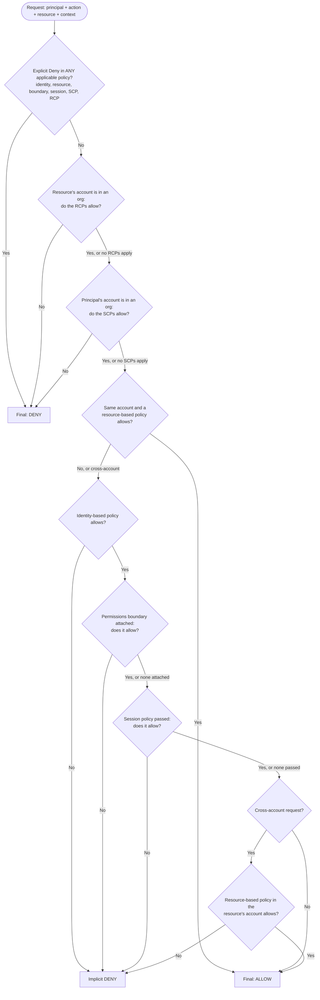
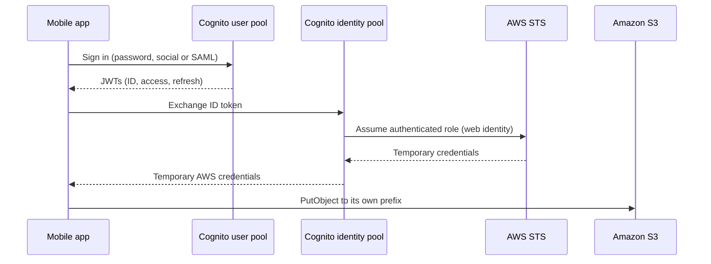

# 01 · IAM, identity and multi-account governance

> [Home](../README.md) · [Study plan](../00-study-plan.md) · Next: [02 Networking & VPC](02-networking-vpc.md)

| Covers task statements | Est. study time | Hands-on lab | Practice |
|---|---|---|---|
| 1.1 (primary), 1.2, 1.3, 4.1–4.4 (multi-account billing) | ~4 hrs | [Lab 01](../labs/lab-01-account-iam.md) | [D1 questions](../practice/d1-secure.md) |

> **New to AWS?** Read these plain-English pages first: [Identity & governance services](../beginner/services/identity-governance.md). Look up unfamiliar terms in the [glossary](../beginner/glossary.md).

Almost every SAA-C03 scenario has an access question hidden inside it: *who* calls *what*, from *which account*, with *which credentials*. This module assumes you've read the [IAM beginner section](../beginner/services/identity-governance.md#aws-iam) (users, roles, policies, allow/deny). It adds the architect's view the exam tests: how several policy types combine, how identities cross account boundaries, and how an organization of dozens of accounts is governed centrally. Encryption keys, secrets and threat detection are in [module 07](07-security-data-protection.md). Network isolation is in [module 02](02-networking-vpc.md).

---

## 1. Shared responsibility model

AWS secures the cloud itself: facilities, hardware, the hypervisor and the global network. You secure what you put in the cloud and how you configure it. The line moves with the level of abstraction, and the exam tests where it sits for a given service.

| Responsibility | EC2 (IaaS) | RDS / Aurora (managed) | Lambda, S3, DynamoDB (abstracted) |
|---|---|---|---|
| Physical security, hardware, hypervisor, AWS network | AWS | AWS | AWS |
| Guest OS patching | **Customer** | AWS | AWS |
| Database engine patching | Customer (self-installed) | AWS (you choose the maintenance window and whether minor upgrades apply automatically) | n/a |
| Network controls (security groups, NACLs, routing) | Customer | Customer (SGs, subnet groups, public accessibility) | Customer (resource policies; VPC config for Lambda) |
| IAM, data classification, choosing to encrypt, key policies | Customer | Customer | Customer |
| Application code and its dependencies | Customer | Customer (SQL, schema, DB users) | Customer |
| HA design (multi-AZ choice, backups configuration) | Customer | Customer chooses Multi-AZ; AWS runs failover | AWS runs it; customer chooses features such as versioning or PITR |

- **Shared controls** belong to both sides in their own layers: patch management, configuration management, and awareness and training.
- **Inherited controls** come fully from AWS (physical and environmental). Compliance reports for them (SOC, ISO, PCI) are downloaded from **AWS Artifact**.
- Exam phrasing: "Which task is the customer's responsibility when using RDS?" Answer: things like security group rules, encryption settings, DB user permissions. *Not* OS patching.

---

## 2. IAM building blocks

### 2.1 Principals

| Principal | What it is | Credentials | Notes |
|---|---|---|---|
| **Root user** | The account's owner identity (the sign-up email) | Password + MFA; should have **no access keys** | Can't be restricted by IAM policies, but **can** be restricted by SCPs in a member account |
| **IAM user** | Long-lived identity in one account | Password and/or access keys | Use only when federation isn't possible (e.g., a third-party tool that needs static keys) |
| **IAM group** | A collection of users for attaching policies | None | **Not a principal**: it can't be named in a resource policy or trust policy. Groups can't be nested. |
| **IAM role** | Identity with permissions but no long-term credentials | Temporary STS credentials when assumed | The default answer for workloads, cross-account access, and federated humans |
| **Federated user / role session** | External identity (IdP, Identity Center, Cognito) acting through a role | Temporary | Session ARN: `arn:aws:sts::ACCOUNT:assumed-role/ROLE/SESSION` |
| **AWS service principal** | e.g., `lambda.amazonaws.com`, `ec2.amazonaws.com` | n/a | Appears in role trust policies and resource policies |

**AWS's direction for humans is federation with temporary credentials** (IAM Identity Center), not IAM users. For workloads it is roles. For on-premises servers that call AWS APIs, **IAM Roles Anywhere** issues temporary credentials in exchange for an X.509 certificate from your PKI, which removes long-lived access keys from data centers.

### 2.2 Policy anatomy

```json
{
  "Version": "2012-10-17",
  "Statement": [{
    "Sid": "ReadOwnPrefixOverTlsWithMfa",
    "Effect": "Allow",
    "Action": ["s3:GetObject", "s3:PutObject"],
    "Resource": "arn:aws:s3:::team-data/${aws:username}/*",
    "Condition": {
      "Bool": { "aws:SecureTransport": "true", "aws:MultiFactorAuthPresent": "true" }
    }
  }]
}
```

- **Effect / Action / Resource / Condition**, plus **Principal** in resource-based policies only. `NotAction`, `NotResource` and `NotPrincipal` invert the match. They are powerful in Deny statements (e.g., "deny everything except these global services") and dangerous in Allow statements.
- Within one statement, the condition operators are ANDed. Multiple values for one key are ORed.
- **Policy variables** such as `${aws:username}` and `${aws:PrincipalTag/team}` let one policy serve many principals.
- **AWS managed** policies are convenient but broad and change when AWS updates them. **Customer managed** policies are reusable and versioned (up to 5 versions). **Inline** policies are embedded 1:1 in a principal and deleted with it; use them only for strict one-off coupling.

### 2.3 Condition keys worth memorizing

| Key | Typical use |
|---|---|
| `aws:PrincipalOrgID` | Resource policy: "allow any principal in my organization" without listing account IDs |
| `aws:ResourceOrgID`, `aws:ResourceAccount` | SCP or endpoint policy: "my identities may only touch resources in my org" (stops data exfiltration to foreign buckets) |
| `aws:SourceVpce`, `aws:SourceVpc` | Bucket policy: "only through this VPC endpoint / VPC" |
| `aws:SourceIp` | Restrict to public corporate IP ranges. ⚠️ It doesn't match traffic arriving via a VPC endpoint (private IPs); use `aws:SourceVpce` or `aws:VpcSourceIp` there. |
| `aws:RequestedRegion` | SCP: block Regions you don't operate in |
| `aws:MultiFactorAuthPresent`, `aws:MultiFactorAuthAge` | Require MFA (and how recently) for sensitive actions |
| `aws:SecureTransport` | Deny non-TLS requests (S3 bucket policies) |
| `aws:PrincipalTag`, `aws:ResourceTag`, `aws:RequestTag`, `aws:TagKeys` | ABAC ([section 7](#7-rbac-vs-abac)) and tag enforcement |
| `aws:SourceArn`, `aws:SourceAccount` | Stop the cross-service confused deputy when an AWS service acts on your resource |
| `aws:PrincipalIsAWSService`, `aws:CalledVia` | Exempt AWS services from perimeter denies, or allow an action only when made through a service such as CloudFormation |

---

## 3. Policy types

| Policy type | Attached to | Grants permissions? | Purpose |
|---|---|---|---|
| **Identity-based** (managed or inline) | User, group, role | ✅ | What this principal can do |
| **Resource-based** | A resource: S3 bucket, KMS key, SQS queue, SNS topic, Lambda function, Secrets Manager secret, ECR repository, API Gateway API… A **role trust policy** is also resource-based. | ✅ (has a `Principal` element) | Who, including other accounts, can use this resource |
| **Permissions boundary** | A user or role (a managed policy) | ❌ sets a maximum | Delegated administration: let developers create roles that can never exceed the boundary |
| **SCP** (service control policy) | Organization root, OU or account | ❌ sets a maximum | Guardrail on what **identities in member accounts** can do |
| **RCP** (resource control policy) | Organization root, OU or account | ❌ sets a maximum | Guardrail on what can be done **to resources in member accounts**, whoever the caller is, including principals outside your org |
| **Session policy** | Passed inline when assuming a role or federating | ❌ sets a maximum | Scope down a single session |
| **VPC endpoint policy** | A VPC endpoint | ❌ filter | Limit what can be reached through the endpoint ([module 02](02-networking-vpc.md)) |
| **ACLs** (S3 legacy, plus some others) | Bucket/object | ✅ | Legacy cross-account grants. Disabled by default on new S3 buckets. |

Key mental model: **only identity-based and resource-based policies (and ACLs) grant**. Everything else only narrows. An SCP that "allows S3" grants nothing until an IAM policy also allows it.

**Permissions boundary pattern (delegated admin):** allow developers `iam:CreateRole` and `iam:AttachRolePolicy` only when the condition `iam:PermissionsBoundary` equals your boundary policy ARN. Also deny them the ability to edit or remove the boundary. Developers then self-serve roles for their Lambda functions without being able to escalate to admin.

---

## 4. Policy evaluation logic

This is the single most valuable IAM topic for the exam. The order below follows AWS's documented evaluation flow, simplified slightly.



Rules to internalize:
1. **Default is implicit deny.** Nothing is allowed until something allows it.
2. **An explicit Deny anywhere wins.** No Allow anywhere can override it.
3. **SCPs and RCPs must allow** (by default the AWS-managed `FullAWSAccess` / `RCPFullAWSAccess` policies do). They never grant.
4. **Within one account, identity-based and resource-based Allows are a union.** Either one is enough, as long as no boundary, session policy or org policy blocks it. (Edge case beyond the exam: a resource policy that names the *role* ARN, rather than the session, is still filtered by boundaries and session policies.)
5. **Across accounts, it's an intersection.** The caller's account must allow the action in an identity policy **and** the resource's account must allow it in a resource-based policy. The alternative is assuming a role in the resource account, which makes the request same-account.
6. **Boundaries and session policies intersect** with identity-based policies: effective = identity ∩ boundary ∩ session.
7. **KMS is stricter.** IAM policies only work for a KMS key if the **key policy** allows it (usually by delegating to the account). See [module 07](07-security-data-protection.md).

| Scenario | What must allow it |
|---|---|
| Same account, user reads a bucket | Identity policy **or** bucket policy, plus SCP/RCP/boundary not blocking |
| Account A role reads a bucket in account B directly | Role's identity policy in A **and** bucket policy in B (+ SCPs of A, RCPs of B) |
| Account A role assumes a role in B, then reads B's bucket | A: identity policy allows `sts:AssumeRole` on the B role ARN. B: role trust policy trusts A. Then B role's permissions apply (a same-account request in B). |
| User has `AdministratorAccess` but the account's SCP denies `ec2:*` outside eu-west-1 | Denied outside eu-west-1. SCPs cap even admins and the member account's root user. |
| Role has `s3:*`, boundary allows only `s3:GetObject`, session policy allows `s3:GetObject` + `s3:PutObject` | Only `s3:GetObject` (intersection) |

---

## 5. Root user and credential hygiene

### 5.1 Hardening the root user

- Enable **MFA** (FIDO2 passkeys/security keys, virtual authenticator app, or hardware TOTP token). IAM supports up to 8 MFA devices per user, root included. AWS has progressively made root MFA mandatory, so treat it as non-optional.
- **Delete root access keys** (or never create them). Use a group email alias for the root address, and store recovery details securely.
- Use root only for **root-only tasks**, for example: changing account name, root email or root password; closing the account; changing or cancelling the AWS Support plan; restoring IAM permissions after an admin locks everyone out; enabling **S3 MFA Delete**; editing or deleting an S3 bucket policy (or SQS queue policy) that denies all principals; registering as a seller on the Reserved Instance Marketplace; activating IAM access to the Billing console.
- Monitor root sign-ins with a CloudTrail → EventBridge rule → SNS alert.

**Centralized root access (Organizations, newer feature):** the management account (or a delegated admin) can **remove root credentials from member accounts** entirely and perform the few privileged root tasks centrally through short-term `sts:AssumeRoot` sessions, such as unlocking a mis-configured bucket policy. For new member accounts this removes the "dozens of root passwords to protect" problem.

### 5.2 Other credential controls

| Control | What it does |
|---|---|
| Account password policy | Length, complexity, rotation and reuse rules for IAM user passwords |
| MFA-required condition | Deny sensitive actions unless `aws:MultiFactorAuthPresent` is true. For CLI users, `sts:GetSessionToken` with an MFA code produces MFA-flagged credentials. |
| Access key rotation | Two keys per user allow zero-downtime rotation. Better: remove keys, use roles. |
| **Credential report** | Account-wide CSV: every IAM user's password status and last use, MFA status, and access key age and last use. Regenerated at most every 4 hours. Use it for audits ("which users lack MFA?", "which keys are older than 90 days?"). |
| **Last accessed information** (Access Advisor) | Per user, group, role or policy: which services (and for many services, which actions) were last used and when, over a tracking window of up to 400 days. Also available for Organizations entities to help write SCPs. Use it to strip unused permissions. |
| **IAM Access Analyzer** | See [section 14](#14-auditing-and-least-privilege-tooling) |

---

## 6. Roles and AWS STS

### 6.1 Two policies on every role

- **Trust policy** (resource-based): *who* may assume the role (an account, a role, a service, a SAML/OIDC provider), with optional conditions such as MFA, external ID, or OIDC token claims.
- **Permissions policies** (identity-based): *what* the role can do once assumed.

### 6.2 STS APIs

| API | Caller | Typical use |
|---|---|---|
| `AssumeRole` | IAM user or role (same or other account) | Cross-account access, role switching in the console, CI/CD. Supports MFA, external ID, session tags, session policies. |
| `AssumeRoleWithSAML` | Holder of a SAML 2.0 assertion from a corporate IdP | Direct IAM federation (pre-Identity Center pattern) |
| `AssumeRoleWithWebIdentity` | Holder of an OIDC token (GitHub Actions, EKS service account, Google…) | Workload federation without keys. For mobile/web app end users, use Cognito identity pools instead of calling this directly. |
| `GetSessionToken` | IAM user | Temporary credentials, typically MFA-authenticated, for CLI use |
| `GetFederationToken` | IAM user (custom identity broker) | Legacy custom federation. Prefer roles. |
| `AssumeRoot` | Management account / delegated admin | Privileged root tasks in member accounts (5.1) |
| `GetCallerIdentity` | Anyone | "Who am I?" Useful in debugging. |

- Session duration: 15 minutes up to the role's **maximum session duration, configurable from 1 to 12 hours** (default 1 hour). **Role chaining** (using role credentials to assume another role) is capped at **1 hour**.
- Temporary credentials can't be revoked individually, but you can **revoke all active sessions** for a role (IAM adds a deny on tokens issued before now), or attach a deny policy.
- **Switching roles** in the console is `AssumeRole` under the hood. You temporarily give up your original permissions and hold only the role's permissions.

### 6.3 Cross-account access: role vs resource-based policy

| | Assume a role in the other account | Resource-based policy on the target resource |
|---|---|---|
| How | Trust policy in B trusts A. A's principal calls `AssumeRole`. | Bucket/queue/key policy in B names A's principal (or uses `aws:PrincipalOrgID`) |
| Caller's own permissions during access | **Given up** for the session | **Kept**: the caller still acts as itself |
| Works for | Every service | Only services that support resource policies (S3, SQS, SNS, KMS, Lambda, Secrets Manager, ECR…) |
| Best when | Many actions or services in B; centrally managed access | Simple data sharing; operations that need permissions in both accounts at once (e.g., copy from a bucket in A to a bucket in B in one call) |
| Object ownership | n/a | For S3, keep **Object Ownership = bucket owner enforced** so objects written cross-account belong to the bucket owner |

```json
{
  "Effect": "Allow",
  "Principal": "*",
  "Action": "s3:GetObject",
  "Resource": "arn:aws:s3:::shared-artifacts/*",
  "Condition": { "StringEquals": { "aws:PrincipalOrgID": "o-a1b2c3d4e5" } }
}
```

The policy above lets every principal in the organization read the bucket. New accounts are covered automatically, and no one outside the org gets access.

### 6.4 External ID and the confused deputy

A SaaS vendor (monitoring, cost tooling) uses *its own* AWS account to assume roles in many customers' accounts. If your trust policy only trusts the vendor's account, another customer of that vendor could give the vendor *your* role ARN and trick the vendor (the "deputy") into acting on your account.

**Fix:** the vendor generates a unique **external ID** per customer, and your trust policy requires it:

```json
{
  "Effect": "Allow",
  "Principal": { "AWS": "arn:aws:iam::111122223333:root" },
  "Action": "sts:AssumeRole",
  "Condition": { "StringEquals": { "sts:ExternalId": "c7f1-customer-4821" } }
}
```

The same problem exists **between AWS services**: when you let a service principal (e.g., `sns.amazonaws.com`, `cloudtrail.amazonaws.com`) write to your resource, add **`aws:SourceArn`** and/or **`aws:SourceAccount`** conditions so only *your* topic or trail can use that permission.

### 6.5 Roles for compute

| Compute | Mechanism | Notes |
|---|---|---|
| **EC2** | **Instance profile** (a container holding one role) | The SDK fetches rotating credentials from the instance metadata service. **Require IMDSv2** (session tokens) to blunt SSRF credential theft. Set hop limit to 2 if containers on the host need IMDS. You can swap the role on a running instance. |
| **Lambda** | **Execution role** (trust `lambda.amazonaws.com`) | Separate from the function's **resource-based policy**, which controls *who may invoke* it (S3, API Gateway, another account) |
| **ECS** | **Task role** (app's permissions) vs **task execution role** (agent pulls images from ECR, writes logs, fetches secrets for injection) | Classic trap, detailed in [module 03](03-compute-containers.md) |
| **EKS** | **EKS Pod Identity** (newer, simpler) or **IRSA** (OIDC provider + service account annotation) | Per-pod least privilege instead of the node's instance role |
| **On-premises servers** | **IAM Roles Anywhere** | X.509 certificate → temporary credentials |
| **CI/CD outside AWS** (GitHub Actions, GitLab) | **IAM OIDC identity provider** + role trusting it, scoped by token claims (repo, branch) | No stored access keys in the CI system |

**Never** put access keys on an instance, in an AMI, in user data or in a container image. "Store the access keys in…" is almost always a wrong option.

---

## 7. RBAC vs ABAC

| | RBAC (role-based) | ABAC (attribute-based) |
|---|---|---|
| Model | A policy per job function listing specific resources | One policy comparing **principal tags** to **resource tags** |
| New project or resource | Edit policies (and possibly add roles) | Nothing to edit: tag the new resource and the right people get access |
| Policy count | Grows with teams × resources | Small and stable |
| Prerequisites | Simple | **Tag governance**: consistent keys, users can't retag themselves or resources freely |
| Audit | Easy to read "who can do what" | Harder: depends on tag values at request time |
| Federation | Map IdP groups to roles | IdP passes attributes as **session tags** (IAM Identity Center "attributes for access control") |

```json
{
  "Effect": "Allow",
  "Action": ["ec2:StartInstances", "ec2:StopInstances", "ec2:RebootInstances"],
  "Resource": "arn:aws:ec2:*:*:instance/*",
  "Condition": {
    "StringEquals": { "aws:ResourceTag/Project": "${aws:PrincipalTag/Project}" }
  }
}
```

Back ABAC with guardrails: require the tag at creation (`aws:RequestTag/Project` + `aws:TagKeys`), deny changes to the `Project` tag except by an admin role, and standardize values with an Organizations **tag policy**. Exam signal: "fast-growing number of projects, minimize policy maintenance, permissions should follow the team" → **ABAC**.

---

## 8. Workforce identity: IAM Identity Center and federation

### 8.1 IAM Identity Center

The recommended way to give **people** access to **many accounts** (successor to AWS SSO).

- **Organization instance** lives in the management account (administration can be delegated to a member account). An **account instance** exists only for application use in a standalone account.
- **Identity source**, one of:
  - the built-in **Identity Center directory**;
  - **Active Directory**: AWS Managed Microsoft AD, or self-managed AD reached through **AD Connector** (or via a trust from Managed AD);
  - an **external IdP** (Entra ID, Okta, Ping, Google Workspace) via **SAML 2.0** for sign-in and **SCIM** for automatic user and group provisioning.
- **Permission sets** bundle AWS managed policies, references to customer managed policies (which must exist by name in each target account), inline policy, an optional permissions boundary, and a session duration (1–12 h). Assigning *group + permission set + account* makes Identity Center create an IAM role (`AWSReservedSSO_…`) in that account.
- Users sign in to the **AWS access portal**, pick an account and permission set, and get console access or short-term CLI credentials (`aws configure sso`).
- **Attributes for access control** pass IdP attributes (department, cost center) as session tags, which enables ABAC across all accounts.
- It also provides SSO to SAML applications and AWS managed applications.

### 8.2 Direct IAM federation (still tested)

- **SAML 2.0 to IAM:** create an IAM SAML identity provider in *each* account and a role that trusts it. Users authenticate at the corporate IdP, which posts an assertion that maps groups to roles (`AssumeRoleWithSAML`). It works, but it is per-account plumbing. With many accounts, Identity Center is the better answer.
- **OIDC to IAM:** IAM OIDC identity provider for machine workloads (GitHub Actions, EKS IRSA). Always pin trust conditions to the token's `aud` and `sub` claims, or any repository on that platform could assume the role.
- **Custom identity broker:** for a non-SAML/OIDC legacy directory, an app authenticates users and calls `AssumeRole` or `GetFederationToken`. It is rarely the best answer today.
- **Web identity for app end users:** use **Cognito** ([section 10](#10-customer-identity-amazon-cognito)).

### 8.3 Choosing an identity approach

| Need | Use |
|---|---|
| Employees need SSO into many AWS accounts with central assignment | **IAM Identity Center** |
| Employees live in Entra ID / Okta | Identity Center + external IdP (SAML + **SCIM**) |
| Employees live in on-prem AD and must stay there | Identity Center + **AD Connector** (or Managed AD with a trust) |
| One account, existing SAML IdP, no Organizations | IAM SAML federation is acceptable |
| CI/CD pipeline deploys without stored keys | IAM OIDC provider + role |
| On-prem servers call AWS APIs | **IAM Roles Anywhere** |
| Third-party SaaS needs access to your account | Cross-account role + **external ID** |
| Your app's end users sign up and sign in | **Cognito user pool** |
| Your app's end users need temporary AWS credentials (e.g., direct S3 upload) | **Cognito identity pool** |

---

## 9. AWS Directory Service

| | AWS Managed Microsoft AD | AD Connector | Simple AD |
|---|---|---|---|
| What it is | Real Microsoft AD domain controllers run by AWS (two DCs in two AZs by default) | A proxy that forwards authentication requests to **your on-prem AD**. It stores no directory data in AWS. | Samba-based, AD-compatible standalone directory |
| Trust with on-prem AD | ✅ one-way or two-way forest trusts | n/a: it *is* your on-prem AD | ❌ |
| Needs on-prem connectivity | Only if you create trusts | **Always** (VPN or Direct Connect). If the link drops, authentication fails. | ❌ |
| Works with | AD-aware workloads: RDS for SQL Server (Windows auth), FSx for Windows File Server, WorkSpaces, SharePoint, Identity Center; supports schema extensions, LDAPS, Group Policy, MFA via RADIUS | Identity Center, WorkSpaces, seamless EC2 domain join, console sign-in with AD credentials, MFA via RADIUS | Basic domain join, Kerberos SSO, WorkSpaces. No MFA, no trusts, no schema extensions. |
| Size | Standard and Enterprise editions | Small and Large | Small (approx. 500 users) and Large (approx. 5,000 users) |
| Choose when | You need an actual AD in AWS, or a trust, or AD-dependent apps | Identities must stay on-prem and you just need AWS services to authenticate against them | Cheap, small, simple Linux/Windows domain needs |

Exam cues: "users must keep using existing on-prem AD credentials, no directory data in the cloud" → **AD Connector**. "Migrate AD-dependent .NET/SQL Server apps; AD must survive a WAN outage" → **Managed Microsoft AD** (with a trust to on-prem). "Low-cost basic directory" → **Simple AD**. That is the exam answer, but ⚠️ Simple AD has been **closed to new customers since mid-2026** (maintenance mode), so real new designs use Managed Microsoft AD.

---

## 10. Customer identity: Amazon Cognito

| | User pools | Identity pools (federated identities) |
|---|---|---|
| Answers | **Authentication**: who is this user? | **AWS authorization**: which temporary AWS credentials does this user get? |
| Output | **JWTs** (ID, access, refresh tokens) | **STS credentials** for an IAM role (authenticated role, optional guest role) |
| Identity sources | Native username/password, social IdPs (Google, Apple, Facebook, Amazon), SAML and OIDC IdPs | User pool tokens, social, SAML, OIDC, developer-authenticated identities, **unauthenticated guests** |
| Features | Managed login (hosted UI), MFA, adaptive authentication / threat protection, groups, Lambda triggers for custom flows | Rules-based role mapping, **ABAC via principal tags**, policy variables per user |
| Integrates with | **ALB** built-in authentication, **API Gateway** Cognito authorizer, AppSync | Direct SDK calls to S3, DynamoDB, IoT and others |



Per-user isolation: the authenticated role's policy allows `arn:aws:s3:::uploads/${cognito-identity.amazonaws.com:sub}/*`, so each user can only touch their own prefix. Exam cue: "millions of mobile users upload photos directly to S3 securely, no backend" → user pool + identity pool + scoped role (or pre-signed URLs from a backend).

---

## 11. AWS Organizations

### 11.1 Structure

- **Management account** (formerly "master"/payer) owns the organization and pays the bill. It should run **no workloads**, because SCPs don't apply to it.
- **Member accounts** are grouped into **OUs** (nestable up to five levels below the root). Policies attached to the root or an OU are inherited.
- Two feature modes: *consolidated billing only*, or **all features** (required for SCPs, RCPs and the other policy types).
- **Delegated administrator**: hand administration of a service (GuardDuty, Security Hub, Config, Identity Center, Firewall Manager, IAM Access Analyzer, CloudFormation StackSets, Backup…) to a member account, typically a Security Tooling account. This keeps day-to-day work out of the management account.
- Org-level features: **organization trail** (CloudTrail for all accounts), Config aggregators, StackSets with automatic deployment to new accounts in an OU.

A common OU design:

```
Root
├── Security OU ........... Log Archive, Security Tooling (audit, delegated admin)
├── Infrastructure OU ..... Network (TGW, Direct Connect, shared VPCs), Shared Services
├── Workloads OU
│   ├── Prod OU ........... app-a-prod, app-b-prod
│   └── Non-Prod OU ....... app-a-dev, app-a-test
├── Sandbox OU ............ experimentation: looser SCPs, budget caps, no connection to prod
├── Policy Staging OU ..... test new SCPs before rollout
└── Suspended OU .......... deny-all SCP for accounts being closed
```

Why many accounts? The account is AWS's **hardest isolation boundary**: blast radius, service quotas, separate IAM, clean cost attribution, and different compliance scopes.

### 11.2 Organizations policy types

| Category | Policy | What it controls |
|---|---|---|
| Authorization | **SCP** | Maximum permissions for IAM users, roles and the root user in member accounts |
| Authorization | **RCP** | Maximum permissions on resources in member accounts (supported services include S3, STS, KMS, SQS and Secrets Manager, with more added since launch) |
| Management | Tag policies | Standard tag keys and allowed values (reports non-compliance; can block non-compliant tagging operations on some resources) |
| Management | Backup policies | Org-wide AWS Backup plans |
| Management | AI services opt-out | Stop AWS AI services from storing/using content for service improvement |
| Management | Declarative policies (newer) | Enforce a service configuration baseline (e.g., EC2: block public AMI sharing, require IMDSv2 defaults) that holds even as APIs change |

### 11.3 SCPs in depth

- **They apply to** every IAM user and role in member accounts, **including the member account's root user**.
- **They do not apply to:** the **management account**, **service-linked roles**, or principals **outside** your org that access your resources (that is what RCPs and resource policies are for).
- **They never grant.** Effective permission = identity/resource policies ∩ every SCP level from root to account.
- **Inheritance:** an action must be allowed at **every** level (root, each OU, the account). A Deny at any level applies to everything below it.
- Quotas are small (approx. 5 SCPs per node and approx. 5,120 characters per policy), so consolidate statements.

| Strategy | Deny-list (default) | Allow-list |
|---|---|---|
| Setup | Keep `FullAWSAccess` attached; add SCPs with explicit **Deny** statements | Remove `FullAWSAccess`; attach SCPs that **Allow** only approved services, at every level |
| New AWS services | Allowed automatically | Blocked until someone adds them |
| Maintenance | Low | High |
| Fit | Most organizations; targeted guardrails | Highly regulated environments that need explicit approval for every service |

Typical deny-list guardrails:
- Deny `organizations:LeaveOrganization`.
- Deny stopping or deleting CloudTrail, GuardDuty, Config and Security Hub (exempting a security role via `aws:PrincipalArn`).
- Deny Regions outside an approved list, with `NotAction` exemptions for global services:

```json
{
  "Sid": "DenyUnapprovedRegions",
  "Effect": "Deny",
  "NotAction": ["iam:*", "organizations:*", "sts:*", "route53:*", "cloudfront:*",
                "globalaccelerator:*", "support:*", "budgets:*", "ce:*", "health:*"],
  "Resource": "*",
  "Condition": {
    "StringNotEquals": { "aws:RequestedRegion": ["eu-west-1", "eu-central-1"] },
    "ArnNotLike": { "aws:PrincipalArn": "arn:aws:iam::*:role/OrgBreakGlass" }
  }
}
```
(The `NotAction` list is abbreviated. AWS publishes a fuller example.)
- Deny `ec2:RunInstances` unless IMDSv2 is required (`ec2:MetadataHttpTokens`), or unless EBS volumes are encrypted.
- Deny `iam:CreateUser` / `iam:CreateAccessKey` to force federation.
- Deny actions by member root users (`aws:PrincipalArn` like `arn:aws:iam::*:root`).

### 11.4 RCPs and the data perimeter

RCPs (introduced late 2024) attach like SCPs but evaluate against **requests to resources** in member accounts, **whoever the caller is**. A single RCP can enforce "no principal outside my org may access any S3 bucket, KMS key or SQS queue in these accounts", even if a developer writes a sloppy bucket policy. Like SCPs, RCPs don't apply to the management account's resources or to service-linked roles.

| Perimeter | Goal | Main controls |
|---|---|---|
| **Identity** | Only trusted identities reach my resources | RCPs and resource policies using `aws:PrincipalOrgID` (exempt `aws:PrincipalIsAWSService`) |
| **Resource** | My identities only reach trusted resources | SCPs and VPC endpoint policies using `aws:ResourceOrgID` / `aws:ResourceAccount` |
| **Network** | Access only from expected networks | `aws:SourceVpc`, `aws:SourceVpce`, `aws:SourceIp` in RCPs/resource policies; endpoint policies |

Exam phrasing: "prevent any principal outside the organization from accessing data, even if a bucket policy is misconfigured" → **RCP**. "Prevent users in member accounts from doing X" → **SCP**.

---

## 12. AWS Control Tower

Control Tower **orchestrates** Organizations, IAM Identity Center, CloudTrail, Config, Service Catalog and CloudFormation StackSets into a best-practice multi-account setup with little effort.

- **Landing zone:** a well-architected baseline. It creates a **Security OU** with a **Log Archive** account (central, immutable CloudTrail and Config logs) and an **Audit** account (cross-account security access and notifications), sets up Identity Center, an org trail, and Region deny settings.
- **Controls** (formerly "guardrails"):

| Control type | Implemented with | Effect | Example |
|---|---|---|---|
| **Preventive** | SCPs (and RCPs / declarative policies) | Blocks the action | Disallow changes to the Log Archive bucket; deny unapproved Regions |
| **Detective** | AWS Config rules | Flags non-compliant resources after the fact | Detect S3 buckets that allow public read; detect root user without MFA |
| **Proactive** | CloudFormation Hooks | Checks resources **before** CloudFormation provisions them | Fail a stack that creates an unencrypted RDS instance |

  Controls are also classed by guidance: **mandatory** (always on), **strongly recommended**, and **elective**.
- **Account Factory:** standardized, self-service account vending (a Service Catalog product) with baseline network and settings. **Account Factory for Terraform (AFT)** and Account Factory Customization serve IaC-driven teams. Existing accounts can be **enrolled**.
- **Drift detection** reports changes made outside Control Tower (e.g., someone edited a managed SCP).

Organizations alone vs Control Tower: "**set up a new multi-account environment quickly following best practices, with ongoing governance and minimal effort**" → **Control Tower**. Fine-grained custom design you build yourself → Organizations + your own tooling.

---

## 13. AWS Resource Access Manager (RAM)

RAM shares resources you own with other accounts, OUs or the whole organization, without copying them. When sharing within an org that has RAM–Organizations integration on, no invitation is needed.

| Commonly shared via RAM | Typical pattern |
|---|---|
| **VPC subnets** (VPC sharing) | A central Network account owns VPCs; app accounts launch into shared subnets ([module 02](02-networking-vpc.md)) |
| **Transit Gateway** | One TGW in the Network account; spoke accounts attach their VPCs |
| **Route 53 Resolver rules** (and DNS Firewall rule groups) | Central hybrid DNS forwarding rules used by every VPC |
| Prefix lists, IPAM pools, Network Firewall policies | Central network governance |
| License Manager configurations | Central license tracking |
| EC2 Capacity Reservations, Dedicated Hosts | Share reserved capacity / BYOL hosts |
| Aurora DB clusters | Cross-account **clone** |
| Outposts, Glue Data Catalog resources, Private CA | Central ownership, distributed use |

The owner keeps ownership. Consumers use but can't modify or delete. ⚠️ S3 buckets, KMS keys, AMIs and EBS snapshots are **not** shared via RAM: use resource policies, AMI launch permissions or snapshot permissions.

---

## 14. Auditing and least-privilege tooling

| Tool | Answers | Notes |
|---|---|---|
| **IAM Access Analyzer: external access** | "What is shared **outside** my account or org?" | Zone of trust = account or organization. Findings for S3 buckets, IAM role trust policies, KMS keys, Lambda functions, SQS queues, Secrets Manager secrets, SNS topics, EBS and RDS snapshots, ECR repositories, EFS file systems, DynamoDB tables and streams. No extra charge. |
| **Access Analyzer: internal access** (newer) | "Which principals **inside** my org can reach my critical resources?" | Paid |
| **Access Analyzer: unused access** | "Which roles, users, keys, passwords and permissions are unused?" | Paid, org-wide dashboard |
| **Access Analyzer: policy validation and custom checks** | "Is this policy valid and safe? Does this change grant new access?" | 100+ checks; `CheckNoNewAccess`, `CheckAccessNotGranted`, `CheckNoPublicAccess` APIs fit CI/CD gates |
| **Access Analyzer: policy generation** | "Write me a least-privilege policy from what this role actually did" | Built from CloudTrail activity |
| **Credential report** | "Which users lack MFA or have old keys?" | Account-level CSV |
| **Last accessed / Access Advisor** | "Which services has this role not used in 90 days?" | Basis for trimming permissions and SCPs |
| **IAM policy simulator** | "Would this request be allowed?" | Testing tool |
| **CloudTrail** | "Who did what, when?" | [Module 07](07-security-data-protection.md) |
| **AWS Config** | "What did it look like, and is it compliant?" | Detective; [module 07](07-security-data-protection.md) |

---

## 15. Multi-account billing and cost governance (4.1–4.4)

The account structure is also your cost structure. Full cost coverage is in [module 10](10-cost-optimization.md). The multi-account parts tested here:

- **Consolidated billing:** one bill paid by the management account. Usage across accounts is **aggregated for volume pricing tiers** (S3 storage tiers, data transfer tiers), so the org pays less than the accounts would separately.
- **Reserved Instance and Savings Plans sharing:** discounts apply first to the purchasing account, then **float to matching usage in other accounts** in the org. The management account can **turn sharing off** for specific accounts (e.g., a subsidiary that must carry its own costs). Zonal RI *capacity reservations* only apply to the owning account, but the *discount* can be shared.
- **Cost allocation tags:** user-defined tags (e.g., `CostCenter`) must be **activated** in the management account's Billing console before they appear in Cost Explorer and the Cost and Usage Report. Combine them with tag policies and SCPs that require tags at creation.
- **Cost Categories** group accounts, tags and services into business units. **AWS Budgets** per account, OU, tag or service, with alerts on actual or forecast spend and **budget actions** (apply an SCP/IAM policy, stop EC2/RDS). **Cost Anomaly Detection** finds unusual spend. **CUR 2.0 via Data Exports** sends line-item data to S3 for Athena/Amazon Quick. **Billing Conductor** produces custom pro-forma bills for chargeback and showback.
- **Network cost via shared infrastructure:** a central Network account with a shared TGW, centralized egress (shared NAT gateways) and shared interface endpoints reduces duplicated hourly charges. VPC sharing assigns shared-infrastructure charges to the owner ([module 02](02-networking-vpc.md)).
- **Sandbox guardrails:** an SCP limiting instance types or Regions, plus a budget action, caps experimentation costs.

---

## 16. How the exam tests this

| If the question says… | Think… |
|---|---|
| "Application on EC2 needs to read S3" | IAM role via **instance profile**, never access keys |
| "Grant a third-party vendor access to our account" | Cross-account **role** with **external ID** |
| "Restrict all accounts (including admins) from using unapproved Regions/services" | **SCP** (deny-list) on the OU/root |
| "Ensure no principal outside the org can access our buckets/keys, even with a bad bucket policy" | **RCP** using `aws:PrincipalOrgID` |
| "Allow every account in our organization to read this bucket; new accounts too" | Bucket policy with **`aws:PrincipalOrgID`** |
| "Developers may create IAM roles but must not escalate privileges" | **Permissions boundary** + condition `iam:PermissionsBoundary` |
| "Centrally manage workforce access to 50 accounts using existing Okta/Entra ID" | **IAM Identity Center** + SAML + **SCIM** |
| "Users authenticate with on-prem AD; no identity data in AWS" | **AD Connector** (with Identity Center) |
| "SQL Server / FSx for Windows needs AD in AWS; trust with on-prem forest" | **AWS Managed Microsoft AD** |
| "Quickly set up a governed multi-account environment with best practices" | **Control Tower** (landing zone, controls, Account Factory) |
| "Detect non-compliant resources across accounts" vs "prevent the action" | Detective control (**Config rule**) vs preventive (**SCP**) |
| "Block non-compliant resources before CloudFormation creates them" | **Proactive control** (CloudFormation Hooks) |
| "Share a Transit Gateway / subnets / Resolver rules with other accounts" | **RAM** |
| "Mobile app users upload to their own S3 folder" | Cognito **user pool + identity pool**, per-user prefix policy variable |
| "Add user sign-in to a web app behind an ALB with minimal code" | **ALB authentication** with a Cognito user pool (or OIDC IdP) |
| "Find resources shared publicly or with external accounts" | **IAM Access Analyzer** (external access) |
| "Identify unused permissions / refine to least privilege" | **Last accessed info**, Access Analyzer **unused access** and **policy generation** |
| "Audit which users don't have MFA" | **Credential report** |
| "Permissions should scale with new projects without editing policies" | **ABAC** with tags |
| "On-prem servers need AWS API access without long-term keys" | **IAM Roles Anywhere** |
| "GitHub Actions deploys to AWS without stored secrets" | **IAM OIDC provider** + role with `sub` claim condition |
| "One bill, volume discounts, share RIs across accounts" | **Organizations consolidated billing** |
| "Allocate costs per team" | **Cost allocation tags** (activated) + Cost Categories / separate accounts |

---

## 17. Common traps

- ⚠️ Trap: **SCPs don't grant permissions.** Attaching an SCP that allows S3 doesn't let anyone use S3 without an IAM policy.
- ⚠️ Trap: **SCPs don't affect the management account or service-linked roles.** "Apply a guardrail to the management account" can't be done with an SCP. Keep workloads out of it.
- ⚠️ Trap: SCPs **do** restrict a member account's **root user**. IAM policies can't.
- ⚠️ Trap: **Cross-account access needs both sides.** A bucket policy allowing account A is not enough if A's role has no identity policy for S3 (and vice versa).
- ⚠️ Trap: An **explicit Deny always wins**, including over `AdministratorAccess`.
- ⚠️ Trap: **IAM groups can't be principals.** You can't name a group in a bucket policy or trust policy.
- ⚠️ Trap: **Permissions boundaries and session policies only limit.** Adding a boundary with `s3:*` to a role that has no S3 policy grants nothing.
- ⚠️ Trap: `aws:SourceIp` **doesn't work for requests through a VPC endpoint**. Use `aws:SourceVpce` / `aws:SourceVpc`.
- ⚠️ Trap: **External ID protects against the confused deputy**, not against stolen credentials. It's for third parties, not your own accounts.
- ⚠️ Trap: **AD Connector caches nothing.** If the VPN/DX link to on-prem fails, users can't authenticate. Managed Microsoft AD keeps working.
- ⚠️ Trap: **Simple AD doesn't support trusts or MFA.** If either is required, it's Managed Microsoft AD.
- ⚠️ Trap: **Cognito user pools authenticate; identity pools hand out AWS credentials.** "Direct access to S3/DynamoDB from the app" needs an identity pool.
- ⚠️ Trap: **Config rules are detective.** "Prevent" means SCP, IAM, RCP or a proactive control.
- ⚠️ Trap: **Role chaining caps sessions at 1 hour**, regardless of the role's maximum session duration.
- ⚠️ Trap: **IAM is global but STS has Regional endpoints.** Identity Center has a **home Region**. Don't confuse IAM being global with every identity service being global.
- ⚠️ Trap: Cost allocation tags **must be activated** before they show up in billing data. Tagging alone isn't enough.

---

## 18. Quick self-check

1. A role in account A has `s3:GetObject` on `arn:aws:s3:::reports-b/*`. The bucket in account B has no bucket policy. Can the role read the objects? What is the minimum fix?
2. Name three kinds of principal that SCPs never restrict.
3. A security vendor asks for a role ARN to monitor your account. What do you add to the trust policy, and which attack does it prevent?
4. Employees are in Entra ID. You need SSO to 40 accounts and automatic deprovisioning when someone leaves. Which services and protocols?
5. Which Control Tower control type would stop a CloudFormation stack from creating an unencrypted EBS volume, and what implements it?

<details>
<summary>Answers</summary>

1. **No.** Cross-account access needs both sides. Add a **bucket policy in B** that allows the role's ARN (or the org via `aws:PrincipalOrgID`) to `s3:GetObject`. Alternatively, have A assume a role in B.
2. The **management account's** principals, **service-linked roles**, and **principals outside the organization** accessing your resources (use RCPs for those).
3. An **`sts:ExternalId` condition** with a unique value from the vendor. It prevents the **confused deputy** problem (another customer tricking the vendor into using your role).
4. **IAM Identity Center** with Entra ID as an **external IdP**: **SAML 2.0** for sign-in and **SCIM** for automatic provisioning and deprovisioning. Assign groups to accounts with **permission sets**.
5. A **proactive control**, implemented with **CloudFormation Hooks**. (A preventive SCP could also deny unencrypted volumes; a detective Config rule would only flag it afterwards.)

</details>

Practice: [D1 Secure architectures questions](../practice/d1-secure.md) · Lab: [Lab 01 Account & IAM](../labs/lab-01-account-iam.md)
