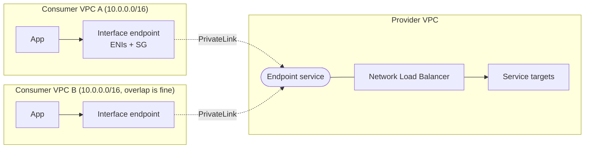
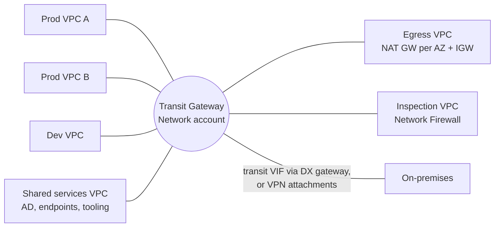
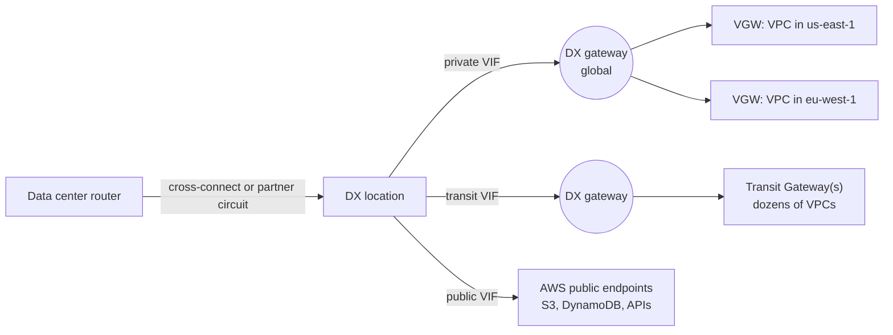
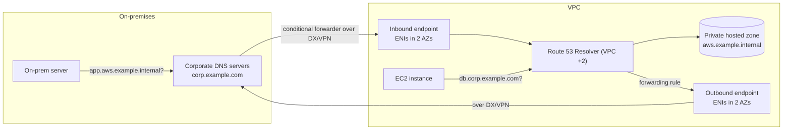

# 02 · Networking and VPC

> [Home](../README.md) · [Study plan](../00-study-plan.md) · Next: [03 Compute & containers](03-compute-containers.md)

| Covers task statements | Est. study time | Hands-on lab | Practice |
|---|---|---|---|
| 1.2, 3.4, 4.4 (plus network parts of 2.2) | ~5 hrs | [Lab 02](../labs/lab-02-custom-vpc.md) | [D1 questions](../practice/d1-secure.md) · [D4 questions](../practice/d4-cost-optimized.md) |

Networking is where developers lose the most points. Most questions don't ask "what is a subnet". They describe a symptom ("instances in the private subnet can't download patches", "the on-prem team can't resolve the private hosted zone", "the NAT bill is huge") and ask for the design change. This module builds up from addressing to multi-VPC and hybrid designs, and ends with the cost paths. Draw the diagrams yourself as you read: the exam rewards people who can picture the packet path.

---

## 1. Global infrastructure that shapes network design

| Construct | What matters for architecture |
|---|---|
| **Region** | Isolated geographic area. Most services and every VPC are Regional. Choose by latency to users, data residency, service availability and price. |
| **Availability Zone** | One or more discrete data centers with independent power and networking, linked by low-latency private fiber. **Subnets live in exactly one AZ.** HA means at least two AZs. |
| **AZ ID vs AZ name** | AZ names (`us-east-1a`) can map to different physical AZs in different accounts. **AZ IDs** (`use1-az1`) are consistent everywhere. Use AZ IDs when aligning resources across accounts (VPC sharing, cross-account latency). |
| **Local Zone** | Extension of a Region into a metro area for single-digit-millisecond latency to local users (opt in, then create a subnet there in your VPC). Subset of services. |
| **Wavelength Zone** | AWS compute inside a telco's 5G network, reached through a **carrier gateway**. For ultra-low latency to mobile devices. |
| **Outposts** | AWS racks/servers in your data center, connected to a parent Region. Subnets can be created on an Outpost. |
| **Edge locations (PoPs)** | Hundreds of sites used by CloudFront, Route 53, Global Accelerator, Shield and Lambda@Edge. You can't put a VPC there. |

Edge services (CloudFront, Global Accelerator) are covered in [module 08](08-ha-dr-edge-ops.md). Compute at the edge (Outposts, Wavelength, Local Zones) is in [module 03](03-compute-containers.md).

---

## 2. IP addressing and CIDR planning

### 2.1 CIDR math refresher

A `/n` prefix leaves `32 − n` host bits, so a block contains **2^(32−n)** addresses. Each step of one bit doubles or halves the size.

| Prefix | Addresses | Usable in an AWS subnet (−5) | Typical use |
|---|---|---|---|
| **/16** | 65,536 | 65,531 | Largest allowed VPC CIDR block |
| /18 | 16,384 | 16,379 | Large EKS subnets |
| /20 | 4,096 | 4,091 | Default VPC subnets |
| /22 | 1,024 | 1,019 | Container-heavy subnets |
| **/24** | 256 | **251** | The "standard" subnet in most diagrams |
| /26 | 64 | 59 | Small tiers |
| /27 | 32 | 27 | Minimum subnet size for an ALB (it also needs at least 8 free IPs) |
| **/28** | 16 | **11** | Smallest allowed subnet and VPC; TGW attachment or firewall subnets |

**The five reserved addresses in every subnet** (example `10.0.1.0/24`):

| Address | Reserved for |
|---|---|
| `10.0.1.0` | Network address |
| `10.0.1.1` | VPC router |
| `10.0.1.2` | DNS (Route 53 Resolver lives at the VPC base + 2; AWS reserves the +2 address in every subnet) |
| `10.0.1.3` | Reserved for future use |
| `10.0.1.255` | Network broadcast (VPCs don't support broadcast, but it's reserved) |

Exam arithmetic: "a subnet must hold 29 instances" → a /27 gives only 27 usable, so you need a **/26**. "How many usable IPs in a /28?" → **11**.

### 2.2 VPC and subnet rules

- IPv4 VPC CIDR: between **/16 and /28**. Use RFC 1918 ranges (`10.0.0.0/8`, `172.16.0.0/12`, `192.168.0.0/16`). `100.64.0.0/10` (shared address space) is allowed as a **secondary** range, often used for EKS pod IPs.
- You **can't change or shrink the primary CIDR**, but you can **add secondary CIDR blocks** (approx. 5 per VPC by default, adjustable). Use this when a VPC runs out of IPs.
- A subnet's CIDR is a subset of the VPC CIDR, can't overlap other subnets, and **can't span AZs**.
- The **default VPC** (`172.31.0.0/16`, a public `/20` per AZ, auto-assigned public IPs) is convenient for tests and wrong for production designs.

### 2.3 Planning for growth and connectivity

- **Never overlap CIDRs** with anything you might connect to: other VPCs (peering and Transit Gateway both require non-overlapping ranges), on-premises networks, partner networks.
- Allocate generously per VPC (e.g., a /16 or /19 per account and Region), and reserve address space per Region and environment.
- **Amazon VPC IPAM** plans, allocates and audits IP space across accounts and Regions (pools shared through RAM), and flags overlaps.
- If overlap is unavoidable (an acquired company, a SaaS partner), the patterns are **PrivateLink** (doesn't care about overlap) or **private NAT gateways** that translate one side.

### 2.4 Public IPv4, Elastic IPs and their cost

- A **public IPv4** is assigned at launch if the subnet's auto-assign setting (or the launch option) says so. It **changes on stop/start**.
- An **Elastic IP (EIP)** is a static public IPv4 owned by your account in one Region. You can remap it to another instance or ENI for manual failover.
- **All public IPv4 addresses are billed hourly** (since Feb 2024), whether auto-assigned or Elastic, in use or idle. Cost levers: put instances behind a load balancer in private subnets, release unused EIPs, use IPv6 where clients support it, and use VPC endpoints instead of public paths. **IPAM Public IP Insights** shows where public IPs are used.
- **BYOIP**: bring your own public ranges (useful when partners allow-list your IPs).

### 2.5 IPv6 and the egress-only internet gateway

- A VPC can get an Amazon-provided **/56** IPv6 block (or IPAM/BYOIP). Subnets typically get a **/64**. A VPC always keeps an IPv4 CIDR, but subnets can be **dual-stack** or **IPv6-only**.
- **All IPv6 addresses are globally unique and publicly routable.** There is no NAT for IPv6. "Private" is achieved with routing and security groups.
- **Egress-only internet gateway (EIGW):** IPv6-only, **stateful**, outbound-initiated traffic only. It's the IPv6 equivalent of NAT for "instances may reach the internet, but nothing may connect in". Route `::/0` → EIGW in private subnets. The EIGW itself has no hourly charge.
- **NAT64 + DNS64:** IPv6-only workloads reach IPv4-only endpoints by routing `64:ff9b::/96` to a NAT gateway and turning on DNS64 in Route 53 Resolver.

---

## 3. Subnets, route tables and gateways

### 3.1 What makes a subnet public

A subnet is **public only because its route table has a route to an internet gateway** (`0.0.0.0/0 → igw-…`). Nothing else about the subnet is "public". For an instance to be reachable from the internet, all of these must be true:

1. Its subnet's route table has a route to the IGW.
2. It has a **public IPv4 or EIP** (or an IPv6 address).
3. The **security group** allows the inbound traffic.
4. The **network ACL** allows the traffic in **and** the return traffic out.

| Subnet type | Default route | Used for |
|---|---|---|
| **Public** | `0.0.0.0/0 → IGW` | Load balancers, NAT gateways, bastions (if any) |
| **Private** (with egress) | `0.0.0.0/0 → NAT GW` (IPv6: `::/0 → EIGW`) | App servers, containers, Lambda ENIs |
| **Isolated / private** (no egress) | None (local only; maybe VPC endpoints) | Databases, caches, sensitive data stores |
| **VPN-only** | `on-prem CIDR → VGW/TGW` | Workloads reachable only from the corporate network |

### 3.2 Route tables and longest-prefix match

- Every VPC has a **main route table**. Subnets not explicitly associated with a custom table use it. Best practice: leave the main table private (local only) and explicitly associate custom tables, so a forgotten subnet is never accidentally public.
- **One route table per subnet**; one route table can serve many subnets.
- Every table has an immutable **local route** for the VPC CIDR(s). Since 2021 you can add routes **more specific than local** to push subnet-to-subnet traffic through a firewall appliance or Network Firewall.
- **Longest prefix match** decides: the most specific route that covers the destination wins, regardless of the order the routes were added.

| Destination | Target |
|---|---|
| `10.0.0.0/16` | local |
| `10.1.0.0/16` | `pcx-…` (peering) |
| `10.1.5.0/24` | `tgw-…` |
| `pl-s3` (S3 prefix list) | `vpce-…` (gateway endpoint) |
| `0.0.0.0/0` | `nat-…` |

A packet to `10.1.5.10` goes to the TGW (the /24 beats the /16). `10.1.9.9` goes over the peering connection. An S3 IP in the prefix list goes to the endpoint (more specific than `0.0.0.0/0`). `8.8.8.8` goes to the NAT gateway.

- For **identical prefixes**, static routes beat propagated ones. Among routes propagated by a virtual private gateway, **Direct Connect routes are preferred over VPN routes**, which is why VPN works as an automatic DX backup.
- **Route propagation**: tick "propagate" on a route table to learn on-prem prefixes from a VGW automatically (BGP).
- **Gateway route tables (edge association)**: a route table associated with the IGW or VGW itself, used for **ingress routing**, i.e., sending inbound internet traffic through a firewall appliance before it reaches the subnet.

### 3.3 Internet gateway

- One per VPC. Horizontally scaled, redundant, highly available, with **no bandwidth limit** you need to design around. It is not an AZ-level single point of failure.
- It performs the 1:1 translation between an instance's private IP and its public IPv4.
- **VPC Block Public Access** (newer) can block internet gateway traffic across a Region's VPCs, with per-VPC or per-subnet exclusions, as an account-level guardrail.

### 3.4 DNS inside the VPC

- **Route 53 Resolver** (`AmazonProvidedDNS`) answers at the VPC base + 2 and at `169.254.169.253`. It resolves public names, VPC-internal hostnames and **private hosted zones** associated with the VPC.
- VPC attributes `enableDnsSupport` and `enableDnsHostnames` **must both be true** for private hosted zones and for **interface endpoint private DNS**. A classic broken-lab cause.
- Hybrid DNS (on-prem ↔ VPC) is [section 12](#12-hybrid-dns-with-route-53-resolver).

---

## 4. Reference design: a 2-AZ three-tier VPC

Learn to draw this from memory; it's the backbone of a third of the exam.

```
                                     Internet
                                        |
                              +---------+---------+
                              |  Internet gateway |
                              +---------+---------+
 VPC 10.0.0.0/16                        |
+---------------------------------------+--------------------------------------+
|                AZ a                   |                AZ b                  |
|  +--------------------------------+   |   +--------------------------------+ |
|  | Public  10.0.0.0/24            |   |   | Public  10.0.1.0/24            | |
|  |  [ALB node]      [NAT GW a]    |   |   |  [ALB node]      [NAT GW b]    | |
|  +--------------------------------+   |   +--------------------------------+ |
|  +--------------------------------+   |   +--------------------------------+ |
|  | Private app  10.0.10.0/24      |   |   | Private app  10.0.11.0/24      | |
|  |  [EC2 in ASG]   sg: app-sg     |   |   |  [EC2 in ASG]   sg: app-sg     | |
|  +--------------------------------+   |   +--------------------------------+ |
|  +--------------------------------+   |   +--------------------------------+ |
|  | Private data 10.0.20.0/24      |   |   | Private data 10.0.21.0/24      | |
|  |  [RDS primary]  sg: db-sg      |   |   |  [RDS standby]  sg: db-sg      | |
|  +--------------------------------+   |   +--------------------------------+ |
|                                                                              |
|  [S3 gateway endpoint]  route in both app route tables (free, no NAT)        |
+------------------------------------------------------------------------------+
```

| Route table | Associated subnets | Routes |
|---|---|---|
| `rt-public` | Public a, Public b | `10.0.0.0/16 → local`, `0.0.0.0/0 → igw` |
| `rt-app-a` | Private app a | `local`, `0.0.0.0/0 → nat-a`, `pl-s3 → vpce-s3` |
| `rt-app-b` | Private app b | `local`, `0.0.0.0/0 → nat-b`, `pl-s3 → vpce-s3` |
| `rt-data` | Private data a, b | `local` only (no internet path at all) |

| Security group | Inbound rule | Why |
|---|---|---|
| `alb-sg` | TCP 443 from `0.0.0.0/0` | Public HTTPS |
| `app-sg` | TCP 8080 from **`alb-sg`** | Only the load balancer can reach the app |
| `db-sg` | TCP 5432 from **`app-sg`** | Only app servers can reach the DB |

Notice that the app and DB rules reference **security groups, not CIDRs**. When the ASG adds instances, nothing needs updating. Two private route tables exist only because each AZ points to **its own** NAT gateway.

---

## 5. NAT: getting private subnets out

### 5.1 The zonal NAT gateway pattern (what the exam tests)

A (public) **NAT gateway** lets instances in private subnets start outbound IPv4 connections (patches, external APIs) while blocking unsolicited inbound connections.

- It is created **in a public subnet** with an **Elastic IP**, and it is **zonal**: redundant inside its AZ, but it fails with that AZ.
- Private subnets send `0.0.0.0/0` to it. **For HA, deploy one NAT gateway per AZ** and give each AZ's private route table a route to its own AZ's NAT gateway.
- Scales automatically (starts at approx. 5 Gbps, up to approx. 100 Gbps). Each NAT IP supports approx. 55,000 simultaneous connections to a single destination. Add secondary IPs if you hit port exhaustion (`ErrorPortAllocation` metric).
- **No security groups** on a NAT gateway. Control traffic with the instances' SGs and the subnet NACLs.
- Billed **per hour plus per GB processed**, on top of normal data transfer. Heavy S3/DynamoDB traffic through NAT is a classic cost mistake ([section 8](#8-vpc-endpoints)).

### 5.2 One shared NAT gateway vs one per AZ

| | One shared NAT GW | One NAT GW per AZ |
|---|---|---|
| Hourly cost | 1 × | N × |
| AZ failure | Private subnets in **every** AZ lose internet egress if the NAT's AZ fails | Each AZ is independent |
| Cross-AZ data | Instances in other AZs pay **inter-AZ data transfer** to reach it | None |
| Fit | Dev/test, cost-sensitive non-critical workloads | **Production / "highly available"** |

The exam guide literally lists this decision. "Most cost-effective" with no HA requirement → shared. "Highly available", "fault tolerant", "survive an AZ failure" → one per AZ.

### 5.3 Regional NAT gateway (new, Nov 2025)

A newer **regional** NAT gateway mode spans AZs automatically and doesn't need a public subnet. It removes the per-AZ wiring. Know it exists, but answer exam questions with the zonal pattern above unless the question explicitly describes the regional mode: practice material and the task statement are written around "a single shared NAT gateway vs NAT gateways in each AZ".

### 5.4 NAT instance, private NAT gateway and others

| | NAT gateway | NAT instance (self-managed EC2) |
|---|---|---|
| Management | AWS-managed, patched, scales | You patch, scale and fail over |
| Availability | HA within its AZ | **Single point of failure** unless you script failover |
| Bandwidth | Up to approx. 100 Gbps | Limited by the instance type |
| Security groups | ❌ | ✅ |
| Can be a bastion / port-forward | ❌ | ✅ |
| Setup detail | — | **Disable source/destination check**; configure iptables masquerading |
| Cost | Hourly + per-GB processing | Instance (+ EIP) only. Cheaper at very small scale. |
| Exam answer | Default | Only for "lowest cost at tiny scale, accept management overhead" or legacy |

- **Private NAT gateway:** no EIP, no internet. It translates private source IPs so that a VPC with overlapping or non-routable ranges can talk to other VPCs or on-prem through a TGW/VGW using a routable range.
- **Egress-only IGW** handles IPv6 outbound ([2.5](#25-ipv6-and-the-egress-only-internet-gateway)). A NAT gateway is not used for IPv6 except NAT64.
- **Centralized egress:** many VPCs → Transit Gateway → one egress VPC with NAT gateways per AZ. Fewer NAT gateways, but you add TGW per-GB processing. It pays off with many small VPCs ([section 17](#17-data-transfer-costs-44)).

---

## 6. Security groups vs network ACLs

### 6.1 Security groups

- Attached to **ENIs**: EC2 instances, load balancers, RDS, ElastiCache, Lambda VPC ENIs, interface endpoints, ECS tasks in `awsvpc` mode.
- **Stateful.** If inbound is allowed, the response is allowed out automatically, and vice versa.
- **Allow rules only.** There is no Deny. You **can't block one specific IP** with an SG: either it's covered by an allow rule or it isn't.
- Rules can reference a CIDR, a **prefix list**, or **another security group**. SG referencing works within a VPC, across **peered VPCs in the same Region**, and (newer) across VPCs attached to the same **Transit Gateway in the same Region** once enabled.
- A new custom SG allows **all outbound and no inbound**. The default SG allows inbound from members of itself.
- Quotas are approx. 60 inbound + 60 outbound rules per SG and approx. 5 SGs per ENI (adjustable).

### 6.2 Network ACLs and ephemeral ports

- Attached to **subnets** (exactly one NACL per subnet). They apply to all traffic **entering or leaving the subnet**, not traffic between instances in the same subnet.
- **Stateless.** Return traffic must be explicitly allowed in the other direction.
- **Allow and Deny rules**, evaluated **in rule-number order, lowest first; the first match wins**. A final `*` rule denies everything else.
- The **default NACL allows everything** in and out. A **new custom NACL denies everything** until you add rules.
- Because they are stateless, you must allow **ephemeral ports** for responses: clients pick a random high source port. Linux uses approx. 32768–60999, Windows 49152–65535, and NAT gateways and ELB use 1024–65535. The safe NACL range is **1024–65535**.

Example: a custom NACL on a public web subnet.

| Direction | Rule # | Protocol / port | Source / dest | Action | Why |
|---|---|---|---|---|---|
| Inbound | 90 | All | `203.0.113.66/32` | **DENY** | Block one abusive IP (an SG can't do this) |
| Inbound | 100 | TCP 443 | `0.0.0.0/0` | ALLOW | Client requests |
| Inbound | 110 | TCP 1024–65535 | `0.0.0.0/0` | ALLOW | Responses to the servers' own outbound calls |
| Inbound | * | All | `0.0.0.0/0` | DENY | Default |
| Outbound | 100 | TCP 1024–65535 | `0.0.0.0/0` | ALLOW | **Responses to clients** (the one everyone forgets) |
| Outbound | 110 | TCP 443 | `0.0.0.0/0` | ALLOW | The servers' own outbound HTTPS calls |
| Outbound | * | All | `0.0.0.0/0` | DENY | Default |

Note that the deny for `203.0.113.66` is rule **90**, before the allow at 100. If it were numbered 200, the allow would match first and the deny would never be evaluated.

### 6.3 Comparison

| | Security group | Network ACL |
|---|---|---|
| Scope | ENI (resource level) | Subnet |
| State | **Stateful** | **Stateless** |
| Rules | Allow only | Allow **and Deny** |
| Evaluation | All rules together; any match allows | Ordered by number; **first match wins** |
| Sources | CIDR, prefix list, **security group** | CIDR only |
| Defaults | New SG: no inbound, all outbound | Default NACL: allow all. Custom NACL: deny all. |
| Applies to | Only the ENIs it's attached to | Everything in the subnet |
| Typical job | Primary, fine-grained micro-segmentation | Coarse subnet guardrail; **explicitly deny IPs/CIDRs** |

Exam heuristics: "block a specific IP address" → NACL deny (or WAF for HTTP at CloudFront/ALB). "Allow only the web tier to reach the DB tier" → SG referencing. "Traffic is allowed in but responses never arrive" → NACL outbound ephemeral ports.

---

## 7. Administrative access: bastion vs Session Manager

| | Bastion host | **SSM Session Manager** | EC2 Instance Connect Endpoint |
|---|---|---|---|
| Inbound ports open | SSH/RDP on the bastion (restricted to corporate IPs) | **None** | None from the internet; target SG allows SSH/RDP from the endpoint |
| Credentials | SSH keys to distribute and rotate | **IAM** only, no keys | IAM-authorized; standard SSH/RDP |
| What the instance needs | SSH daemon, key | SSM Agent, an instance profile with `AmazonSSMManagedInstanceCore`, and a path to the SSM endpoints (NAT, or interface endpoints `ssm` and `ssmmessages`) | A private IP in a VPC with the endpoint |
| Auditing | DIY | Session logs to S3/CloudWatch Logs; CloudTrail | CloudTrail |
| Extra cost | Instance + public IP | No extra charge for sessions | No extra charge |
| Exam answer when | Legacy designs | "Most secure", "no inbound ports", "no SSH keys", "audit every command" | "SSH to private instances with no bastion and no public IP" |

Session Manager also does **port forwarding** (e.g., a local tunnel to a private RDS instance), so a bastion is rarely needed.

---

## 8. VPC endpoints

### 8.1 Gateway vs interface endpoints

VPC endpoints let resources in private subnets reach AWS services **without an IGW, NAT, or public IPs**. Traffic stays on the AWS network.

| | **Gateway endpoint** | **Interface endpoint** (PrivateLink) |
|---|---|---|
| Services | **S3 and DynamoDB only** | Most AWS services (including S3 and DynamoDB), partner/SaaS services, your own endpoint services |
| Mechanism | A **route table entry**: service **prefix list** → `vpce-…` | **ENIs with private IPs** in the subnets/AZs you choose. DNS returns those IPs. |
| Cost | **Free** | **Per hour per AZ + per GB** processed |
| Access control | Endpoint policy | Endpoint policy **+ security groups** on the ENIs |
| Reachable from on-prem (DX/VPN), peered VPCs, TGW-attached VPCs | ❌ **Not transitive**: only from the VPC whose route tables reference it | ✅ It's just an IP in your VPC |
| Region | Same-Region service only | Same Region (cross-Region supported for some endpoint services, newer) |
| DNS | Uses the service's public names; routing does the steering | **Private DNS** makes the standard service name resolve to the endpoint inside the VPC (needs both DNS attributes on) |

A third type, the **Gateway Load Balancer endpoint**, is a route-table target that sends traffic to a GWLB appliance fleet ([section 13](#13-network-security-layers)).

### 8.2 Endpoint policies and locking a bucket to an endpoint

An **endpoint policy** is a resource-style policy on the endpoint that limits *what can be done through it*. It never grants by itself: the caller's IAM policy and the resource policy still apply. Default: full access.

Endpoint policy that stops data exfiltration to foreign buckets:

```json
{
  "Statement": [{
    "Effect": "Allow",
    "Principal": "*",
    "Action": ["s3:GetObject", "s3:PutObject", "s3:ListBucket"],
    "Resource": ["arn:aws:s3:::corp-data-prod", "arn:aws:s3:::corp-data-prod/*"]
  }]
}
```

Bucket policy that makes the bucket reachable **only** through that endpoint:

```json
{
  "Statement": [{
    "Sid": "DenyUnlessThroughOurEndpoint",
    "Effect": "Deny",
    "Principal": "*",
    "Action": "s3:*",
    "Resource": ["arn:aws:s3:::corp-data-prod", "arn:aws:s3:::corp-data-prod/*"],
    "Condition": { "StringNotEquals": { "aws:SourceVpce": "vpce-0a1b2c3d4e5f67890" } }
  }]
}
```

⚠️ A blanket deny like this also locks out console users and CI pipelines that don't come through the endpoint. Add exceptions (e.g., `aws:PrincipalArn` for an admin role) in real designs.

### 8.3 Endpoint patterns

| Need | Pattern |
|---|---|
| Private subnets use S3/DynamoDB heavily; cut the NAT bill | **Gateway endpoint** (free) in each private route table |
| On-prem servers reach S3 privately over DX/VPN | **S3 interface endpoint** (gateway endpoints aren't reachable from on-prem), or a DX public VIF |
| Private subnets with no NAT must call SSM, Secrets Manager, ECR, CloudWatch Logs, STS… | One interface endpoint per service. ECR also needs the **S3 gateway endpoint** for image layers. |
| Dozens of VPCs each need the same 10 interface endpoints | **Centralize** them in a shared-services VPC reached via TGW, with Route 53 private hosted zones associated to the spoke VPCs. Fewer hourly charges, but adds TGW data processing. |
| Restrict which buckets can be reached from a VPC | Endpoint policy listing allowed buckets (or `aws:ResourceOrgID`) |

---

## 9. PrivateLink: exposing your own service

**PrivateLink** lets a provider expose **one service** to many consumer VPCs (other teams, other accounts, SaaS customers) without peering, without routing whole networks, and with **overlapping CIDRs allowed**.



- The provider puts the service behind an **NLB** (or a **GWLB** for appliances) and creates a **VPC endpoint service**. Consumers create **interface endpoints** to it.
- Connections are **consumer-initiated only**. The provider can't open connections back into consumer VPCs.
- The provider controls access with an allow-list of principals and optional **acceptance** of each connection request. A verified **private DNS name** can be offered.
- Scales to thousands of consumers. Consumers pay the endpoint hourly and per-GB charges.
- Exam cues: "SaaS provider must expose an API to customers' VPCs privately", "service consumed by hundreds of VPCs with overlapping CIDRs", "expose only one application, not the whole network" → **PrivateLink**.

(Amazon VPC Lattice is a newer application-layer service-networking option. It's outside the exam's service list.)

---

## 10. Connecting VPCs: peering, Transit Gateway and alternatives

### 10.1 VPC peering

- A **one-to-one** private connection between two VPCs: same or different account, same or different Region.
- **Non-transitive:** A↔B and B↔C does **not** give A↔C. Full mesh needs n(n−1)/2 connections (10 VPCs = 45 peerings).
- **No overlapping CIDRs.**
- **No edge-to-edge routing:** A can't use B's IGW, NAT gateway, VPN/VGW, Direct Connect, or gateway endpoint.
- You must add routes **on both sides** (and allow traffic in SGs/NACLs).
- No gateway, no single point of failure, no bandwidth bottleneck beyond the instances. **No hourly charge**. Data transfer **within the same AZ is free**; cross-AZ and inter-Region data are charged.
- SG referencing works across peered VPCs **in the same Region** only.
- Quota approx. 50 active peerings per VPC by default (adjustable up to approx. 125).

### 10.2 Transit Gateway (TGW)

A **Regional hub router**. Attach VPCs, VPNs, Direct Connect gateways and other TGWs; routing between them is **transitive**, controlled by TGW route tables.

- **Attachments:** VPC (an ENI in one subnet per AZ you choose; use small dedicated /28 subnets), Site-to-Site VPN, **Direct Connect gateway** (via a transit VIF), **TGW peering** (inter-Region or intra-Region; static routes), and **Connect** (GRE + BGP for SD-WAN appliances).
- **Route tables:** each attachment is **associated** with exactly one TGW route table (where its lookups happen) and can **propagate** its routes into any number of tables. This gives **segmentation**: e.g., prod and dev VPCs can both reach shared services and on-prem but not each other. **Blackhole routes** drop traffic explicitly.
- **ECMP over VPN:** multiple VPN tunnels to a TGW can be load-balanced to exceed one tunnel's approx. 1.25 Gbps.
- **Appliance mode:** keeps both directions of a flow in the same AZ when traffic passes through stateful appliances in an inspection VPC.
- **Multicast** support (rarely tested).
- **Sharing:** one TGW in a Network account, shared to other accounts with **RAM**.
- **Pricing:** per attachment-hour **plus per-GB data processing**. This is the cost trade-off against peering.
- Bandwidth per VPC attachment is high (approx. up to 100 Gbps burst), so it's rarely the bottleneck in exam scenarios.



| TGW route table | Associated attachments | Routes it contains | Effect |
|---|---|---|---|
| `rt-prod` | Prod VPC A, Prod VPC B | Propagated: prod VPCs, shared services, on-prem. Static `0.0.0.0/0` → egress VPC | Prod ↔ prod, shared, on-prem, internet |
| `rt-dev` | Dev VPC | Propagated: shared services. Static `0.0.0.0/0` → egress VPC. (Optional blackhole for prod CIDRs.) | **Dev can't reach prod** |
| `rt-shared` | Shared services, egress VPC, on-prem attachment | Propagated: all VPCs | Return paths to everyone |

### 10.3 Choosing a VPC-to-VPC option

| | VPC peering | Transit Gateway | PrivateLink | VPC sharing (RAM) |
|---|---|---|---|---|
| Topology | 1:1 mesh, non-transitive | Hub-and-spoke, **transitive** | Service-level, one-way | Many accounts **inside one VPC** |
| Overlapping CIDRs | ❌ | ❌ (between routed attachments) | ✅ | n/a |
| Scale | Painful beyond a handful of VPCs | Thousands of attachments | Thousands of consumers | Org-wide subnets |
| Cross-Region | ✅ inter-Region peering | ✅ via TGW peering | ✅ for some endpoint services (newer) | ❌ same Region only |
| Hybrid (VPN/DX) reuse | ❌ no edge-to-edge | ✅ one VPN/DX for all VPCs | n/a | ✅ (it's one VPC) |
| SG referencing | ✅ same Region | ✅ same Region (enable it) | ❌ (use the endpoint ENI IPs) | ✅ |
| Cost | No hourly; data transfer only | Attachment-hours + per-GB processing | Endpoint hours + per-GB | No extra |
| Pick when | **Few VPCs**, high throughput, **lowest cost** | **Many VPCs**, hybrid, centralized egress/inspection, segmentation | Expose **one service**, SaaS, overlapping CIDRs | Central network team, fewer VPCs, simple routing |

(AWS Cloud WAN is a managed global WAN built on similar concepts. It's outside the exam's service list.)

---

## 11. Hybrid connectivity

### 11.1 AWS Site-to-Site VPN

- **IPsec** tunnels over the internet between your **customer gateway device** (represented in AWS by a **customer gateway** resource: its public IP and BGP ASN) and either a **virtual private gateway (VGW)**, attached to one VPC, or a **Transit Gateway**.
- **Every VPN connection has two tunnels**, terminating in different AZs on the AWS side. Configure **both**: AWS maintenance can take one down.
- **Routing:** static, or dynamic with **BGP** (preferred: automatic failover, route propagation).
- **Throughput:** approx. 1.25 Gbps per standard tunnel. A VGW doesn't aggregate tunnels. To scale, use a **TGW with ECMP** across multiple VPN connections.
- **Accelerated Site-to-Site VPN:** the tunnels enter the AWS network at the nearest edge location via Global Accelerator, which improves performance over long or unstable internet paths. **TGW attachments only.**
- **VPN CloudHub:** several branch sites each connect to the same VGW (unique BGP ASNs) and can then reach each other through AWS (hub-and-spoke over VPN).
- **Setup in hours**, priced per connection-hour plus data transfer out. It is **encrypted**, but latency and throughput vary with the internet.

### 11.2 AWS Direct Connect (DX)

A **private, dedicated network connection** from your data center (or colocation) to an AWS **Direct Connect location**, then over the AWS backbone. You get consistent latency, high bandwidth, and lower data-transfer-out rates.

**Connection types**

| | Dedicated connection | Hosted connection |
|---|---|---|
| Provisioned by | AWS (a physical port for you at the DX location; you or a partner arrange the cross-connect) | An AWS Direct Connect Partner, from its existing interconnect |
| Speeds | **1, 10, 100, 400 Gbps** | From **50 Mbps** up to multi-Gbps (partner-dependent) |
| VIFs | Multiple | **One VIF per hosted connection** |
| MACsec | ✅ on supported 10/100/400 Gbps ports | ❌ |
| Typical | Large, steady traffic; you're already in a DX colo | Sub-1 Gbps needs, faster provisioning via a partner |

**Lead time:** DX takes **weeks to months** (circuit ordering, cross-connects). "Needs connectivity next week" → **Site-to-Site VPN now**, DX later (and keep the VPN as backup).

**Virtual interfaces (VIFs)** ride on the connection, each a VLAN with a BGP session:

| VIF | Reaches | Terminates on |
|---|---|---|
| **Private VIF** | Private IPs in VPCs | A **VGW** (one VPC) or a **Direct Connect gateway** (many VPCs, many Regions) |
| **Public VIF** | **AWS public service endpoints** (S3, DynamoDB, public APIs, public IPs of your resources) in all commercial Regions. **Not** the general internet. | AWS public network |
| **Transit VIF** | VPCs behind Transit Gateways | A **Direct Connect gateway associated with TGW(s)** |



**Direct Connect gateway (DXGW):** a **global** resource. One private VIF to a DXGW reaches VGWs in **multiple Regions and accounts**; a transit VIF to a DXGW reaches TGWs. The associated VPC CIDRs must not overlap. A DXGW **doesn't route between the VPCs** attached to it (no VPC-to-VPC transit), and it isn't a path between on-prem sites. (**DX SiteLink** is the feature that sends traffic between DX locations over the AWS backbone, for site-to-site.)

**Encryption:** DX is private but **not encrypted by default**. Options:
- **MACsec** (layer 2, line-rate) on supported dedicated connections at supported locations.
- **IPsec Site-to-Site VPN over DX**: over a public VIF to the VPN endpoints, or as a **private IP VPN** over a transit VIF to a TGW.
- Application-level TLS, which is always possible.

**Resilience models** (from AWS's Direct Connect Resiliency Toolkit):

| Model | Layout | Survives | Use |
|---|---|---|---|
| **Maximum resiliency** | **4 connections**: 2 at each of **2 DX locations**, on separate devices | Device, connection **and** location failure | Critical production |
| **High resiliency** | **2 connections at 2 different DX locations** | Location failure | Most production workloads |
| Development and test | 2 connections at **1 location** on separate devices | Device failure, not location | Non-critical |
| **DX + VPN backup** | 1 DX + Site-to-Site VPN | DX failure (at VPN throughput) | **Cost-effective** resilience |

- **Link aggregation group (LAG):** bundles several dedicated connections of the same speed **at the same location** (LACP) into one logical link for more bandwidth. It is **not** location resilience.
- **Cost:** port-hours (dedicated) or partner fees, plus **DX data-transfer-out rates**, lower than internet egress. Inbound is free.

### 11.3 AWS Client VPN

A managed, OpenVPN-based **remote-access** VPN for **people** (laptops), not sites.
- A Client VPN endpoint is associated with subnets (target networks) in a VPC. **Authorization rules** decide which CIDRs each user group can reach.
- Authentication: **Active Directory** (Directory Service), **SAML 2.0** federation (e.g., IAM Identity Center, Okta), or **mutual certificate** authentication.
- **Split tunnel** sends only AWS-bound traffic through the VPN. Users can reach peered VPCs and on-prem networks if routes allow.
- Billed per endpoint-association hour plus per connection-hour.

### 11.4 Hybrid connectivity decision table

| Requirement | Best fit |
|---|---|
| Connect a data center **quickly** (hours/days), modest bandwidth, encrypted | **Site-to-Site VPN** |
| **Consistent latency**, steady high throughput, lower egress cost | **Direct Connect** (dedicated) |
| Less than 1 Gbps, or faster provisioning through a partner | **Hosted** DX connection |
| DX **and** encryption | **MACsec** (dedicated, supported locations) or **IPsec VPN over DX** |
| Cost-effective HA for a DX link | DX primary + **VPN backup** |
| Critical workloads, maximum resilience | Separate DX connections at **2+ DX locations** (max resiliency: 4 connections) |
| One DX to VPCs in several Regions | **DX gateway** with a private VIF (→ VGWs) or transit VIF (→ TGWs) |
| One DX to dozens of VPCs | **Transit VIF → DXGW → Transit Gateway** |
| On-prem reaches S3 privately over DX | **Public VIF**, or an S3 **interface endpoint** over a private/transit VIF |
| Remote employees reach the VPC | **Client VPN** |
| Branch offices interconnect through AWS | **VPN CloudHub** (VGW) or TGW with VPN attachments |
| VPN throughput beyond one tunnel | **TGW + ECMP** across multiple VPN connections |
| VPN from far away over a poor internet path | **Accelerated Site-to-Site VPN** (TGW) |
| Move tens of TB once, link too slow | Offline transfer (Snow Family) or DataSync over DX: [module 09](09-data-analytics-migration.md) |

---

## 12. Hybrid DNS with Route 53 Resolver

On-prem DNS can't query the VPC's `.2` resolver directly, and VPC instances can't resolve `corp.example.com` unless someone forwards those queries. **Route 53 Resolver endpoints** bridge the two over DX/VPN.



| Direction | Component | How |
|---|---|---|
| **On-prem → AWS** (resolve private hosted zones, interface endpoint names) | **Inbound endpoint** | On-prem DNS servers **conditionally forward** the AWS domain to the inbound endpoint's IPs |
| **AWS → on-prem** (resolve corporate names) | **Outbound endpoint + forwarding rules** | A rule says "forward `corp.example.com` to 10.10.0.2 and 10.10.0.3" via the outbound endpoint |
| Many VPCs and accounts | **Share forwarding rules with RAM** and associate them with each VPC | Central DNS team, one set of endpoints |

- Private hosted zones must be **associated** with each VPC that needs them (cross-account association is supported via authorization).
- **Route 53 Resolver DNS Firewall** filters outbound DNS queries (block known-bad or non-approved domains), a cheap DNS-exfiltration control. **Resolver query logging** records the queries.

---

## 13. Network security layers

| Control | Layer | Where it sits | Stateful? | Use for |
|---|---|---|---|---|
| **Security group** | L3/L4 | ENI | ✅ | Resource-level allow lists |
| **Network ACL** | L3/L4 | Subnet | ❌ | Subnet guardrails, explicit IP denies |
| **AWS Network Firewall** | L3–L7: stateless and stateful rules (Suricata-compatible), **domain/FQDN filtering**, IPS signatures, TLS inspection | Firewall endpoints in dedicated subnets; you route traffic through them | Both | Centralized **egress filtering** ("only allow `*.example.com`"), ingress and east-west inspection, IDS/IPS |
| **AWS WAF** | L7 HTTP(S) | CloudFront, ALB, API Gateway, AppSync, Cognito, App Runner, Verified Access | n/a | SQLi/XSS, rate limiting, geo blocking, bots |
| **AWS Shield** | L3/L4 (+L7 with Advanced) | Edge, ELB, EIPs | n/a | DDoS |
| **Route 53 Resolver DNS Firewall** | DNS | VPC resolver | n/a | Block DNS lookups of bad domains |
| **GWLB + third-party appliances** | L3 (GENEVE) | Inspection VPC | Vendor | Keep an existing vendor firewall (Palo Alto, Fortinet…) |
| **Firewall Manager** | Management | Org-wide | n/a | Push WAF, Shield Advanced, SG, Network Firewall and DNS Firewall policies to every account |

**Network Firewall deployment:** a firewall subnet in each AZ holds a firewall endpoint. Route tables send traffic through it: e.g., private subnet `0.0.0.0/0 → firewall endpoint → NAT GW → IGW`, plus an **IGW ingress route table** sending return traffic back through the endpoint. At scale, deploy it once in an **inspection VPC behind a Transit Gateway** (with appliance mode) instead of in every VPC. WAF and Shield details are in [module 07](07-security-data-protection.md).

Exam cues: "filter outbound traffic by domain name" → **Network Firewall** (or DNS Firewall for DNS-level blocking). "Inspect all traffic between VPCs and to the internet centrally" → **TGW + inspection VPC with Network Firewall** (or GWLB + vendor appliances). "Block SQL injection" → **WAF**, never a NACL.

---

## 14. Visibility: VPC Flow Logs and friends

- **VPC Flow Logs** capture **IP traffic metadata** (not payloads) at the **VPC, subnet or ENI** level: source/destination IP and port, protocol, packets, bytes, start/end, and **ACCEPT/REJECT**. Custom formats add fields such as VPC/subnet ID, TCP flags, flow direction, traffic path and the original packet source/destination (useful behind NAT).
- Destinations: **CloudWatch Logs**, **S3** (query with **Athena**), or **Amazon Data Firehose**. Aggregation interval of 1 or 10 minutes, so it's near-real-time, not real-time.
- **Not captured:** traffic to the Amazon DNS resolver, instance metadata (`169.254.169.254`), Amazon Time Sync, DHCP, Windows license activation, and mirrored traffic.
- **Troubleshooting pattern:** inbound **ACCEPT** followed by outbound **REJECT** for the same flow → a **stateless NACL** is blocking the return traffic (an SG would have allowed the response automatically).
- **Traffic Mirroring:** copies **full packets** from an ENI to an NLB or ENI target for IDS or forensics. Use it when payload inspection is required.
- **Reachability Analyzer:** analyzes configuration to tell you whether a path exists between two resources and which component (SG, NACL, route) blocks it. No packets are sent.
- **Network Access Analyzer:** finds unintended network access paths (e.g., "which resources are reachable from the internet?").
- GuardDuty analyzes flow log data on its own; you don't need to enable flow logs for it ([module 07](07-security-data-protection.md)).

---

## 15. Multi-account networking: VPC sharing via RAM

**VPC sharing** lets a central Network account own the VPC, subnets, route tables, NACLs, gateways and endpoints, and **share subnets** through **RAM** with other accounts in the same organization.

- **Participants** launch their own resources (EC2, RDS, Lambda ENIs, load balancers) into the shared subnets. They own and manage those resources and their **security groups**. They **can't** modify the VPC, subnets, route tables or NACLs.
- Resources from different accounts in the same VPC talk over the local route, with no peering or TGW needed, and can reference each other's SGs.
- **Billing:** participants pay for their own resources and their data transfer. The **VPC owner pays** for shared infrastructure such as NAT gateways, VPC endpoints and TGW attachments.
- Same **Region** only. Shared subnets are referenced by **AZ ID** across accounts.
- Benefits: fewer VPCs and TGW attachments, IP space used efficiently, central network governance, and app teams still get account isolation for IAM and billing.
- Exam cue: "many accounts, centralized network management, minimize the number of VPCs and inter-VPC connections, teams keep control of their own resources" → **VPC sharing**.

---

## 16. Load balancers and performance in the VPC (3.4)

**Load balancer placement** (load balancer types in detail are in [module 03](03-compute-containers.md)):
- An **internet-facing ALB** goes in **public subnets in at least two AZs** (ALB requires two). Its targets sit in **private subnets**. The load balancer reaches targets by private IP, so targets need no public IP.
- ALB subnets should be at least **/27** with at least 8 free IPs, because the ALB adds nodes as it scales.
- An **internal ALB/NLB** goes in private subnets (for internal tiers or PrivateLink).
- The target SG references the load balancer's SG ([section 4](#4-reference-design-a-2-az-three-tier-vpc)).
- An NLB gets **one static IP per AZ** (optionally an EIP), which is useful for allow-listing.

**Performance levers:**

| Need | Lever |
|---|---|
| Lowest latency, highest throughput between instances | **Cluster placement group** + **ENA** (enhanced networking) or **EFA** for HPC: [module 03](03-compute-containers.md) |
| Single-flow throughput | Limited per flow (approx. 5 Gbps outside a cluster placement group). Use multiple flows or a placement group. |
| Large packets | **Jumbo frames (MTU 9001)** inside a VPC. Traffic through an IGW or a VPN is limited to 1500 bytes. |
| Global users, static content or APIs | **CloudFront** (caching) or **Global Accelerator** (anycast static IPs, TCP/UDP, fast Regional failover): [module 08](08-ha-dr-edge-ops.md) |
| Consistent on-prem ↔ AWS performance | **Direct Connect**; for VPN over long distances, **accelerated VPN** |
| Many VPCs at high bandwidth | Peering has no aggregate bottleneck. TGW per-attachment bandwidth is high. Either works; choose by cost and topology. |

---

## 17. Data transfer costs (4.4)

Data transfer is the hidden half of most AWS bills, and the exam's cost-optimized network questions are mostly about recognizing the expensive path. Prices below are **approx. us-east-1 list prices** for orientation; check the pricing pages for current values.

| Path | Charge (approx.) |
|---|---|
| Internet → AWS (ingress) | **Free** |
| Same AZ, **private IP** (EC2 ↔ EC2, EC2 ↔ RDS) | **Free** |
| Same AZ, but via a public IP or EIP | Charged like inter-AZ (traffic goes out and back in) |
| **Cross-AZ** within a Region | approx. $0.01/GB **in each direction** |
| VPC peering, same AZ | Free. Cross-AZ: standard inter-AZ rates. Inter-Region: inter-Region rates. |
| **Inter-Region** | approx. $0.02/GB (varies by Region pair) |
| **AWS → internet** | Tiered, approx. $0.09/GB in the first tier. The first 100 GB/month is free across the account. |
| **NAT gateway** | Hourly (approx. $0.045/h) **plus approx. $0.045/GB processed**, plus normal data transfer |
| **Gateway endpoint** (S3, DynamoDB) | **Free** |
| Interface endpoint | approx. $0.01/h per AZ + approx. $0.01/GB |
| Transit Gateway | Per attachment-hour + approx. $0.02/GB processed |
| Direct Connect | Port-hours + DX data-transfer-out (lower than internet) |
| CloudFront | Origin fetches from AWS origins are free; edge delivery per GB is usually cheaper than serving from EC2/S3 directly |
| S3 → EC2 in the same Region | Free data transfer (requests are still charged) |
| RDS Multi-AZ replication | Free (no cross-AZ charge for the synchronous replication) |
| ALB cross-zone | No inter-AZ charge. NLB/GWLB with cross-zone enabled → inter-AZ charges. |
| Public IPv4 address | Hourly per address (approx. $0.005/h), in use or idle |

**Cost optimization patterns:**
1. **S3/DynamoDB from private subnets → gateway endpoints.** They remove NAT processing charges entirely. This is the single most common cost answer in networking.
2. **One NAT gateway per AZ** isn't only for HA: it also stops instances paying cross-AZ charges to reach a NAT in another AZ.
3. **Keep chatty traffic inside an AZ** where HA allows (AZ-affinity routing, consumers reading from same-AZ replicas), but never trade away a stated multi-AZ requirement.
4. **CloudFront in front of S3/ALB** reduces egress cost and origin load.
5. **Direct Connect** for large, steady hybrid egress volumes (lower per-GB rate than the internet).
6. **Centralize** NAT and interface endpoints behind a TGW when you have many small VPCs. Compare the saved hourly charges against TGW per-GB processing.
7. **VPC sharing** avoids duplicate NAT gateways, endpoints and TGW attachments.
8. **Release idle EIPs and public IPv4s**; prefer private subnets behind load balancers; use IPv6 with an egress-only IGW where possible.
9. Use **private IPs**, not public ones, for traffic between instances.

---

## 18. How the exam tests this

| If the question says… | Think… |
|---|---|
| "Instances in a private subnet must download patches; no inbound from the internet" | **NAT gateway** in a public subnet + route `0.0.0.0/0 → NAT` in the private route table |
| "…and it must survive an AZ failure" | **One NAT gateway per AZ**, each AZ's route table pointing to its own |
| "IPv6 instances need outbound-only internet" | **Egress-only internet gateway** |
| "Instance has a public IP but isn't reachable from the internet" | Check the route to the IGW, then the SG, then the NACL (in **and** out) |
| "Block a specific malicious IP" | **NACL deny rule** (numbered before the allows); for HTTP at the edge, WAF |
| "Allow only the app tier to reach the DB" | DB SG inbound **from the app SG** |
| "Responses never arrive after adding a custom NACL" | Missing **ephemeral port** rule (1024–65535) |
| "Private access to S3 / DynamoDB, reduce NAT cost" | **Gateway endpoint** (free) |
| "Private access to SQS / KMS / Secrets Manager / SSM from a subnet with no internet" | **Interface endpoints** |
| "On-prem must reach S3 privately over DX/VPN" | **S3 interface endpoint** (or public VIF), not a gateway endpoint |
| "Bucket accessible only from our VPC" | Bucket policy with **`aws:SourceVpce`** (or `aws:SourceVpc`) |
| "Expose a service to hundreds of customer VPCs, overlapping CIDRs" | **PrivateLink** (NLB-backed endpoint service) |
| "Connect two VPCs cheaply" | **VPC peering** |
| "Connect 50 VPCs and on-prem with central routing and segmentation" | **Transit Gateway** (+ RAM to share it) |
| "VPC A peers with B, B with C; A can't reach C" | Peering is **non-transitive**. Add A↔C peering or use a TGW. |
| "Need connectivity to on-prem within days" | **Site-to-Site VPN** |
| "Consistent low latency, high bandwidth to on-prem" | **Direct Connect** |
| "DX must be encrypted" | **MACsec** or **IPsec VPN over DX** |
| "Cost-effective resilience for DX" | **Backup VPN** |
| "Maximum resilience for DX" | Connections at **two DX locations** (4 connections for maximum) |
| "One DX link to VPCs in several Regions" | **Direct Connect gateway** |
| "On-prem servers must resolve Route 53 private hosted zone names" | **Resolver inbound endpoint** + conditional forwarding on-prem |
| "EC2 must resolve on-prem names" | **Resolver outbound endpoint** + forwarding rules (share via RAM) |
| "Remote employees need access to private resources" | **Client VPN** |
| "Admin access without bastions, open ports or SSH keys" | **SSM Session Manager** |
| "Filter egress traffic by FQDN / central IPS" | **Network Firewall** (inspection VPC behind TGW at scale) |
| "Insert a third-party firewall transparently" | **Gateway Load Balancer** |
| "Troubleshoot why traffic is rejected" | **VPC Flow Logs** (ACCEPT/REJECT), **Reachability Analyzer** |
| "Need packet payloads for IDS" | **Traffic Mirroring** |
| "Central network team; app accounts deploy into common VPCs" | **VPC sharing** via RAM |
| "Reduce data transfer costs between tiers" | Same-AZ private IPs where HA allows; gateway endpoints; CloudFront |

---

## 19. Common traps

- ⚠️ Trap: **A NAT gateway must sit in a public subnet**, and the *private* subnet's route table points to it. Putting the NAT GW in the private subnet is a classic wrong answer. (The new regional mode changes this, but the exam's framing is zonal.)
- ⚠️ Trap: **A single NAT gateway is a single-AZ dependency.** "Highly available" requires one per AZ.
- ⚠️ Trap: **Security groups have no deny rules.** "Use a security group to block an IP" is always wrong.
- ⚠️ Trap: **NACLs are stateless.** If you allow inbound 443, you must also allow outbound ephemeral ports for the responses.
- ⚠️ Trap: **NACL rule order matters.** A deny numbered after a matching allow never fires.
- ⚠️ Trap: **Gateway endpoints are not reachable from on-prem or peered VPCs.** Use interface endpoints for those paths.
- ⚠️ Trap: **Gateway endpoints exist only for S3 and DynamoDB.** "Gateway endpoint for SQS" doesn't exist.
- ⚠️ Trap: **VPC peering is not transitive** and has **no edge-to-edge routing**. A peered VPC can't use your NAT gateway, IGW, VPN or DX.
- ⚠️ Trap: **Overlapping CIDRs break peering and TGW routing.** Only PrivateLink (or private NAT) works around them.
- ⚠️ Trap: **Direct Connect isn't encrypted** and **isn't fast to provision**. Watch for "within a week" and "encrypted" in the question.
- ⚠️ Trap: **Two DX connections at the same location don't survive a location outage.** High resiliency needs two locations.
- ⚠️ Trap: A **LAG** adds bandwidth at one location. It isn't a resilience design.
- ⚠️ Trap: A **public VIF reaches AWS public services, not the internet.**
- ⚠️ Trap: A **VGW can't aggregate VPN tunnels** for more bandwidth. ECMP needs a Transit Gateway.
- ⚠️ Trap: A **DX gateway doesn't route VPC-to-VPC.** Use a TGW or peering for that.
- ⚠️ Trap: Interface endpoint **private DNS needs `enableDnsSupport` and `enableDnsHostnames`** on the VPC.
- ⚠️ Trap: Subnet sizing: **5 IPs are reserved per subnet**. A /28 has 11 usable, a /24 has 251.
- ⚠️ Trap: **Placing Lambda (or anything) in a public subnet doesn't give it internet access** without a public IP. VPC-attached Lambda needs a NAT gateway or VPC endpoints ([module 03](03-compute-containers.md)).
- ⚠️ Trap: **VPC sharing is same-Region and same-org**, and participants can't change route tables or NACLs.
- ⚠️ Trap: Flow logs show **metadata, not payloads**. "Inspect packet contents" → Traffic Mirroring.

---

## 20. Quick self-check

1. How many usable IP addresses does a `/26` subnet have in AWS, and what are the reserved ones used for?
2. A private subnet in AZ b routes `0.0.0.0/0` to a NAT gateway in AZ a. Name two problems.
3. Your app servers in private subnets push 30 TB/month to S3 through a NAT gateway. What's the cheapest fix, and why does it help?
4. A company needs on-prem connectivity in 5 days, and long-term 10 Gbps with consistent latency that survives a DX location failure, at reasonable cost. Outline the plan.
5. On-prem servers can't resolve `orders.internal.example.com`, a Route 53 private hosted zone associated with the VPC. What do you add, and where?

<details>
<summary>Answers</summary>

1. **59** (64 − 5). Reserved: network address, VPC router (+1), DNS (+2), future use (+3), broadcast (last address).
2. (a) **AZ a is a single point of failure** for AZ b's internet egress. (b) AZ b pays **cross-AZ data transfer** on every byte. Fix: a NAT gateway in AZ b and route AZ b's private route table to it.
3. Add an **S3 gateway endpoint** to the private route tables. It's **free**, and S3 traffic no longer passes through the NAT gateway, which removes the per-GB NAT processing charge.
4. **Site-to-Site VPN now** (hours to set up). Order **Direct Connect** 10 Gbps dedicated connections at **two different DX locations** (high resiliency), and keep the VPN as an additional backup. Use a DX gateway (and a TGW via transit VIF if there are many VPCs). Add MACsec or VPN over DX if encryption is required.
5. A **Route 53 Resolver inbound endpoint** in the VPC (ENIs in two AZs), plus a **conditional forwarder** on the on-prem DNS servers for `internal.example.com` pointing at the inbound endpoint's IPs over DX/VPN.

</details>

Practice: [D1 Secure architectures questions](../practice/d1-secure.md) · [D4 Cost-optimized questions](../practice/d4-cost-optimized.md) · Lab: [Lab 02 Custom VPC](../labs/lab-02-custom-vpc.md)
