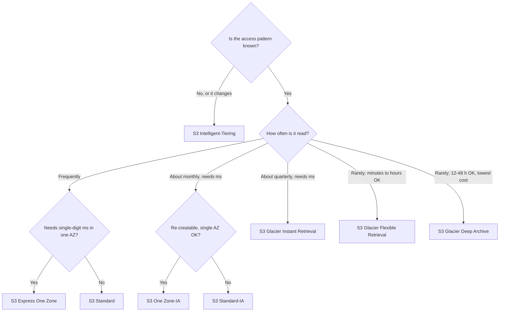
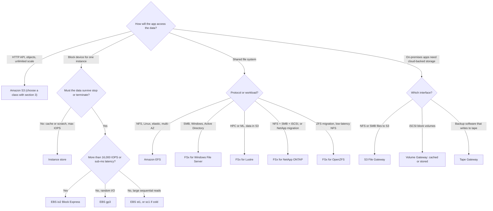

# 04 · Storage: S3, EBS, EFS, FSx, Storage Gateway, AWS Backup
> [Home](../README.md) · [Study plan](../00-study-plan.md) · Next: [05 Databases](05-databases.md)

| Covers task statements | Est. study time | Hands-on lab | Practice |
|---|---|---|---|
| 1.3, 3.1, 4.1, 2.2 | ~3.5 hrs | [Lab 04](../labs/lab-04-s3-cloudfront.md) | [D3 questions](../practice/d3-high-performing.md) · [D4 questions](../practice/d4-cost-optimized.md) |

> **New to AWS?** Read these plain-English pages first: [Storage services](../beginner/services/storage.md). Look up unfamiliar terms in the [glossary](../beginner/glossary.md).

Storage comes up in every domain. D3 asks which volume, file system or S3 feature meets a performance target. D4 asks for the cheapest class or tier that still fits the access pattern. D1 asks how the data is encrypted, locked and kept private. D2 asks how it survives the loss of an AZ or a Region. You'll rarely be asked what a service is. You'll be asked to pick the cheapest option that still meets a latency, durability or compliance constraint.

---

## 1. Object vs block vs file

| | Object: **Amazon S3** | Block: **Amazon EBS**, instance store | File: **Amazon EFS**, **Amazon FSx** |
|---|---|---|---|
| Interface | HTTPS REST API (PUT/GET/LIST) | Raw block device; the OS formats it | Mounted share over NFS or SMB (ONTAP also does iSCSI) |
| Sharing | Any number of clients, anywhere they have network access and permissions | One instance (io1/io2 Multi-Attach is the exception) | Thousands of concurrent clients, across AZs (EFS Regional, FSx Multi-AZ) |
| Write model | Whole-object PUT; no in-place edit or append | In-place block writes | In-place byte-range writes, locks, POSIX/NTFS permissions |
| Failure scope | Region (≥3 AZs), except the One Zone classes | Single AZ | Region (EFS Regional, FSx Multi-AZ) or single AZ |
| Capacity model | Unlimited; pay per GB-month stored | Provisioned size; you pay for it whether or not you use it | EFS: elastic, pay for what you use. FSx: provisioned capacity |
| Latency | Milliseconds; single-digit ms with Express One Zone | Sub-ms (io2 Block Express, instance store) to low ms | Low ms (EFS); sub-ms on SSD-backed FSx |
| Natural fit | Data lakes, backups, media, static web assets, logs, ML datasets | Boot volumes, self-managed databases, transactional apps | Shared content, home directories, CMS, lift-and-shift apps that expect a file system, HPC |

**Exam reflex:** match the nouns in the question.
- "Shared file system for Linux instances across AZs" → EFS.
- "SMB", "Windows", "Active Directory" or "NTFS ACLs" → FSx for Windows File Server.
- "Boot volume" or "database on one instance" → EBS.
- "Temporary", "scratch", "buffer" or "highest IOPS, data loss acceptable" → instance store.
- "Unlimited", "static", "archive" or "data lake" → S3.

---

## 2. S3 essentials

- **Strong read-after-write consistency** applies to every PUT, overwrite, DELETE and LIST. An answer that works around "eventual consistency" is out of date.
- Bucket names are globally unique, but each bucket and its data live in **one Region**. Data leaves that Region only if you replicate or copy it.
- The key space is flat. "Folders" are just **prefixes**, and prefixes matter for performance (§10) and as filters for lifecycle, replication and event notifications.
- Max object size is **50 TB** (raised from 5 TB in Dec 2025, so older questions may still say 5 TB) and a single PUT can be at most **5 GB**. Use **multipart upload for anything over ~100 MB**; it's mandatory above 5 GB.
- Every class has **11 nines of durability**, but *availability* differs by class (§3). The One Zone classes lose data if their AZ is destroyed.
- New buckets start with **Block Public Access on, ACLs disabled (Object Ownership = bucket owner enforced) and SSE-S3 default encryption**.
- There are two bucket types you need to know. *General purpose buckets* are the default and are what this module means unless stated. *Directory buckets* are used by S3 Express One Zone and have different naming and session-based auth. Table buckets (S3 Tables, for Apache Iceberg) are an analytics feature you're unlikely to meet on SAA-C03.

---

## 3. S3 storage classes

| Class | AZs | Min storage duration | Min billable object size | First-byte latency | Retrieval fee | Designed availability | Typical use case |
|---|---|---|---|---|---|---|---|
| **S3 Standard** | ≥3 | None | None | ms | None | 99.99% | Hot data, web/mobile content, analytics |
| **S3 Intelligent-Tiering** | ≥3 | None | Objects <128 KB aren't auto-tiered (always billed at the Frequent rate) | ms (hours for the opt-in archive tiers) | **None**; small monthly monitoring fee per object | 99.9% | **Unknown or changing access patterns** |
| **S3 Standard-IA** | ≥3 | **30 days** | 128 KB | ms | Per GB | 99.9% | Read about monthly but needs instant access: backups, DR copies |
| **S3 One Zone-IA** | **1** | **30 days** | 128 KB | ms | Per GB | 99.5% | **Re-creatable** infrequent data, secondary copies, replicas |
| **S3 Glacier Instant Retrieval** | ≥3 | **90 days** | 128 KB | **ms** | Per GB (higher than IA) | 99.9% | Archive read about once a quarter that still needs instant access (medical images, news archives) |
| **S3 Glacier Flexible Retrieval** | ≥3 | **90 days** | ~40 KB overhead per object | **Expedited 1–5 min · Standard 3–5 h · Bulk 5–12 h** | Per GB per tier; **Bulk is free** | 99.99% | Backups and archives where minutes to hours is fine |
| **S3 Glacier Deep Archive** | ≥3 | **180 days** | ~40 KB overhead per object | **Standard within 12 h · Bulk within 48 h** | Per GB | 99.99% | Compliance retention for 7–10+ years; tape replacement; the cheapest class |
| **S3 Express One Zone** | **1 (you pick the AZ)** | None | None | **Single-digit ms** | None (requests plus a per-GB charge on large requests) | 99.95% | Latency-critical, request-heavy work (ML training, interactive analytics, HPC scratch) with compute in the **same AZ** |

### Intelligent-Tiering tiers
| Tier | Object moves in after | Access latency | Activation |
|---|---|---|---|
| Frequent Access | Default | ms | Automatic |
| Infrequent Access | 30 consecutive days with no access | ms | Automatic |
| Archive Instant Access | 90 days with no access | ms | Automatic |
| Archive Access | 90–730 days (you configure) | 3–5 h | **Opt-in** |
| Deep Archive Access | 180–730 days (you configure) | Within 12 h | **Opt-in** |

Any access moves an object back to Frequent Access. There are **no retrieval fees** and no lifecycle rules to write, so it's the low-overhead answer whenever the access pattern is unpredictable. It isn't the answer when the pattern is *known*. For example, "accessed for 30 days, then never" is cheaper with an explicit lifecycle rule straight to a Glacier class, with no monitoring fee.

### Cost mechanics the exam assumes you know
- **Minimum storage duration.** If you delete, overwrite or transition an object early, you still pay for the remaining days.
- **Minimum billable size.** The IA classes and Glacier IR bill every object as at least 128 KB. Glacier Flexible Retrieval and Deep Archive add ~40 KB of index and metadata per object, part of it billed at the Standard rate. Millions of tiny objects in Glacier cost more than you'd expect, so bundle them (tar/zip) first.
- **Per-object request and transition charges.** Lifecycle transitions are billed per object.
- In short, IA and Glacier only save money on objects that are **large enough, kept long enough and read rarely enough**.

### Restores and uploads
- Objects in Glacier Flexible Retrieval and Deep Archive (and in the Intelligent-Tiering archive tiers) can't be read until you call `RestoreObject`. S3 creates a temporary copy for the number of days you ask for, and you pay for the archive and the copy. A restore can fire an event notification when it finishes (`s3:ObjectRestore:Completed`).
- Expedited retrievals are best-effort unless you buy **provisioned capacity**.
- Glacier IR and Archive Instant Access need **no restore**; they're readable in milliseconds.
- You can upload straight into any class with the storage-class header. Data doesn't have to land in Standard first.



---

## 4. Lifecycle rules

| Action | What it does | Typical use |
|---|---|---|
| **Transition** | Moves current versions to a cheaper class after N days or on a date | Standard → Standard-IA at 30 d → Glacier Flexible at 90 d |
| **Expiration** | Deletes current versions after N days. On a versioned bucket it adds a delete marker instead | Delete logs after 1 year |
| **Noncurrent version transition / expiration** | The same, for previous versions, counted from when each became noncurrent. `NewerNoncurrentVersions` keeps the latest N | Keep 3 old versions and expire the rest after 30 days |
| **Expired object delete marker removal** | Removes delete markers that have no versions behind them | Keeps versioned buckets clean and LISTs fast |
| **AbortIncompleteMultipartUpload** | Deletes the parts of uploads that weren't completed within N days | Stops you paying for orphaned parts you can't see. **Put it on every bucket** |

Rules can be filtered by prefix, object tags, object size (min/max), or apply to the whole bucket.

```json
{
  "Rules": [{
    "ID": "logs-tiering",
    "Status": "Enabled",
    "Filter": { "Prefix": "logs/" },
    "Transitions": [
      { "Days": 30,  "StorageClass": "STANDARD_IA" },
      { "Days": 90,  "StorageClass": "GLACIER" },
      { "Days": 365, "StorageClass": "DEEP_ARCHIVE" }
    ],
    "Expiration": { "Days": 2555 },
    "NoncurrentVersionExpiration": { "NoncurrentDays": 30, "NewerNoncurrentVersions": 3 },
    "AbortIncompleteMultipartUpload": { "DaysAfterInitiation": 7 }
  }]
}
```
In the API, `GLACIER` means Glacier Flexible Retrieval and `GLACIER_IR` means Glacier Instant Retrieval.

**Rules the exam tests:**
- **The 30-day rule.** Objects must be at least **30 days** old before a lifecycle rule can move them to Standard-IA or One Zone-IA, so "transition to Standard-IA after 7 days" is invalid. If you need cheaper storage sooner, upload to IA directly, use Intelligent-Tiering, or transition to a Glacier class, which has no such wait.
- Transitions only go **one way down** the waterfall: Standard → Standard-IA → Intelligent-Tiering → One Zone-IA → Glacier IR → Glacier Flexible → Deep Archive. Nothing transitions back up. To bring data back to a warmer class, restore it and copy it.
- Minimum-duration charges still apply between transitions. An object that spends only 15 days in Standard-IA before its next transition is billed for the other 15.
- By default, lifecycle **won't transition objects smaller than 128 KB**, because the move would cost more than it saves. A size filter can override this.
- Lifecycle runs asynchronously. Billing switches once an object is eligible, even if the physical move lags.
- **S3 Storage Class Analysis** watches the access pattern of a prefix or tag and tells you when a Standard-IA transition would pay off. Use it to *choose* the rule's day count.

---

## 5. Versioning and MFA Delete

- A bucket is **unversioned → enabled → suspended**. It can never go back to unversioned. Objects that existed before versioning get the version ID `null`.
- A DELETE **without** a version ID adds a **delete marker**. The object looks deleted, but the older versions are kept and still billed. Delete the marker to "undelete" the object.
- A DELETE **with** a version ID is **permanent**.
- Every version is billed as a full object, so pair versioning with noncurrent-version lifecycle rules.
- **MFA Delete** requires an MFA code to (a) permanently delete a version and (b) change the versioning state. Only the **bucket owner's root user** can enable it, and only through the CLI/SDK/API, not the console.
- Versioning is a **prerequisite** for replication, Object Lock, MFA Delete and AWS Backup of S3.

---

## 6. Replication

| | **Cross-Region Replication (CRR)** | **Same-Region Replication (SRR)** |
|---|---|---|
| Destination | A bucket in another Region | A bucket in the same Region |
| Typical drivers | DR; lower latency for distant users; a compliance rule asking for a copy far away | Collecting logs into one bucket; syncing prod data to test; data residency (must stay in-Region); an isolated copy in another account for ransomware protection |

**Requirements**
- **Versioning on both the source and the destination.**
- An IAM role that S3 assumes to read the source and write to the destination.
- Cross-account replication also needs the destination bucket policy to trust that role. If the destination has ACLs disabled (bucket owner enforced), the destination account owns the replicas automatically.
- If the source uses Object Lock, the destination must use it too.
- SSE-KMS objects are replicated only if you opt in and name a destination KMS key. The role needs `kms:Decrypt` on the source key and `kms:Encrypt` on the destination key.

| What happens to… | Replicated? |
|---|---|
| New objects written after the rule exists | ✅ Asynchronously; most within minutes |
| **Objects that existed before the rule, or that failed** | ❌ by default. Use **S3 Batch Replication** |
| Metadata, tags, Object Lock retention settings | ✅ |
| **Delete markers** (DELETE without a version ID) | ❌ by default; ✅ if you enable delete marker replication (not available with tag-based filters) |
| **Deletes of a specific version ID** | ❌ **Never**, so a malicious delete in the source can't wipe the replica |
| Replicas of replicas (A→B→C) | ❌ Not transitive by default (Batch Replication can do it) |
| Bucket-level settings (lifecycle rules, policies) | ❌ Configure each bucket yourself |

- **S3 Replication Time Control (RTC)** replicates **99.99% of new objects within 15 minutes, backed by an SLA**. It comes with replication metrics and notifications for objects that miss the threshold. Choose it when a question asks for predictable or compliance-grade replication time.
- **Two-way replication:** create a rule in each direction and turn on *replica modification sync* so metadata changes flow both ways.
- **S3 Multi-Region Access Points** give you one global endpoint over buckets in several Regions. Requests are routed to the closest bucket, and failover controls let you run active/active or active/passive. Pair them with two-way CRR. More DR patterns are in [module 08](08-ha-dr-edge-ops.md).

---

## 7. Object Lock and Glacier Vault Lock

**S3 Object Lock** is WORM (write once, read many) protection for individual object *versions*. It requires versioning, which is turned on automatically, and it can be enabled on new or existing buckets.

| | **Governance mode** | **Compliance mode** | **Legal hold** |
|---|---|---|---|
| Who can delete or shorten retention | Principals with `s3:BypassGovernanceRetention` who send the bypass header | **Nobody, including the root user**, until the retention date passes | Anyone with `s3:PutObjectLegalHold` can remove the hold |
| Retention period | Yes (days or years; can be the bucket default) | Yes; it can be **extended but not shortened**, and the mode can't be changed | **No expiry**; it lasts until removed |
| Use for | Protection against accidents while admins keep an escape hatch; testing retention settings | Regulations such as SEC 17a-4, FINRA, or "must be immutable for 7 years" | Litigation or investigation holds of unknown length |

- A legal hold is independent of retention. An object version can have both, and it's protected while either applies.
- Under Object Lock, a plain DELETE still **succeeds** and adds a delete marker. The *locked version* underneath stays intact. Questions sometimes describe this as "users can still delete objects".
- Set a **default retention** on the bucket so every new object is locked automatically.

**S3 Glacier Vault Lock** applies to the older, vault-based S3 Glacier service. You write a vault lock policy (for example, "deny delete for archives younger than 365 days") and **initiate** the lock. You then have **24 hours** to test it and **complete** the lock, after which the policy is **immutable**. New designs normally use the Glacier *storage classes* inside S3 buckets with Object Lock instead.

---

## 8. Encryption

| Option | Who manages the key | Key-use audit trail | Choose when / notes |
|---|---|---|---|
| **SSE-S3** | S3 (AES-256) | No per-key audit | **The default for all new objects since Jan 2023**. No effort and no extra cost |
| **SSE-KMS** | AWS KMS, using the AWS managed key `aws/s3` or a **customer managed key** | ✅ Every KMS call is logged in CloudTrail | **Separation of duties** (the key policy decides who can decrypt), rotation, revocation, audit. Adds KMS request charges and counts against KMS quotas |
| **DSSE-KMS** | KMS, with two independent layers of encryption | ✅ | Rules that mandate **dual-layer** encryption (e.g., some US government and defense standards). Costs more and doesn't support Bucket Keys |
| **SSE-C** | **You** send the key with every request; S3 uses it and then discards it | Your responsibility | Requires HTTPS. If you lose the key, you lose the data. Since **April 2026, SSE-C is disabled by default on new buckets**. Uploads using it get a 403 until you enable it with `PutBucketEncryption`. Older questions may still offer SSE-C as a normal choice. |
| **Client-side** | You (e.g., AWS Encryption SDK or Amazon S3 Encryption Client, with keys in KMS or elsewhere) | Your responsibility | The data must never reach AWS as plaintext |

- **Cross-account access to SSE-KMS objects needs a customer managed key.** You can't edit the key policy of the AWS managed `aws/s3` key, so you can't grant another account `kms:Decrypt` on it.
- **KMS throttling.** With SSE-KMS, every PUT calls `GenerateDataKey` and every GET calls `Decrypt`. Both count against the account's per-Region KMS request quota, so very high request rates can be throttled.
- **S3 Bucket Keys** fix this. S3 gets a short-lived bucket-level key from KMS and derives the per-object keys locally, which **cuts KMS requests and cost by up to 99%**. CloudTrail then shows the bucket ARN, not each object ARN, as the encryption context. Turn them on for any high-volume SSE-KMS bucket.
- Default encryption only affects **new** objects. Changing it doesn't re-encrypt what's already there; to do that, run an S3 Batch Operations copy-in-place (find the targets with S3 Inventory).
- A bucket policy can enforce encryption. Deny `s3:PutObject` unless `s3:x-amz-server-side-encryption` is `aws:kms`, and optionally pin a key with `s3:x-amz-server-side-encryption-aws-kms-key-id`.
- To enforce encryption **in transit**, deny any request where `aws:SecureTransport` is false:

```json
{ "Sid": "DenyInsecureTransport", "Effect": "Deny", "Principal": "*", "Action": "s3:*",
  "Resource": ["arn:aws:s3:::example-bucket", "arn:aws:s3:::example-bucket/*"],
  "Condition": { "Bool": { "aws:SecureTransport": "false" } } }
```
KMS internals (envelope encryption, key policies, grants, multi-Region keys) are covered in [module 07](07-security-data-protection.md).

---

## 9. Access control

| Control | Scope | Use it for |
|---|---|---|
| **IAM identity policies** | Principals in your account | What your users and roles may do in S3 |
| **Bucket policy** | One bucket (resource-based, max 20 KB) | Cross-account access; enforcing TLS or encryption; restricting by VPC endpoint, IP or organization (`aws:PrincipalOrgID`) |
| **Block Public Access** | Account and bucket | A guardrail that **overrides** any policy or ACL that would grant public access |
| **Object Ownership** | Bucket | **Bucket owner enforced** (the default) disables ACLs, so the bucket owner owns every object |
| ACLs | Bucket or object (legacy) | Avoid. Keep them only for rare legacy needs |
| **Access points** | A named endpoint per app or team, each with its own policy, optionally **VPC-only** | Replacing one huge bucket policy on a shared data lake |
| **Multi-Region Access Points** | One global endpoint over replicated buckets | Lowest-latency routing and Regional failover |
| **Presigned URLs** | One object, for a limited time | Temporary upload or download for users who have no AWS credentials |
| **VPC endpoint policy** | The endpoint | Limiting which buckets the VPC can reach (data-exfiltration control) |
| **CloudFront OAC** | The bucket policy grants one CloudFront distribution | Serving a private bucket through a CDN (see [module 08](08-ha-dr-edge-ops.md)) |

**How access is evaluated**
- **Same account:** a request is allowed if the IAM policy *or* the bucket policy allows it, nothing explicitly denies it, and Block Public Access doesn't block it.
- **Cross-account:** *both* sides must allow it. The bucket policy must name the external principal, *and* the caller's own IAM policy must allow the action. The alternative is for the caller to assume a role in the bucket owner's account.
- An **explicit deny** anywhere wins. That includes SCPs/RCPs, permissions boundaries, VPC endpoint policies and the **KMS key policy**. "Access denied" on an SSE-KMS object usually means `kms:Decrypt` is missing.

**Restricting a bucket to a VPC endpoint**
```json
{ "Sid": "DenyUnlessViaMyEndpoint", "Effect": "Deny", "Principal": "*", "Action": "s3:*",
  "Resource": ["arn:aws:s3:::example-bucket", "arn:aws:s3:::example-bucket/*"],
  "Condition": { "StringNotEquals": { "aws:SourceVpce": "vpce-0abc1234def567890" } } }
```
- `aws:SourceVpce` matches one specific endpoint. `aws:SourceVpc` matches any endpoint in a VPC.
- **`aws:SourceIp` doesn't match traffic that arrives through a VPC endpoint**, because that traffic uses private IPs. Use the VPC conditions instead.
- A blanket Deny like this one also locks out administrators and the console. Exempt an admin role with an `aws:PrincipalArn` condition.
- The **gateway endpoint** for S3 is free, same-Region only and works through route tables. **Interface endpoints** (PrivateLink) cost per hour and per GB, but they can be reached from on-premises over Direct Connect or VPN and from peered VPCs. See [module 02](02-networking-vpc.md).

**Presigned URLs**
- A presigned URL carries the **signer's** permissions. If the signer loses access, the URL stops working.
- A URL signed with an IAM user's long-term keys (SigV4) can last up to **7 days**. A URL signed with **temporary credentials** (a role or STS) stops working when those credentials expire, so a URL generated inside Lambda can't outlive the function's session.
- For uploads, use a presigned PUT or a presigned POST. A POST policy can also limit the object's size and content type.
- S3 Access Grants map directory identities (via IAM Identity Center) to S3 prefixes at scale. It's useful to know it exists, but it's rarely the answer.

---

## 10. S3 performance

- **3,500 PUT/COPY/POST/DELETE and 5,500 GET/HEAD requests per second per prefix**, with no limit on the number of prefixes. Spreading reads across 10 prefixes gives ~55,000 GET/s. S3 adds partitions automatically. During a sudden ramp-up you can see `503 Slow Down`; retry with exponential backoff.
- **Multipart upload** sends parts in parallel (5 MiB–5 GiB each, up to 10,000 parts). Only failed parts are retried, and an upload can start before the total size is known.
- **S3 Transfer Acceleration** brings uploads and downloads into AWS at the nearest edge location and carries them over the AWS backbone. Clients use the `<bucket>.s3-accelerate.amazonaws.com` endpoint, and the bucket name must be DNS-compliant with no dots. The extra per-GB fee is charged only when the transfer is actually faster. Use it for long-distance transfers into a single bucket.
- **Byte-range fetches** split a GET into parallel range requests for more throughput. They also let you read only the header of a large file and retry a small range instead of the whole object.
- **S3 Select and Glacier Select are closed to new customers.** Query data in S3 with **Athena** instead ([module 09](09-data-analytics-migration.md)).
- **SSE-KMS** can throttle at high request rates; turn on **S3 Bucket Keys** (§8).
- **CloudFront** in front of S3 caches at the edge for read-heavy global traffic and cuts GET costs.
- **S3 Express One Zone** gives single-digit-ms latency and very high request rates for compute placed in the same AZ.
- On the client side, use many parallel connections. The AWS CRT-based transfer managers, and **Mountpoint for Amazon S3** (which mounts a bucket as a local file system for read-heavy Linux workloads), parallelize for you.

---

## 11. Events, website hosting, Requester Pays, Storage Lens, Batch Operations

### Event notifications
| Destination | Notes |
|---|---|
| Amazon SNS (standard topics) | Fan out to many subscribers |
| Amazon SQS (standard queues) | Buffer events for a pool of workers |
| AWS Lambda | Process each event directly |
| **Amazon EventBridge** | Turn it on once per bucket, and *all* events go to the default event bus. Rules then add **advanced filtering** (key patterns, size, metadata), **multiple targets** (including SQS FIFO and Step Functions), archive/replay and cross-account routing |

- Direct destinations need a resource policy that allows `s3.amazonaws.com`: an SNS topic policy, an SQS queue policy, or a Lambda resource-based permission.
- Direct notifications can't target FIFO queues or FIFO topics. Route through EventBridge if you need FIFO.
- Two notification rules for the same event type can't overlap on prefix/suffix. To send one event to several places, use SNS fan-out or EventBridge.
- Events usually arrive within seconds but can take a minute or more, and delivery is at-least-once. On an unversioned bucket, two simultaneous writes to the same key can produce only one notification. Enable versioning if every write must produce an event.

### Static website hosting
- The **website endpoint** is **HTTP only**. It supports index and error documents and redirect rules, and it needs public read access (Block Public Access off for that bucket, plus a bucket policy).
- For HTTPS, a custom domain with TLS, or a **private** bucket, put **CloudFront with OAC** in front of the bucket's REST endpoint and leave Block Public Access on. OAC doesn't work with the website endpoint, which CloudFront treats as a custom origin.
- A Route 53 alias straight to a website endpoint only works if the **bucket name equals the host name** (e.g., `www.example.com`).
- If JavaScript on another domain calls the bucket, configure **CORS** on the bucket.

### Requester Pays
The **requester** pays for requests and data transfer, and the bucket owner still pays for storage. Requesters must be authenticated AWS identities (no anonymous access) and must send `x-amz-request-payer: requester`. It's the standard way to share large datasets with other accounts without paying for their downloads.

### S3 Storage Lens
Organization-wide dashboards across accounts and Regions. The free metrics cover usage. The paid advanced metrics add activity data, prefix-level detail, CloudWatch publishing and recommendations. Use it to find buckets with no lifecycle rules, bytes stuck in incomplete multipart uploads, noncurrent-version bloat, unencrypted or unreplicated buckets, and cold buckets that could move to a cheaper class.

### S3 Batch Operations and S3 Inventory
- **Batch Operations** runs one job over millions or billions of objects listed in a manifest (an S3 Inventory report or a CSV). Supported operations include **copy** (re-encrypt, change storage class, copy cross-account), **invoke Lambda**, replace or delete tags, **restore from Glacier**, set **Object Lock retention or legal holds**, and **replicate** (Batch Replication). It handles retries, tracks progress and writes a completion report.
- **S3 Inventory** delivers a daily or weekly list of objects and their metadata (encryption status, storage class, replication status) as CSV, ORC or Parquet. You can query it with Athena.

---

## 12. Amazon EBS

| Type | Family | Size | Max IOPS | Max throughput | Multi-Attach | Bootable | Use |
|---|---|---|---|---|---|---|---|
| **gp3** | General purpose SSD | 1 GiB–64 TiB | **80,000** (3,000 baseline at any size) | **2,000 MiB/s** (125 baseline) | ❌ | ✅ | **The default.** Boot volumes, most databases, dev/test |
| gp2 | General purpose SSD (previous gen) | 1 GiB–16 TiB | 16,000 (3 IOPS/GiB; volumes under 1 TiB can burst to 3,000) | 250 MiB/s | ❌ | ✅ | Legacy. Migrate it to gp3 |
| **io2 Block Express** | Provisioned IOPS SSD | 4 GiB–64 TiB | **256,000** | **4,000 MiB/s** | ✅ | ✅ | Mission-critical databases (SAP HANA, Oracle, SQL Server), **sub-ms latency, 99.999% durability** |
| io1 | Provisioned IOPS SSD (previous gen) | 4 GiB–16 TiB | 64,000 | 1,000 MiB/s | ✅ | ✅ | Legacy. Prefer io2 |
| **st1** | Throughput-optimized HDD | 125 GiB–16 TiB | n/a (throughput-based) | 500 MiB/s | ❌ | **❌** | Large sequential I/O: big data, log processing, Kafka |
| **sc1** | Cold HDD | 125 GiB–16 TiB | n/a | 250 MiB/s | ❌ | **❌** | The cheapest; infrequent sequential access |

**Rules of thumb:** more than 16,000 IOPS on one volume, or sub-ms latency → **io2 Block Express**. That's the classic rule from when gp3 topped out at 16,000. gp3 now reaches 80,000, so in a newer cost-focused question that needs, say, 30,000 IOPS without sub-ms latency or Multi-Attach, gp3 can be the answer. "Cut EBS cost without losing performance" → **gp2 to gp3**. gp3 costs up to ~20% less per GB and lets you set IOPS and throughput independently of size, so nobody has to over-size a gp2 volume just to get IOPS. Big sequential scans on a budget → st1. Cold data that still has to sit on a block device → sc1.

**Behaviors that matter**
- **EBS is AZ-scoped.** A volume and its instance must be in the same AZ. To move a volume, snapshot it and create a new volume from the snapshot in the target AZ (copy the snapshot first to change Region).
- EBS replicates within its AZ. This protects against hardware failure but not against losing the AZ.
- A root volume's `DeleteOnTermination` defaults to **true**; extra volumes default to **false**.
- **Elastic Volumes** change size, type, IOPS and throughput while the volume is in use. You then grow the file system yourself. Volumes can't shrink; to go smaller, create a new volume and copy the data.
- **The instance caps performance.** Every instance type has a maximum EBS bandwidth and IOPS, so a 256,000-IOPS volume attached to a small instance won't deliver 256,000 IOPS.
- RAID 0 across volumes adds throughput beyond what one volume gives. RAID 1 adds nothing, because EBS already replicates.

### Snapshots
- Snapshots are stored in S3 (managed by AWS, not visible in your buckets) and are **Regional** and **incremental**: each one stores only the blocks that changed. Deleting a snapshot removes only blocks that no other snapshot needs, so any remaining snapshot can still restore the full volume.
- A snapshot is point-in-time and **crash-consistent**. For *application* consistency, flush or freeze I/O first, or use VSS on Windows. Multi-volume snapshots capture all of an instance's volumes at the same moment.
- Snapshots can be **copied across Regions** (DR, migration) and **shared across accounts**. To share an encrypted snapshot, it must use a **customer managed KMS key** that the other account is allowed to use; snapshots encrypted with the AWS managed key can't be shared.
- A volume restored from a snapshot **lazy-loads** its blocks from S3, so the first read of each block is slow. **Fast Snapshot Restore (FSR)** gives you fully initialized volumes immediately. It's enabled per snapshot, per AZ, and billed by the hour. The cheaper workaround is to read every block once (with `fio` or `dd`) before production traffic arrives.
- **EBS Snapshots Archive** stores full snapshots for up to ~75% less. Restores take 24–72 h, and the minimum archive period is 90 days. Use it for snapshots you must keep but rarely need.
- **Recycle Bin** retention rules let you recover snapshots and AMIs that were deleted by mistake.

### Amazon Data Lifecycle Manager vs AWS Backup
| | **Amazon Data Lifecycle Manager (DLM)** | **AWS Backup** |
|---|---|---|
| Scope | EBS snapshots and EBS-backed AMIs only | Many services in one plan (§17) |
| Targeting | Tags on volumes or instances | Tags, resource IDs, or the whole organization via backup policies |
| Copies | Cross-Region and cross-account | Cross-Region and cross-account |
| Extras | Turns on FSR; archive tiering | Vault Lock, audit reports, restore testing, central console |
| Pick when | "Automate EBS snapshots with retention" at no extra charge | "Centralize and govern backups across services and accounts" |

### Encryption
- EBS encryption uses KMS (AES-256) and covers data at rest, data moving between the instance and the volume, all snapshots, and every volume created from those snapshots. The performance impact is negligible.
- **Encryption by default** is an account-level setting **per Region**. Once it's on, every new volume and snapshot copy is encrypted (you choose the default key).
- To encrypt an existing unencrypted volume, **snapshot it, copy the snapshot with encryption on** (or create a volume from it with encryption on), then swap the volumes. You can't encrypt a volume in place, and you can't decrypt an encrypted one.

### Multi-Attach
- **io1 and io2 only.** One volume attaches to up to 16 Nitro instances **in the same AZ**.
- The instances need a **cluster-aware file system** (e.g., GFS2) or application-level coordination. Standard XFS or ext4 mounted on several hosts will corrupt.
- Multi-Attach is **not** a cross-AZ HA solution.

---

## 13. Instance store

- NVMe or SSD disks physically attached to the host. The cost is included in the instance price, and the size and count depend on the instance type (storage-optimized families and types with a `d` suffix).
- The data **survives a reboot** but is **lost on stop, hibernate or terminate, and if the host fails**. You can't snapshot it, detach it or move it. On Nitro, the NVMe instance store is encrypted at the hardware level.
- It delivers the **highest IOPS and lowest latency** available, up to millions of IOPS on storage-optimized types. Use it for caches, buffers, scratch space and temp tables, or for data stores that replicate at the application layer (Cassandra, Kafka, HDFS, OpenSearch with replicas) and tolerate losing a node.
- **Exam reflex:** "highest possible IOPS, data is temporary or replicated elsewhere" → instance store. "Must persist" → EBS.

---

## 14. Amazon EFS

- Managed **NFS (v4.0/v4.1)** with POSIX semantics, for **Linux only**. Windows clients aren't supported; they need FSx for Windows File Server.
- There's one **mount target per AZ** in a VPC subnet, protected by security groups (allow TCP 2049). EC2, ECS, EKS, Fargate and Lambda can mount EFS, and so can on-premises servers over Direct Connect or VPN.
- Capacity is **elastic**: no provisioning, and you pay for GB stored (plus data transferred with Elastic throughput).
- **Regional** file systems store data across multiple AZs and survive the loss of an AZ. **One Zone** file systems keep data in one AZ and cost much less; use them for dev/test or re-creatable data.
- **Storage classes:** Standard, Infrequent Access (IA) and **Archive**. **Lifecycle management** moves files based on how long since they were last accessed (for example, IA after 30 days and Archive after 90) and can move a file back to Standard the first time it's read. IA and Archive charge per GB accessed. Archive is meant for files read a few times a year.

| Performance mode | Notes |
|---|---|
| **General Purpose** (default) | Lowest latency. AWS recommends it for virtually every workload |
| Max I/O (legacy) | Higher latency, built for very high parallel throughput. Not available for One Zone or with Elastic throughput |

| Throughput mode | How it works | Pick when |
|---|---|---|
| **Elastic** (default) | Scales automatically with demand; you pay per GB transferred | Spiky or unpredictable workloads; **the usual answer** |
| **Provisioned** | You set throughput regardless of storage size | Steady, high throughput on a *small* data set |
| Bursting | Throughput grows with stored size, plus burst credits | Legacy. Throughput rises and falls with how much you store |

- **EFS access points** are app-specific entry points that enforce a POSIX user/group and a root directory. Combine them with IAM authorization in the file system policy for multi-tenant access, Lambda and containers.
- Security: security groups, an IAM file system policy, **encryption at rest (KMS, chosen at creation)**, and encryption in transit through TLS in the EFS mount helper.
- Protection: AWS Backup, and **EFS Replication** to another Region or AZ for DR. Replication has an RPO of minutes, and the destination stays read-only until you fail over.
- Cost: EFS costs several times more per GB than EBS gp3 and far more than S3. Justify it with sharing and multi-AZ needs, and cut the cost with IA/Archive lifecycle rules and One Zone for non-critical data.

---

## 15. Amazon FSx family

| | **FSx for Windows File Server** | **FSx for Lustre** | **FSx for NetApp ONTAP** | **FSx for OpenZFS** |
|---|---|---|---|---|
| Protocols | **SMB** | Lustre client (POSIX) | **NFS, SMB, iSCSI** (also NVMe/TCP) | **NFS** (v3, v4.x) |
| Clients | Windows (plus Linux and macOS over SMB) | **Linux** | Linux, Windows, macOS | Linux, macOS, Windows NFS clients |
| Deployment and HA | Single-AZ or **Multi-AZ** | Single-AZ: **Scratch** or **Persistent** | Single-AZ or **Multi-AZ** | Single-AZ or Multi-AZ |
| Storage | SSD or HDD | SSD or HDD (plus newer tiering options) | SSD tier with automatic tiering to a low-cost capacity pool | SSD |
| Signature features | **Active Directory** (AWS Managed Microsoft AD or self-managed), NTFS ACLs, **DFS Namespaces**, shadow copies, data deduplication, quotas | **Sub-ms latency, hundreds of GB/s, millions of IOPS**; **S3 data repository association** (lazy-loads S3 objects as files and exports results back) | Snapshots, **SnapMirror**, FlexClone, dedup/compression/compaction, **one data set over several protocols** | Snapshots, instant clones, compression, very low latency |
| Choose when | Windows apps, home directories, SharePoint, SQL Server file shares, **lift-and-shift of Windows file servers** | **HPC, ML training, genomics, rendering, financial modeling**, especially on data stored in S3 | **Migrating NetApp**, NFS+SMB on the same data, block plus file in one service, VMware Cloud on AWS datastores | **Migrating ZFS** or Linux NFS servers, high-IOPS NFS, dev/test clones |

- **Lustre Scratch vs Persistent.** Scratch doesn't replicate data and is the cheapest; it suits short-term processing where losing data is acceptable because the source is in S3. Persistent replicates within the AZ and replaces failed servers; it suits long-running or sensitive workloads. Both are **single-AZ**.
- **DFS Namespaces** join several FSx for Windows file systems into one namespace, which lets you scale past a single file system's limits and simplifies migrations.
- All FSx types run inside your VPC (ENIs plus security groups), encrypt at rest with KMS by default, take incremental backups, integrate with AWS Backup, and are reachable from on-premises over Direct Connect or VPN.

---

## 16. AWS Storage Gateway

Storage Gateway gives on-premises applications access to cloud storage through standard protocols. It runs as a VM on premises (VMware ESXi, Hyper-V or KVM) or as an EC2 instance. It keeps a **local cache** for low-latency access and uploads to AWS asynchronously over TLS, with bandwidth throttling.

| Type | On-prem interface | Stored in AWS as | Local data | Use case |
|---|---|---|---|---|
| **S3 File Gateway** | NFS, SMB | **Objects in S3**, one file per object (Standard, IA, One Zone-IA, Intelligent-Tiering; lifecycle to Glacier) | Cache of recent data | File shares backed by S3, database backups into S3, feeding a data lake; AD authentication for SMB |
| **FSx File Gateway** | SMB | FSx for Windows File Server | Cache | Low-latency branch-office access to a central FSx share. ⚠️ Closed to new customers since late 2024, but it can still appear on the exam |
| **Volume Gateway: cached** | iSCSI | Volumes in S3, with point-in-time EBS snapshots | Frequently accessed data only | Keep primary data in AWS and shrink the on-prem storage footprint |
| **Volume Gateway: stored** | iSCSI | Asynchronous backups as **EBS snapshots** | **The full data set** | Low-latency access to *all* data on premises, with cloud backup and DR (restore as an EBS volume in AWS) |
| **Tape Gateway** | iSCSI virtual tape library (VTL) | Virtual tapes in S3, archived to **Glacier Flexible Retrieval or Deep Archive** | Cache | **Replace physical tapes without changing the backup software** (Veeam, NetBackup, Commvault and others) |

**Exam reflex:** "one-time or bulk migration" → DataSync or the Snow Family ([module 09](09-data-analytics-migration.md)), not Storage Gateway. "Ongoing hybrid access from on-premises apps" → Storage Gateway.

---

## 17. AWS Backup

- **Centralized, policy-based backup** for EC2, EBS, EFS, all FSx types, RDS, Aurora, DynamoDB, DocumentDB, Neptune, Redshift, **S3** (versioning required), Storage Gateway volumes, VMware workloads and more.
- **Building blocks**
  - A **backup plan** sets the schedule (frequency or cron), the backup window, lifecycle to cold storage, retention, and **copy actions**.
  - A **resource assignment** selects resources by tag or ID.
  - A **backup vault** is a container encrypted with KMS and governed by its own access policy.
- **Cross-Region copy** supports DR. **Cross-account copy** (with Organizations) keeps backups safe even if the production account is compromised. **Organizations backup policies** push plans to every account.
- **AWS Backup Vault Lock** makes recovery points WORM.
  - *Governance mode*: users with the right permissions can still remove the lock.
  - *Compliance mode*: after a short grace period, the lock becomes immutable, and **nobody, including root, can delete recovery points early or change retention**.
  - Vault Lock is the backup equivalent of Object Lock and the standard ransomware-resilience answer.
- **Logically air-gapped vaults** are locked, isolated vaults you can share with a recovery account through AWS RAM.
- **Continuous backup with point-in-time restore** is available for RDS, Aurora and S3.
- **Backup Audit Manager** produces compliance reports. **Restore testing** runs automated, scheduled restores to prove that your RTO is achievable.

---

## 18. Choosing storage



---

## 19. How the exam tests this

| If the question says… | Think… |
|---|---|
| "Unknown or changing access pattern", "minimize operational overhead" | **S3 Intelligent-Tiering** |
| "Accessed infrequently but must be available immediately", "resilient to AZ loss" | **S3 Standard-IA** (or Glacier IR if it's read about quarterly and kept 90+ days) |
| "Can be re-created", "secondary copy", cheapest storage with ms access | **S3 One Zone-IA** |
| "Archive, occasionally needed within minutes" | **Glacier Flexible Retrieval** with expedited retrieval (buy provisioned capacity if it must be guaranteed) |
| "Retain 7–10 years, retrieval within 48 h is fine, lowest cost" | **Glacier Deep Archive** (bulk retrieval) |
| "WORM", "SEC 17a-4", "nobody including root can delete" | **S3 Object Lock in compliance mode** with a default retention |
| "Protect against accidental deletes or overwrites" | **Versioning** (+ MFA Delete, or Object Lock in governance mode) |
| "Replicate the existing objects too" | Replication rule **+ S3 Batch Replication** |
| "Replication must complete within 15 minutes" (SLA) | **S3 RTC** |
| "Audit key usage", "separation of duties", "revoke access to the data" | **SSE-KMS with a customer managed key** |
| "SSE-KMS bucket is throttling or KMS costs are high" | **S3 Bucket Keys** |
| "Access only from our VPC", "no internet path" | **Gateway VPC endpoint** + a bucket policy on `aws:SourceVpce` |
| "Temporary access for users without AWS credentials" | **Presigned URL** (CloudFront signed URLs if it's served through a CDN) |
| "Uploads from distant continents are slow" | **Transfer Acceleration** + multipart upload |
| "Large uploads fail on a flaky network" | **Multipart upload** |
| "Process every uploaded object" | **S3 event → Lambda or SQS**; EventBridge for complex filters or several targets |
| "Find wasted S3 spend across the organization" | **S3 Storage Lens** (+ lifecycle rules) |
| "Apply one change to millions of existing objects" | **S3 Batch Operations** with an S3 Inventory manifest |
| "Need >16,000 IOPS on one volume", "sub-ms latency" | **EBS io2 Block Express** |
| "Cut EBS cost, keep performance" | **gp2 to gp3** |
| "Volumes restored from snapshots are slow at first" | **Fast Snapshot Restore** |
| "Shared POSIX storage for Linux, containers or Lambda across AZs" | **EFS** (General Purpose + Elastic throughput) |
| "Windows file shares with AD and SMB" | **FSx for Windows File Server** (Multi-AZ) |
| "HPC or ML on data in S3", "short-term processing" | **FSx for Lustre** (Scratch) |
| "Migrate NetApp", "NFS + SMB + iSCSI" | **FSx for NetApp ONTAP** |
| "Backup software writes to physical tapes" | **Tape Gateway** |
| "On-prem apps need low-latency file access backed by S3" | **S3 File Gateway** |
| "Centralized, immutable backups across accounts" | **AWS Backup** + Vault Lock + cross-account copy |

---

## 20. Common traps

- ⚠️ Trap: **A lifecycle rule to Standard-IA or One Zone-IA before day 30** is invalid. Look for Intelligent-Tiering or a Glacier class instead.
- ⚠️ Trap: **One Zone-IA for data that can't be re-created.** The class loses data when its AZ is destroyed.
- ⚠️ Trap: **Glacier Flexible Retrieval or Deep Archive for "immediate access".** Only Glacier IR (among the Glacier classes) and Archive Instant Access return data in milliseconds.
- ⚠️ Trap: **Moving millions of tiny objects to IA or Glacier.** Minimum billable sizes, per-object overhead and transition fees can make it cost more than leaving them in Standard.
- ⚠️ Trap: **Expecting replication to copy existing objects** or permanent version deletes. Existing objects need Batch Replication, and version deletes are never replicated.
- ⚠️ Trap: **Governance mode for a regulator's "nobody can delete" requirement.** Governance can be bypassed; the requirement needs compliance mode.
- ⚠️ Trap: **Thinking Object Lock blocks every DELETE.** A plain DELETE still adds a delete marker; it's the locked *version* that stays protected.
- ⚠️ Trap: **Using the AWS managed `aws/s3` key for cross-account SSE-KMS access.** You can't edit its key policy, so the other account can't decrypt. Use a customer managed key.
- ⚠️ Trap: **Using `aws:SourceIp` to allow traffic from a VPC endpoint.** Endpoint traffic uses private IPs; condition on `aws:SourceVpce` or `aws:SourceVpc`.
- ⚠️ Trap: **Expecting the S3 website endpoint to serve HTTPS.** It's HTTP only; HTTPS needs CloudFront.
- ⚠️ Trap: **Attaching an EBS volume to an instance in another AZ.** Volumes are AZ-scoped; go through a snapshot.
- ⚠️ Trap: **Proposing Multi-Attach as cross-AZ HA, on gp3, or with a normal file system.** It works only with io1/io2, in one AZ, with a cluster-aware file system.
- ⚠️ Trap: **Booting from st1 or sc1.** HDD volumes aren't bootable.
- ⚠️ Trap: **Keeping data that must persist on instance store.** It's lost on stop, hibernate and terminate.
- ⚠️ Trap: **Using EFS for Windows.** EFS is NFS for Linux only; Windows needs FSx for Windows File Server.
- ⚠️ Trap: **Choosing Lustre Scratch for long-lived data that has no copy elsewhere.** Scratch doesn't replicate. Use Persistent, or keep the master copy in S3.
- ⚠️ Trap: **Using Storage Gateway for a one-time bulk migration.** That's a job for DataSync or Snow.
- ⚠️ Trap: **Forgetting that RDS, EBS and EFS encryption is chosen at creation.** Encrypting existing data later means snapshot → encrypted copy → restore (EBS/RDS) or a copy into a new file system (EFS).

---

## 21. Quick self-check

1. A team wants objects moved to Standard-IA 10 days after upload. Why does the lifecycle rule fail, and what are two alternatives?
2. A CRR rule was added to a bucket that already holds 50 TB. What happens to the existing data, and how do you copy it?
3. Name the difference between Object Lock governance mode, compliance mode and a legal hold, in one line each.
4. When do you pick io2 Block Express over gp3, and what's the maximum IOPS of each?
5. An HPC job reads 200 TB from S3 for a 6-hour simulation, and the results go back to S3. Which storage service and deployment type fit?

<details>
<summary>Answers</summary>

1. Lifecycle won't move objects to Standard-IA or One Zone-IA until they're at least 30 days old. You can upload directly with storage class STANDARD_IA, use Intelligent-Tiering (no minimum duration and automatic tiering), or transition to a Glacier class, which has no 30-day wait.
2. Replication only applies to objects written after the rule exists, so the 50 TB isn't copied. Run **S3 Batch Replication** with a manifest to copy existing objects and any that failed. Versioning must already be enabled on both buckets.
3. Governance: privileged users with `s3:BypassGovernanceRetention` can delete early or shorten retention. Compliance: nobody, including root, can delete early or shorten retention, though it can be extended. Legal hold: no expiry; it protects the version until someone with `s3:PutObjectLegalHold` removes it.
4. Pick io2 Block Express when one volume needs more than 16,000 IOPS (classic rule) or sub-ms latency, 99.999% durability or Multi-Attach. gp3 maxes out at 80,000 IOPS / 2,000 MiB/s; io2 Block Express at 256,000 IOPS / 4,000 MiB/s.
5. **FSx for Lustre** with a **Scratch** deployment, linked to the S3 bucket through a data repository association. It lazy-loads input and exports results back to S3. Scratch is the cheapest option and is fine here because the source data stays in S3.

</details>

**Practice next:** [D3 high-performing questions](../practice/d3-high-performing.md) · [D4 cost-optimized questions](../practice/d4-cost-optimized.md) · [Decision tables](../cheatsheets/decision-tables.md)
