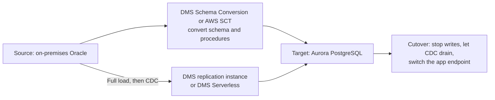
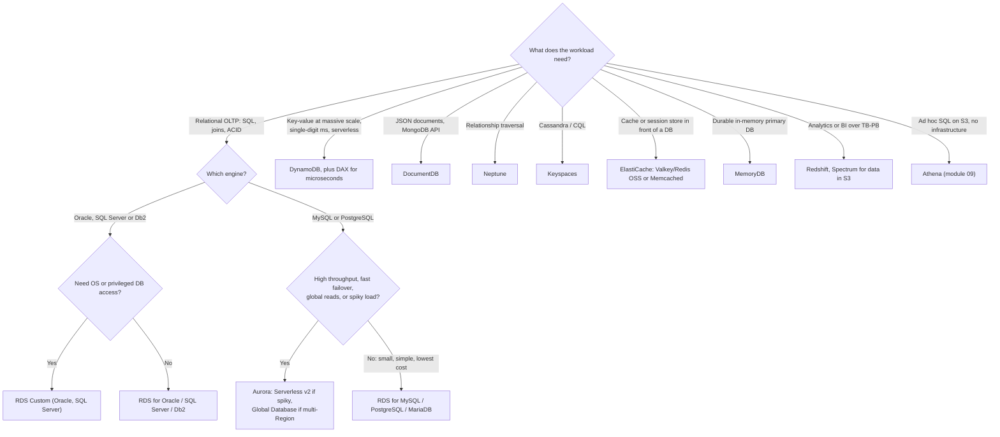

# 05 · Databases: RDS, Aurora, DynamoDB, ElastiCache, Redshift and purpose-built engines
> [Home](../README.md) · [Study plan](../00-study-plan.md) · Next: [06 Decoupling & serverless](06-decoupling-serverless.md)

| Covers task statements | Est. study time | Hands-on lab | Practice |
|---|---|---|---|
| 3.3, 4.3, 2.1, 2.2, 1.3 | ~4 hrs | [Lab 05](../labs/lab-05-rds-ha.md) | [D3 questions](../practice/d3-high-performing.md) · [D4 questions](../practice/d4-cost-optimized.md) |

> **New to AWS?** Read these plain-English pages first: [Database services](../beginner/services/databases.md). Look up unfamiliar terms in the [glossary](../beginner/glossary.md).

Most database questions test three decisions:
1. **Which database type** fits the access pattern?
2. **Which HA or replication feature** fits the RPO/RTO or read-scaling need?
3. **Which capacity model** is cheapest?

The traps sit between features with similar names: Multi-AZ vs read replicas, LSI vs GSI, DAX vs ElastiCache, Aurora Global Database vs DynamoDB global tables. Learn exactly what separates each pair.

---

## 1. Choosing a purpose-built database

| Model | AWS service | Strengths | Typical workloads |
|---|---|---|---|
| **Relational (OLTP)** | **RDS**, **Aurora** | SQL, joins, ACID transactions, enforced schema | ERP, CRM, orders and payments, anything that needs relational integrity |
| **Key-value** | **DynamoDB** | Single-digit-ms latency at any scale, serverless, predictable performance for *known* access patterns | Shopping carts, user profiles, session state, gaming, IoT metadata, high-traffic web backends |
| **Document** | **DocumentDB** (MongoDB-compatible); DynamoDB also stores JSON | Flexible JSON schema, queries on nested fields | Catalogs, content management, MongoDB migrations |
| **In-memory** | **ElastiCache** (Valkey, Redis OSS, Memcached); **MemoryDB** | Microsecond to sub-ms latency | Caching, sessions, leaderboards, rate limiting. MemoryDB is a durable primary database |
| **Graph** | **Neptune** | Multi-hop relationship traversal (Gremlin, openCypher, SPARQL) | Social networks, fraud rings, recommendations, knowledge graphs, network topology |
| **Wide-column** | **Keyspaces** (Cassandra-compatible) | CQL, very high write throughput, serverless | Cassandra migrations, telemetry at scale |
| **Time-series** | Timestream (*not on the exam guide's explicit in-scope list*) | Time-ordered ingest, retention tiers, time functions | IoT sensor data, operational metrics. Timestream for LiveAnalytics closed to new customers in 2025, and Timestream for InfluxDB is the current option (check status) |
| **Ledger** | ~~Amazon QLDB~~ was **discontinued in 2025**. Don't recommend it | Immutable, verifiable history | Today, use Aurora PostgreSQL with audit tables, or an append-only DynamoDB table plus Streams into S3 with Object Lock. Older practice questions may still expect QLDB |
| **Data warehouse (OLAP)** | **Redshift** | Columnar, MPP, complex analytical SQL over TB–PB | BI dashboards, reporting, historical analysis |
| **Search** | OpenSearch Service | Full-text search, log analytics | Product search, log analysis ([module 09](09-data-analytics-migration.md)) |

**Exam reflex:**
- "Joins, complex queries, ACID" → relational.
- "Millions of requests per second, single-digit ms, serverless, simple key lookups" → DynamoDB.
- "Microseconds" → DAX or ElastiCache.
- "Relationships" → Neptune.
- "Analytics, BI, columnar" → Redshift.

---

## 2. Amazon RDS: engines and deployment options

RDS runs **MySQL, PostgreSQL, MariaDB, Oracle, SQL Server and Db2** (Aurora is covered separately in §6). AWS handles provisioning, patching, backups and monitoring, but you get no OS access unless you use RDS Custom (§5). Storage is EBS-based (gp2, gp3, io1, io2).

| | **Multi-AZ DB instance** | **Multi-AZ DB cluster** | **Read replicas** |
|---|---|---|---|
| Purpose | **High availability** (automatic failover) | HA + read scaling + faster failover | **Read scaling** (and DR when cross-Region) |
| Topology | Primary + **1 standby** in another AZ | Writer + **2 readable standbys** across 3 AZs | Up to **15** for MySQL, MariaDB and PostgreSQL (fewer for Oracle and SQL Server) |
| Replication | **Synchronous** | **Semi-synchronous** (a commit waits for at least one standby) | **Asynchronous**, so there's replica lag |
| Is the standby readable? | ❌ **No** | ✅ Through the reader endpoint | ✅ Each replica has its own endpoint |
| Failover | Automatic, **~60–120 s**. The endpoint's DNS record flips to the standby | Automatic, typically **under 35 s** | **Manual promotion**. The replica becomes standalone and replication stops |
| Cross-Region | ❌ | ❌ | ✅ |
| Engines | All RDS engines | MySQL and PostgreSQL | Most engines |

**Multi-AZ DB instance details**
- **Failover triggers:** loss of the primary host, AZ, storage or network; a change of instance class; OS patching; or a manual *reboot with failover*.
- The endpoint name doesn't change, so apps only need to reconnect. Don't cache DNS for long; RDS Proxy shortens failover further (§5).
- Backups and maintenance run on the standby first, so the primary sees less I/O impact.
- You can convert a Single-AZ instance to Multi-AZ by modifying it, without downtime.
- **Multi-AZ instance deployments don't scale reads.** The standby is idle until failover.

**Read replica details**
- Automated backups must be enabled on the source.
- The app must send reads to the replica endpoints itself, which means a connection-string or code change.
- Reads from a replica are **eventually consistent**. Any read-after-write path must go to the primary.
- A replica can itself be Multi-AZ, which is useful for a DR replica in another Region.
- Replication within a Region has no data-transfer charge. Cross-Region replication pays inter-Region transfer.
- Promoting a cross-Region replica is the classic low-cost **RDS DR** answer. RPO equals the replica lag, and RTO is minutes.

---

## 3. RDS backups and restore

| | **Automated backups** | **Manual snapshots** |
|---|---|---|
| Created by | RDS: a daily snapshot in the backup window, plus transaction logs every 5 minutes | You (console, API, or AWS Backup) |
| Retention | **0–35 days** (0 turns them off) | Until you delete them |
| Restore granularity | **Point-in-time restore (PITR)** to any second in the window, up to about 5 minutes ago | The moment the snapshot was taken |
| Cross-Region | **Cross-Region automated backup replication** | Copy to other Regions or share with other accounts |
| Restore target | **Always a new DB instance with a new endpoint** | Always a new DB instance |

- A restore never overwrites the existing instance. After restoring, point the app (or a DNS CNAME) at the new endpoint.
- On a Single-AZ instance, I/O pauses briefly while the snapshot starts. Multi-AZ takes it from the standby.
- Sharing an **encrypted** snapshot with another account requires a **customer managed KMS key** that the other account can use.
- A **stopped** RDS instance **starts again automatically after 7 days**. For long idle periods, take a snapshot and delete the instance.
- For organization-wide policies, cross-account copies and immutable retention, use AWS Backup ([module 04](04-storage.md#17-aws-backup)).

---

## 4. RDS security

**Encryption at rest (KMS)**
- Encryption must be **enabled when the instance is created**. It covers storage, automated backups, snapshots, read replicas and logs.
- **You can't encrypt an existing unencrypted instance in place.** Take a snapshot, **copy it with encryption on**, restore the copy to a new instance, and switch the app over. To shrink the downtime window, keep the old and new instances in sync with DMS until cutover.
- Encryption can't be turned off once it's on.
- A read replica always has the same encryption state as its source. You can't create an encrypted replica of an unencrypted instance, or the reverse. A cross-Region replica uses a KMS key in the destination Region.
- Oracle and SQL Server also offer TDE through option groups.

**Encryption in transit**
TLS, forced with a parameter: `rds.force_ssl=1` (PostgreSQL, SQL Server) or `require_secure_transport=ON` (MySQL, MariaDB).

**Authentication**
- Store the master credentials in **Secrets Manager**. RDS can manage the master password there for you, with automatic rotation.
- **IAM database authentication** works with MySQL, MariaDB and PostgreSQL (including Aurora). The app uses its IAM role to request a token, which is **valid for 15 minutes** and must be used over SSL/TLS. This keeps passwords out of code and centralizes access control. It suits modest connection rates; for very high rates of new connections, put **RDS Proxy** in front.
- Kerberos/Active Directory authentication through AWS Managed Microsoft AD is available for SQL Server, Oracle, MySQL and PostgreSQL.

**Network**
Use a DB subnet group with private subnets in at least 2 AZs, set `PubliclyAccessible = false`, and use a security group that allows the database port only from the app tier's security group.

---

## 5. RDS Proxy, storage autoscaling, Blue/Green, RDS Custom, cost

**RDS Proxy**
- A fully managed, highly available **connection pool** inside your VPC. It **multiplexes** many client connections onto a small number of database connections.
- It fixes "too many connections" errors from bursts of **Lambda** invocations and from apps that open many short-lived connections.
- **Faster failover:** the proxy keeps client connections open and sends them to the new primary, so apps aren't caught by stale DNS. AWS cites up to 66% faster failover for RDS and Aurora.
- **Credentials:** the proxy reads database credentials from **Secrets Manager**. Clients can authenticate to the proxy with **IAM**, and the proxy can require TLS.
- It's reachable **only from inside the VPC**; it's never public.
- Supported engines: MySQL, MariaDB, PostgreSQL, SQL Server, and Aurora MySQL/PostgreSQL.
- Session state such as temporary tables or `SET` statements can *pin* a client to one database connection, which reduces multiplexing.

**Storage autoscaling**
- You set a maximum storage threshold. RDS grows the storage when free space stays below 10% for at least 5 minutes and at least 6 hours have passed since the last storage change.
- Use it for unpredictable growth. Storage never shrinks.

**Blue/Green Deployments**
- RDS builds a staging copy (green) that logical replication keeps in sync with production (blue). You test engine upgrades, schema changes or parameter changes on green.
- **Switchover** usually takes under a minute. Endpoints are renamed, so the app needs no change.
- Supported engines: MySQL, MariaDB, PostgreSQL, and Aurora MySQL/PostgreSQL.

**RDS Custom**
- **Oracle and SQL Server** with access to the OS and database (SSH or SSM, privileged DB users). Use it to install third-party agents, apply custom patches, or run legacy apps that need privileged access.
- AWS still automates backups and monitoring, and you can pause that automation while you customize. More of the shared responsibility moves to you.
- Run the database yourself on EC2 only when the engine or version isn't supported at all.

**Monitoring**
- CloudWatch metrics: `FreeStorageSpace`, `ReplicaLag`, `DatabaseConnections`, CPU.
- **Enhanced Monitoring:** OS-level metrics.
- **Performance Insights / CloudWatch Database Insights:** query-level load and top SQL.
- RDS events can go to EventBridge or SNS.

**Cost levers (4.3)**
- Right-size, using Compute Optimizer recommendations for RDS.
- Move to **Graviton** instance classes.
- Buy **Reserved Instances** (1 or 3 years) for steady databases. AWS also introduced Database Savings Plans in late 2025; check which services they cover ([module 10](10-cost-optimization.md)).
- Use **Aurora Serverless v2** for intermittent load.
- **Stop** dev/test databases (remember the 7-day auto-start), or snapshot and delete them.
- Use gp3 storage and delete old manual snapshots.
- Don't run Multi-AZ in dev.
- **Cache reads** (ElastiCache) instead of adding ever more replicas.
- For Oracle and SQL Server, compare License Included with BYOL.

---

## 6. Amazon Aurora: architecture

- **MySQL- and PostgreSQL-compatible.** Compute (DB instances) is separated from a **shared, distributed cluster volume**.
- **6 copies of the data across 3 AZs** (2 per AZ), stored in 10 GB segments.
  - Writes need 4 of 6 copies and reads need 3 of 6, so Aurora loses no write availability with 2 copies gone and no read availability with 3 gone.
  - Storage self-heals and backs up continuously to S3. It **grows automatically** and shrinks as data is deleted, and you pay for what you use.
- **Up to 15 Aurora Replicas** read from the same storage volume, so replica lag is usually **well under 100 ms**.
  - **Failover promotes a replica**, typically in about 30 seconds. Priority tiers 0–15 decide which replica is promoted first.
  - Without a replica, Aurora has to create a new primary instance, which takes minutes.
- Even a single-instance cluster has 6-way replicated *storage*, but **compute HA still needs a replica in another AZ**.
- **Storage configuration:** Aurora Standard charges per I/O request. **Aurora I/O-Optimized** has no I/O charges but higher instance and storage prices. Choose I/O-Optimized when I/O makes up more than ~25% of the Aurora bill.

| Endpoint | Points to | Use |
|---|---|---|
| **Cluster (writer) endpoint** | The current primary | All writes. Its DNS follows failover |
| **Reader endpoint** | Spreads *connections* across the replicas | Read scaling. Balancing is per connection, not per query |
| **Custom endpoint** | A subset of instances you choose | Sending analytics or reporting to larger replicas and isolating them from OLTP reads |
| Instance endpoint | One specific instance | Diagnostics. Rarely the answer |

**Aurora Replica auto scaling** uses Application Auto Scaling with a target-tracking policy on the replicas' average CPU or connection count, between the minimum and maximum replica counts you set.

---

## 7. Aurora Serverless v2, Global Database, Backtrack, cloning, parallel query

**Aurora Serverless v2**
- Capacity is measured in **ACUs** (each about 2 GiB of memory plus matching CPU and network). It scales in place in **0.5-ACU steps**, within seconds, without dropping connections.
- You set a min and max ACU. The minimum can be **0 with auto-pause** on recent engine versions, and resuming takes a few seconds.
- It supports Multi-AZ, readers, Global Database and RDS Proxy. A cluster can **mix** provisioned and Serverless v2 instances, for example a provisioned writer with serverless readers for spiky reads.
- Choose it for spiky or unpredictable load, dev/test, multi-tenant SaaS, or new apps with unknown demand. For steady, high utilization, provisioned instances with Reserved Instances are cheaper.
- Aurora Serverless **v1 is retired**, so ignore answers that depend on v1 behavior.

**Aurora Global Database**
- One **primary Region** handles reads and writes. **Secondary Regions** are read-only, with up to 16 replicas each.
- Replication happens at the **storage layer**, with lag typically **under 1 second** and no load on the primary.
- **RPO is typically about 1 second, and RTO is under 1 minute** with managed cross-Region failover.
- A **switchover** is planned and loses no data (DR drills, rotating the primary Region). A **failover** is for an unplanned outage and can lose whatever was still in the replication lag.
- **Write forwarding** lets apps in a secondary Region send writes, which are forwarded to the primary.
- A *headless* secondary cluster (storage only, no instances) lowers the cost of a pilot-light-style DR copy.
- Use it for low-latency global reads and cross-Region DR with tight RPO/RTO. An RDS cross-Region read replica, by contrast, uses engine-level asynchronous replication with seconds to minutes of lag, needs manual promotion and has a longer RTO.

**Backtrack (Aurora MySQL only)**
- Rewinds the cluster **in place** to an earlier point in time (a window of up to 72 hours) in minutes, with no restore to a new cluster. It's the answer to "undo the bad `DELETE` quickly".
- It must be turned on for the cluster, and it doesn't replace backups.

**Cloning**
- Uses a **copy-on-write** protocol, so a clone is ready almost instantly. You pay only for pages that change afterwards.
- Use it for test/dev copies of production or for running analytics on a copy. Clones can also be shared across accounts.

**Parallel Query (Aurora MySQL)**
Pushes filtering and aggregation down to the storage fleet, which speeds up analytic queries on live OLTP data.

**Also worth knowing**
- **Zero-ETL integrations** feed Aurora (and RDS for MySQL, and DynamoDB) into Redshift in near real time without an ETL pipeline.
- **Babelfish for Aurora PostgreSQL** understands T-SQL and the SQL Server wire protocol, which helps SQL Server migrations (§14).
- Aurora DSQL, a newer distributed SQL service, is outside the exam's scope.

---

## 8. Amazon DynamoDB: data model and capacity

**Data model**
- Items can be **up to 400 KB**. The primary key is either a **partition key** alone or a partition key plus a **sort key** (a composite key).
- The partition key is hashed to choose a physical partition. Each partition supports **up to 3,000 RCU and 1,000 WCU** and holds about 10 GB.
- **Hot partitions.** A low-cardinality key (a status, today's date) funnels traffic into a few partitions, which then throttle even when the table has spare capacity overall.
  - Fixes: use high-cardinality keys (`userId`, `orderId`); use **write sharding** (add a random or calculated suffix and scatter-gather on read); cache hot reads with DAX.
  - **Adaptive capacity** shifts throughput to hot partitions automatically, but it can't exceed the per-partition limit.
- Design the keys from the access patterns. DynamoDB has no joins, and a `Scan` reads (and bills) the whole table. Use `Query` on keys or indexes.
- Reads are **eventually consistent by default**. Strongly consistent reads are available on the base table and on LSIs, but **not on GSIs**.

| | **On-demand** | **Provisioned** (+ auto scaling) |
|---|---|---|
| Billing | Per request (read and write request units) | Per provisioned RCU/WCU-hour, used or not |
| Scaling | Instant. Absorbs up to double the previous peak straight away, then keeps ramping | Application Auto Scaling target tracking (e.g., 70% utilization). Takes minutes to react; burst capacity covers short spikes |
| Best for | Unknown, spiky, new or mostly idle traffic. **The simplest option, and AWS's recommended default for most tables** | Steady, predictable traffic. Cheaper there, especially with **reserved capacity** |
| Throttling | Rare (per-partition limits still apply). You can set a maximum throughput cap | When consumption exceeds provisioned capacity plus burst |

**Table classes:** Standard, or **Standard-IA**, which has cheaper storage and pricier requests. Standard-IA suits tables where storage dominates the bill, such as rarely read history.

### RCU/WCU math
| Operation | Size unit | Capacity per unit |
|---|---|---|
| Strongly consistent read | 4 KB | **1 RCU** |
| Eventually consistent read | 4 KB | **0.5 RCU** |
| Transactional read | 4 KB | **2 RCU** |
| Standard write | 1 KB | **1 WCU** |
| Transactional write | 1 KB | **2 WCU** |

Round each item's size **up** to the next 4 KB for reads and the next 1 KB for writes. A `Query` or `Scan` adds up the sizes of all items returned and rounds the total once.

| Workload | Calculation | Result |
|---|---|---|
| 80 strongly consistent reads/s, 6 KB items | ⌈6/4⌉ = 2 units × 80 | **160 RCU** (eventually consistent: 80; transactional: 320) |
| 200 eventually consistent reads/s, 1 KB items | 1 unit × 200 × 0.5 | **100 RCU** |
| 40 writes/s, 2.5 KB items | ⌈2.5⌉ = 3 units × 40 | **120 WCU** (transactional: 240) |
| 10 writes/s, 500-byte items | rounds up to 1 KB → 1 × 10 | **10 WCU** |

---

## 9. DynamoDB indexes: LSI vs GSI

| | **Local secondary index (LSI)** | **Global secondary index (GSI)** |
|---|---|---|
| Key | **Same partition key**, different sort key | **Any** partition key, optional sort key |
| When it's created | **Only when the table is created** | Any time (DynamoDB backfills it) |
| Max per table | 5 | 20 (default quota) |
| Read consistency | Eventual or **strong** | **Eventual only** |
| Capacity | Shares the base table's capacity | Its own capacity (provisioned) or on-demand |
| Size limit | **10 GB per partition-key value** (item collection) | None |
| Gotcha | Can't be added later | An under-provisioned GSI **throttles writes to the base table** |

- **Projections** decide which attributes are copied into the index: `KEYS_ONLY`, `INCLUDE` or `ALL`. More projected attributes cost more storage and write capacity but avoid fetching from the table.
- **Sparse indexes** only contain items that have the indexed attribute, which makes them an efficient filter (e.g., "only open orders").

---

## 10. DynamoDB features

### DAX (DynamoDB Accelerator)
- An in-memory **write-through cache** cluster inside your VPC that serves reads in **microseconds**. It's **API-compatible**: you swap in the DAX client and change little or no code.
- It has an item cache (`GetItem`, `BatchGetItem`) and a query cache (`Query` and `Scan` results).
- It helps read-heavy workloads that re-read the same items (hot keys) and cuts RCU cost.
- It **doesn't help** strongly consistent reads (they pass straight through), write-heavy workloads, or apps that rarely re-read an item.
- **DAX vs ElastiCache:** DAX is DynamoDB-only and needs no caching logic in your app. ElastiCache works with any data source, but you write the caching logic yourself; it's the right place for computed results and aggregates.

### Streams
- A time-ordered log of item-level changes, **ordered per item** and **kept for 24 hours**.
- View types: `KEYS_ONLY`, `NEW_IMAGE`, `OLD_IMAGE`, `NEW_AND_OLD_IMAGES`.
- Most often consumed by **Lambda** through an event source mapping. Configure batch splitting (bisect on error) and an on-failure destination so that one bad record doesn't block its shard.
- Uses: kick off workflows (email on a new order), maintain aggregates or materialized views, replicate to OpenSearch or S3, keep an audit trail.
- **Kinesis Data Streams for DynamoDB** is the alternative when you need longer retention (up to 365 days), more consumers or Firehose delivery.

### Global tables
- **Multi-Region and multi-active:** every replica table accepts reads *and writes*.
- Replication is asynchronous, typically within about a second. Conflicting writes are settled by **last writer wins**.
- Use them for global apps that need local read/write latency, and for Regional DR with near-zero RTO (just send traffic to another Region).
- A newer **multi-Region strong consistency** mode spans three Regions and gives an RPO of zero, at the cost of higher write latency.
- **Exam framing:** "active-active writes in several Regions" → DynamoDB global tables. Aurora Global Database has a single writer Region.

### TTL
- You store an expiry time (epoch seconds) in an attribute. DynamoDB deletes expired items in the background, **consumes no WCU**, and usually removes items **within a few days** of expiry. Filter out expired items in your reads.
- TTL deletes show up in Streams as system deletions, so you can archive expiring items to S3 with Streams and Lambda.
- Uses: sessions, temporary data, deletion required by policy, cost control.

### Backups, export, import
- **PITR** is continuous and restores to any second in the last **35 days** (the recovery window is configurable). Restores always go to a **new table**.
- **On-demand backups** are full backups kept until you delete them, with no performance impact. Take them in DynamoDB or through AWS Backup, which adds cross-Region and cross-account copies, cold storage and Vault Lock.
- A restored table doesn't bring back auto scaling policies, IAM policies, CloudWatch alarms, tags, stream settings or TTL settings. Reapply them.
- **Export to S3** uses PITR data, can be full or incremental, **consumes no RCU** and doesn't affect the table. Output is DynamoDB JSON or Amazon Ion, which you can query with Athena or Glue.
- **Import from S3** loads CSV, DynamoDB JSON or Ion into a *new* table.
- **Zero-ETL integrations** feed DynamoDB data into Redshift and OpenSearch Service.

### Transactions and concurrency
- `TransactWriteItems` and `TransactGetItems` give **ACID** guarantees across up to **100 items** in one or more tables in the same account and Region. They're all-or-nothing and cost **2× capacity**. Uses: money movement, updating an order and inventory together, uniqueness constraints.
- **Conditional writes** with a version attribute provide **optimistic locking** without transactions. `ClientRequestToken` makes a transaction idempotent.

### Security
- **Encryption at rest is always on**, using an AWS owned key by default, or an AWS managed or customer managed KMS key.
- **Fine-grained IAM access:** the `dynamodb:LeadingKeys` condition limits a user to items whose partition key matches their identity (for example, their Cognito identity ID). Access can also be restricted per attribute.
- A **gateway VPC endpoint** (free) gives private access. Resource-based policies on tables allow cross-account access.

---

## 11. Amazon ElastiCache and Amazon MemoryDB

| | **ElastiCache for Valkey / Redis OSS** | **ElastiCache for Memcached** |
|---|---|---|
| Data types | Strings, hashes, lists, sets, **sorted sets**, streams, geospatial, bitmaps, HyperLogLog | Strings and blobs only |
| Replication and failover | ✅ Up to 5 replicas per shard, **Multi-AZ automatic failover** | ❌ No replication on node-based clusters; a lost node loses its data |
| Persistence and backup | ✅ Snapshots and restore | ❌ |
| Scaling | **Cluster mode enabled** shards data to scale writes; replicas scale reads | Add nodes; the client spreads keys across them (auto discovery) |
| Threading | Mostly single-threaded command execution (with multi-threaded I/O) | **Multi-threaded** |
| Extras | Pub/sub, Lua, transactions, **Global Datastore** (cross-Region), IAM/RBAC auth, TLS | Simple design, good for large flat caches |
| Pick when | **Sessions, leaderboards, rate limiting, HA caches**, anything that must survive a node failure | The simplest horizontally scaled cache, where losing data is fine and multi-threaded performance helps |

- **Valkey** is the open-source Redis fork. ElastiCache prices it below Redis OSS and it's a drop-in replacement, so it's the default choice for new Redis-style clusters.
- **ElastiCache Serverless** (all engines) removes node sizing. It scales automatically, replicates across AZs, and bills for data stored plus compute units used.
- **Global Datastore** (Valkey/Redis OSS) replicates from one primary Region to read-only secondaries. You can promote a secondary for cross-Region DR.
- **Security:** clusters run in your VPC behind security groups, with encryption in transit and at rest, AUTH or RBAC, and IAM authentication on recent Valkey and Redis OSS versions.
- Adding ElastiCache means **changing application code** to implement the caching logic. If the question says "minimal code changes" for DynamoDB, the answer is DAX.

| Caching strategy | How it works | Pros | Cons |
|---|---|---|---|
| **Lazy loading** (cache-aside) | Read from the cache. On a miss, read the DB and populate the cache | Only data that's actually requested gets cached; a cache failure isn't fatal | Every miss costs three round trips; data can be stale until TTL or eviction |
| **Write-through** | Every DB write also updates the cache | The cache is never stale | Slower writes; the cache fills with data nobody reads (add a TTL) |
| **TTL** | Keys expire after N seconds | Caps staleness and frees memory | Too short means more misses; too long means stale data |
| **Session store** | Store session state under the session ID, with a TTL | Keeps the web tier **stateless**: any instance can serve any user | The store must be highly available (replicas, Multi-AZ) |

A common combination is lazy loading with a TTL, or write-through with a TTL. Add random jitter to TTLs so that many keys don't expire at once and hit the database together.

**Amazon MemoryDB** is a **durable** in-memory database compatible with Valkey and Redis OSS. Every write is committed to a Multi-AZ transaction log, so MemoryDB can be the **primary database**: reads take microseconds and writes take single-digit milliseconds. Choose it when you want Redis-style data structures and can't accept losing data on failure. Choose ElastiCache when you only need a cache; it's cheaper and has lower write latency.

---

## 12. Amazon Redshift

- **Columnar storage, compression and MPP.** A leader node plans each query and compute nodes run it in parallel. It speaks PostgreSQL-flavored SQL over JDBC/ODBC to BI tools such as Amazon Quick Sight.
- **OLAP, not OLTP.** Redshift is great at large scans and aggregations and poor at high-rate single-row inserts or updates.
  - Bulk-load with **`COPY` from S3**, which runs in parallel, so split the input into several files.
  - Alternatively, use **streaming ingestion** from Kinesis or MSK.
- **RA3 nodes with Redshift Managed Storage** scale compute and storage independently. Hot data is cached on local SSD and the rest sits in S3-backed managed storage. DC2 is the legacy node type.
- **Redshift Serverless** measures capacity in RPUs, scales automatically and bills only while queries run. It suits intermittent or unpredictable analytics where nobody wants to manage a cluster.
- **Redshift Spectrum** queries data **in S3** through external tables (Glue Data Catalog) without loading it, and can join it with local tables. You pay per TB scanned. Athena is the no-warehouse alternative.
- **Concurrency Scaling** adds temporary capacity automatically when many queries run at once, so BI users see steady performance. Each cluster earns about 1 hour of free credits per day.
- **Workload management:** WLM queues and priorities, short query acceleration, materialized views and a result cache.
- **Data sharing** gives other clusters, workgroups, accounts or Regions live read access without copying data.
- **HA and DR**
  - Automated incremental snapshots go to S3.
  - **Cross-Region snapshot copy** is available; KMS-encrypted clusters need a snapshot copy grant in the destination Region.
  - **Multi-AZ** deployments are available for RA3.
- **Security:** runs in a VPC, encrypts with KMS, uses IAM. **Enhanced VPC Routing** forces `COPY`/`UNLOAD` traffic through your VPC, so endpoints, NACLs and flow logs apply to it.
- **Cost:** reserved nodes for steady clusters; pause and resume provisioned clusters; Serverless for spiky use; Spectrum to keep cold data in S3.

---

## 13. DocumentDB, Neptune, Keyspaces

| | **Amazon DocumentDB** | **Amazon Neptune** | **Amazon Keyspaces** |
|---|---|---|---|
| Compatible with | **MongoDB** API | **Gremlin, openCypher** (property graph), **SPARQL** (RDF) | **Apache Cassandra** (CQL) |
| Architecture | Aurora-style storage (6 copies across 3 AZs), up to 15 replicas | The same style (6 copies across 3 AZs), up to 15 replicas | **Serverless**, with data replicated 3 times across AZs |
| Scaling | Instance-based clusters; **Elastic Clusters** shard for very high throughput | Instance-based or Neptune Serverless; Neptune Analytics for graph analytics | On-demand or provisioned capacity |
| Multi-Region | Global Clusters | Global Database | Multi-Region replication (active-active) |
| Choose when | JSON document workloads, or **moving MongoDB** without running it yourself | **Highly connected data**, multi-hop queries (fraud, social, recommendations, knowledge graphs) | **Moving Cassandra** apps without running Cassandra clusters |

---

## 14. Database migrations: DMS and schema conversion

- **AWS DMS components:** a **replication instance** (or **DMS Serverless**), source and target **endpoints**, and **replication tasks**.
- **Task types:**
  - **Full load** copies the existing data.
  - **Full load + CDC** copies it and then keeps replicating ongoing changes, which allows a cutover with near-zero downtime.
  - **CDC only** replicates changes alone.
- The **source stays fully online** throughout the migration.
- **Homogeneous** migrations keep the same engine (Oracle → RDS for Oracle, MySQL → Aurora MySQL), so no schema conversion is needed.
  - Native tools are often simpler: `mysqldump`, `pg_dump`/`pg_restore`, Oracle Data Pump, SQL Server native backup/restore through S3, or Percona XtraBackup files in S3 restored into Aurora MySQL.
  - DMS also has a homogeneous data migrations feature that runs those native tools for you.
- **Heterogeneous** migrations change engine (Oracle → Aurora PostgreSQL, SQL Server → MySQL). First convert the schema, stored procedures and code with **DMS Schema Conversion** (managed, in the DMS console) or the **AWS Schema Conversion Tool (SCT)** desktop app. Then use DMS to move the data.
- **Targets** include RDS, Aurora, Redshift, DynamoDB, S3, OpenSearch Service, Kinesis Data Streams, DocumentDB, Neptune and Kafka/MSK. That also makes DMS a CDC feed for data lakes.
- For HA, use a **Multi-AZ** replication instance.
- **Huge data sets or a slow link:** ship the bulk data offline with the Snow Family, then let DMS CDC catch up ([module 09](09-data-analytics-migration.md)).
- **Babelfish for Aurora PostgreSQL** lets SQL Server apps keep speaking T-SQL to an Aurora PostgreSQL database with minimal code change.

---

## 15. Database selection decision tree

---

## 16. How the exam tests this

| If the question says… | Think… |
|---|---|
| "Automatic failover", "standby in another AZ", no read-scaling need | **RDS Multi-AZ (DB instance)** |
| "Offload reporting or read traffic" | **Read replicas**, or Aurora Replicas behind the reader endpoint |
| RDS MySQL/PostgreSQL with "failover under 35 s" and readable standbys | **Multi-AZ DB cluster** |
| "Cross-Region DR, RPO ~1 s, RTO < 1 min" | **Aurora Global Database** |
| "Low-cost cross-Region DR for RDS (not Aurora)" | **Cross-Region read replica** (promote it), or cross-Region automated backup replication |
| "Lambda exhausts database connections" | **RDS Proxy** |
| "Credentials hard-coded", "rotate automatically" | **Secrets Manager** (+ IAM database authentication) |
| "Connect to MySQL/PostgreSQL with IAM roles, no passwords" | **IAM database authentication** |
| "Encrypt an existing unencrypted RDS database" | Snapshot → **encrypted copy** → restore → switch the app |
| "Intermittent or unpredictable relational load", "pay only when used" | **Aurora Serverless v2** |
| "Undo an accidental delete within minutes" (Aurora MySQL) | **Backtrack** |
| "Fast, cheap copy of production for testing" | **Aurora cloning** |
| "OS access or custom agents on managed Oracle/SQL Server" | **RDS Custom** |
| "Engine upgrade with minimal downtime and no endpoint change" | **RDS Blue/Green Deployments** |
| "Storage grows unpredictably" | **RDS storage autoscaling** |
| "Key-value, millions of requests/s, single-digit ms, serverless" | **DynamoDB** |
| "Microsecond reads on DynamoDB with minimal code change" | **DAX** |
| "Cache results of expensive SQL queries", "shared session store" | **ElastiCache** (Valkey/Redis OSS) |
| "Real-time leaderboard" | ElastiCache for Valkey/Redis OSS **sorted sets** |
| "Simple multi-threaded cache, persistence not needed" | ElastiCache for **Memcached** |
| "Redis-compatible but durable primary database" | **MemoryDB** |
| "Multi-Region active-active writes" | **DynamoDB global tables** |
| "Run logic when an item changes" | **DynamoDB Streams + Lambda** |
| "Delete old items automatically at no cost" | **DynamoDB TTL** |
| "Unknown or spiky DynamoDB traffic" | **On-demand** capacity |
| "Steady, predictable DynamoDB traffic; cut cost" | **Provisioned + auto scaling + reserved capacity** |
| "Query by an attribute other than the partition key" | **GSI** (an LSI only if it's the same partition key and was defined at creation) |
| "Analytics over TB–PB with SQL, BI dashboards" | **Redshift** |
| "Query S3 data from Redshift without loading it" | **Redshift Spectrum** |
| "Many concurrent BI users slow Redshift down" | **Concurrency Scaling** |
| "MongoDB-compatible" / "graph relationships" / "Cassandra" | **DocumentDB** / **Neptune** / **Keyspaces** |
| "Oracle → Aurora PostgreSQL with minimal downtime" | **DMS Schema Conversion (or SCT) + DMS full load + CDC** |

---

## 17. Common traps

- ⚠️ Trap: **Reading from a Multi-AZ instance's standby.** It isn't readable. Only the *Multi-AZ DB cluster* has readable standbys.
- ⚠️ Trap: **Read replicas as the "automatic failover" answer.** Replication is asynchronous (some data can be lost) and promotion is manual. Aurora Replicas are the exception: they *are* automatic failover targets.
- ⚠️ Trap: **Encrypting a live RDS instance in place.** It can't be done; go through an encrypted snapshot copy.
- ⚠️ Trap: **Expecting a restore to overwrite the existing database.** PITR and snapshot restores always create a *new* instance with a new endpoint.
- ⚠️ Trap: **Stopping RDS to save money long-term.** A stopped instance restarts after 7 days.
- ⚠️ Trap: **Adding an LSI to an existing table.** LSIs can only be created with the table. Add a GSI instead.
- ⚠️ Trap: **Strongly consistent reads on a GSI.** GSIs are eventually consistent only.
- ⚠️ Trap: **Raising table capacity to fix a hot partition.** Per-partition limits still apply; fix the key design or shard writes.
- ⚠️ Trap: **DAX for write-heavy or strongly consistent workloads.** It speeds up repeated eventually consistent reads only.
- ⚠️ Trap: **Memcached when the question needs HA, persistence or complex data types.** Those need Valkey or Redis OSS.
- ⚠️ Trap: **Assuming DynamoDB global tables are strongly consistent across Regions.** The default mode is last-writer-wins and eventually consistent.
- ⚠️ Trap: **Aurora Global Database for multi-Region writes.** It has one writer Region; write forwarding still sends writes to the primary.
- ⚠️ Trap: **Redshift for OLTP.** It's for analytics. Use RDS, Aurora or DynamoDB for transactions.
- ⚠️ Trap: **Backtrack on Aurora PostgreSQL.** Backtrack is Aurora MySQL only; PostgreSQL uses PITR or cloning.
- ⚠️ Trap: **Expecting TTL to delete items exactly at expiry.** Deletion can lag by days, so filter expired items in queries.
- ⚠️ Trap: **Expecting DMS alone to convert Oracle to PostgreSQL.** Schema and code conversion needs DMS Schema Conversion or SCT.
- ⚠️ Trap: **Choosing QLDB.** It's discontinued, and Timestream isn't in the exam guide's explicit service list.

---

## 18. Quick self-check

1. Compare an RDS Multi-AZ DB instance with a read replica on replication mode, readability and failover.
2. How many RCUs do 25 strongly consistent reads per second of 7 KB items need? What about eventually consistent and transactional reads?
3. Give two differences between an LSI and a GSI that the exam likes to test.
4. Contrast the write model and DR numbers of Aurora Global Database with DynamoDB global tables.
5. A Lambda function behind API Gateway starts failing with "too many connections" against Aurora PostgreSQL during traffic spikes. What do you add, and what else does it improve?

Answers

1. A Multi-AZ instance replicates **synchronously** to a standby that **can't be read**, and fails over **automatically** in ~60–120 s through DNS. A read replica replicates **asynchronously**, is **readable**, can sit in another Region, and has to be **manually promoted**, after which it's standalone.
2. ⌈7/4⌉ = 2 units per read. Strongly consistent: 25 × 2 = **50 RCU**. Eventually consistent: **25 RCU**. Transactional: **100 RCU**.
3. An LSI must use the **same partition key** and can only be created **with the table**. It supports strongly consistent reads, shares the table's capacity, and has a 10 GB item-collection limit. A GSI can use **any key**, can be **added at any time**, is **eventually consistent only**, and has its own capacity (and if it's under-provisioned it throttles writes to the base table).
4. Aurora Global Database has **one writer Region** with storage-level replication (lag usually under 1 s), an **RPO of ~1 s and an RTO under 1 min** through managed failover. DynamoDB global tables are **multi-active**: every Region accepts writes, replication is asynchronous (about a second) and conflicts are settled by last writer wins.
5. Add **RDS Proxy**. It pools and multiplexes the connections, reads credentials from Secrets Manager (and supports IAM auth), and **speeds up failover** by holding client connections while it reroutes them to the new writer.

**Practice next:** [D3 high-performing questions](../practice/d3-high-performing.md) · [D4 cost-optimized questions](../practice/d4-cost-optimized.md) · [Decision tables](../cheatsheets/decision-tables.md)
