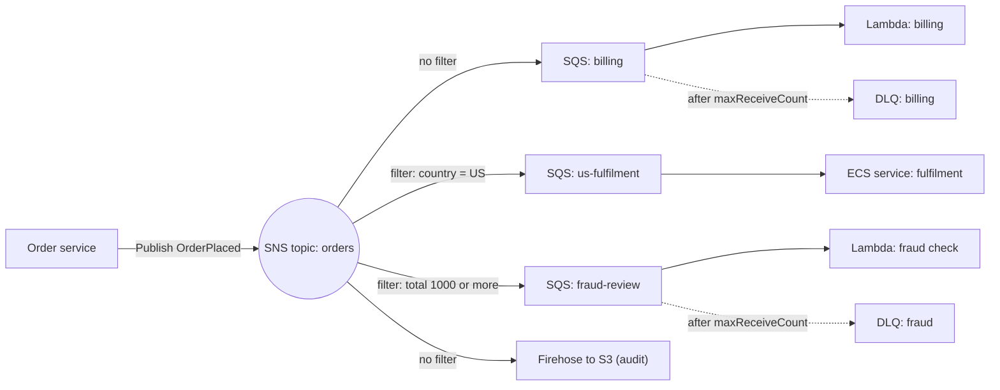
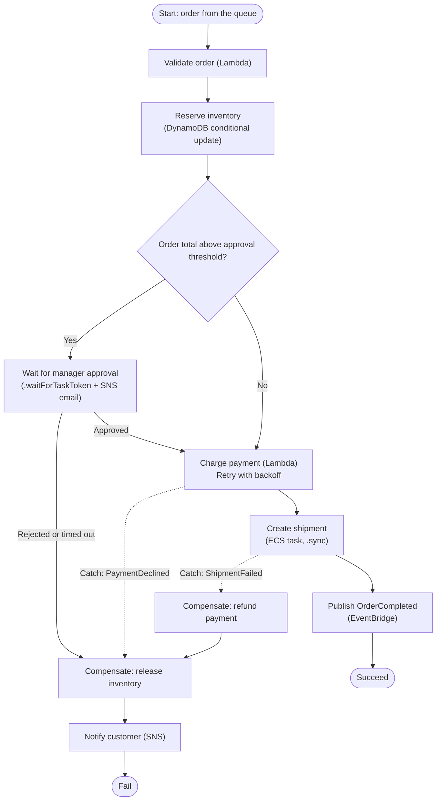

# 06 · Decoupling & serverless: SQS, SNS, EventBridge, MQ, Step Functions, API Gateway
> [Home](../README.md) · [Study plan](../00-study-plan.md) · Next: [07 Security & data protection](07-security-data-protection.md)

| Covers task statements | Est. study time | Hands-on lab | Practice |
|---|---|---|---|
| 2.1 (primary), 2.2, 3.2 | ~2.5 hrs | [Lab 06](../labs/lab-06-serverless-decoupled.md) | [D2 questions](../practice/d2-resilient.md) |

> **New to AWS?** Read these plain-English pages first: [Integration & messaging services](../beginner/services/integration.md). Look up unfamiliar terms in the [glossary](../beginner/glossary.md).

Task 2.1 ("design scalable and loosely coupled architectures") names more services than any other task statement. The typical question describes a tightly coupled system that breaks under load, or when one component fails. It then asks which managed integration service fixes it with the **least operational overhead**. You don't need to know how to call these services from code. The exam tests whether you can pick between them from one sentence of requirements.

---

## 1. Why decouple

| | **Synchronous** (request/response) | **Asynchronous** (queue, topic, event, stream) |
|---|---|---|
| Coupling | The caller waits, so both sides must be up at the same moment (temporal coupling) | Producer and consumer run independently in time |
| Failure | A slow or failed downstream service cascades upstream | Work waits in a durable buffer, and consumers retry |
| Scaling | Every tier must be sized for peak | Each tier scales on its own signal, such as queue depth |
| Traffic spikes | Overload the slowest tier | Absorbed by the buffer (**load leveling**) |
| User response | The result comes back immediately | Accept now (HTTP 202), then notify or let the client poll |
| Use when | The user needs the answer right away (reads, validation) | Work can finish later (orders, emails, media processing, ETL) |

**Key ideas**
- **Backpressure.** Consumers *pull* at a rate they can sustain, which protects databases and rate-limited third-party APIs. The backlog becomes the scaling metric.
- **Independent scaling and deployment.** Each component can be released, scaled or replaced without touching the others.
- **Failure isolation.** When a consumer fails, requests aren't lost. They stay in the queue, or end up in a dead-letter queue.
- **Extensibility.** With fan-out, you add a new consumer without changing the producer.
- **The costs of decoupling.** Results become eventually consistent, duplicates appear (at-least-once delivery means consumers must be **idempotent**), ordering needs care, and requests are harder to trace (use X-Ray and correlation IDs).

| Style | Service | Shape |
|---|---|---|
| Queue | SQS | Each message goes to one consumer (competing consumers), pulled |
| Pub/sub | SNS | Each message goes to many subscribers, pushed |
| Event bus | EventBridge | Events routed by content to many targets; AWS and SaaS sources; schedules |
| Stream | Kinesis Data Streams | Ordered, replayable log; many readers, each at its own position |
| Broker | Amazon MQ | Standard protocols (JMS, AMQP, MQTT) for existing apps |
| Orchestration | Step Functions | A stateful workflow with retries, branching and compensation |

---

## 2. Amazon SQS

| | **Standard queue** | **FIFO queue** |
|---|---|---|
| Ordering | Best effort; messages can arrive out of order | **Strict order within a message group** |
| Delivery | **At-least-once** (occasional duplicates) | **Exactly-once processing**: duplicates within the 5-minute deduplication interval are dropped |
| Throughput | Nearly unlimited | **300 TPS per API action** without batching; **3,000 msg/s with batching** (10 per batch). **High-throughput FIFO mode** goes far higher (up to 70,000 TPS in the largest Regions) |
| Message group ID | n/a | Required. Messages in one group are delivered in order to one consumer at a time, so parallelism equals the number of active groups |
| Deduplication | None; consumers must be idempotent | A **message deduplication ID**, or **content-based deduplication** (a SHA-256 hash of the body) |
| Naming | Any name | Must end in `.fifo` |
| Per-message delay | ✅ Message timers | ❌ Queue-level delay only |
| Use when | You want maximum throughput and order doesn't matter (most workloads) | **Order matters and duplicates aren't acceptable** (payments, per-account commands, inventory updates) |

You **can't convert** a standard queue to FIFO, or FIFO to standard. Create a new queue and migrate producers and consumers to it.

| Setting | Default | Range | What it does |
|---|---|---|---|
| **Message size** | n/a | Up to **1 MiB** | For bigger payloads, the **Extended Client Library** stores the body in S3 (up to 2 GB) and sends a pointer (the claim-check pattern). Older questions still quote 256 KB |
| **Retention** | **4 days** | 1 minute–**14 days** | Messages nobody consumed are deleted after this |
| **Visibility timeout** | **30 s** | 0 s–**12 h** | A received message is hidden for this long. If the consumer doesn't delete it in time, it becomes visible and another consumer gets it |
| **Delivery delay** | 0 | 0–**15 min** | A delay queue. Standard queues also support per-message timers |
| **Receive wait time** | 0 (short polling) | 1–**20 s** (long polling) | Long polling waits for messages to arrive: fewer empty responses, lower cost, lower latency |
| **Batch** | n/a | Up to **10 messages** | Applies to send, receive and delete |
| **Redrive policy** | None | `maxReceiveCount` | Moves a message to the DLQ after N receives without a delete |

### Visibility timeout
- Set it **longer than the maximum processing time**. If it's too short, a second consumer picks up a message the first is still working on, and you get duplicates. If it's too long, a message from a crashed consumer waits that long before it's retried.
- For long jobs, the consumer calls `ChangeMessageVisibility` periodically to extend the timeout, like a heartbeat.
- Delete the message only **after** processing succeeds.

### Dead-letter queues and redrive
- After `maxReceiveCount` receives without a delete, SQS moves the message to the **DLQ**. That isolates "poison" messages so they don't block healthy ones. Alarm on the DLQ's `ApproximateNumberOfMessagesVisible`.
- A DLQ must be the **same queue type** (FIFO source → FIFO DLQ) in the **same account and Region**.
- For standard queues, a message's expiry is based on its *original* enqueue time, so set the DLQ's retention **longer** than the source queue's.
- **DLQ redrive** moves messages back to the source queue (or another queue) once the bug is fixed.
- On FIFO queues, sending a message to the DLQ takes it out of its group's sequence. If strict ordering matters more than isolating failures, design for that.

### Polling
**Short polling** samples a subset of SQS servers, so it can return nothing even when messages exist. **Long polling** (`WaitTimeSeconds` up to 20) waits until a message arrives. "Reduce empty responses" or "reduce SQS cost" → long polling.

### Security
- Encryption at rest with SSE-SQS (the default) or SSE-KMS.
- A **queue access policy** for cross-account access and for letting SNS, S3 or EventBridge send messages.
- IAM, and **interface VPC endpoints** for private access.

---

## 3. SQS with Lambda and with Auto Scaling

### SQS as a Lambda event source
- Lambda's **event source mapping** long-polls the queue and invokes your function with batches. It adds pollers and concurrency as the backlog grows.
- **Batch size:** up to 10 for FIFO, and up to 10,000 for standard with a **batching window** of up to 5 minutes. The whole batch must fit the 6 MB synchronous invocation payload.
- **When the function succeeds**, Lambda deletes the batch. **When it fails**, the whole batch becomes visible again after the visibility timeout and is retried. After `maxReceiveCount`, the queue's own DLQ takes it. Lambda's async DLQ and on-failure destinations don't apply to SQS event sources.
- **Partial batch response:** turn on `ReportBatchItemFailures` and return the IDs of the failed messages. Only those are retried, and the successful ones aren't processed again.
- Set the queue's visibility timeout to **at least 6× the function timeout**, and set `maxReceiveCount` to **at least 5** so that brief throttling doesn't push good messages into the DLQ.
- **To protect a downstream database**, use the event source mapping's **maximum concurrency** setting. Reserved concurrency also caps the function, but it does so by throttling, which sends messages back to the queue and burns receive counts. Add RDS Proxy in front of relational databases.
- **FIFO queues:** Lambda keeps the order within each message group, and concurrency is limited by the number of active groups.

### Scaling EC2 or ECS workers on queue depth
- `ApproximateNumberOfMessagesVisible` is the backlog. The raw number doesn't scale with fleet size, so AWS recommends a custom metric, **backlog per instance** = visible messages ÷ running instances, used in a **target-tracking** policy.
- **Target backlog per instance** = acceptable latency ÷ average processing time per message. For example, 0.1 s per message with 10 s acceptable latency gives a target of 100 messages per instance, so a backlog of 1,500 means 15 instances.
- Use `ApproximateAgeOfOldestMessage` for latency alarms.
- Queue workers are a natural fit for **Spot**. If an instance is interrupted, its in-flight message becomes visible again after the visibility timeout.

---

## 4. Amazon SNS

- **Pub/sub push.** Publishers send to a topic and SNS pushes copies to every subscriber. **SNS doesn't store messages.** If delivery fails after the retry policy runs out, the message is lost unless the subscription has a **DLQ** (an SQS queue).
- **Subscriber types:** SQS, Lambda, HTTP/S, email and email-JSON, SMS, mobile push (APNs, FCM and others) and Amazon Data Firehose.
- **Message filtering:** a **filter policy** on each subscription, matched against message attributes or the message body. Each subscriber then receives only the messages it cares about, with no separate topic per message type and no filtering in consumer code.
- **FIFO topics** keep strict order per message group and deduplicate. Their subscribers are SQS queues (use FIFO queues to keep the order end to end). Throughput is lower than on standard topics.
- **Raw message delivery** strips the SNS JSON envelope for SQS, HTTP and Firehose subscribers.
- **Security:** KMS encryption at rest, a **topic policy** for cross-account publish/subscribe (and to let S3 or CloudWatch publish), interface VPC endpoints and TLS.
- SNS can deliver to SQS queues and Lambda functions **in other Regions**.
- Common uses: CloudWatch alarm notifications, fan-out of S3 events, and application-to-person messages (SMS, email, push).

---

## 5. The SNS + SQS fan-out pattern

**Why it's needed:** one event has to be processed by several independent systems. Each system needs its own buffer, retries, scaling and DLQ, so that a slow or broken consumer doesn't affect the others. To add a consumer, add a subscription; the producer doesn't change.



**Requirements**
- Each SQS **queue policy** must allow `sns.amazonaws.com` to call `sqs:SendMessage`, with the condition `aws:SourceArn` = the topic ARN.
- If a queue uses SSE-KMS, it needs a **customer managed key** whose key policy lets SNS use it. You can't edit the AWS managed `aws/sqs` key's policy, so SNS can't use that key.
- A standard topic can't deliver to a FIFO queue. FIFO end to end needs a FIFO topic.
- **S3 + fan-out:** S3 can't send the same event type for overlapping prefixes to several destinations. Point the S3 event at SNS and fan out from there, or use EventBridge.
- **Alternatives:** an EventBridge rule with several targets (up to 5 per rule, and you can add rules), or Kinesis with several consumers when you need ordering and replay.

---

## 6. Amazon EventBridge

- **Event buses**
  - The **default** bus receives AWS service events: EC2 state changes, S3 events (when enabled), CloudTrail-recorded API calls, Health events and more.
  - **Custom** buses carry your own application events, sent with `PutEvents`.
  - **Partner** buses receive SaaS events (Zendesk, Datadog, Shopify, Auth0, PagerDuty and others) without any polling code.
- **Rules and event patterns** can match any field in the JSON event, with prefix, suffix, numeric ranges, exists, anything-but, wildcard and CIDR matching. Each rule can have **up to 5 targets**, and an **input transformer** reshapes the payload for each target.
- **Targets** include Lambda, SQS (including FIFO), SNS, Step Functions, Kinesis, Firehose, ECS tasks, Batch, API Gateway, Systems Manager, other event buses (cross-account or cross-Region), and **API destinations** (any HTTPS endpoint, with managed auth and rate limiting).
- **Delivery** is at-least-once, with retries and exponential backoff for up to 24 hours by default. Each target can have its own SQS DLQ.
- **EventBridge Scheduler** is a serverless scheduler for one-time and recurring (cron or rate) schedules, with time zones and flexible time windows. It scales to millions of schedules and can call thousands of AWS API actions directly. Use it instead of scheduled rules or cron on an EC2 instance.
- **EventBridge Pipes** connect one source to one target: **source → filter → enrichment** (Lambda, Step Functions, API Gateway or an API destination) **→ target**. Sources are SQS, Kinesis, DynamoDB Streams, MSK or self-managed Kafka, and Amazon MQ. Pipes replace hand-written "glue" Lambda functions.
- **Archive and replay** keeps events (all, or a filtered set) for a retention period or indefinitely, then replays them to the bus. Use it for recovery after a consumer bug, for testing, or for backfill.
- **Schema Registry** stores event schemas. **Schema discovery** infers them from bus traffic, and code bindings can be generated for Java, Python, TypeScript and Go.
- **Cross-account delivery:** a bus resource policy allows other accounts, or a whole organization, to send events. Rules can target buses in other accounts or Regions. A common pattern is a central bus that collects security or operational events from every account.
- **Global endpoints** fail event ingestion over between Regions using health checks.

---

## 7. Choosing between EventBridge, SNS, SQS and Kinesis

| | **SQS** | **SNS** | **EventBridge** | **Kinesis Data Streams** |
|---|---|---|---|---|
| Model | Queue (pull), competing consumers | Pub/sub (push) | Event bus and router (push) | Ordered stream (pull), replayable log |
| Consumers per message | **One** (whoever deletes it) | **Many** subscribers | **Many** targets through rules | **Many independent consumers**, each tracking its own position |
| Persistence | Up to 14 days | None (retries, then DLQ) | None, but **archive and replay** | 24 h by default, up to 365 days; **replay** from any point |
| Ordering | FIFO queues, per message group | FIFO topics, per message group | **Not guaranteed** | **Per shard** (partition key) |
| Filtering | In consumer code | Subscription filter policies | **Rich patterns on any field**, plus input transformation | In consumer code |
| Sources | Your apps, S3, SNS, EventBridge | Your apps, S3, CloudWatch alarms, many AWS services | **AWS service events, SaaS partners, custom apps, schedules** | SDK/KPL producers, agents, DynamoDB, IoT |
| Throughput | Standard: nearly unlimited. FIFO: see §2 | Very high (standard topics) | High (soft per-Region `PutEvents` quota) | Scales with shards (1 MB/s or 1,000 records/s in per shard) or on-demand mode |
| Typical use | Work queues, buffering, load leveling | Notifications, simple fan-out, SMS/email/push | Event-driven microservices, SaaS integration, reacting to AWS events, schedules | Real-time analytics, clickstreams, logs, telemetry, ordered replay ([module 09](09-data-analytics-migration.md)) |

**One-line rules**
- "Buffer", "decouple", "work queue", "process later" → **SQS**.
- "Notify many subscribers", "fan-out", "email/SMS" → **SNS** (+ SQS).
- "React to AWS service or SaaS events", "route by content", "schedule" → **EventBridge**.
- "Real-time stream, several consumers read the *same* data, replay, per-key ordering" → **Kinesis Data Streams**.
- "The existing app speaks JMS, AMQP, MQTT or STOMP" → **Amazon MQ**.

Every one of these services limits payload size. For large payloads, put the data in S3 and send a pointer (the **claim-check** pattern).

---

## 8. Amazon MQ

- Managed **Apache ActiveMQ** and **RabbitMQ** brokers.
- **Protocols:** JMS, AMQP (0-9-1 on RabbitMQ, 1.0 on ActiveMQ), MQTT, OpenWire, STOMP and WebSocket.
- **Lift-and-shift with no code change:** move on-premises brokers to AWS and repoint the producers and consumers at the new endpoint.
- **HA:** ActiveMQ runs as an **active/standby** pair across 2 AZs with shared durable storage. RabbitMQ runs as a **3-node cluster** across AZs.
- Brokers run on instances in your VPC whose size you choose. It **isn't serverless**, and it scales with broker size, not elastically like SQS and SNS.
- **Exam rule:** a new cloud-native design → SQS, SNS or EventBridge. An *existing* app on industry-standard messaging protocols → **Amazon MQ**.

---

## 9. AWS Step Functions

| | **Standard workflows** | **Express workflows** |
|---|---|---|
| Max duration | **1 year** | **5 minutes** |
| Execution semantics | **Exactly-once** | **At-least-once** (async) or at-most-once (sync) |
| Pricing | Per state transition | Per execution, duration and memory |
| Start rate | Moderate (quota-bound) | Very high (approx. 100,000+ per second) |
| Execution history | Visual history in the console (90 days) | CloudWatch Logs |
| `.sync` and callback (`.waitForTaskToken`) | ✅ | ❌ |
| Use for | Long-running, auditable business processes, human approval, steps that aren't idempotent | High-volume, short event processing (IoT ingestion, stream transforms, synchronous API backends) |

**State types:** Task, Choice, Parallel, Map, Wait, Pass, Succeed, Fail.

### Error handling
- **Retry** is configured per error type (`States.Timeout`, `States.TaskFailed`, `States.ALL` or custom errors), with `IntervalSeconds`, `MaxAttempts`, `BackoffRate`, `MaxDelaySeconds` and jitter.
- **Catch** routes a failure to a fallback state (a compensating step, a notification) and puts the error details into the state's input.
- `TimeoutSeconds` and `HeartbeatSeconds` on a task catch stuck workers.
- All of this moves retry logic out of application code into a visible, consistent place.

```json
"ChargePayment": {
  "Type": "Task",
  "Resource": "arn:aws:states:::lambda:invoke",
  "Parameters": { "FunctionName": "charge-payment", "Payload.$": "$" },
  "Retry": [{ "ErrorEquals": ["Lambda.TooManyRequestsException", "States.Timeout"],
              "IntervalSeconds": 2, "MaxAttempts": 3, "BackoffRate": 2.0 }],
  "Catch": [{ "ErrorEquals": ["PaymentDeclined"], "ResultPath": "$.error", "Next": "ReleaseInventory" }],
  "Next": "CreateShipment"
}
```

### Service integration patterns
| Pattern | Resource suffix | Behavior | Example |
|---|---|---|---|
| Request-response | (none) | Calls the API and moves on immediately | Publish to SNS, put an item in DynamoDB |
| **Run a job** | `.sync` | Waits for the job to finish | ECS/Fargate `RunTask`, a Glue job, a Batch job, an Athena query, a nested state machine |
| **Wait for callback** | `.waitForTaskToken` | Pauses until something calls `SendTaskSuccess` or `SendTaskFailure` with the task token | **Human approval**, an external partner system, a legacy app reached through SQS |

- **Optimized integrations** cover Lambda, DynamoDB, SNS, SQS, ECS/Fargate, Batch, Glue, Athena, EMR, SageMaker AI, EventBridge, API Gateway and nested Step Functions. **AWS SDK integrations** reach 200+ more services. Calling a service directly removes "glue" Lambda functions, which means less code and lower cost.
- **Human approval:** a task with `.waitForTaskToken` sends the token out, for example in an SNS email containing approve/reject links. The links hit API Gateway, which calls Lambda (or calls Step Functions directly), which calls `SendTaskSuccess` or `SendTaskFailure`. A Standard workflow can wait up to a year, so set a timeout.
- **Map state:** processes an array in parallel, limited by `MaxConcurrency`. **Distributed Map** runs **up to 10,000 parallel child executions** over very large data sets (millions of S3 objects or CSV rows), giving serverless batch processing at scale.
- **Parallel state:** runs a fixed set of branches at the same time and waits for all of them.
- Executions can be started by EventBridge rules or Scheduler, API Gateway, EventBridge Pipes, or SDK calls. **Activities** let workers anywhere, including on-premises, poll for tasks.
- **Orchestration vs choreography.** Step Functions *orchestrates*: one workflow you can see, with central error handling. Services reacting to each other's events on EventBridge or SNS is *choreography*: looser coupling, but harder to see end to end. The exam prefers orchestration for multi-step business transactions that need compensation (the **saga** pattern).

---

## 10. Order-processing workflow (saga with Step Functions)

The entry path is API Gateway (`POST /orders`) → SQS (a buffer, so the client gets a 202 immediately) → an EventBridge Pipe → a **Standard** state machine. Every step that changes something has a compensating step.



**Why the exam likes this design:**
- The queue absorbs order spikes.
- The workflow holds the state, so the compute stays stateless.
- Retries and compensation are declared in the state machine, not written in code.
- The human-approval step costs nothing while it waits.
- Downstream systems react to `OrderCompleted` without the workflow knowing they exist.

---

## 11. Amazon API Gateway

| | **REST API** | **HTTP API** | **WebSocket API** |
|---|---|---|---|
| Model | Request/response, full feature set | Request/response, lean | Persistent, two-way connections |
| Endpoint types | Edge-optimized, Regional, **Private** | Regional | Regional |
| Authorization | IAM, **Cognito user pool authorizer**, Lambda authorizer, resource policies | IAM, **JWT authorizer** (Cognito or any OIDC provider), Lambda authorizer | IAM, Lambda authorizer (on `$connect`) |
| **Usage plans and API keys** | ✅ | ❌ | ❌ |
| **Caching** | ✅ | ❌ | ❌ |
| Request validation, mapping templates | ✅ | Parameter mapping only | Route selection, limited mapping |
| **AWS WAF** | ✅ | ❌ (put CloudFront + WAF in front) | ❌ |
| Private integrations (VPC link) | NLB | ALB, NLB, Cloud Map | n/a |
| Cost and latency | Higher | **Lower (approx. 70% cheaper), lower latency** | Billed per message and per connection-minute |
| Pick when | You need caching, usage plans, WAF, private APIs, request transformation or edge-optimized endpoints | A cheap, simple proxy to Lambda or HTTP backends with JWT auth | Chat, live dashboards, notifications, multiplayer games |

### Endpoint types
| Type | How it works | Use when |
|---|---|---|
| **Edge-optimized** (the REST default) | Requests enter through CloudFront edge locations and reach the API in its home Region. A custom domain's ACM certificate must be in **us-east-1** | Clients are spread around the world |
| **Regional** | The endpoint lives in the Region; the certificate is in the same Region. You can put your own CloudFront distribution in front for custom caching or WAF | Clients in the same Region, or **multi-Region active-active** with Route 53 latency routing |
| **Private** | Reachable only from VPCs through an **interface VPC endpoint (`execute-api`)**. A resource policy is required | Internal microservice APIs |

### Throttling and usage plans
- The account-level default is **10,000 requests/s steady-state with a burst of 5,000**, per Region (a soft limit). Requests over the limit get **429 Too Many Requests**.
- You can also set throttles per stage and per method.
- **Usage plans** with **API keys** give each client its own rate, burst and daily or monthly quota, which is how you package APIs for partners or paid tiers. **API keys identify callers. They don't authorize them.**
- Backends cap throughput too. At the default Lambda concurrency of 1,000 and 1 s per request, the backend tops out around 1,000 requests/s, well under API Gateway's 10,000.

### Caching (REST only)
- Configured per stage, from 0.5 GB to 237 GB. The default TTL is **300 s** and the maximum is **3,600 s**, with per-method overrides.
- The cache key is built from the request parameters and headers you choose. An authorized client can invalidate an entry with `Cache-Control: max-age=0`.
- Caching cuts backend calls and latency for repeated GETs.

### Authorizers and access control
- **IAM (SigV4)** for AWS principals. Combine it with a resource policy for cross-account access.
- A **Cognito user pool authorizer** (REST) or **JWT authorizer** (HTTP) validates end-user tokens.
- A **Lambda authorizer** runs custom logic: third-party OAuth tokens, custom headers, legacy auth. There are **TOKEN** and **REQUEST** types. The function returns an IAM policy, and the result can be cached (300 s by default, up to 1 h).
- **Resource policies** allow or deny by source IP, VPC endpoint or account.
- **Mutual TLS** can be required on custom domains.

### Integrations
- **Lambda proxy** passes the whole request through, and the function returns the status, headers and body. Lambda *custom* integration uses mapping templates instead.
- **HTTP / HTTP proxy** forwards to any endpoint, such as a public ALB or an on-premises server.
- **AWS service integrations** call SQS `SendMessage`, DynamoDB `PutItem`, Step Functions `StartExecution` or Kinesis `PutRecord` **with no Lambda in between**, which is cheaper and has fewer moving parts. REST APIs can call any AWS service action; HTTP APIs support a set of first-class integrations, including SQS, Step Functions, Kinesis and EventBridge.
- **Mock** integrations return a canned response, and **VPC link** integrations reach private backends.

### Timeouts and limits
- The **integration timeout is 50 ms to 29 s by default.** Regional and private REST APIs can request a longer timeout through a quota increase, which may reduce the account's throttle quota. HTTP APIs max out at 30 s.
- The maximum payload is **10 MB**. A Lambda backend is also limited to 6 MB for synchronous payloads.
- **Long-running work:** return **202 with a job ID**, do the work asynchronously (SQS or Step Functions), and let the client poll a status endpoint or receive a push over WebSocket.
- **Also available:** stages and stage variables, canary deployments (REST), custom domain names, X-Ray tracing, CloudWatch access logs, CORS, and OpenAPI import/export.

---

## 12. Lambda invocation models (the decoupling view)

| Model | How it's invoked | Retries | Failure handling | Typical sources |
|---|---|---|---|---|
| **Synchronous** | The caller waits for the response | Up to the caller | The error goes back to the caller | API Gateway, ALB, SDK `Invoke`, Cognito triggers |
| **Asynchronous** | Lambda queues the event internally | **2 retries** by default (configurable 0–2); maximum event age up to 6 h | **On-failure destination** (SQS, SNS, Lambda, EventBridge) or a DLQ; on-success destinations too | S3, SNS, EventBridge |
| **Event source mapping** (polling) | Lambda polls the source | SQS: until `maxReceiveCount`. Streams: until success or record expiry | SQS: the queue's DLQ. Streams: bisect the batch, cap retries, on-failure destination | SQS, Kinesis, DynamoDB Streams, MSK, Amazon MQ |

- **Reserved concurrency** caps a function *and* guarantees it that capacity. Use it to protect a downstream system, but prefer *maximum concurrency* on SQS event sources (§3).
- **Provisioned concurrency** (or **SnapStart**) removes cold starts for latency-sensitive APIs.
- Lambda limits and compute trade-offs are in [module 03](03-compute-containers.md).

---

## 13. Serverless patterns and design principles

| Pattern | Shape | Notes |
|---|---|---|
| **Serverless web/API** | CloudFront + S3 (static front end) → API Gateway → Lambda → DynamoDB, with Cognito for auth | Scales to zero and bills per request. Add DAX or API caching for hot reads |
| **Storage-triggered processing** | S3 event → Lambda, or S3 → SQS → Lambda for buffering and retries | Write output to a **different bucket or prefix** so the function doesn't trigger itself in a loop |
| **Fan-out** | SNS → several SQS queues → consumers, or an EventBridge rule with several targets | Each consumer is isolated and has its own DLQ |
| **Queue-based load leveling** | API Gateway → SQS (direct integration) → Lambda (maximum concurrency set) → RDS Proxy → RDS | Shields the database from spikes. The client gets a 202 immediately |
| **Saga (orchestrated)** | Step Functions, with a compensating action in each step's Catch (§10) | Distributed transactions across services without two-phase commit |
| **Event sourcing / CQRS** | An append-only event log (Kinesis, a DynamoDB table plus Streams, or an EventBridge archive) projected into read models (DynamoDB, OpenSearch) | A full audit trail and replay. Read models are eventually consistent |
| **Scheduled jobs** | EventBridge Scheduler → Lambda, Step Functions or an ECS task | Replaces cron on an always-on EC2 instance |
| **Strangler fig** | API Gateway or an ALB sends some paths to new services and the rest to the legacy system | Incremental migration away from a monolith |

### Idempotency
SQS standard, SNS, EventBridge, Lambda async retries and S3 events are all **at-least-once**, so every consumer will eventually see duplicates. Ways to make consumers safe:
- **Record an idempotency key** (message ID, order ID or client token) in DynamoDB with a conditional put (`attribute_not_exists`) before or together with the side effect. Powertools for AWS Lambda has an idempotency utility that does this.
- **Prefer naturally idempotent operations**, such as upserting an absolute value instead of incrementing a counter.
- **Let the platform deduplicate:** SQS FIFO (5-minute window), DynamoDB transactions with `ClientRequestToken`, and Step Functions Standard (exactly-once, with unique execution names).
- **Accept an idempotency key from clients** (for example, an `Idempotency-Key` header) so their retries are safe.

### Stateless vs stateful compute
- **Stateless** compute, where any instance or function can serve any request, scales horizontally. Scale-in is safe, Spot capacity works, and Lambda gets it for free.
- **Externalize the state:**
  - Sessions → **ElastiCache** (Valkey/Redis OSS) or **DynamoDB** with TTL.
  - Files → S3 or EFS.
  - Workflow state → Step Functions.
  - Configuration → Parameter Store or AppConfig.
  - Auth state → signed tokens (JWTs from Cognito).
- **Sticky sessions** on an ALB keep state on one instance. That causes uneven load and loses sessions on scale-in or failure, so treat them as a stopgap, never as the scalable answer.

### Resilience
- Put a timeout on every call.
- Retry with **exponential backoff and jitter**.
- Use circuit breakers.
- Use **bulkheads**: separate queues and concurrency limits per consumer.
- Attach a DLQ to everything asynchronous.
- Degrade gracefully, for example by serving cached content when a dependency is down.

---

## 14. Microservice design principles

- **Single responsibility and a bounded context** for each service.
- **One database per service.** Services don't share schemas; they talk through APIs and events.
- **Prefer asynchronous events between services.** In a synchronous call chain, latency adds up and availability multiplies down: five services in series at 99.9% each give about 99.5% overall.
- **Smart endpoints, dumb pipes.** SNS, SQS and EventBridge move messages; business logic stays in the services.
- **Use a front door and service discovery:** API Gateway or an ALB with path-based routing, plus Cloud Map or ECS Service Connect.
- **Deploy independently.** Each service has its own pipeline, and contracts stay backward-compatible (versioned schemas in the EventBridge Schema Registry help).
- **Observability:** X-Ray distributed tracing, correlation IDs, structured logs and CloudWatch metrics.
- **Compute fit:** Lambda for event-driven or spiky work, and ECS/EKS on Fargate or EC2 for long-running containers ([module 03](03-compute-containers.md)).

---

## 15. AppFlow, SAM, Serverless Application Repository, Amplify

- **Amazon AppFlow** is a fully managed, no-code service for moving data between **SaaS apps and AWS**.
  - Sources and destinations include Salesforce, SAP (OData), ServiceNow, Zendesk, Slack, Marketo and Google Analytics on one side, and S3, Redshift, Snowflake, Salesforce or EventBridge on the other.
  - Flows run on demand, on a schedule, or on an event (such as Salesforce change events). They can filter, map, validate and mask fields, and they encrypt with KMS.
  - Supported SaaS sources can use **PrivateLink**, so the data never crosses the public internet.
  - "Load Salesforce data into S3 every day with minimal effort" → AppFlow.
- **AWS SAM** is an extension of CloudFormation (`Transform: AWS::Serverless-2016-10-31`).
  - It adds shorthand resources (`AWS::Serverless::Function`, `Api`, `HttpApi`, `SimpleTable`, `StateMachine`), and `sam build`, `sam deploy` and `sam local invoke` support local testing.
  - It has built-in **gradual Lambda deployments** through CodeDeploy (canary or linear), with alarm-based automatic rollback.
- **AWS Serverless Application Repository (SAR)** is a catalog of SAM-packaged applications. You publish them privately (to an account or organization) or publicly, then deploy them with a click or nest them in SAM templates (`AWS::Serverless::Application`). "Share reusable serverless components across teams" → SAR.
- **AWS Amplify** is a front-end and full-stack toolkit.
  - **Amplify Hosting** provides Git-based CI/CD and managed hosting for single-page and server-rendered apps (React, Next.js, Vue), with custom domains and per-branch preview environments.
  - Amplify backends provision Cognito, AppSync (GraphQL), DynamoDB and S3.
  - "Web and mobile developers need to build and host a full-stack app quickly with little infrastructure knowledge" → Amplify.

---

## 16. How the exam tests this

| If the question says… | Think… |
|---|---|
| "Decouple the tiers so a slow backend doesn't lose orders", "absorb traffic spikes" | **SQS** between the tiers |
| "Order matters, no duplicates" | **SQS FIFO**, with a message group ID per entity (for example, per account) |
| "FIFO queue throughput is too low" | **Batching** (3,000 msg/s), **high-throughput FIFO**, more message groups |
| "One event, several systems process it independently" | **SNS → multiple SQS queues** (fan-out) |
| "Each consumer only wants some of the messages" | **SNS filter policies** or **EventBridge rules** |
| "React to AWS service events or SaaS events" | **EventBridge** |
| "Run a job nightly, or at a set time per customer" | **EventBridge Scheduler** |
| "Replay past events after fixing a consumer bug" | **EventBridge archive and replay** (or Kinesis) |
| "One bad message keeps failing and blocks the others" | **DLQ** with `maxReceiveCount`, an alarm, then redrive |
| "Messages are processed twice" | Visibility timeout shorter than processing time: **increase it**, and make consumers **idempotent** |
| "Too many empty receives, SQS cost too high" | **Long polling** (`WaitTimeSeconds` up to 20) |
| "Payload is bigger than the SQS limit" | **S3 + Extended Client Library** (claim check) |
| "Scale EC2 workers with the backlog" | **Target tracking on backlog per instance** |
| "Lambda reprocesses the whole SQS batch when one message fails" | **`ReportBatchItemFailures`** (partial batch response) |
| "Lambda overwhelms the database as the queue grows" | **Maximum concurrency** on the event source mapping (+ RDS Proxy) |
| "Migrate an app that uses JMS/AMQP/MQTT without code changes" | **Amazon MQ** |
| "Coordinate a multi-step process with retries, branches and compensation" | **Step Functions Standard** |
| "Very high volume of short workflows (under 5 minutes)" | **Step Functions Express** |
| "Pause for human approval" | **Step Functions callback with a task token** |
| "Process millions of S3 objects in parallel" | **Step Functions Distributed Map** (or S3 Batch Operations for per-object actions) |
| "Per-customer quotas and API keys" | **REST API + usage plans** |
| "Cheapest, simplest proxy to Lambda with JWT auth" | **HTTP API** |
| "Real-time two-way communication" | **WebSocket API** |
| "API reachable only from inside the VPC" | **Private REST API** + interface endpoint |
| "Cut backend load from repeated GETs" | **REST API caching** (or CloudFront) |
| "Custom authorization logic or third-party tokens" | **Lambda authorizer** |
| "Requests take longer than 29 s" | **Async pattern** (202 + SQS or Step Functions + polling or WebSocket), or ask for a longer timeout on a Regional REST API |
| "Write to SQS or DynamoDB from an API with no compute" | **API Gateway AWS service integration** |
| "Host a front-end app with CI/CD quickly" | **Amplify Hosting** (or S3 + CloudFront) |
| "Pull Salesforce data into S3 on a schedule" | **AppFlow** |
| "Sessions are lost when instances scale in" | **Externalize sessions** to ElastiCache or DynamoDB |

---

## 17. Common traps

- ⚠️ Trap: **Using SQS when several consumers need the same message.** A message is consumed once and then deleted. Use SNS fan-out, EventBridge or Kinesis.
- ⚠️ Trap: **Expecting SNS to hold messages for a subscriber that's down.** It doesn't persist anything. Put SQS behind it, or at least a subscription DLQ.
- ⚠️ Trap: **Converting a standard queue to FIFO.** That isn't possible; create a new `.fifo` queue.
- ⚠️ Trap: **Wiring a standard SNS topic or S3 event notification directly to a FIFO queue.** That isn't supported. Use a FIFO topic, or EventBridge.
- ⚠️ Trap: **Mixing up the timers.** *Visibility timeout* hides a message that's being processed, *delay* hides a new message, and *retention* is how long an unconsumed message lives.
- ⚠️ Trap: **A standard DLQ for a FIFO queue,** or a DLQ in another Region or account. A DLQ must match the source queue's type, Region and account.
- ⚠️ Trap: **Configuring a Lambda async DLQ or destination for an SQS-triggered function.** It has no effect; failures go to the *queue's* redrive DLQ.
- ⚠️ Trap: **Reserved concurrency on an SQS-triggered Lambda.** Throttled messages go back to the queue, use up receive counts and can land in the DLQ. Use maximum concurrency.
- ⚠️ Trap: **Assuming EventBridge preserves order.** It doesn't. Use SQS FIFO, SNS FIFO or Kinesis when order matters.
- ⚠️ Trap: **Using Step Functions Express for runs over 5 minutes, human approval or `.sync` jobs.** Those need Standard workflows.
- ⚠️ Trap: **Treating API keys as authentication.** They identify callers for usage plans; use IAM, Cognito/JWT or a Lambda authorizer to authorize.
- ⚠️ Trap: **Needing caching, usage plans or WAF on an HTTP API.** Those are REST API features.
- ⚠️ Trap: **An ACM certificate in the API's Region for an edge-optimized custom domain.** Edge-optimized needs the certificate in us-east-1; Regional needs it in the API's own Region.
- ⚠️ Trap: **A synchronous API Gateway → Lambda design for work that takes minutes.** The 29 s default integration timeout breaks it; make it asynchronous.
- ⚠️ Trap: **Amazon MQ for a new, highly scalable cloud-native app.** It's for protocol compatibility with existing apps; SQS, SNS or EventBridge scale with less operational work.
- ⚠️ Trap: **Sticky sessions as the scaling fix.** Externalize the state instead.
- ⚠️ Trap: **Trusting a 256 KB SQS limit from an old practice question.** The limit is now 1 MiB. The S3 claim-check pattern is still right for anything bigger.

---

## 18. Quick self-check

1. Give three differences between SQS standard and FIFO queues, and FIFO's throughput with and without batching.
2. Workers sometimes process the same SQS message twice, and jobs take up to 2 minutes. What's the likely cause, and what are two fixes?
3. Every upload to an S3 bucket must trigger thumbnailing, virus scanning and metadata indexing, each scaling and failing independently. Sketch the design.
4. An order workflow needs a manager's approval, which may take two days. Standard or Express workflow, and which integration pattern?
5. Name three features you'd lose by choosing an HTTP API over a REST API.

<details>
<summary>Answers</summary>

1. Standard is at-least-once, best-effort ordered and has nearly unlimited throughput. FIFO gives exactly-once processing (5-minute deduplication), strict order per message group, and requires a `.fifo` name and a message group ID. FIFO handles **300 TPS per API action without batching and 3,000 msg/s with batching**, and high-throughput mode goes much higher.
2. The **visibility timeout** (default 30 s) is shorter than the processing time, so the message reappears and a second worker takes it. Raise the visibility timeout above the maximum processing time (or extend it with `ChangeMessageVisibility` heartbeats), and make the consumer **idempotent**, for example with a DynamoDB conditional write on the message ID.
3. S3 event notification → **SNS topic** → **three SQS queues** (one per function), each with its own consumer, scaling and **DLQ**. The alternative is S3 → **EventBridge** with one rule and three targets (or three rules). Either way, write outputs to another bucket or prefix to avoid recursive triggers.
4. A **Standard** workflow, because Express is capped at 5 minutes and doesn't support callbacks. Use the **`.waitForTaskToken` callback** pattern: send the token to the manager (for example, an SNS email with links to API Gateway), call `SendTaskSuccess` or `SendTaskFailure`, and set a timeout.
5. Any three of: **API caching**, **usage plans and API keys**, **AWS WAF integration**, **private endpoints**, **edge-optimized endpoints**, request validation and mapping templates, canary deployments.

</details>

**Practice next:** [D2 resilient-architecture questions](../practice/d2-resilient.md) · [Exam keywords](../cheatsheets/exam-keywords.md)
