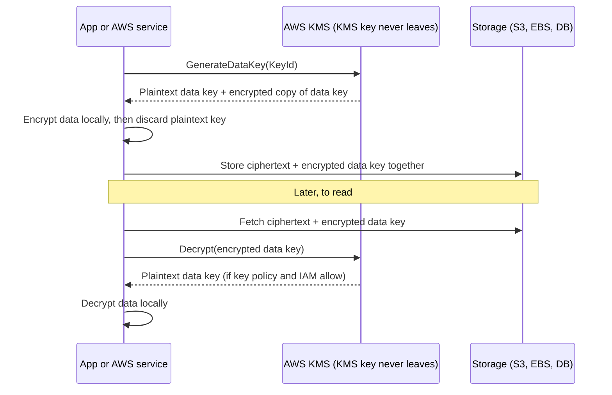
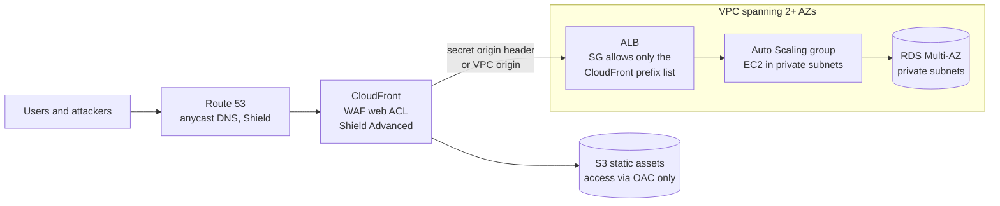

# 07 · Security and data protection

> [Home](../README.md) · [Study plan](../00-study-plan.md) · Next: [08 HA, DR, edge & operations](08-ha-dr-edge-ops.md)

| Covers task statements | Est. study time | Hands-on lab | Practice |
|---|---|---|---|
| 1.2, 1.3 (primary), 1.1 | ~3 hrs | [Lab 04](../labs/lab-04-s3-cloudfront.md) · [Lab 05](../labs/lab-05-rds-ha.md) | [D1 questions](../practice/d1-secure.md) |

Domain 1 is 30% of the exam, the largest share. [Module 01](01-iam-multi-account.md) covered *who* may act (IAM, Organizations, SCPs, IAM Identity Center) and [module 02](02-networking-vpc.md) covered *network* isolation. This module covers the rest: keys and secrets, edge protection, threat detection, audit and compliance, and immutability. Most questions here ask for "the most secure option with the least operational overhead", so the skill is knowing which managed service owns each job.

---

## 1. Encryption at rest and in transit

### 1.1 At rest: who holds the key, and who does the work

| Model | Who encrypts | Who manages the key | Exam signal |
|---|---|---|---|
| Server-side, AWS owned key (S3 SSE-S3, DynamoDB default) | The AWS service | AWS. You can't see it. | "Encrypt with minimal effort", no need to audit key use |
| Server-side, KMS key (S3 SSE-KMS, EBS, RDS, etc.) | The AWS service | AWS KMS. You control the policy if the key is customer managed. | "Audit every use of the key", "separate permission to decrypt", "control rotation" |
| Server-side, customer-provided key (S3 SSE-C) | The AWS service | You. The key is sent with every request and AWS doesn't store it. HTTPS is required. | "Keys must stay outside AWS, but S3 should do the encryption" |
| Client-side | Your code (AWS Encryption SDK, S3 Encryption Client) | You, usually with KMS-generated data keys | "Encrypt before the data leaves the client", "AWS must never see plaintext" |

S3 notes: every new object is encrypted with **SSE-S3 by default**. **SSE-KMS** adds key-level access control and a CloudTrail record of each key use. **DSSE-KMS** (dual-layer) applies two independent layers for regimes that demand it.

### 1.2 Encrypting resources that are already unencrypted

This is a favourite scenario: for most resources you **can't switch encryption on in place**.

| Resource | How to encrypt an existing unencrypted one |
|---|---|
| EBS volume | Snapshot → copy the snapshot with encryption on → create a volume (or AMI) from the copy. Turn on **EBS encryption by default** per Region so no new unencrypted volumes appear. |
| RDS / Aurora | Snapshot → copy the snapshot with a KMS key → restore a new instance → cut over. Encryption is chosen only at creation. A read replica has the same encryption status as its source. |
| S3 existing objects | Default encryption affects only new writes. Re-encrypt existing objects with **S3 Batch Operations** (copy in place). |
| EFS | Chosen at creation. Create an encrypted file system and copy the data across (e.g., with DataSync). |
| DynamoDB | Always encrypted. You can switch between AWS owned, AWS managed and customer managed keys at any time. |

### 1.3 In transit

- TLS terminates at CloudFront, ALB, NLB (TLS listener) or API Gateway using ACM certificates ([section 4](#4-acm-and-certificates)). If the requirement says **end-to-end encryption**, re-encrypt to the targets (HTTPS target group) or use an NLB TCP listener so the instance terminates TLS itself.
- To force TLS: an S3 bucket policy that denies requests where `aws:SecureTransport` is `false`; RDS parameter `rds.force_ssl` (PostgreSQL, SQL Server) or `require_secure_transport` (MySQL, MariaDB); in-transit encryption on ElastiCache; `require_ssl` on Redshift.
- **Private is not the same as encrypted.** Direct Connect is private but **not encrypted by default** ([section 10](#10-user-access-and-external-connections)).

---

## 2. AWS KMS

AWS KMS is a regional, multi-tenant managed service backed by FIPS-validated HSMs. Symmetric key material never leaves KMS in plaintext. The direct `Encrypt` API accepts only **4 KB** of plaintext, so real data is protected with envelope encryption (2.3).

### 2.1 Key ownership types

| | AWS owned key | AWS managed key | Customer managed key |
|---|---|---|---|
| Example | Default keys behind SSE-S3, DynamoDB | `aws/s3`, `aws/ebs`, `aws/rds` | A key you create, e.g., `alias/orders-prod` |
| Visible in your account | ❌ | ✅ | ✅ |
| You edit the key policy | ❌ | ❌ (view only) | ✅ |
| Rotation | AWS decides | Automatic, every year; you can't change it | Optional automatic rotation (period you choose), plus on-demand |
| Key use logged in your CloudTrail | ❌ | ✅ | ✅ |
| Usable cross-account | ❌ | ❌ | ✅ (via key policy) |
| Disable / schedule deletion | ❌ | ❌ | ✅ (7–30-day waiting period, default 30) |
| Monthly key fee | None | None | Yes (approx. 1 USD per key-month). API request charges apply too. |

**Rule:** once a question needs *control*, such as a custom key policy, cross-account sharing, disabling the key, separation of duties or a chosen rotation period, the answer is a **customer managed key**.

### 2.2 Key specs

- **Symmetric** (AES-256-GCM): the default, and what nearly every AWS service integration requires. It can't be exported.
- **Asymmetric** (RSA, ECC): the public key can be downloaded and the private key never leaves KMS. Use it for **sign/verify** (code signing, tokens) or when parties **outside AWS who can't call KMS** must encrypt data that only you can decrypt.
- **HMAC** keys: generate and verify message authentication codes.

### 2.3 Envelope encryption

Why it's designed this way:
- **No size limit.** Only a small data key travels to KMS, and the bulk cryptography runs locally and fast.
- **One KMS key protects millions of data keys**, so rotating the KMS key doesn't force you to re-encrypt the data.
- S3 SSE-KMS, EBS and RDS do all of this for you. You do it yourself only for client-side encryption, usually with the AWS Encryption SDK.

**Encryption context**: optional key-value pairs bound to the ciphertext as additional authenticated data. Decrypt fails unless the same context is supplied. The context appears in CloudTrail and can be required in key-policy conditions.

### 2.4 Key policies, IAM policies and grants

- Every KMS key has exactly **one key policy**, and it is the primary control. Unlike most services, **an IAM policy alone grants nothing on a KMS key unless the key policy allows it**.
- The default key policy includes a statement that gives the **account principal** (`arn:aws:iam::111122223333:root`) full access. Despite the ARN, this doesn't mean "root user only". It **delegates to IAM**, so IAM policies in that account can then grant `kms:Decrypt` and similar actions. Remove that statement and only principals named in the key policy can use the key.
- Separate **key administrators** (manage the key but can't use it) from **key users** (use it but can't manage it). This is how you show separation of duties.
- **Grants** are programmatic, narrowly scoped and revocable delegations of permissions for a key. AWS services use them to act on your behalf. For example, EC2 holds a grant so it can decrypt an EBS volume's data key while the volume is attached.
- Useful condition keys: `kms:ViaService` (the key is usable only through a given service, e.g., S3 in one Region), `kms:CallerAccount`, `kms:EncryptionContext:<key>`.

Evaluation: access is allowed if the key policy allows the principal directly, **or** the key policy delegates to the account **and** an IAM policy allows it, **or** a grant allows it. An explicit deny anywhere wins.

### 2.5 Cross-account key use

Two halves, and **both are required**:
1. The **key policy** in account A allows the principal (or the whole account) of account B.
2. An **IAM policy** in account B allows that principal to call the KMS actions on the key's **ARN**. Aliases don't resolve across accounts.

Classic scenarios:
- **Sharing an encrypted EBS snapshot, AMI or RDS snapshot** with another account requires a **customer managed key**, and you share the key too. If it is encrypted with `aws/ebs` or `aws/rds`, first copy it and re-encrypt it with a customer managed key, then share.
- **Cross-account reads of SSE-KMS objects in S3**: the reader needs `kms:Decrypt` through both halves. Objects under `aws/s3` can't be decrypted from another account.
- **Uploading to an SSE-KMS bucket** needs `kms:GenerateDataKey` (and `kms:Decrypt` for multipart uploads), and downloading needs `kms:Decrypt`. An S3 "Access Denied" with correct S3 permissions often means the KMS permissions are missing.

### 2.6 Rotation

| | Automatic rotation | Manual rotation |
|---|---|---|
| Applies to | Symmetric customer managed keys whose material KMS generated. AWS managed keys rotate yearly on their own. | Everything else: asymmetric, HMAC, imported key material, custom key stores. Also used when you want a brand-new key. |
| How | KMS creates new backing key material on schedule. **Default 365 days, configurable** (90–2,560 days). You can also trigger on-demand rotation. | Create a new key and **repoint the alias** to it. Apps that reference the alias pick it up. |
| Key ID / ARN | Unchanged | Changes, which is why apps should use aliases |
| Old ciphertext | Still decrypts, because KMS keeps every previous version of the material | Keep the old key enabled until the old data is re-encrypted or expired |

### 2.7 Multi-Region keys

- A **primary** key plus **replica** keys in other Regions that share the **same key ID (`mrk-…`) and key material**. Data encrypted in one Region can be decrypted in another with no cross-Region call and no re-encryption.
- Each replica is an independent resource with its own key policy, grants and aliases. Rotation is driven from the primary. You can promote a replica to primary.
- Uses: DR and active-active apps that do **client-side encryption** across Regions (e.g., with DynamoDB global tables), and signing in several Regions. Most AWS services still treat them as Regional keys (cross-Region snapshot copies re-encrypt with a destination-Region key either way), so don't use them by default.

### 2.8 Imported key material and custom key stores

- **Imported key material (BYOK):** you generate the material, wrap it with a KMS wrapping public key, and import it. You can set an **expiration** or delete the material immediately (instant crypto-shredding). You are responsible for its durability, so keep a copy. **No automatic rotation**: rotate manually with aliases.
- **Custom key stores** keep the KMS API and its service integrations while the key material lives elsewhere:
  - **CloudHSM key store**: key material lives in *your* CloudHSM cluster ([section 3](#3-aws-cloudhsm)).
  - **External key store (XKS)**: key material stays in an HSM you run outside AWS ("hold your own key").
  - Trade-off: you now own the availability, latency and cost of the key backend. Neither supports automatic rotation.

### 2.9 Quotas, cost and S3 Bucket Keys

- Cryptographic operations share a **per-account, per-Region request quota**, in the thousands to tens of thousands per second depending on Region and key type. It can be raised via Service Quotas. Going over it returns `ThrottlingException`.
- **High-volume SSE-KMS on S3** is the classic way to hit the quota, because each object operation calls KMS. **S3 Bucket Keys** make S3 derive a short-lived bucket-level key from your KMS key and generate object data keys from it locally. That **cuts KMS requests and cost dramatically** (AWS cites up to 99%). Side effect: CloudTrail shows the bucket ARN, not each object ARN, as the encryption context.
- Other fixes: data-key caching (Encryption SDK), a quota increase, and retries with exponential backoff.
- **Deleting a key destroys every piece of data encrypted under it.** Disable the key first, and alarm on attempted use (CloudTrail → CloudWatch metric filter) during the waiting period.

---

## 3. AWS CloudHSM

AWS CloudHSM gives you **dedicated, single-tenant HSMs in your VPC**, validated at **FIPS 140-3 Level 3** on the current HSM type. AWS manages the hardware, patching and encrypted backups. **You alone manage the crypto users and keys.** AWS can't see or recover your keys, so if you lose the credentials, the keys are gone.

- **High availability is your design job.** A cluster places ENIs in your subnets. Run **at least two HSMs in different AZs**, and the cluster synchronizes keys between them.
- Standard interfaces: **PKCS#11, JCE, Microsoft CNG/KSP, OpenSSL**. Typical uses: **SSL/TLS offload** for web servers, **Oracle TDE**, protecting a Microsoft AD CS private CA key, document and code signing, and as the backend of a **KMS custom key store**.
- Most AWS services don't integrate with CloudHSM directly. If you need "S3/EBS encryption **and** single-tenant HSM keys", use a **KMS custom key store backed by CloudHSM**.

| | AWS KMS | AWS CloudHSM |
|---|---|---|
| Tenancy | Multi-tenant managed service | **Single-tenant** HSMs in your VPC |
| Who controls keys | You control policy; AWS operates the service | **You have exclusive control**; AWS has no access |
| Validation | FIPS-validated HSMs | **FIPS 140-3 Level 3** (current HSM type) |
| APIs | AWS KMS API, IAM, key policies | PKCS#11, JCE, CNG/KSP, OpenSSL |
| AWS service integration | Native with 100+ services | Via KMS custom key store, or directly in your apps |
| HA / scaling | Built in | You add HSMs across AZs |
| Symmetric + asymmetric | ✅ | ✅ (including key types and algorithms KMS doesn't offer) |
| Cost | Per key-month + per request | Per HSM-hour (much higher) |
| Exam signal | "Managed", "integrated", "audit", "least overhead" | "**Single-tenant**", "**customer-exclusive key control**", "contractual or regulatory HSM requirement", "TLS offload", "Oracle TDE" |

---

## 4. ACM and certificates

AWS Certificate Manager (ACM) issues and manages TLS certificates for **integrated services**: ELB (ALB, NLB), CloudFront, API Gateway, App Runner, Amplify, and Elastic Beanstalk through its load balancer.

| Topic | What to know |
|---|---|
| Public certificates | **Free** for use with integrated services. Validated by **DNS** (a CNAME, which enables fully automatic renewal) or by email (renewal needs a human to approve). |
| Private certificates | Issued from **AWS Private CA**, a paid managed private CA hierarchy for internal TLS, mTLS and IoT devices. Private certificates can be exported to install anywhere. |
| Renewal | **ACM-issued certificates auto-renew** before expiry, provided DNS validation is still in place. **Imported certificates never auto-renew.** ACM sends expiry events to EventBridge (starting about 45 days ahead) and AWS Config has a managed rule for certificate expiry. |
| Regionality | ACM is Regional. **CloudFront (and edge-optimized API Gateway) requires the certificate in us-east-1.** An ALB, NLB or Regional API Gateway needs the certificate **in its own Region**, so a multi-Region app needs a certificate per Region. |
| On EC2 | Classic exam rule: ACM public certificates can't be installed on your own EC2 web server, so put an ALB or CloudFront in front. (AWS added a paid exportable-public-certificate option in 2025, but the exam's answer is still "use an integrated service".) |
| Multiple domains on one listener | ALB and NLB support **SNI** with multiple certificates, and one certificate can carry multiple SANs or a wildcard. |

---

## 5. Secrets and configuration

### 5.1 Comparison

| | AWS Secrets Manager | Systems Manager Parameter Store |
|---|---|---|
| Purpose | Secrets with a lifecycle: DB credentials, API keys, OAuth tokens | Configuration plus simple secrets |
| Encryption | Always KMS-encrypted (`aws/secretsmanager` or a customer managed key) | `SecureString` uses KMS. `String` and `StringList` are plaintext. |
| **Rotation** | **Built in.** A Lambda rotation function on a schedule, with AWS templates for RDS, Aurora, Redshift and DocumentDB. **Managed rotation** for some services, e.g., RDS can manage the master password in Secrets Manager with no Lambda. | **None built in.** You'd have to build it (EventBridge Scheduler + Lambda). |
| Cross-Region | **Replica secrets** in other Regions for DR and multi-Region apps | No native replication |
| Cross-account | Resource-based policy on the secret (plus a customer managed key) | Advanced-tier parameters can be shared via AWS RAM; otherwise use roles |
| Size and tiers | Secret value up to 64 KB | **Standard** (free, up to 10,000 parameters, 4 KB values, no parameter policies) and **Advanced** (charged, up to 100,000 parameters, 8 KB, **parameter policies** such as expiration notifications) |
| Cost | Per secret-month (approx. 0.40 USD) + API calls | Standard tier free. Advanced and higher-throughput settings are charged. |
| Extras | Random password generation, versioning labels (`AWSCURRENT`, `AWSPREVIOUS`), CloudFormation dynamic references | Hierarchies (`/app/prod/db-url`), versions and labels, public parameters (e.g., the latest Amazon Linux AMI ID), and it can reference Secrets Manager secrets |
| Pick it when | "**Rotate automatically**", "RDS credentials", "replicate to the DR Region" | "Store config cheaply", "no rotation needed", "feature flags, AMI IDs, endpoints" |

Both integrate with ECS task definitions, Lambda (via extensions or SDK), CloudFormation and CodeBuild. Cache secrets in the app instead of calling the API on every request.

### 5.2 Securing application credentials: the hierarchy

The exam always prefers **temporary credentials from roles** over stored keys.

| Workload | Right answer | Wrong answer |
|---|---|---|
| EC2 | **Instance profile (IAM role).** Credentials come from IMDS. **Enforce IMDSv2** to blunt SSRF attacks that steal role credentials. | Access keys in `~/.aws/credentials`, user data or the AMI |
| Lambda | Execution role | Keys in environment variables |
| ECS | **Task role** for the app's AWS calls. The **task execution role** is for the agent (pull from ECR, fetch secrets, write logs). | One shared instance role for every task |
| EKS | EKS Pod Identity or IRSA (IAM roles for service accounts) | Node role used by all pods |
| On-premises servers | **IAM Roles Anywhere** (X.509 certificates → temporary credentials), or a Systems Manager hybrid activation | Long-lived IAM user keys |
| CI/CD (e.g., GitHub Actions) | **OIDC federation** to assume a role | Keys stored as CI secrets |
| Humans | IAM Identity Center with temporary credentials ([module 01](01-iam-multi-account.md)) | IAM users with access keys |
| Third-party passwords and API keys the app needs | Secrets Manager, fetched at runtime with the role's permissions | Hardcoded in source or config files |

If a key leaks: **deactivate it, rotate it, review CloudTrail** for what it did, and move the workload to a role. GuardDuty flags credentials used from unexpected places, such as EC2 instance credentials used from outside AWS.

---

## 6. Edge and application protection

### 6.1 AWS WAF

A layer-7 firewall for HTTP(S), configured as a **web ACL** of rules evaluated in priority order.
- **Actions:** Allow, Block, Count (test a rule safely), CAPTCHA, Challenge. A default action applies when no rule matches.
- **Rule statements:** IP sets, **geo match** (country), **rate-based rules** (requests per IP or another aggregation key within a time window; offending sources are blocked while they exceed the limit), string and regex match, size constraints, **SQL injection** and **XSS** match statements, label matching.
- **Managed rule groups:** AWS Managed Rules (core rule set, known bad inputs, SQL database, IP reputation, anonymous IP list, OS- and app-specific sets) plus paid groups for **Bot Control** and **fraud control** (account takeover, fake account creation). AWS Marketplace sellers also offer rule groups.
- **Attaches to:** **CloudFront**, **ALB**, **API Gateway REST APIs**, **AppSync** GraphQL APIs, **Cognito user pools**, **App Runner**, **Verified Access**. A web ACL for CloudFront is global. The others are Regional.
- **Does not attach to:** NLB, EC2 directly, or API Gateway HTTP APIs. Front them with CloudFront, or use security groups, Network Firewall or Shield Advanced.
- Logs go to CloudWatch Logs, S3 or Firehose.

### 6.2 AWS Shield

| | Shield Standard | Shield Advanced |
|---|---|---|
| Cost | **Free, automatic** for every customer | Subscription (approx. 3,000 USD per month per organization, 1-year commitment) plus data transfer fees |
| Layers | L3/L4 (SYN floods, UDP reflection) | L3/L4 **plus L7** detection and **automatic application-layer mitigation** (it writes WAF rules for you) |
| Resources | All, especially CloudFront and Route 53 | You choose: **CloudFront, Route 53 hosted zones, Global Accelerator, ELB, EC2 Elastic IPs** |
| Response team | ❌ | **Shield Response Team (SRT**, formerly DRT) 24/7. Requires Business or Enterprise support. Optional proactive engagement. |
| **Cost protection** | ❌ | ✅ Service credits for scaling charges (EC2, ELB, CloudFront, Route 53) caused by an attack |
| Visibility | Basic | Near-real-time attack metrics and diagnostics, health-based detection with Route 53 health checks |
| WAF | Billed separately | WAF usage on protected resources is included |

### 6.3 AWS Firewall Manager

**Org-wide, centrally enforced policy** for: **WAF** web ACLs, **Shield Advanced** protections, **security groups** (common baselines, auditing over-permissive rules, finding unused groups), **Network Firewall**, Route 53 Resolver **DNS Firewall**, network ACLs and some third-party firewalls.
- Prerequisites: **AWS Organizations** with all features, a Firewall Manager administrator account, and **AWS Config** turned on in the member accounts and Regions.
- The key value: policies **automatically apply to new accounts and new resources** that match the scope, such as tagged ALBs in OU "Prod". Exam signal: "ensure every current *and future* account has the same WAF rules".

### 6.4 DDoS-resilient reference architecture

Why each piece is there:
- **Route 53 and CloudFront** run on AWS's global edge with Shield Standard built in. Their anycast design spreads volumetric attacks across many locations, and caching absorbs request floods before they reach the origin.
- **WAF on CloudFront** blocks L7 floods (rate-based rules), SQLi/XSS, bad bots and unwanted geographies at the edge.
- **Only CloudFront can reach the origin.** The ALB security group allows only the **AWS-managed prefix list for CloudFront origin-facing IPs**, and CloudFront adds a secret custom header that the ALB (or a second web ACL) checks. Alternatively, a **CloudFront VPC origin** reaches an ALB in *private* subnets with no public exposure at all. S3 accepts reads only via **Origin Access Control (OAC)**.
- **ALB + ASG across AZs** scale to absorb what reaches them. Shield Advanced cost protection covers the attack-driven scaling bill.
- Minimize attack surface: no public IPs on instances, private subnets, Session Manager instead of SSH ([module 08](08-ha-dr-edge-ops.md)).

### 6.5 Threat vectors mapped to controls

| Threat | Primary controls |
|---|---|
| Volumetric DDoS (L3/L4) | Shield Standard/Advanced, CloudFront, Route 53, Global Accelerator, ELB and Auto Scaling to absorb |
| HTTP flood (L7) | WAF **rate-based** rules, CloudFront caching, Shield Advanced automatic L7 mitigation |
| SQL injection, XSS | WAF **SQLi/XSS** rules and managed core rule set, plus parameterized queries and output encoding in the app |
| Bots, scraping, credential stuffing | WAF Bot Control, CAPTCHA/Challenge, fraud control rules, Cognito threat protection and MFA |
| **Credential leakage** (keys in code or repos) | IAM roles everywhere, Secrets Manager with rotation, GuardDuty, CloudTrail review, IAM Access Analyzer (unused access) |
| SSRF stealing instance credentials | **IMDSv2** (session tokens, hop limit), WAF rules, least-privilege instance roles |
| Data exfiltration | VPC endpoint policies, bucket policies with `aws:SourceVpce` / `aws:PrincipalOrgID`, Macie, GuardDuty S3 Protection |
| Compromised instance (crypto-mining, C2 traffic) | GuardDuty (with Runtime Monitoring), Inspector to patch CVEs, isolate with a restrictive SG, snapshot for forensics |
| Ransomware or malicious deletion | **S3 Object Lock**, versioning + MFA Delete, **Backup Vault Lock**, cross-account backup copies |
| Eavesdropping / man in the middle | TLS with ACM certificates, Site-to-Site VPN, **MACsec** on Direct Connect |
| Misconfiguration (public bucket, open SG) | S3 Block Public Access, Config rules + auto-remediation, Security Hub, Firewall Manager SG policies, SCPs |

---

## 7. Threat detection and security posture

| Service | Job | Inputs | Exam keyword |
|---|---|---|---|
| **Amazon GuardDuty** | ML/threat-intel **threat detection** | Foundational sources: **CloudTrail management events, VPC Flow Logs, Route 53 Resolver DNS logs** (GuardDuty reads them directly, so you don't enable them). Optional protection plans: **S3** (data events), **EKS** audit logs, **Runtime Monitoring** (EKS, ECS on Fargate, EC2 via agent), **Malware Protection** for EC2 (agentless EBS scan) and **for S3** (scans new uploads), RDS/Aurora login activity, Lambda network activity | "Detect compromised instances, crypto-mining, unusual API calls, credential exfiltration, malicious IPs" |
| **Amazon Macie** | **Sensitive-data discovery in S3** (PII, financial data, credentials) and bucket posture (public, unencrypted, shared) | S3 objects. Managed and custom (regex) data identifiers, automated sampling-based discovery, or targeted jobs. | "Find PII in S3", "GDPR data inventory" |
| **Amazon Inspector** | **Vulnerability management** (CVEs) and network reachability | **EC2** (via SSM Agent, or agentless EBS-snapshot scanning), **ECR images** (on push and re-scanned as new CVEs appear), **Lambda** functions and code | "Scan EC2/containers/Lambda for software vulnerabilities continuously" |
| **Amazon Detective** | **Investigation and root cause** with a behaviour graph | CloudTrail, VPC Flow Logs, GuardDuty findings, EKS audit logs. Builds on GuardDuty. | "Investigate a finding", "visualize what else this IP or role did" |
| **AWS Security Hub** | **Aggregation + posture checks** | Findings from GuardDuty, Inspector, Macie, Firewall Manager, IAM Access Analyzer, Config and partners in a common format. Automated checks against standards: **AWS Foundational Security Best Practices, CIS AWS Foundations Benchmark**, PCI DSS, NIST 800-53. **Requires AWS Config.** | "Single dashboard across accounts", "compliance score against CIS" |
| IAM Access Analyzer | External and unused access, policy validation | Resource policies, IAM activity | "Which resources are shared outside the org?" ([module 01](01-iam-multi-account.md)) |

Notes:
- In 2025 AWS renamed the posture-check part to **Security Hub CSPM** and launched a broader Security Hub that correlates signals across these services. For the exam, "Security Hub" means **central aggregation + standards-based checks**.
- All of these are **Regional** and support a **delegated administrator** account in AWS Organizations, so you enable them org-wide and in every Region.
- **Detection services don't remediate.** The pattern is: **finding → EventBridge rule → Lambda / SSM Automation / Step Functions / SNS**. Example: GuardDuty finds an EC2 instance talking to a crypto-mining pool → EventBridge → Lambda swaps its security group to a quarantine SG and snapshots the volume.

---

## 8. Governance and audit

### 8.1 AWS CloudTrail: who did what, when, from where

- **Event history**: 90 days of **management events**, free and on by default, per Region. For anything longer or for analysis, create a **trail** (to S3, optionally also CloudWatch Logs) or use **CloudTrail Lake**.
- **Management events** (control plane, e.g., `CreateBucket`, `RunInstances`, console sign-in) vs **data events** (data plane, e.g., S3 `GetObject`/`PutObject`, Lambda `Invoke`, DynamoDB item-level operations). **Data events are off by default**, high-volume and charged. **Insights events** flag unusual API call rates or error rates.
- **Organization trail**: created in the management account (or a delegated admin) and logs every member account. Members can't modify or delete it. Send it to a bucket in a dedicated **log-archive account**.
- **Log file integrity validation**: CloudTrail writes hourly signed **digest files** (SHA-256 hashes, RSA signatures), so you can prove that log files weren't modified or deleted (`aws cloudtrail validate-logs`). Combine it with SSE-KMS, a restrictive bucket policy, MFA Delete or **S3 Object Lock** on the log bucket.
- **Near-real-time alerting**: CloudTrail → CloudWatch Logs **metric filter** → alarm (e.g., root sign-in, `UnauthorizedOperation`), or EventBridge rules on API calls.
- **CloudTrail Lake**: a managed event data store you query with **SQL**, with long retention (years). It can also ingest Config items and non-AWS events. Choose it over "trail to S3 + Athena" when the question wants built-in querying with little setup.

### 8.2 AWS Config: what does it look like, and is it compliant?

- The **configuration recorder** captures **configuration items** for supported resources, so you get **resource history** ("what did this SG look like last Tuesday?") and **relationships** (which instance used this ENI).
- **Rules** evaluate compliance. **Managed rules** include `s3-bucket-public-read-prohibited`, `encrypted-volumes`, `restricted-ssh`, `required-tags` and `iam-root-access-key-check`. **Custom rules** are written in Lambda or Guard. Rules trigger on configuration change or on a schedule.
- **Remediation** uses **SSM Automation runbooks**, either manual or **automatic** with retries (e.g., re-enable Block Public Access, or remove a 0.0.0.0/0 SSH rule).
- **Conformance packs**: a packaged set of rules and remediations (sample packs exist for CIS, PCI DSS, HIPAA and other frameworks), deployable **across an organization**.
- **Aggregators** give a multi-account, multi-Region compliance view. Advanced queries use a SQL-like syntax.
- **Config detects; it doesn't prevent.** Prevention comes from SCPs, IAM, permission boundaries and S3 Block Public Access. Config costs scale with configuration items recorded and rule evaluations.

| Question asks | Service |
|---|---|
| "Who changed the security group / deleted the table?" | CloudTrail |
| "What was the configuration at a point in time, and is it compliant now?" | Config |
| "Alert within minutes when someone signs in as root" | CloudTrail → CloudWatch metric filter/alarm, or EventBridge |
| "Automatically fix unencrypted or public resources" | Config rule + SSM Automation remediation |
| "Prove the audit logs are untampered" | CloudTrail log file integrity validation |

### 8.3 AWS Audit Manager and AWS Artifact

- **Audit Manager** continuously **collects evidence** from your accounts (Config, CloudTrail, Security Hub) and maps it to frameworks such as PCI DSS, HIPAA, SOC 2 and GDPR, so you can produce assessment reports for *your* workload's audit.
- **Artifact** is a self-service portal for **AWS's own** compliance reports (SOC 1/2/3, PCI DSS attestation, ISO certificates) and for **agreements**, such as the **HIPAA Business Associate Addendum (BAA)**, accepted per account or for the whole organization.
- ⚠️ Trap: Artifact proves *AWS's* side of the shared responsibility model. It doesn't assess your resources.

---

## 9. Data protection lifecycle

### 9.1 Classification and retention

- **Classify**: define levels (e.g., public, internal, confidential, restricted), tag resources with them (`DataClassification=Confidential`), use **Macie** to find sensitive data that isn't where it should be, and drive access with tag-based ABAC ([module 01](01-iam-multi-account.md)).
- **Retain, then delete on schedule**: S3 Lifecycle expiration ([module 04](04-storage.md)), AWS Backup plan retention rules, CloudWatch Logs retention (log groups never expire by default), DynamoDB TTL. RDS automated backups keep at most **35 days**, so use AWS Backup or manual snapshots for longer retention.
- **Protect from accidents**: S3 versioning, RDS and DynamoDB deletion protection, EC2 termination protection, and Recycle Bin for EBS snapshots and AMIs.

### 9.2 Immutability (WORM)

| | S3 Object Lock: Governance | S3 Object Lock: Compliance | S3 Legal hold |
|---|---|---|---|
| Who can delete or shorten retention early | Users with `s3:BypassGovernanceRetention` who send the bypass header | **No one, including the root user**, until retention expires (retention can be extended, never shortened) | Anyone with `s3:PutObjectLegalHold` can remove the hold |
| Duration | Retention period | Retention period | **No expiry**, until it is removed |
| Use | Protect against most users; test lock settings | **Regulatory WORM** (e.g., SEC 17a-4-style rules, "N years, undeletable") | Litigation, investigation |

- Object Lock **requires versioning** and works per object version. A simple DELETE only adds a delete marker, and the locked version survives. You can set a bucket default retention, and Object Lock can now be enabled on existing buckets.
- **MFA Delete**: only the bucket owner's root user can enable it, via CLI/API. It then requires MFA to permanently delete versions or change versioning.
- **AWS Backup Vault Lock**: Governance mode, or **Compliance mode**, which becomes immutable after a grace period of at least 3 days. After that no one, including the root user or AWS, can delete recovery points early or change the lock. Combine it with **cross-account backup copies** into a separate security account (and logically air-gapped vaults) for ransomware resilience. See [module 08](08-ha-dr-edge-ops.md).
- **S3 Glacier Vault Lock** is the older, vault-level equivalent for Glacier vaults, and it is immutable once confirmed.

### 9.3 Data access governance

For a data lake, **AWS Lake Formation** centralizes permissions on Glue Data Catalog tables, down to **column, row and cell level** with LF-tags and cross-account sharing, instead of juggling bucket policies per team. See [module 09](09-data-analytics-migration.md).

---

## 10. User access and external connections

### 10.1 App users: Amazon Cognito

- **User pools**: a user directory for sign-up and sign-in, MFA, social/SAML/OIDC federation, and **JWT** issuance. It integrates with **ALB authentication** and **API Gateway authorizers**.
- **Identity pools**: exchange a token (from a user pool or a social IdP) for **temporary AWS credentials** scoped by IAM role, e.g., a mobile app uploading directly to its own S3 prefix.
- Details and the identity-pool vs user-pool decision are in [module 01](01-iam-multi-account.md).

### 10.2 Securing connections to on-premises and other networks

| Need | Answer |
|---|---|
| Encrypted site-to-site connection over the internet | **Site-to-Site VPN** (IPsec, two tunnels per connection) |
| Remote users into the VPC | **Client VPN** (TLS-based, managed) |
| Private, consistent bandwidth | **Direct Connect**, but it is **not encrypted by default** |
| Encrypted Direct Connect | **MACsec** (layer-2 encryption on supported dedicated connections at higher port speeds) or an **IPsec VPN running over Direct Connect** |
| Reach AWS services without the internet | VPC gateway endpoints (S3, DynamoDB) and interface endpoints (PrivateLink) with **endpoint policies** |
| Expose your service privately to other VPCs or accounts | **PrivateLink** (NLB-backed endpoint service) |

Details are in [module 02](02-networking-vpc.md).

---

## 11. How the exam tests this

| If the question says… | Think… |
|---|---|
| "Encrypt at rest, audit each key use, control who can decrypt" | **SSE-KMS with a customer managed key**, key policy, CloudTrail |
| "Single-tenant HSM", "exclusive control of keys", "FIPS 140-3 Level 3" | **CloudHSM** (or a KMS custom key store on CloudHSM if S3/EBS integration is also needed) |
| "Encrypt before upload; AWS must never see plaintext" | **Client-side encryption** with KMS data keys (Encryption SDK) |
| "Decrypt in the DR Region without re-encrypting" (client-side) | **KMS multi-Region keys** |
| "SSE-KMS bucket, very high request rate, `ThrottlingException`" | **S3 Bucket Keys** |
| "Share an encrypted snapshot/AMI with another account" | Customer managed key + key policy grant to the account (re-encrypt if it uses an AWS managed key) |
| "Rotate database credentials automatically" | **Secrets Manager** rotation (RDS integration) |
| "Store config and some secrets cheaply, rotation not required" | **Parameter Store** (SecureString, Standard tier) |
| "HTTPS on a custom domain for CloudFront" | ACM certificate in **us-east-1** |
| "Third-party certificate expired and caused an outage" | Imported certs don't auto-renew. Monitor via EventBridge/Config, or switch to ACM-issued with DNS validation. |
| "Block SQLi/XSS", "block countries", "throttle IPs hammering /login" | **WAF** (managed rules, geo match, rate-based) on CloudFront/ALB/API Gateway |
| "DDoS cost protection", "24/7 DDoS experts" | **Shield Advanced** |
| "Same firewall rules across all accounts, including future ones" | **Firewall Manager** |
| "Detect compromised instances or anomalous API activity" | **GuardDuty** |
| "Find PII in S3" | **Macie** |
| "CVE scanning for EC2, ECR images, Lambda" | **Inspector** |
| "Root-cause investigation of a finding" | **Detective** |
| "Central findings dashboard + CIS/FSBP compliance across accounts" | **Security Hub** |
| "Who deleted it?" vs "Is it compliant / what did it look like?" | **CloudTrail** vs **Config** |
| "Auto-remediate non-compliant resources" | **Config rule + SSM Automation** |
| "Prove the logs weren't altered" | **CloudTrail log file integrity validation** (+ Object Lock on the bucket) |
| "Download a SOC report", "accept the BAA" | **Artifact** |
| "WORM for 7 years; even admins can't delete" | **S3 Object Lock Compliance mode** / **Backup Vault Lock Compliance mode** |
| "Encrypt traffic over Direct Connect" | **MACsec** or **VPN over DX** |
| "App on EC2 needs S3 access" | **IAM role via instance profile**, never access keys |

---

## 12. Common traps

- ⚠️ Trap: **AWS managed keys can't be used cross-account** and their policies can't be edited. Sharing encrypted snapshots, AMIs or SSE-KMS objects across accounts needs a **customer managed key**.
- ⚠️ Trap: **An IAM policy alone doesn't grant KMS access.** The key policy must allow it, either directly or by delegating to the account.
- ⚠️ Trap: You **can't encrypt an existing unencrypted RDS instance or EBS volume in place**. Snapshot → encrypted copy → restore.
- ⚠️ Trap: KMS `Encrypt` handles only 4 KB. For larger data the answer is **envelope encryption** (`GenerateDataKey`), not "call Encrypt in chunks".
- ⚠️ Trap: **Automatic rotation keeps the same key ID** and needs no re-encryption. Imported key material and custom key stores **don't support automatic rotation**: rotate manually with aliases.
- ⚠️ Trap: **Imported ACM certificates don't auto-renew**, and a certificate for **CloudFront must be in us-east-1**.
- ⚠️ Trap: **Parameter Store has no built-in rotation.** "Rotate automatically" means Secrets Manager.
- ⚠️ Trap: **WAF doesn't attach to an NLB or directly to EC2.** Put CloudFront (or an ALB) in front, or use Shield Advanced and security groups.
- ⚠️ Trap: **Shield Standard is already on, for free.** Don't pick "enable Shield Standard" as a step. SRT access, cost protection and L7 auto-mitigation are **Advanced** only.
- ⚠️ Trap: GuardDuty **doesn't require** you to turn on VPC Flow Logs, DNS logs or a trail, and it **doesn't remediate** on its own (use EventBridge).
- ⚠️ Trap: **Macie is S3 only.** Inspector scans EC2/ECR/Lambda, not RDS. Detective investigates; it doesn't detect first.
- ⚠️ Trap: **Security Hub and Firewall Manager both depend on AWS Config** being enabled.
- ⚠️ Trap: CloudTrail Event history holds only **90 days of management events**. **Data events** (S3 object-level, Lambda invoke) aren't logged until you enable them on a trail or event data store.
- ⚠️ Trap: **Config is detective, not preventive.** "Prevent anyone from…" is an SCP, IAM or Block Public Access answer.
- ⚠️ Trap: **Object Lock Governance mode can be bypassed** by privileged users. "Even the root user can't delete" means **Compliance mode**. Object Lock needs versioning.
- ⚠️ Trap: **Direct Connect isn't encrypted.** A "private connection" isn't the same as an "encrypted connection".
- ⚠️ Trap: Scheduling a KMS key for deletion is irreversible once the waiting period ends. **Disable** first if you're unsure.

---

## 13. Quick self-check

1. A role in account B must decrypt S3 objects encrypted with a KMS key in account A. What two policies must allow it?
2. You rotate a customer managed key automatically. Do applications need to change the key ID, and do you need to re-encrypt old data?
3. A web app on CloudFront + ALB in eu-west-1 needs HTTPS on `www.example.com`. Where must the certificates live?
4. Which service finds credit-card numbers in S3, and which one finds CVEs in container images?
5. A regulator requires backups that no one, including the root user, can delete for 7 years. Name two ways to meet it.

Answers

1. The **key policy** in account A must allow account B (or the role), **and** an **IAM policy** on the role in account B must allow `kms:Decrypt` on the key ARN. The bucket policy must also allow the S3 read.
2. **No and no.** The key ID and ARN stay the same, and KMS keeps the old key material, so old ciphertext still decrypts.
3. The CloudFront certificate in **us-east-1**. If the ALB also serves HTTPS (CloudFront → ALB), it needs its own ACM certificate in **eu-west-1**.
4. **Macie** for sensitive data in S3. **Inspector** for CVEs in ECR images (and on EC2 and Lambda).
5. **AWS Backup Vault Lock in Compliance mode** (after the grace period), and/or **S3 Object Lock in Compliance mode** with a 7-year retention. Add cross-account copies for extra resilience.

Practice: [D1 Secure architectures questions](../practice/d1-secure.md) · Labs: [Lab 04: S3 + CloudFront](../labs/lab-04-s3-cloudfront.md) · [Lab 05: RDS HA](../labs/lab-05-rds-ha.md)
