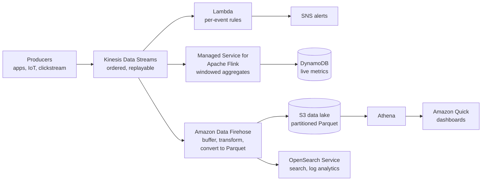
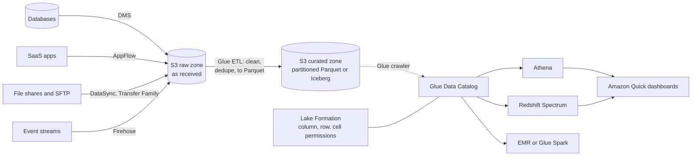

# 09 · Data, analytics and migration

> [Home](../README.md) · [Study plan](../00-study-plan.md) · Next: [10 Cost optimization](10-cost-optimization.md)

| Covers task statements | Est. study time | Hands-on lab | Practice |
|---|---|---|---|
| 3.5 (primary), 3.1, 4.1, 4.3 | ~2 hrs | [Lab 07](../labs/lab-07-data-lake.md) | [D3 questions](../practice/d3-high-performing.md) |

> **New to AWS?** Read these plain-English pages first: [Analytics services](../beginner/services/analytics.md) · [Migration & transfer services](../beginner/services/migration-transfer.md) · [AI & ML services](../beginner/services/ai-ml.md). Look up unfamiliar terms in the [glossary](../beginner/glossary.md).

Task 3.5 ("high-performing data ingestion and transformation") draws on many analytics services, but the exam asks architect-level questions: *which* ingestion service, *which* query engine, *which* format, *which* transfer tool, and how to make it cheaper. You don't need deep Spark or Kafka knowledge. You need the decision rules below.

---

## 1. Ingestion patterns

| Pattern | Latency | Typical size and frequency | AWS services |
|---|---|---|---|
| **Batch** | Hours to a day | Large files or DB extracts on a schedule | DataSync, Transfer Family, DMS full load, AppFlow (scheduled), Glue jobs, Snowball Edge for bulk |
| **Micro-batch / near real-time** | Seconds to minutes | Continuous small records, buffered | **Amazon Data Firehose**, Glue streaming jobs, Lambda batching from a stream |
| **Streaming / real-time** | Milliseconds to seconds | Continuous events, ordered, replayable | **Kinesis Data Streams**, **MSK**, Managed Service for Apache Flink |
| Change data capture | Seconds | Row-level DB changes | DMS CDC, DynamoDB Streams, MSK Connect (Debezium), zero-ETL integrations into Redshift |
| SaaS ingestion | Scheduled or event-driven | Salesforce, SAP, ServiceNow, Zendesk and similar | **Amazon AppFlow** |

Questions to ask of every scenario: **How fresh must the data be? Do multiple consumers need it? Must it be replayable or ordered? Who operates it (serverless vs clusters)? Where does it land?**

---

## 2. The Kinesis family

### 2.1 Kinesis Data Streams (KDS)

- **Shards** are the unit of capacity. Each shard takes **1 MB/s or 1,000 records/s of writes** and serves **2 MB/s of reads**, shared across standard consumers.
- **Capacity modes:** **provisioned** (you choose and reshard the shard count, and pay per shard-hour) or **on-demand** (scales automatically with traffic, billed per stream-hour plus data volume; best for unpredictable or new workloads).
- **Retention: 24 hours by default, extendable up to 365 days.** Consumers can **replay** from any point in the retention window, and **many independent consumers** can read the same data.
- **Ordering is per shard.** Records with the same **partition key** go to the same shard in order. A low-cardinality key causes **hot shards** and `ProvisionedThroughputExceededException`. Fix it with a high-cardinality key, more shards (or on-demand), and producer retries with backoff.
- **Enhanced fan-out:** each registered consumer gets its **own 2 MB/s per shard**, pushed over HTTP/2 with lower latency. Use it when several consumers would otherwise fight over the shared 2 MB/s.
- **Producers:** AWS SDK (`PutRecord(s)`), Kinesis Producer Library (batching and aggregation), Kinesis Agent, CloudWatch Logs subscriptions, IoT Core rules.
- **Consumers:** **Lambda** event source mapping (batch size, batching window, a parallelization factor for more concurrency per shard, bisect-on-error, on-failure destinations), **KCL** applications on EC2/ECS (a DynamoDB table tracks leases and checkpoints), Firehose, Managed Flink, Glue streaming.
- Security: server-side encryption with KMS, IAM, interface VPC endpoints.

### 2.2 Amazon Data Firehose (formerly Kinesis Data Firehose)

- **Fully managed delivery.** There are no shards, it scales automatically, and you pay per GB ingested.
- **Near real-time, not real-time.** It **buffers** by size (MiB) and time (seconds up to 15 minutes) before delivery.
- **Sources:** Direct PUT, Kinesis Data Streams, MSK, CloudWatch Logs, EventBridge, IoT, WAF logs.
- **Destinations:** **S3**, **Redshift** (staged in S3 then loaded with `COPY`), **OpenSearch Service and OpenSearch Serverless**, **Splunk**, **HTTP endpoints** and partner tools (e.g., Datadog, New Relic, Snowflake), and Apache Iceberg tables.
- **Transformations:** a **Lambda transform** per batch (enrich, filter, re-shape). **Record format conversion** from JSON to **Parquet or ORC** using a schema from the **Glue Data Catalog**. **Dynamic partitioning** writes to S3 prefixes based on keys inside the records (e.g., `customer_id=…/date=…`). Compression (GZIP, Snappy, ZIP). Failed records go to an S3 backup prefix.
- ⚠️ **No storage and no replay**, and you can't attach your own consumers. If you need those, put Kinesis Data Streams in front.

### 2.3 Managed Service for Apache Flink and Kinesis Video Streams

- **Amazon Managed Service for Apache Flink** (formerly Kinesis Data Analytics) runs Apache Flink apps (Java, Python, Scala, or Flink SQL in Studio notebooks) for **real-time stateful processing**: windowed aggregations, joins between streams, anomaly detection, enrichment. Sources and sinks include KDS, MSK, S3, Firehose and OpenSearch. The older SQL-only Kinesis Data Analytics is discontinued.
- **Amazon Kinesis Video Streams** ingests, stores and indexes **video and other time-encoded media** from cameras and devices, supports HLS/DASH playback and WebRTC, and feeds ML such as **Rekognition Video** or SageMaker AI.

### 2.4 Kinesis Data Streams vs Firehose

| | Kinesis Data Streams | Amazon Data Firehose |
|---|---|---|
| Latency | **Real-time** (~sub-second) | **Near real-time** (buffered) |
| Capacity management | Shards (provisioned) or on-demand | None, fully automatic |
| Storage and replay | ✅ 24 h–365 days | ❌ |
| Consumers | Your own: Lambda, KCL, Flink, Firehose, multiple at once | None. It delivers to destinations. |
| Transformations | In your consumer code | Built in: Lambda transform, Parquet/ORC conversion, dynamic partitioning |
| Pick it when | "Custom real-time processing", "multiple consumers", "replay", "ordering" | "Load streaming data into S3/Redshift/OpenSearch/Splunk with **least operational overhead**" |

---

## 3. Amazon MSK, and choosing between MSK, Kinesis and SQS

**Amazon MSK** runs Apache Kafka for you:
- **MSK provisioned**: brokers spread across 2–3 AZs that you size. Standard brokers (with tiered storage) or Express brokers (more throughput per broker, faster scaling, storage managed for you).
- **MSK Serverless**: capacity is managed automatically and you pay for usage (partitions, data throughput, storage) instead of sizing brokers. IAM authentication.
- **MSK Connect**: managed **Kafka Connect** connectors (e.g., Debezium CDC from databases, S3 sink).
- Other features: MSK Replicator for cross-cluster and cross-Region replication. IAM, SASL/SCRAM or mTLS authentication. KMS at rest, TLS in transit.

| | Kinesis Data Streams | Amazon MSK | Amazon SQS ([module 06](06-decoupling-serverless.md)) |
|---|---|---|---|
| Model | Ordered, replayable stream (shards) | Ordered, replayable log (topics and partitions) | Queue. Messages are deleted after processing. |
| Multiple independent consumers | ✅ | ✅ (consumer groups) | ❌ Use SNS fan-out to multiple queues |
| Retention | Up to 365 days | Configurable, effectively unlimited with tiered storage | Up to 14 days |
| Ecosystem | AWS-native (Lambda, Firehose, Flink) | **Open-source Kafka APIs**, connectors, Kafka Streams | AWS-native |
| Ops effort | Low (on-demand) | Medium (provisioned) to low (Serverless) | Lowest |
| Choose when | Real-time AWS-native streaming | "**Existing Kafka** apps", "migrate on-premises Kafka", Kafka-specific features or portability | Decouple producers and consumers, work queues, no replay needed |

---

## 4. Reference streaming architecture

One stream feeds three consumers with different latency needs: Lambda for instant per-event actions, Flink for real-time aggregates, and Firehose for cheap, near-real-time landing in the lake and in OpenSearch.

---

## 5. Data lakes on S3

### 5.1 Layout

- **S3 is the storage layer**: virtually unlimited, 11 nines of durability, cheap tiers, and compute decoupled from storage.
- **Zones** (separate prefixes or buckets):
  - **Raw/landing**: immutable data exactly as received.
  - **Curated/cleansed**: validated, deduplicated, converted to columnar formats, partitioned.
  - **Analytics/consumption**: aggregates and data marts.
- **Partition** by the columns you filter on most, usually date: `s3://lake/curated/sales/year=2026/month=11/day=05/`. Engines then skip irrelevant prefixes (partition pruning). Avoid millions of tiny files, because compaction to ~128 MB–1 GB files speeds every engine.
- **Open table formats** such as **Apache Iceberg** add ACID transactions, schema evolution and time travel on S3. Athena, Glue, EMR and Redshift support them, and **S3 Tables** offers managed Iceberg tables.

### 5.2 File formats

| Format | Layout | Schema | Compression | Best for | Avoid for |
|---|---|---|---|---|---|
| CSV | Row, text | None (header at best) | Poor | Interchange, small data, humans | Large-scale analytics (full scans, no types) |
| JSON | Row, text, nested | Self-describing per record | Poor | APIs, logs, semi-structured raw data | Analytics at scale (verbose, scans everything) |
| **Parquet** | **Columnar**, binary | Embedded | Excellent (per column) | **Athena, Redshift Spectrum, Spark, Glue**: read only the needed columns, predicate pushdown | Row-by-row writes or streaming appends |
| **ORC** | **Columnar**, binary | Embedded | Excellent | Hive-centric workloads, same benefits as Parquet | |
| **Avro** | **Row**, binary | Embedded, with **schema evolution** | Good | **Streaming and Kafka** records, write-heavy pipelines, schema registries | Column-selective analytics |

**Exam rule:** "reduce Athena cost / improve query performance" → **convert to Parquet or ORC, compress, partition**.

---

## 6. AWS Glue

| Component | What it does | Exam signal |
|---|---|---|
| **Data Catalog** | A central, Hive-compatible **metastore** (databases, tables, schemas, partitions), used by **Athena, Redshift Spectrum, EMR, Lake Formation** and Firehose format conversion | "Central metadata repository" |
| **Crawlers** | Scan S3, JDBC sources or DynamoDB, **infer schemas**, create or update tables and partitions, on a schedule | "Automatically discover schema and new partitions" |
| **ETL jobs** | **Serverless Apache Spark** (PySpark/Scala) batch or streaming jobs, plus lightweight Python shell jobs. Billed per DPU-second. Glue Studio is the visual editor. Flex execution suits non-urgent jobs at lower cost. | "Serverless ETL", "transform CSV to Parquet on a schedule" |
| **Job bookmarks** | Track what was already processed so reruns handle **only new data** | "Avoid reprocessing old files" |
| **Glue DataBrew** | **No-code, visual data preparation** with hundreds of built-in transforms and data profiling | "Analysts clean data without writing code" |
| Data Quality, workflows/triggers, Schema Registry | Rules-based quality checks, orchestrating crawlers and jobs, schema validation for streaming (Kafka/Kinesis) | |

⚠️ **Crawlers catalog data but don't transform it.** ETL jobs do the transforming.

---

## 7. AWS Lake Formation

- **Builds and governs data lakes on top of the Glue Data Catalog.** Instead of a tangle of S3 bucket policies and IAM policies per team, you **GRANT/REVOKE** on catalog databases, tables and **columns**, with **data filters** for **row-level and cell-level** security.
- **LF-tags** (tag-based access control) scale permissions: tag tables or columns `Confidentiality=High` and grant analysts access by tag.
- **Cross-account sharing** of catalog resources (via AWS RAM), the standard pattern for a **data mesh** of producer and consumer accounts.
- Enforced by integrated engines: **Athena, Redshift Spectrum, EMR, Glue, Amazon Quick**. Blueprints help ingest from databases.
- Exam signal: "analysts in different departments/accounts may see only certain **columns or rows** of the same tables" → **Lake Formation**.

---

## 8. Query and processing engines

### 8.1 Amazon Athena

- **Serverless SQL** (Trino/Presto-based) directly on data in S3, using the Glue Data Catalog for schemas. **Pay per TB scanned** (approx. 5 USD/TB in many Regions, with a small per-query minimum).
- **Cost and performance levers:** **partitioning** (and partition projection), **columnar formats**, **compression**, fewer and larger files, selecting only the columns you need. **CTAS** (`CREATE TABLE AS SELECT`) or `INSERT INTO` converts CSV/JSON into partitioned Parquet in one query.
- **Workgroups** separate teams, enforce **per-query or per-workgroup data-scanned limits** and track cost. Query result reuse avoids re-scanning. Provisioned capacity gives dedicated compute.
- **Federated query** uses Lambda-based connectors to query DynamoDB, RDS, Redshift, CloudWatch Logs, on-premises JDBC sources and more, joined with S3 data, without moving it.
- Classic uses: ad-hoc analysis of **CloudTrail, ALB, VPC Flow Logs and CUR** data in S3. It also supports Iceberg tables (ACID) and Apache Spark notebooks.

### 8.2 Amazon Redshift

- **Columnar, MPP data warehouse** for structured and semi-structured analytics at TB–PB scale with consistent, fast performance under **high concurrency**.
- **Provisioned** clusters (RA3 nodes with managed storage that separates compute from storage) or **Redshift Serverless** (capacity in RPUs, pay while queries run).
- **Redshift Spectrum** queries data **in S3** through external tables in the Glue Data Catalog and joins it with warehouse tables, so you don't have to load cold data.
- Getting data in: `COPY` from S3 (parallel, so split files), **zero-ETL integrations** from Aurora, RDS and DynamoDB, **streaming ingestion** from KDS/MSK. `UNLOAD` exports to S3 (Parquet).
- Scale and share: **concurrency scaling** for bursts, materialized views, **data sharing** across clusters and accounts without copying, Multi-AZ (RA3), automated snapshots with **cross-Region snapshot copy** for DR.
- ⚠️ Redshift is OLAP. It isn't for high-rate single-row OLTP transactions (that's RDS/Aurora/DynamoDB).

### 8.3 Amazon EMR

- **Managed big-data frameworks**: Spark, Hive, HBase, Presto/Trino, Flink, Hudi, Iceberg. Choose it over Glue when you need **framework control, custom configuration, specific versions, or long-running clusters**.
- **EMR on EC2** node types: **primary** (coordinates), **core** (runs tasks **and stores HDFS data**), **task** (compute only). Put **Spot Instances on task nodes** for big savings. Keep primary and core On-Demand, because losing core nodes loses HDFS data. Instance fleets mix instance types for Spot resilience. **Managed scaling** adjusts capacity.
- Store data in **S3 (EMRFS)**, not HDFS, so clusters can be **transient**: spin up, run steps, terminate.
- **EMR Serverless**: run Spark and Hive jobs with no cluster to size. **EMR on EKS**: run Spark on your existing EKS clusters alongside other workloads.

### 8.4 Amazon OpenSearch Service

- Managed **OpenSearch** (the open-source fork of Elasticsearch, which still runs legacy Elasticsearch versions) for **full-text search, log and observability analytics, and vector search**, with OpenSearch Dashboards.
- Domains: data nodes, **dedicated cluster-manager (master) nodes** (3, across AZs), **Multi-AZ with standby** for the highest availability, and hot, **UltraWarm** and cold storage tiers for cheaper retention of older logs.
- **OpenSearch Serverless**: collections for search, time series or vector workloads, with no cluster sizing.
- Ingestion: Firehose, **OpenSearch Ingestion** (managed pipelines), CloudWatch Logs subscriptions (via Lambda), zero-ETL from DynamoDB and S3.
- ⚠️ It is a search and analytics index, not a primary system of record.

### 8.5 Which engine?

| Need | Choose |
|---|---|
| Ad-hoc SQL on S3, infrequent, no infrastructure, pay per query | **Athena** |
| Heavy, frequent BI on structured data, complex joins, many concurrent dashboard users, consistent performance | **Redshift** (+ Spectrum for S3 data) |
| Serverless ETL into the lake, schema discovery | **Glue** |
| Custom Spark/Hadoop, specific frameworks, very large batch at the lowest cost with Spot | **EMR** (on EC2, Serverless, or on EKS) |
| Real-time stream processing | **Managed Service for Apache Flink** |
| Full-text search, log analytics, dashboards over logs | **OpenSearch Service** |
| Business dashboards for non-technical users | **Amazon Quick** |

---

## 9. Visualization, data products and orchestration

- **Amazon Quick** (formerly **QuickSight**; the BI component is now **Amazon Quick Sight**). It is the same serverless **BI dashboarding** service that older practice material calls QuickSight. It has **SPICE**, an in-memory engine you import data into for fast, scalable dashboards (or direct query), plus **row-level security**, **embedded dashboards** in your apps, ML insights and natural-language questions. Pricing is per user. Sources include Athena, Redshift, RDS/Aurora, S3, OpenSearch and SaaS apps.
- **AWS Data Exchange**: find, subscribe to and use **third-party data** (files delivered to S3, APIs, Redshift datashares, Lake Formation datasets). Exam signal: "subscribe to a vendor's dataset and keep it updated automatically".
- **Amazon AppFlow**: managed, no-code **SaaS ↔ AWS** data flows (Salesforce, SAP, ServiceNow, Zendesk, Slack and more) into S3 or Redshift, on a schedule, on events or on demand, with filtering and masking.
- **AWS Data Pipeline**: a **legacy** service in maintenance mode and closed to new customers. It still appears in the exam guide, but for new designs use **Glue workflows, Step Functions, or Amazon MWAA** (Managed Workflows for Apache Airflow).

---

## 10. Reference data lake architecture

---

## 11. Data transfer and migration

### 11.1 Transfer-time arithmetic

At **full** utilization, 1 Gbps moves about **1 TB in 2.2 hours**. Real links rarely sustain more than ~70–80% for days, so pad accordingly.

| Data | 100 Mbps | 1 Gbps | 10 Gbps |
|---|---|---|---|
| 1 TB | ~22 hours | ~2.2 hours | ~13 minutes |
| 10 TB | ~9 days | ~22 hours | ~2.2 hours |
| **100 TB** | ~3 months | **~9–10 days** | ~22 hours |
| 1 PB | ~2.5 years | ~3 months | ~9–10 days |

**Rule of thumb:** compare *network time (at realistic utilization, without starving production)* with *roughly a week or more for a Snowball round trip* (order, ship, load, ship back, import). If the network takes weeks, ship the data. If it takes days and the transfer is a one-off, use DataSync over the network. If it recurs and is large, consider **Direct Connect**.

### 11.2 Transfer and migration services

| Service | What it does | Key facts |
|---|---|---|
| **AWS DataSync** | **Online** transfer of file and object data | Sources: **NFS, SMB, HDFS, self-managed object storage**, other clouds, AWS storage. Destinations: **S3 (any storage class), EFS, all FSx types**. An **agent** (VM or EC2) is needed for on-premises storage; AWS-to-AWS transfers are agentless. **Scheduling, incremental copies, integrity verification, TLS encryption, bandwidth throttling, filters**, metadata preservation. Works over the internet, VPN or Direct Connect (VPC endpoint). |
| **AWS Transfer Family** | Managed **SFTP, FTPS, FTP and AS2** endpoints backed by **S3 or EFS** | Partners keep their existing clients and scripts. Identity via service-managed SSH keys, Active Directory, or a custom IdP (Lambda/API Gateway). Plain FTP is allowed only inside a VPC. Managed workflows process uploaded files. |
| **Snow Family** (Snowball Edge) | **Offline** transfer on rugged, encrypted devices, plus edge compute in disconnected sites | Storage Optimized (bulk migration) and Compute Optimized (edge processing) variants. Data is encrypted with KMS-managed keys. Imports land in **S3**, so use lifecycle rules to move data to Glacier classes. **AWS has narrowed the lineup over time**: Snowmobile and Snowcone are discontinued, and device availability for new customers has changed, so check the current Snow page. Learn the *decision rule* (11.1) rather than device specs. |
| **Storage Gateway** | **Hybrid access**: on-premises apps keep file (NFS/SMB), volume (iSCSI) or tape interfaces while the data lives in AWS | An ongoing hybrid bridge, not a one-time mover. See [module 04](04-storage.md). |
| **AWS DMS** | Database migration and **CDC replication** with minimal downtime, homogeneous or heterogeneous (with schema conversion) | See [module 05](05-databases.md). For huge databases, do the bulk load offline and CDC over the network. |
| **AWS Application Migration Service (MGN)** | **Lift-and-shift (rehost)** of physical, VMware, Hyper-V and other-cloud servers into EC2 | The agent does continuous block-level replication into a staging area. Launch test instances, then **cut over** with minutes of downtime. It is the recommended rehost tool. |
| **AWS Application Discovery Service** | **Discovery and planning**: inventory, utilization, **dependencies** | **Agentless collector** (VMware VM inventory and performance) vs **Discovery Agent** (per server: processes and **network connections**, i.e., dependency mapping). Data feeds Migration Hub and can be exported for analysis. ⚠️ Closed to new customers since Nov 7, 2025 (AWS points to AWS Transform), but still in the exam guide. |
| **AWS Migration Hub** | A single place to **track** migration progress across tools (MGN, DMS), plus strategy recommendations | Briefly: it is a tracking and planning console, not a mover. ⚠️ Closed to new customers since Nov 2025 (AWS now points to AWS Transform for migration planning). |
| S3 Transfer Acceleration | Faster long-distance uploads to one bucket via CloudFront edge locations | Use with multipart upload. Pay only when it helps. |

### 11.3 Which transfer tool?

| Requirement | Answer |
|---|---|
| Copy an NFS/SMB share to S3/EFS/FSx once or on a schedule, verified, encrypted, throttled | **DataSync** |
| External partners upload over SFTP into S3, with no change for them | **Transfer Family** |
| On-premises apps need ongoing local access to cloud-backed storage, or tape replacement | **Storage Gateway** |
| Tens of TB to PB over a slow or saturated link, or no connectivity | **Snowball Edge** |
| Migrate a database with minimal downtime | **DMS** |
| Rehost hundreds of VMs with minimal downtime | **MGN** |
| Map server dependencies before migrating | **Application Discovery Service** (agent-based) |
| Large recurring transfers with consistent bandwidth | **Direct Connect** (+ DataSync over it) |

### 11.4 The 7 Rs of migration

| R | Meaning | Example |
|---|---|---|
| **Retire** | Decommission what isn't needed | Shut down an unused reporting server |
| **Retain** | Keep on-premises for now | Mainframe with a recent hardware refresh |
| **Rehost** | Lift and shift, no changes | VMs to EC2 with **MGN** |
| **Relocate** | Move at the hypervisor level | VMware workloads to **VMware Cloud on AWS** |
| **Replatform** | Lift, tinker and shift | Self-managed MySQL to **RDS**, an app server onto Elastic Beanstalk |
| **Repurchase** | Drop and shop: move to SaaS | Self-hosted CRM to a SaaS CRM |
| **Refactor / re-architect** | Redesign as cloud-native | Monolith to Lambda + DynamoDB + SQS |

---

## 12. Managed ML/AI services (one-liners)

| Service | Does | Exam trigger |
|---|---|---|
| **Comprehend** | NLP: sentiment, entities, key phrases, language, **PII detection**, topic modeling | "Analyze customer reviews for sentiment" |
| **Lex** | **Chatbots**: conversational voice and text interfaces | "Build a chatbot / IVR bot" |
| **Polly** | **Text-to-speech** | "Read articles aloud" |
| **Rekognition** | **Image and video** analysis: objects, faces, content moderation, text in images, PPE | "Detect inappropriate images", "face comparison" |
| **SageMaker AI** | Build, train and deploy **custom ML models** | "Data scientists train their own model" |
| **Textract** | Extract text, **forms and tables from documents** (OCR+) | "Extract fields from scanned invoices or forms" |
| **Transcribe** | **Speech-to-text**, with PII redaction and call analytics | "Transcribe call recordings" |
| **Translate** | **Machine translation** between languages | "Localize product descriptions" |
| Kendra | ML-powered enterprise search over documents | May appear as a distractor (closed to new customers since mid-2026) |
| Personalize | Real-time recommendations | May appear as a distractor |
| Forecast | Time-series forecasting (closed to new customers; SageMaker AI is the successor path) | May appear as a distractor |
| Bedrock | Managed foundation models (generative AI) | May appear as a distractor |

⚠️ Rekognition reads text in *photos and video*. Textract understands *documents* (forms, tables). Transcribe is speech → text, Polly is text → speech, and Translate is text → text.

---

## 13. How the exam tests this

| If the question says… | Think… |
|---|---|
| "Real-time, ordered, multiple consumers, replay" | **Kinesis Data Streams** (enhanced fan-out if consumers compete) |
| "Load streaming data into S3/Redshift/OpenSearch with least operational overhead" | **Amazon Data Firehose** |
| "Convert incoming JSON to Parquet before storing" | Firehose **record format conversion** (Glue Data Catalog schema) |
| "Partition delivered data by a field in the record" | Firehose **dynamic partitioning** |
| "Existing Kafka producers/consumers, move off self-managed Kafka" | **MSK** (Serverless for least ops) |
| "Real-time aggregations or anomaly detection on a stream" | **Managed Service for Apache Flink** |
| "`ProvisionedThroughputExceededException` on one shard" | Hot partition key: increase cardinality, add shards or go on-demand |
| "Ad-hoc SQL on S3, no servers" | **Athena** |
| "Athena queries are slow and expensive" | **Parquet/ORC + compression + partitioning** (CTAS) |
| "Complex BI queries, many concurrent users, structured data" | **Redshift** |
| "Query S3 data from the warehouse without loading it" | **Redshift Spectrum** |
| "Serverless ETL" / "discover schema" / "only new files" | **Glue** jobs / **crawler** / **job bookmarks** |
| "Column- or row-level access to lake tables across accounts" | **Lake Formation** |
| "Spark/Hadoop cluster at lowest cost" | **EMR** with **Spot task nodes**, transient clusters on S3 |
| "Full-text search or log analytics with dashboards" | **OpenSearch Service** |
| "Interactive business dashboards" | **Amazon Quick** (QuickSight) |
| "Ingest Salesforce data to S3" | **AppFlow** |
| "Third-party datasets by subscription" | **Data Exchange** |
| "Sync on-premises NFS to EFS nightly, encrypted, bandwidth-limited" | **DataSync** |
| "Partners use SFTP" | **Transfer Family** |
| "80 TB, a shared 100 Mbps link, deadline in 2 weeks" | **Snowball Edge** (network would take ~2+ months) |
| "Lift and shift many servers with minimal downtime" | **MGN** |

---

## 14. Common traps

- ⚠️ Trap: **Firehose isn't real-time** (it buffers) and **can't replay**. "Sub-second" or "replay" means Kinesis Data Streams.
- ⚠️ Trap: Kinesis ordering is **per shard (partition key)**, not across the whole stream.
- ⚠️ Trap: **SQS isn't a stream.** Messages disappear after processing and there's no replay for a second consumer. Use Kinesis/MSK, or SNS fan-out to multiple queues.
- ⚠️ Trap: Athena bills on **data scanned**, so `SELECT *` on uncompressed CSV is the most expensive pattern. Compression and columnar formats cut the bill.
- ⚠️ Trap: **Glue crawlers don't transform data**, and "schedule an EMR cluster" is rarely the *least-ops* answer for simple ETL (Glue is).
- ⚠️ Trap: **Spot on EMR core nodes** risks HDFS data loss. Spot belongs on **task** nodes.
- ⚠️ Trap: **Redshift isn't an OLTP database**, and **OpenSearch isn't a system of record**.
- ⚠️ Trap: **Lake Formation** is the answer for *fine-grained, centralized* lake permissions. Piling up bucket policies is the distractor.
- ⚠️ Trap: Snowball imports land in **S3**. Data reaches Glacier classes through **lifecycle rules**, not by shipping straight into Glacier.
- ⚠️ Trap: **DataSync moves data. Storage Gateway provides ongoing hybrid access.** Don't swap them.
- ⚠️ Trap: **MGN migrates servers. DRS replicates them for DR. DMS migrates databases.**
- ⚠️ Trap: "QuickSight" in older material = **Amazon Quick** now. The legacy Kinesis Data Analytics (SQL) is discontinued, and Data Pipeline is legacy.
- ⚠️ Trap: Transfer-time questions assume you do the math. At 1 Gbps, 100 TB is **~9–10 days at 100%**, and longer in practice.

---

## 15. Quick self-check

1. A stream must feed three independent applications, each needing full read throughput and the ability to reprocess the last 3 days. Which service and features?
2. Name three changes that cut Athena cost for a CSV-based log dataset.
3. Where should Spot Instances go in an EMR on EC2 cluster, and why?
4. A partner can only send files over SFTP. Data must land in S3 with no servers to manage. What do you use?
5. You need to move 200 TB from a data center with a 1 Gbps link that production also uses, within 3 weeks. Network or Snowball? Show the rough math.

Answers

1. **Kinesis Data Streams** with retention extended past 72 hours and **enhanced fan-out** (a dedicated 2 MB/s per shard for each consumer).
2. Convert to **Parquet/ORC** (CTAS), **compress**, and **partition** (e.g., by date) so queries prune. Also select only the needed columns and enforce **workgroup** scan limits.
3. On **task nodes**. They don't store HDFS data, so interruptions only cost compute time. Keep primary and core nodes On-Demand.
4. **AWS Transfer Family** (SFTP endpoint backed by S3).
5. 200 TB at 1 Gbps ≈ 2 × 9.3 ≈ **~19 days at 100%** utilization. Sharing the link with production makes it far longer, so use **Snowball Edge** (multiple devices in parallel). Use DataSync afterwards for the delta.

Practice: [D3 High-performing architectures questions](../practice/d3-high-performing.md) · Lab: [Lab 07: Data lake](../labs/lab-07-data-lake.md)
