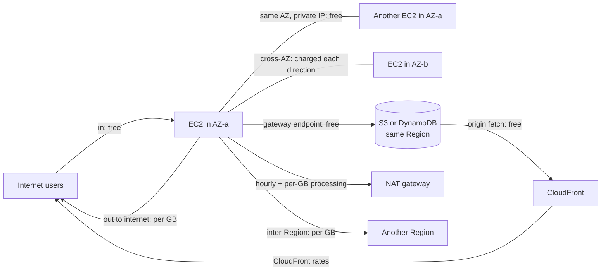

# 10 · Cost optimization

> [Home](../README.md) · [Study plan](../00-study-plan.md) · Next: [Cheat sheets](../cheatsheets/decision-tables.md)

| Covers task statements | Est. study time | Hands-on lab | Practice |
|---|---|---|---|
| 4.1, 4.2, 4.3, 4.4 (primary) | ~2 hrs | Cost sections of every lab ([labs index](../labs/README.md)) | [D4 questions](../practice/d4-cost-optimized.md) |

> **New to AWS?** Read these plain-English pages first: [Cost management services](../beginner/services/cost-management.md). Look up unfamiliar terms in the [glossary](../beginner/glossary.md).

Domain 4 is 20% of the exam, and cost also decides many questions in other domains ("…in the **most cost-effective** way"). This module collects the purchasing, storage, database and network cost levers in one place. Service mechanics are covered in modules [03](03-compute-containers.md), [04](04-storage.md), [05](05-databases.md) and [02](02-networking-vpc.md). Here the focus is the *money*.

---

## 1. The cost-optimization mindset

The Well-Architected **cost optimization pillar** comes down to five design principles:
1. **Implement cloud financial management**: someone owns cost, with visibility and accountability.
2. **Adopt a consumption model**: pay only for what you use, and turn things off when they're idle.
3. **Measure overall efficiency**: cost per business output (per order, per user), not just the total bill.
4. **Stop spending on undifferentiated heavy lifting**: managed and serverless services remove ops cost.
5. **Analyze and attribute expenditure**: tags, accounts and cost categories show who spends what.

**The order of operations matters.** First **eliminate** waste (idle and orphaned resources), then **rightsize**, then **schedule** non-production, then **commit** (Savings Plans/RIs) on the remaining steady baseline, then use **Spot** for interruptible work. Buying commitments before rightsizing locks in waste.

---

## 2. Pricing fundamentals

| Driver | How it's billed | Hidden-cost hotspots |
|---|---|---|
| **Compute** | Per second or hour (EC2, Fargate), per request + GB-second (Lambda), per capacity unit (Aurora Serverless, Redshift Serverless) | Idle instances, oversized instances, non-production running 24/7 |
| **Storage** | Per GB-month, by class, plus **requests** and **retrievals** | Old snapshots, unattached EBS volumes, noncurrent S3 versions, incomplete multipart uploads, logs kept forever, minimum-duration charges in IA/Glacier classes |
| **Data transfer** | Per GB, by **direction and path** | **The most-tested hidden cost**: NAT gateway processing, cross-AZ traffic, internet egress, inter-Region replication |

Inbound data from the internet is free. Most other paths cost something ([section 7](#7-network-cost)).

---

## 3. Compute purchasing options

### 3.1 The comparison

| Option | Commitment | Max discount vs On-Demand (approx.) | Flexibility | Capacity guarantee | Fits |
|---|---|---|---|---|---|
| **On-Demand** | None | 0% | Full | No (unless you add a capacity reservation) | Short-term, unpredictable, new workloads, the baseline before you know usage |
| **Compute Savings Plan** | $/hour for 1 or 3 years | ~66% | **Any instance family, size, OS, tenancy, Region**, plus **Fargate and Lambda** | No | Steady spend whose *shape* may change (migrations, containers, serverless) |
| **EC2 Instance Savings Plan** | $/hour for 1 or 3 years on **one instance family in one Region** | ~72% | Size, OS, tenancy and AZ within that family and Region | No | Steady use of one family in one Region |
| **Standard Reserved Instance** | 1 or 3 years for specific attributes | ~72% | Regional RIs: AZ and size flexibility (Linux, default tenancy). Can be **sold on the RI Marketplace**. | **Zonal RI only** | Very stable workloads. RIs are also how you discount **RDS, ElastiCache, Redshift and OpenSearch** (reserved instances or nodes). |
| **Convertible Reserved Instance** | 1 or 3 years | ~66% | **Exchange** for another family, OS or tenancy of equal or greater value. **Can't be sold.** | Zonal RI only | Stable, but the instance type may change |
| **Spot Instances** | None | **~90%** | Can be **interrupted with a 2-minute notice** | No | **Stateless, fault-tolerant, flexible** work: batch, CI/CD, big data, rendering, HPC, containers, test |
| **Dedicated Host** | On-Demand or Host Reservation | (Reservations discount the host) | A whole physical server, with socket and core visibility, host affinity | Yes (the host) | **BYOL** with per-socket/per-core licenses (Windows Server, SQL Server, Oracle), compliance needing dedicated physical servers |
| Dedicated Instance | Per instance | Premium | Single-tenant hardware, no host-level visibility | No | Single-tenancy compliance without license-binding needs |
| **On-Demand Capacity Reservation** | None. **You pay for it whether you use it or not.** | None by itself (apply Savings Plans or Regional RIs on top) | Specific AZ and instance type | **Yes** | DR Regions, launch events, guaranteed capacity |

**Payment options** for Savings Plans and RIs: All Upfront > Partial Upfront > No Upfront, in order of discount. A 3-year term discounts more than a 1-year term.

### 3.2 Savings Plans vs RIs, the decision

- For EC2, Fargate and Lambda, **Savings Plans are the modern default**. They apply automatically to the eligible usage with the biggest discount first, so there's nothing to match by hand. Pick **Compute SP** when flexibility matters, or **EC2 Instance SP** for the deepest discount on a known family.
- **RIs remain the classic answer for managed databases and analytics** (RDS, ElastiCache, Redshift, OpenSearch) and wherever a question says "zonal capacity reservation" or "sell unused commitment" (Standard RIs on the Marketplace). AWS introduced **Database Savings Plans** in late 2025, extending the SP model to several managed database services, so check current coverage for real projects. Expect older exam questions to use RIs.
- **Commit only to the steady baseline** (e.g., the minimum you've run for months). Cover peaks with On-Demand or Spot. Cost Explorer's **SP/RI purchase recommendations** and its **utilization and coverage** reports drive these decisions.
- RDS RIs offer **size flexibility** within an instance family for most engines (not for license-included SQL Server or Oracle). A Multi-AZ deployment needs a Multi-AZ RI to be fully covered.

### 3.3 Spot done right

- **Diversify**: many instance types and AZs, with the **price-capacity-optimized** allocation strategy (the recommended default).
- Use an **ASG mixed instances policy** (an On-Demand base plus a Spot percentage) or EC2 Fleet. **Capacity Rebalancing** launches replacements when AWS signals elevated interruption risk.
- Handle the **2-minute interruption notice** (instance metadata or EventBridge): drain from the load balancer, checkpoint work, and put state in S3, DynamoDB or SQS.
- ⚠️ Avoid Spot for databases, stateful single instances, and long jobs that can't checkpoint. Spot blocks (fixed-duration Spot) are no longer offered.
- **Fargate Spot**: up to ~70% off Fargate for interruptible ECS tasks (ECS only), with the same 2-minute warning (SIGTERM).

---

## 4. Rightsizing and efficient compute

### 4.1 Rightsizing

- **AWS Compute Optimizer**: ML recommendations for **EC2, Auto Scaling groups, EBS volumes, Lambda functions, ECS services on Fargate, RDS/Aurora** and commercial-software licenses, based on CloudWatch history. **Memory-based recommendations need the CloudWatch agent.** Enhanced infrastructure metrics (paid) extend the lookback window.
- **Cost Explorer** rightsizing recommendations and **Cost Optimization Hub** (which consolidates and de-duplicates recommendations across accounts and Regions with estimated savings) are the other inputs.
- Look at **CPU, memory, network and disk** utilization at peak, not just averages. Burstable (T-family) instances suit low-average, occasionally spiky loads.

### 4.2 Graviton

**AWS Graviton (Arm)** instances usually cost less per hour than comparable x86 instances and often deliver better price-performance (AWS cites up to ~40% for many workloads, approx.). They are available for EC2, **Lambda (arm64)**, **Fargate**, RDS, Aurora, ElastiCache, OpenSearch, EMR and others. Interpreted and JVM languages often move with little or no change. Exam signal: "improve price-performance with minimal change" → Graviton.

### 4.3 Scheduling non-production

| Tool | Use |
|---|---|
| **Instance Scheduler on AWS** (AWS solution) | Start and stop EC2 and RDS on schedules defined by tag (e.g., office hours only) |
| **ASG scheduled actions** | Scale to 0 at night and back up in the morning |
| EventBridge Scheduler + SSM Automation or Lambda | Custom start/stop jobs |
| **EC2 hibernation** | Saves RAM to the (encrypted) EBS root volume, so long-initializing apps resume fast while compute charges stop |
| **RDS stop** | Saves instance-hours, but ⚠️ RDS **automatically restarts a stopped instance after 7 days** |
| **Aurora Serverless v2** | Scales capacity with load, and can scale **to zero** (auto-pause) for idle dev and test |

Office hours (~50 of 168 hours a week) cut non-production compute by roughly 70%.

### 4.4 Serverless and containers for utilization

| Workload shape | Usually cheapest |
|---|---|
| Spiky, intermittent, event-driven, low average utilization | **Lambda** (billed per ms, nothing when idle) |
| Steady containers, moderate utilization, no wish to manage servers | **Fargate** + Compute Savings Plan. **Fargate Spot** for interruptible tasks. |
| Sustained high utilization, large scale, special hardware (GPU, high memory) | **EC2** (ECS/EKS on EC2 with bin-packing) + Savings Plans/RIs + Spot |

- **Break-even reasoning:** Lambda's per-unit compute price is higher than EC2's, so it wins when the alternative would sit idle. As utilization approaches "busy all day", containers or instances with commitments become cheaper.
- **Lambda cost tuning:** memory sets CPU, so more memory can be *cheaper* if the function finishes much faster (test with Lambda Power Tuning or Compute Optimizer). Use arm64. Avoid Lambda functions that sit idle waiting on other calls (use Step Functions waits instead).

---

## 5. Storage cost

### 5.1 S3

| Class | Use when | Cost gotchas |
|---|---|---|
| Standard | Frequently accessed | None for access |
| **Intelligent-Tiering** | **Unknown or changing access patterns** | Small per-object monitoring fee (objects under 128 KB aren't monitored or tiered). **No retrieval fees**, no minimum duration. Optional archive tiers. |
| Standard-IA / One Zone-IA | Infrequent but immediate access (One Zone-IA for re-creatable data) | **30-day minimum**, **128 KB minimum billable size**, per-GB retrieval fee |
| Glacier Instant Retrieval | Rarely accessed (~quarterly) but needs **milliseconds** | **90-day** minimum, higher retrieval fee |
| Glacier Flexible Retrieval | Archives accessed ~1–2×/year. Expedited 1–5 min, standard 3–5 h, **bulk 5–12 h** (free bulk). | **90-day** minimum |
| Glacier Deep Archive | Compliance archives, 7–10+ years. Standard within 12 h, bulk within 48 h. | **180-day** minimum. Lowest storage price. |

Levers:
- **Lifecycle rules** transition objects by age and **expire** them ([module 04](04-storage.md)). Objects must be **at least 30 days old** before moving to Standard-IA or One Zone-IA, and by default lifecycle doesn't transition objects smaller than 128 KB.
- **Clean up the invisible**: expire **noncurrent versions** and stale delete markers, and **abort incomplete multipart uploads**.
- Many tiny objects in Glacier classes cost extra (per-object metadata overhead and request charges). **Bundle them** (e.g., tar) before archiving.
- **Requester Pays**: the requester (an authenticated AWS account, never anonymous) pays request and transfer costs. Use it for sharing large datasets.
- **S3 Storage Lens**: org-wide dashboards of usage, activity and cost-efficiency (e.g., buckets with incomplete multipart uploads or no lifecycle rules). **Storage Class Analysis** observes access patterns to suggest IA transitions.

### 5.2 EBS

- **Migrate gp2 → gp3**: approx. 20% cheaper per GB, with IOPS and throughput provisioned independently of size (3,000 IOPS and 125 MiB/s baseline). It's an in-place **Elastic Volumes** change with no downtime.
- **Overprovisioned io1/io2** → gp3 if the workload fits gp3's limits (now up to 80,000 IOPS; older questions assume 16,000) and doesn't need io2's durability, sub-ms latency or Multi-Attach.
- **Delete unattached (available) volumes.** Check "delete on termination" settings so terminating instances doesn't leave orphans.
- **Snapshots** are incremental, but old ones pile up. Automate creation and retention with **Data Lifecycle Manager** or AWS Backup. Move long-retention snapshots to the **EBS Snapshots Archive** tier (approx. 75% cheaper storage, 90-day minimum, restores take up to ~72 hours). **Recycle Bin** guards against accidental deletion.
- For throughput-heavy sequential data use **st1**, and for cold data **sc1**. Neither can be a boot volume.

### 5.3 EFS and FSx

- **EFS lifecycle management** moves files not accessed for N days to **Infrequent Access** and then **Archive**, much cheaper per GB. Optionally move them back to Standard on first access. **One Zone** classes cost less for re-creatable data. **Elastic throughput** avoids paying for provisioned throughput you rarely use.
- **FSx**: **data deduplication** (FSx for Windows File Server, often large savings on user shares), **compression** (FSx for Lustre, ONTAP, OpenZFS), **HDD storage** options (Windows, Lustre), and **capacity-pool tiering** of cold data on **FSx for NetApp ONTAP**. Lustre **scratch** file systems are cheaper than persistent ones for short-lived processing.

---

## 6. Database cost

| Lever | When |
|---|---|
| **RDS Reserved Instances** | Steady production databases (1 or 3 years). Rightsize first. |
| **Aurora Serverless v2** | **Spiky, unpredictable or dev/test** load, scaling in fine-grained capacity units (down to zero with auto-pause) |
| **Aurora I/O-Optimized** vs Standard | **I/O-Optimized** has no per-I/O charges but higher compute and storage prices. Switch when **I/O is more than ~25% of Aurora spend**. Standard suits low or moderate I/O. |
| **DynamoDB on-demand** | Unknown, spiky or new workloads. After AWS's late-2024 price cut it is the default recommendation for most variable traffic. |
| **DynamoDB provisioned + auto scaling (+ reserved capacity)** | **Steady, predictable** throughput. Reserved capacity discounts provisioned capacity further. |
| **DynamoDB Standard-IA table class** | Tables where **storage dominates** the cost and items are rarely read. Storage is cheaper, requests cost more. |
| **DynamoDB TTL** | Delete expired items automatically, at no write cost |
| **Caching** (ElastiCache, DAX, CloudFront, API Gateway cache) | Read-heavy workloads. Cheaper than scaling the database for repeated reads. |
| **Read replicas vs a bigger instance** | Read-heavy and horizontally divisible → replicas. Write-bound or a single heavy query → a bigger instance (or a redesign). |
| **Snapshot and backup retention** | Automated backups up to the size of the database are free, but **manual snapshots persist and cost until deleted**. Set AWS Backup retention policies. |
| **Purpose-built stores** | Move analytics off the OLTP database to a **columnar** store (Redshift, or Parquet on S3 + Athena). Store time-series data in a time-series-optimized form (a time-series database, or partitioned Parquet). |
| **Graviton DB instances**, stopping idle dev databases, avoiding **RDS Extended Support** | Old major engine versions past end of standard support incur Extended Support charges automatically, so upgrade on time. |

---

## 7. Network cost

### 7.1 Data transfer cost map

| Path | Cost (approx.; check current pricing) |
|---|---|
| Internet → AWS | **Free** |
| AWS → internet | **Charged per GB**, tiered (a small monthly free allowance) |
| Same AZ, **private IP** | **Free** |
| Between instances via **public or Elastic IPs** | Charged, even in the same AZ |
| **Cross-AZ** in the same Region | **Charged in both directions** (approx. 0.01 USD/GB each way) |
| **Inter-Region** | Charged per GB (source side), varies by Region pair |
| EC2 → S3/DynamoDB, same Region, via **gateway endpoint** | **Free** (no NAT charges) |
| Via **NAT gateway** | **Hourly + per-GB processing** (approx. 0.045 USD per hour and per GB in us-east-1), plus any cross-AZ or egress charges |
| Interface endpoints (PrivateLink) | Hourly per AZ + per GB (cheaper per GB than NAT processing) |
| VPC peering | No hourly fee. Normal cross-AZ or inter-Region data rates (same-AZ is free). |
| Transit Gateway | **Per attachment-hour + per GB processed** |
| S3/EC2/ALB origin → **CloudFront** | **Free** |
| CloudFront → viewers | CloudFront rates, often lower than direct egress, and caching cuts origin load |
| Direct Connect | Port-hours + **reduced** egress rates. Inbound is free. |
| Site-to-Site VPN | Per connection-hour + standard internet egress rates |
| Global Accelerator | Fixed hourly fee + per-GB premium on top of standard data transfer |

### 7.2 NAT gateways and endpoints

- **NAT gateway processing is the classic surprise bill.** If private instances pull lots of data from **S3 or DynamoDB**, add **gateway endpoints** (free) so that traffic bypasses NAT. For other AWS services with heavy traffic, **interface endpoints** usually beat NAT per GB.
- **Single shared NAT gateway vs one per AZ:**

| | One shared NAT gateway | One NAT gateway per AZ |
|---|---|---|
| Cost | Lower (one hourly fee) | Higher (one per AZ) |
| Resilience | ❌ **An AZ failure cuts egress for every AZ** | ✅ Each AZ is independent |
| Cross-AZ charges | Other AZs' traffic crosses AZs to reach it | None (each AZ uses its own) |
| Choose for | Dev/test, cost-first | **Production**, HA requirements |

- AWS added a **regional NAT gateway** mode (late 2025) that spans AZs automatically and needs no public subnet. It is new, so exam questions still describe the zonal pattern ([module 02](02-networking-vpc.md)).
- A **NAT instance** can be cheaper at small scale but is self-managed and a single point of failure.

### 7.3 Other network levers

- **Public IPv4 addresses are billed hourly** (approx. 0.005 USD per IP-hour), whether attached to a resource or idle, including Elastic IPs. Release unused EIPs, put instances behind load balancers in private subnets, and consider IPv6 (free).
- **Keep chatty traffic in one AZ** where resilience allows (e.g., batch clusters, placement groups). With **NLB, cross-zone load balancing is off by default** and turning it on adds cross-AZ charges. ALB doesn't charge for its own cross-zone traffic.
- **VPC peering vs Transit Gateway:** peering has no hourly fee or per-GB processing, so it's the cheapest for a **few VPCs with heavy traffic**. Transit Gateway adds per-attachment and per-GB fees but **simplifies many-VPC and hybrid topologies**. The exam picks TGW for scale and manageability, and peering for "lowest cost, few VPCs".
- **CloudFront in front of S3, ALB or EC2** cuts origin egress and load. Origin fetches from AWS origins are free, and cached responses never touch the origin. (AWS also introduced flat-rate CloudFront plans in late 2025 that bundle the CDN with security features. Check whether one fits before comparing per-GB rates.)
- **Direct Connect vs VPN:** for **steady, high-volume** transfer, DX's lower per-GB egress rate outweighs its port-hour fees and lead time. For low volume or quick setup, VPN is cheaper. A VPN is also the cheap **backup** for DX.
- **Global Accelerator** adds a fixed fee and a per-GB premium. Use it only when you need its features (static IPs, non-HTTP, fast failover), not for cacheable web content.

### 7.4 Bandwidth sizing

| Link | Capacity (approx.) | Scaling it |
|---|---|---|
| Site-to-Site VPN tunnel | **~1.25 Gbps per tunnel** (2 tunnels per connection) | Use **multiple VPN connections to a Transit Gateway with ECMP** (BGP) to aggregate. A virtual private gateway can't aggregate this way. AWS has added higher-bandwidth tunnel options for some attachment types, so check the docs. |
| Direct Connect dedicated | **1, 10, 100 or 400 Gbps** ports | **LAG** to bundle ports. Two connections at two locations for resilience. |
| Direct Connect hosted (via partner) | 50 Mbps up to 25 Gbps | Order a bigger hosted connection |

Size for the peak transfer window and the RPO of any replication, then add headroom ([module 09](09-data-analytics-migration.md) has the transfer-time math).

### 7.5 Throttling to protect cost

- **API Gateway usage plans + API keys** give per-client rate limits and quotas, so one customer can't run up your backend bill. Stage and method throttling, and caching, help too.
- **WAF rate-based rules** stop floods and scrapers before they hit paid compute.
- **Lambda reserved concurrency** caps runaway scaling. **SQS** buffers bursts so you can size consumers for the average, not the peak.
- **Budgets actions** can automatically apply restrictive policies or stop instances when spend crosses a threshold.

---

## 8. Cost management tools

| Tool | What it's for | Key facts |
|---|---|---|
| **AWS Cost Explorer** | **Analysis and visualization** of past spend, plus **forecasts** | Filter and group by service, account, Region, tag or cost category. **Savings Plans/RI purchase recommendations**, utilization and coverage reports, rightsizing recommendations. Optional hourly and resource-level granularity. |
| **AWS Budgets** | **Alerts** on actual or **forecasted** cost or usage | Budget types: cost, usage, **RI utilization/coverage**, **Savings Plans utilization/coverage**. Alerts via email or SNS (and chat channels). **Budget actions** apply IAM policies or SCPs, or stop EC2/RDS instances automatically. |
| **Cost and Usage Report (CUR 2.0) via Data Exports** | The **most granular** billing data: line items by hour or day, resource IDs, tags, pricing and discounts | Delivered to **S3** (e.g., Parquet). Query with **Athena**, visualize with Amazon Quick. Legacy CUR and FOCUS-format exports also exist. |
| **Cost allocation tags** | Attribute cost to teams, apps and environments | **User-defined** (your tags) and **AWS-generated** (e.g., `aws:createdBy`). They **must be activated** in the Billing console by the management account, apply **from activation onward** (not retroactively), and take up to ~24 hours to appear. Enforce them with **tag policies** and SCPs. |
| **Cost Categories** | Group costs by rules (e.g., "Team A = these accounts + tag X") | Shows up in Cost Explorer, Budgets and CUR |
| **AWS Cost Anomaly Detection** | **ML-based detection of unusual spend** | Monitors by service, account, cost category or tag, with alert subscriptions (immediate or daily/weekly summaries) and root-cause hints |
| **Consolidated billing** (Organizations) | One bill for all accounts | **Usage aggregates for volume pricing tiers**. **RI and Savings Plans discounts are shared** across accounts by default (sharing can be turned off per account). Free. |
| **AWS Trusted Advisor** | Best-practice checks, including **cost**: idle load balancers, low-utilization EC2, underused EBS, unassociated EIPs, idle RDS | The full set of checks needs Business-level support or higher. Basic tiers get core checks. |
| **AWS Compute Optimizer** / **Cost Optimization Hub** | Rightsizing / consolidated savings recommendations | [Section 4.1](#41-rightsizing) |
| **AWS Pricing Calculator** | **Estimate** the cost of a planned architecture before building it | Free, shareable estimates |

**Which tool?** "Visualize and understand spend" → Cost Explorer. "Alert me before we exceed X" → Budgets. "Most detailed data, query it with SQL" → CUR + Athena. "Unexpected spike" → Cost Anomaly Detection. "Estimate before building" → Pricing Calculator. "Charge back by team" → cost allocation tags + Cost Categories.

---

## 9. Cost-optimization review checklist (for an existing workload)

1. **Visibility**: Are cost allocation tags defined, **activated** and enforced? Are there Budgets with forecast alerts and Cost Anomaly Detection monitors? Is CUR exported to S3 for Athena?
2. **Waste**: Unattached EBS volumes, old snapshots and AMIs, idle load balancers, unassociated EIPs and unused public IPv4, idle RDS instances, forgotten dev stacks, log groups with no retention.
3. **Rightsizing**: Review Compute Optimizer and Cost Optimization Hub. Move to current-generation and **Graviton** instances. Migrate **gp2 → gp3**.
4. **Elasticity**: Is everything that can scale with load doing so (ASG, Aurora Serverless v2, DynamoDB on-demand or auto scaling)? Is non-production scheduled off-hours?
5. **Purchasing**: Is the steady baseline covered by **Savings Plans/RIs** (check coverage and utilization)? Is interruptible work on **Spot / Fargate Spot**?
6. **Storage**: S3 lifecycle and **Intelligent-Tiering** where access is unknown. Noncurrent-version expiration and multipart cleanup. EFS IA/Archive lifecycle. FSx deduplication and compression.
7. **Databases**: Aurora I/O-Optimized vs Standard. DynamoDB capacity mode and table class. Caching. Manual snapshot cleanup. No RDS Extended Support charges.
8. **Network**: **Gateway endpoints** for S3/DynamoDB. NAT gateway placement and data volumes. Cross-AZ chatter. CloudFront in front of origins. Peering vs TGW. DX vs VPN for steady volumes.
9. **Architecture**: Could managed or serverless services replace self-managed fleets (e.g., self-run Kafka → MSK Serverless, cron servers → EventBridge Scheduler + Lambda)?
10. **Guardrails**: Usage plans, WAF rate limits, Lambda reserved concurrency, Budgets actions, SCPs restricting expensive instance types or Regions.

---

## 10. How the exam tests this

| If the question says… | Think… |
|---|---|
| "Steady 24/7 EC2 usage, may change instance families or move to Fargate" | **Compute Savings Plan** |
| "Steady usage of one instance family in one Region, maximum discount" | **EC2 Instance Savings Plan** (or Standard RI) |
| "Steady RDS/ElastiCache/Redshift usage" | **Reserved Instances / reserved nodes** |
| "Batch jobs that can be interrupted and restarted", "CI build fleet" | **Spot** (diversified, price-capacity-optimized) |
| "Existing per-socket/per-core licenses" | **Dedicated Hosts** |
| "Guarantee capacity in a specific AZ for DR" | **On-Demand Capacity Reservation** (+ SP/RI for the discount) |
| "Unknown or changing S3 access patterns" | **S3 Intelligent-Tiering** |
| "Data rarely accessed but needed in milliseconds" | **S3 Glacier Instant Retrieval** |
| "Archive for 7 years, retrieval within 48 hours is fine" | **S3 Glacier Deep Archive** |
| "Reduce EBS cost without performance loss" | **gp2 → gp3** |
| "Spiky or unpredictable relational database load, or dev/test" | **Aurora Serverless v2** |
| "Aurora bill dominated by I/O charges" | **Aurora I/O-Optimized** |
| "DynamoDB with unpredictable traffic" / "steady traffic" | **On-demand** / **provisioned + auto scaling + reserved capacity** |
| "Private instances download lots of data from S3 through NAT; reduce cost" | **S3 gateway endpoint** |
| "Reduce data transfer cost for global static content" | **CloudFront** (S3 → CloudFront is free) |
| "Most cost-effective NAT design for dev" vs "HA NAT for prod" | **One shared NAT gateway** vs **one per AZ** |
| "Large steady data flow to on-premises" | **Direct Connect** |
| "More than ~1.25 Gbps over VPN" | **Multiple VPN connections + ECMP on Transit Gateway** (or DX) |
| "Alert when forecasted spend exceeds budget" | **AWS Budgets** |
| "Detailed per-resource billing analyzed with SQL" | **CUR 2.0 (Data Exports) + Athena** |
| "Detect unusual spending automatically" | **Cost Anomaly Detection** |
| "Tags don't show in Cost Explorer" | **Activate the cost allocation tags** (management account) |
| "Share RI discounts across accounts" | **Consolidated billing** in Organizations |

---

## 11. Common traps

- ⚠️ Trap: **Commit after rightsizing**, not before. Savings Plans and RIs are commitments you generally can't cancel.
- ⚠️ Trap: **Convertible RIs can't be sold** on the Marketplace. Only Standard RIs can.
- ⚠️ Trap: **Regional RIs and Savings Plans don't reserve capacity.** Only zonal RIs and On-Demand Capacity Reservations do.
- ⚠️ Trap: **Compute Savings Plans cover Fargate and Lambda. EC2 Instance Savings Plans don't.**
- ⚠️ Trap: Spot for a **database or stateful single server** is wrong, however cheap it is.
- ⚠️ Trap: **A stopped RDS instance restarts after 7 days.** For long idle periods, snapshot and delete, or use Aurora Serverless v2 scale-to-zero.
- ⚠️ Trap: **IA and Glacier classes have minimum durations and retrieval fees.** Data read often or deleted quickly can cost *more* there. Objects must be 30 days old before lifecycle moves them to Standard-IA.
- ⚠️ Trap: **NAT gateway per-GB processing** applies to S3/DynamoDB traffic unless you add **gateway endpoints**.
- ⚠️ Trap: **Cross-AZ traffic is charged in both directions.** A single NAT gateway saves hourly fees but adds cross-AZ data charges and an AZ-wide failure risk.
- ⚠️ Trap: **Public IPv4 (including Elastic IPs) costs money** even while attached.
- ⚠️ Trap: **Cost allocation tags do nothing until activated**, and they aren't retroactive.
- ⚠️ Trap: Cost Explorer *analyzes*, Budgets *alerts*, CUR is *raw detail*. Pick the tool that matches the verb in the question.
- ⚠️ Trap: Global Accelerator isn't a cheaper CloudFront. It doesn't cache and adds a premium.
- ⚠️ Trap: Manual RDS and EBS snapshots **persist and bill until deleted**, and CloudWatch Logs **never expire by default**.

---

## 12. Quick self-check

1. A company runs a steady fleet of EC2 instances today and plans to move half of it to Fargate next year. Which commitment fits?
2. Private-subnet instances process 50 TB/month from S3 via a NAT gateway. What single change cuts the bill most?
3. When should you switch an Aurora cluster to I/O-Optimized?
4. Name the tool for each verb: *forecast and visualize*, *alert*, *query raw line items with SQL*, *detect unusual spikes*.
5. Give two reasons the exam would choose one NAT gateway per AZ over a single shared one, and one reason to choose the shared one.

Answers

1. A **Compute Savings Plan**. It covers EC2 across families and Regions, plus Fargate and Lambda.
2. Add an **S3 gateway endpoint** to the private route tables. It is free and removes the NAT per-GB processing charge for that traffic.
3. When **I/O charges are a large share** of Aurora spend (AWS's guide: more than ~25%), or when I/O is unpredictable and you want predictable pricing.
4. **Cost Explorer**, **Budgets**, **CUR 2.0 (Data Exports) + Athena**, **Cost Anomaly Detection**.
5. Per-AZ: **an AZ failure doesn't break egress for the other AZs**, and there are **no cross-AZ data charges** for routing to another AZ's NAT gateway. Shared: **lower cost** (one hourly fee), acceptable for dev/test.

Practice: [D4 Cost-optimized architectures questions](../practice/d4-cost-optimized.md) · Labs: cost sections of every lab ([labs index](../labs/README.md))
